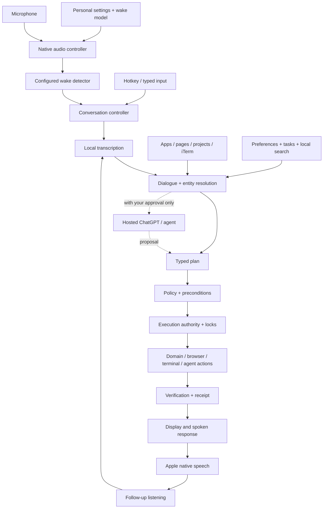

# kst — personal assistant built on Personal Secretary

**Status:** Implementation started; task ownership, completed gates, and limitations are tracked in `KST-TASKS.md`.  
**Updated:** November 6, 2026.  
**Target:** Your M4 Pro MacBook Pro, 24 GB memory, macOS login, projects, browser, and iTerm sessions.  
**Scope:** Persistent personal bot, configurable wake phrase, multi-turn conversation, Apple native speech output, laptop context, reliable actions, and optional coding-agent delegation.

This revision replaces the earlier implementation plan. The separate brainstorming PRD is historical; decisions here take precedence.

**Product naming:** The application is named **kst**, with transparent Naruto Sage Mode eyes as its logo. “Jarvis” describes the original assistant concept; **arise** is the configurable default wake phrase. Build instructions and current implementation boundaries are in `KST-README.md`; implementation status is in `KST-TASKS.md`.

**Navigate:** [Architecture](#3-architecture-and-pipeline) · [Conversation](#4-multi-turn-personal-conversation) · [Wake/audio](#5-configurable-wake-phrase-and-native-audio) · [iTerm](#7-your-iterm-sessions) · [Locking](#8-locking-ownership-and-recovery) · [Installations](#11-installations-and-mac-setup) · [Code/contracts](#12-contracts-configuration-and-code-structure) · [Work plan](#13-concrete-implementation-work-plan) · [Tests](#14-testing-strategy-and-fixtures) · [Acceptance](#16-definition-of-done-for-your-personal-bot)

## 1. Product contract

The bot stays available in the menu bar while you work. You address it using a configurable wake phrase; it opens a discussion and listens for follow-ups without requiring that phrase before every turn. It remembers the current discussion, approved personal preferences, project aliases, and work you have asked it to do.

It must help with your actual daily work: tasks, reminders, notes, schedules, files, browser pages, terminal sessions, project commands, and coding-agent tasks. Replies use Apple native speech and show detailed evidence on screen.

### Decisions

1. **Apple native TTS is the only output integration.** No cloud speech adapter or browser speech fallback. If native speech is unavailable, show text and a clear status.
2. **The wake phrase is configuration.** `arise` is the default onboarding value; runtime matching reads the shared setting. Changes must update actual detection.
3. **One wake opens a conversation.** Listen between turns until explicit closure, configured inactivity, a privacy event, or a fault.
4. **Existing iTerm panes are accessible.** Automated jobs also use managed panes for stronger ownership and observability.
5. **One execution authority controls effects.** Voice, dashboard, scheduler, and agents use the same policy and resource coordination.
6. **Routine behavior is code-driven.** No local reasoning LLM runs. Before any web browse or request to ChatGPT, Codex, Claude, or another hosted agent, Jarvis explains the destination and information to be shared and asks you.
7. **Personal preferences persist.** Reuse approved scopes rather than asking repeatedly; clarify genuinely missing targets or consequential effects.

### Example

> You: “Jarvis, what is running in my terminals?”  
> Bot: “The secretary server is running; the API pane is idle.”  
> You: “Run the tests in the API project.”  
> Bot: “Running the approved test recipe.”  
> You: “If they fail, ask Codex to investigate.”  
> Bot: “I’ll investigate a failure in a separate worktree and show you the changes.”  
> You: “Remind me to review that in an hour.”  
> Bot: “Reminder saved.”  
> You: “We’re done.”

The discussion closes. Explicitly authorized background work continues and reports visually. This is target behavior, not a claim about the current implementation.

## 2. Starting point and reuse

The project already has Bun/TypeScript, Elysia, React/Vite, SQLite, shared types, tasks, reminders, notes, calendar, scheduling, and a basic command parser. Preserve these rather than rewriting every layer.

Current checks found iTerm **3.7.7**, Apple Python **3.9.6**, Homebrew, Swift command-line tools, Node, and `codex`, `claude`, and `agy` executable paths. Xcode is absent from `/Applications/Xcode.app`; `xcode-select` points to Command Line Tools. Bun was not found on PATH or in the standard locations checked. Presence of agent executables does not prove authentication.

| Existing area | Reuse | Required change |
|---|---|---|
| Domain repositories/services | Tasks, notes, reminders, calendar | Tests, correct targets, verified read-back |
| Scheduler | Scheduling rules | Persist next-run state; timezone/DST/sleep reconciliation |
| `intent-parser.ts` | Grammar and date parsing | Dialogue slots, ambiguity, negation, no accidental defaults |
| `command-router.ts` | Domain dispatch | Action registry, authorization, coordination, verification |
| `/api/chat` | UI entry point | Shared conversation/command service |
| `response-formatter.ts` | Display formatting | Separate concise spoken response |
| React dashboard | Detailed productivity UI | Conversations, jobs, terminals, personal settings |
| FTS5 | Local search | Provenance, project association, retention/deletions |

Fix these before computer control:

- Activity tracking is mocked; replace with native observations.
- Transcription defaults to a Windows executable and synchronous spawning.
- The browser TTS helper is not wired to the inspected chat path; replace desktop output ownership with the native app.
- Browser voice transcribes before wake checking, has competing phrase defaults, and does not robustly reload changed wake settings.
- Empty normalized text can satisfy the substring wake check; reject it.
- Endpointing uses callback counts with an incorrect timing comment; use samples/time.
- Reminder parsing and empty task matching can cause unintended writes; remove guessed dates and targets.
- `/remind` and `/reminder` disagree across UI/parser; support deliberate aliases.
- Token-returning bootstrap and credential mismatch logs must be removed before action APIs.
- Live WAL database backups must use a consistent mechanism, followed by restore verification.

No live iTerm connection, terminal-content read, installation, shell-integration change, or application migration was performed for this revision.

## 3. Architecture and pipeline



| Component | Technology | Responsibility |
|---|---|---|
| `kst.app` | SwiftUI/AppKit/AVFoundation | Menu bar, mic, speech, conversation lifecycle, emergency controls |
| Native execution broker | Swift actor + OS synchronization | Final capability checks, resource coordination, job supervision |
| Existing core | TypeScript/Bun | Domain services, dialogue grammar, plans, search, jobs, receipts |
| iTerm bridge | Isolated Python + `iterm2` | Session observations and bounded operations, no independent planning |
| Managed runner | Native supervisor + PTY | Explicit cwd/argv/env, process ownership, exit status, workload locks |
| Browser bridge | Chrome extension + native messaging | Stable tab/selection context and scoped actions |
| Agent worker | Node where required | Provider SDKs, structured events, restricted tasks |

Use versioned, schema-validated IPC. The native app supervises the core through inherited pipes. External local bridges authenticate through private endpoints. Keep control messages bounded and audio out of logs. Dashboard HTTP stays loopback-only with strict Origin/Host checks and pairing.

The pipeline is: **activate → capture original context → listen → finalize transcript → resolve intent/references → build typed plan → authorize → lock and revalidate → execute → verify → respond → listen for follow-up → close when appropriate.**

Every effect, including domain writes, goes through the execution authority. A response is spoken only after its claimed result is supported by evidence.

### 3.1 Product decision: one personal system, native companion interface

**Build Jarvis as the native Mac companion to Personal Secretary, in the same repository, using the existing core and data. Ship one desktop installation.** Personal Secretary remains the detailed productivity dashboard; Jarvis provides voice, menu-bar access, computer context, proactive nudges, and execution. They are two interfaces to your one personal assistant.

The native target ships as `kst.app`. Its native shell and the productivity dashboard belong to the same product and shared profile. Current Swift-package sources live in `apps/macos`; older proposed Xcode folder names below are design destinations, not a second app.

| Option | Benefit | Cost | Decision |
|---|---|---|---|
| Add voice only to the current browser app | Smallest initial UI change | Browser lifetime and audio ownership complicate reliable background listening and Mac integration | Insufficient for the complete requirement |
| Build a separate standalone Jarvis with its own backend/database | Freedom to start fresh | Duplicate tasks, reminders, memory, scheduling, and settings; synchronization becomes permanent work | Reject |
| Native Jarvis companion with shared Personal Secretary core | Reuses domain features while giving audio and Mac control a clear owner | Requires native packaging and a well-defined IPC boundary | Recommended |

Keep a modular monolith: one local core, one native authority, and supervised adapters. Do not introduce a separate server, vector database, or independent scheduling service for each feature. Split only where the OS/runtime boundary requires it.

### 3.2 What you see

- **Menu bar:** armed/listening/muted state, current job, next appointment, pending nudges, and immediate Stop.
- **Small conversation panel:** live transcript, concise replies, clarification, approval for external services, and job progress. Opening it does not require opening the full dashboard.
- **Personal Secretary dashboard:** existing tasks, calendar, notes, planning, activity history, routines, nudge preferences, and detailed receipts. Initially open the existing authenticated local dashboard from Jarvis; embedding the React UI in a native window is an optional presentation improvement, not a second backend.
- **Notifications:** brief actionable nudges with snooze, dismiss, and open-task controls. Native notification delivery has one owner.

Example: you create “finish API tests” in the dashboard. Jarvis immediately sees the same task ID. You say “start that task,” and Jarvis starts an approved recipe. Progress appears in the dashboard. A failure produces a verified job event that may become a nudge. You say “remind me after lunch”; the same reminder repository stores it and the same scheduler delivers it.

### 3.3 Ownership and synchronization

| Responsibility | Single owner | Other components |
|---|---|---|
| Tasks, notes, reminders, calendar cache, profile, approved memory | Existing Bun core and domain SQLite database | Both interfaces use the same APIs |
| Dialogue/action planning and nudge rules | Shared core services | Native and dashboard input enter the same service |
| Microphone, wake detection, Apple speech, conversation audio lifecycle | Native app | Dashboard never starts a second desktop listener |
| Final authorization, locks, execution ledger | Native broker | Core proposes; adapters execute scoped capabilities |
| Due reminders and nudge scheduling | One core scheduler | Native app delivers; dashboard reflects status |
| App activity observations and OS interruption state | Native collectors | Core aggregates into useful context |

Use committed domain events with IDs and revisions, plus a durable outbox for changes that must be delivered. The dashboard subscribes through its existing event-stream mechanism; the native app subscribes over authenticated IPC. Consumers deduplicate by event ID and resume from a cursor. After a gap, fetch a current snapshot. Never copy all tasks into a second Jarvis database to keep them synchronized.

The native authority ledger described later is operational state for permissions and jobs; it is not a second copy of your personal data. Domain revisions prevent a dashboard edit and a voice command from silently overwriting each other.

### 3.4 Startup, closure, and failure

On login, the native app obtains its singleton lock, starts one supervised core, reconciles jobs, and then enables voice and scheduling. Closing the dashboard or conversation panel leaves the menu-bar app running. **Quit Jarvis** explicitly stops the listener and core after applying each job's shutdown policy; local proactive monitoring and due-reminder delivery resume on the next launch. Show that consequence in the quit flow.

In the desktop deployment, opening the dashboard connects to the existing core and never starts a second scheduler. Development servers use a separate scratch profile/ports and must not attach to live personal data or the production broker.

If the core fails, show an unavailable state and restart with backoff; buffer only bounded observations. If the native broker fails, the core admits no new effects. Supervised running jobs follow their recorded policy. Resume scheduling only after reconciliation, so a restart does not produce duplicate reminders or a flood of old nudges.

### 3.5 Proactive nudging is a core feature

Implement a local, deterministic `NudgeEngine` in the shared core. It combines observed app usage, calendar availability, selected tasks, and verified job state. It requires no local LLM and makes no automatic web or hosted-model request. If a nudge suggests external help, selecting it leads to the usual per-request approval flow.

Pipeline: **native activity events + calendar/task/job updates → aggregate evidence → evaluate rules → check interruption policy → deduplicate and prioritize → deliver → record response and cooldown.**

For screen time, maintain Jarvis's own approved activity summaries: foreground app, active/idle intervals, screen locked/unlocked, and optionally approved browser-domain categories. Treat these as measured computer-use time, not proof of attention or productivity. Do not assume access to the full Apple Screen Time history. Exclude locked/asleep/idle intervals and report missing observations as unknown. No continuous screenshots, keylogging, or transcript archive is required.

| Nudge | Example initial rule, configurable | Example response |
|---|---|---|
| Meeting preparation | Calendar event starts in 10 minutes; not declined/cancelled; preparation not already acknowledged | “Your review starts in 10 minutes. Open the agenda?” |
| Long work interval | 60 active minutes since a detected break, with a configurable idle threshold | “You’ve been active for an hour. Take a short break?” |
| User-defined distraction | 15 active minutes on a user-classified distracting app/domain during an explicit focus session | “You planned to work on API tests. Return to that task?” |
| Work becoming stale | A task is explicitly marked in progress, its planned checkpoint passed, and no progress update exists | “Is API testing still in progress, or should we update the plan?” |
| Job needs attention | Owned job fails, requests input, or completes a user-selected milestone | “The tests failed. View the failure?” |
| Schedule conflict | Fresh calendar data conflicts with a planned focus block | “Your new meeting overlaps this focus block. Adjust it?” |
| End-of-day review | Configured workday boundary, unfinished tasks, no meeting in progress | “Review today’s unfinished tasks?” |

Window switching alone never marks a task abandoned. A process being idle never proves a person is procrastinating. Each nudge carries an evidence summary and a “why this appeared” view. Unknown or stale calendar/work state suppresses rules that depend on it. Calendar synchronization continues only under the connector scope the user has configured; adding a connector requires its own setup.

### 3.6 Interruption policy and storage

Default to quiet visual notifications. Spoken proactive nudges are off; if enabled, they use the one default Apple voice and respect current conversation, audio route, and quiet hours. A nudge never activates the microphone. Wake phrase, hotkey, or explicit interaction opens the discussion.

Initial defaults: at most two ordinary nudges per hour, at least 20 minutes between them, and one pending ordinary nudge at a time. Explicitly scheduled reminders and time-sensitive meeting alerts follow their own user-visible notification rules. Provide snooze for 15/30/60 minutes, dismiss today, disable this rule, and pause all proactive nudges. Repeated dismissals can suggest reducing frequency; they must not silently change personal preferences.

Suppress ordinary nudges during a known meeting, presentation, screen sharing, explicit focus/do-not-disturb session, OS lock, or quiet hours. If those states cannot be observed reliably, provide a manual “do not interrupt” toggle and show the limitation. Recheck conditions at delivery time. Discard expired candidates after sleep; merge related job/reminder notices instead of repeating them through both apps.

Persist rule settings, minimal activity aggregates, delivery deduplication keys, and snooze/cooldown state. Suggested retention: raw app-transition events up to 24 hours, daily app/category totals 30 days, nudge receipts 30 days. Raw window/page text is not required. Deleting activity history removes its aggregates and derived nudge evidence. Preferences and explicit task/reminder data retain their existing policy.

### 3.7 Implementation additions and release gates

1. During P1/P2, establish the shared-profile contract, event IDs/revisions, one scheduler, and one notification owner. Prove a dashboard write is visible in a voice session and vice versa.
2. During P6, add native activity collection, `NudgeEngine`, `InterruptionPolicy`, and dashboard nudge settings. Inspect and adapt existing `usage-tracking`, `productivity`, `notification`, and `presentation-detector` services; replace mock or platform-specific assumptions rather than running parallel implementations.
3. Add migrations for activity intervals/aggregates, rule settings, and nudge delivery/snooze records. Use stable rule/entity/time-window deduplication keys across restarts.
4. Exercise fake-clock scenarios for active versus idle time, meeting changes, stale data, cooldowns, snooze, quiet hours, lock/sleep, restart, and DST. Confirm that two open dashboard windows do not double-deliver notifications.
5. Run a daily-use observation period with quiet visual nudges. Check relevance with the user before enabling any spoken proactive delivery.

Release gate: task/calendar/job changes propagate between both interfaces without duplicate state; appropriate nudges appear with an explanation; suppression/snooze survive restart; there are no automatic external-service calls; no nudge opens listening or executes the proposed task by itself.

## 4. Multi-turn personal conversation

### 4.1 Separate conversation, turn, and job

A conversation is the current discussion. A turn is one finalized utterance and response/clarification. A job is executable work that can outlive a turn and, when explicitly backgrounded, a conversation.

State machine:

`MUTED → ARMED → ACTIVATING → LISTENING → FINALIZING → RESOLVING → EXECUTING/WAITING_FOR_INPUT → SPEAKING → FOLLOWUP_LISTENING`

`FOLLOWUP_LISTENING` starts another turn without wake detection. It can enter `IDLE_GRACE → CLOSING → ARMED`. OS lock, logout, microphone revocation, or fatal audio failure force closure.

One native `ConversationController` actor serializes transitions. Callbacks carry conversation ID, turn ID, and generation. Old callbacks cannot speak, execute, or reopen a closed session.

### 4.2 End-of-discussion policy

Initial defaults, configurable:

- Stay in follow-up listening after each response; no repeated wake phrase.
- Close on explicit “end conversation” or “we’re done.”
- “Thank you, that’s all” closes when no unresolved request remains. “Thanks, and open the file” continues.
- After 45 seconds with no accepted user speech following the last response, show a quiet 15-second closing countdown. Speech cancels it.
- Do not run idle timeout during your utterance, speech playback, or an active foreground operation. Long jobs can be explicitly backgrounded.
- A pending clarification has its own 90-second timeout. Expiry suspends the unresolved intent; it never guesses the answer.
- “Keep listening” can disable discussion-idle closure for that session. A visible indicator and OS-lock closure still apply.
- A model cannot unilaterally decide the conversation has ended.

This makes closure predictable. Timers are tunable defaults, not hardcoded limits. While waiting for a long job, you can continue discussing other work; conflicting actions queue under resource policy.

### 4.3 Stop semantics

| Instruction | Behavior |
|---|---|
| “Stop talking” | Stop TTS; keep discussion open |
| “Stop listening” / “end conversation” | Close conversation; discard uncommitted turns; existing authorized jobs retain their policies |
| “Stop” | Interrupt speech, close discussion, cancel queued foreground effects, request active foreground-job cancellation |
| “Cancel that command” | Cancel identified job; keep discussion open |
| “Cancel all jobs” | Cancel all cancellable Jarvis jobs; report irreversible/unknown effects |
| “We’re done” | Close discussion; preserve explicitly backgrounded jobs |
| “Wait, use the other project” | Replace a pending plan before commit; if execution started, reconcile before redirecting |

Emergency Stop uses a native control path independent of STT, the core, and the work queue. It cannot wait behind the operation it is cancelling.

### 4.4 References, corrections, and personal memory

Keep a discussion anchor separate from fresh foreground observations. Each turn observes current focus. References to the ongoing task retain the anchor; “this pane here” explicitly selects fresh context. Switching windows must not silently retarget a running job.

Routine dialogue uses grammar, slot filling, aliases, memory, and explicit correction rules. There is no local general-purpose reasoning model. When a request needs open-ended reasoning, a coding agent, or fresh web information, summarize the question, intended service, and context to be shared. Ask before contacting it. If you decline, continue with local information or explain the limitation. Results from a service are proposals or evidence; they cannot authorize actions or bypass locks.

Persist approved preferences, project aliases, trusted recipes, voice selection, reminder conventions, and saved routines. Store provenance and scope. An ephemeral terminal ID is re-resolved after restart rather than treated as a permanent identity.

Support “remember this preference,” “forget that,” “what do you remember about me,” and “don’t save this conversation.” Temporary discussion state is separate from durable memory. Do not store speculative personality/priorities as facts. One macOS user owns the profile; wake activation is not speaker authentication.

## 5. Configurable wake phrase and native audio

### 5.1 Current implementation decision

The default phrase is **arise**, configurable through the shared versioned core settings. The Mac app implements exact whole-word or multiword phrase matching over Apple's on-device speech recognition. It uses the installed speech framework, not a separate keyword-model download or local reasoning LLM. A previous default of `jarvis` migrates to `arise`; a deliberately customized phrase is preserved.

The armed listener transiently transcribes local microphone input to detect the configured phrase. Ambient transcripts remain in RAM, are discarded, and are not sent to the core or any hosted service. This differs from a dedicated low-power keyword detector: CPU, battery, recognition accuracy, and offline behavior must be measured on the real device before claiming daily-use readiness.

### 5.2 Activation and discussion lifecycle

An explicit **Arm arise** action requests microphone and speech permission. The recognizer must support on-device recognition; every request requires it, with no online fallback. The first implementation uses one English locale and the default Apple output voice. Unsupported local recognition reports unavailable and leaves typed interaction usable.

Armed mode accepts only the current configured phrase at word boundaries. Partial/final callbacks have generation and turn guards, and cannot duplicate commands or revive stopped listening. A wake-only utterance opens discussion listening; an inline instruction such as “arise, remind me to stretch in ten minutes” preserves the instruction. During discussion, follow-up turns do not need the phrase again.

Discussion closure or idle can return to armed mode when the user armed the assistant. Explicit Stop disarms and cancels local microphone/speech immediately. OS/session lock, sleep, permission loss, audio-route faults, unavailable recognition, and expired capture/finalization deadlines close input without dispatching partial text.

### 5.3 Shared configuration

The core owns one phrase and revision. Native and dashboard changes use compare-and-swap updates. Native phrase matching consumes the current shared setting; changing the label alone must never leave a hidden old trigger active. The matcher rejects empty phrases, partial-word matches, and stale callbacks.

There are no third-party wake-engine credentials, training files, or optional engine/model pickers in the current build. Any future dedicated detector would be a separate measured optimization and would require its own explicit implementation decision.

### 5.4 Conversation audio and testing

Current audio uses turn-taking: microphone capture pauses during Apple speech playback and resumes follow-up listening after verified completion. A stale playback callback cannot reopen capture. Full-duplex barge-in remains a release-quality improvement requiring echo-cancellation and real hardware validation; it must not be claimed as delivered by a half-duplex implementation.

Only finalized recognized text enters the same authenticated, idempotent command path as typed input. Missing dates, durations, targets, or ambiguous entities cause clarification. A capture/time limit never silently submits truncated text.

Build checks exercise pure wake/session invariants without requesting permissions or recording. The manual gate covers real wake attempts, near-miss phrases, default/custom phrase changes, microphone and output routes, offline launch, Stop, lock/sleep, idle rearming, and resource consumption. A sleeping Mac cannot listen.

## 6. Apple native speech output

Use `AVSpeechSynthesizer` and `AVSpeechUtterance` through one long-lived coordinator. Use the macOS default standard Apple voice and its exact system identifier; do not present a voice picker or download extra speech voices. If macOS's default changes, follow the current system default. If that voice is unavailable, show text and a clear error instead of installing or silently switching voices.

Validate synthesis and offline operation in the actual signed app. [Apple synthesis API](https://developer.apple.com/documentation/avfaudio/avspeechsynthesizer?changes=l_2_1)

Requirements:

- Mark a voice ready only after enumeration, nonempty synthesis, completion, playback, and offline checks.
- Use exact IDs, never substring matching.
- If missing, use text-only output and report the issue.
- One audible utterance; deduplicate by reply ID.
- Distinct completed/interrupted/failed/skipped states; settle callers once.
- Stop/close increments generation and invalidates late audio.
- Keep raw audio in RAM by default; bound and delete private temporary data.
- Do not speak personal content while locked or on an unexpected output-route change.
- Speak concise verified results; show logs, paths, tables, and diffs on screen.

Action success and speech success are separate. A saved reminder remains saved if a speaker disconnects.

## 7. Your iTerm sessions

### 7.1 Integration and permission levels

Use the official iTerm Python API, not screen-coordinate typing. Enable the API in iTerm settings during onboarding and preserve its authentication mechanism. An external bridge may need Automation permission to obtain the connection cookie. Never disable cookie authentication or enable unrestricted access. [iTerm API authentication](https://iterm2.com/python-api-auth.html)

Enable shell integration for the profiles you select. On supported profiles, prefer iTerm's **Load shell integration automatically** setting over editing every shell startup file. Verify your actual zsh/profile setup. Shell integration provides command/prompt information; its absence must be visible. [Shell integration](https://iterm2.com/documentation-shell-integration.html)

| Scope | Personal-bot behavior |
|---|---|
| Inventory | List windows, tabs, panes, labels, connection state |
| Observe selected sessions | Read bounded visible output and approved scrollback on demand |
| Prepare | Show a proposed command and target without submitting it |
| Execute existing local pane | Requires explicit session ownership, reliable prompt state, and approved action scope |
| Managed job | Bot starts a supervised process with known arguments and shows its output in iTerm |
| Remote session | Separate host/project authorization; local permissions do not imply remote permissions |

Save your chosen scopes in personal settings so routine operations do not repeatedly ask. A new host, ambiguous pane, changed command, or materially different effect requires resolution. The menu bar should say which session is being controlled and provide **Take over**.

### 7.2 Registry and observations

Maintain `TerminalRegistry` records containing connection epoch, iTerm session ID, window/tab ID, label, approved alias, cwd, hostname, prompt ID if available, command state, last observation time, ownership, and sensitivity classification. Do not identify targets solely by tab position or title.

Enumerate the app's windows, tabs, and sessions. Query documented session variables for context. Read bounded screen/scrollback ranges; associate every result with its session and timestamp. [App hierarchy](https://iterm2.com/python-api/app.html), [session operations](https://iterm2.com/python-api/session.html), [context variables](https://iterm2.com/documentation-scripting-fundamentals.html)

Subscribe to prompt/command events where shell integration supports them. Associate start/end events and exit status with the dispatched job. Capability-test prompt IDs and other version-sensitive features at startup. An event that merely looks like a prompt in terminal text is not authoritative. [Prompt monitoring](https://iterm2.com/python-api/prompt.html)

On reconnect, increment the connection epoch and invalidate prior observation-based capabilities. Re-enumerate before acting. A stored alias such as `api` resolves to an approved project plus a newly verified session; it is not a permanent session UUID.

### 7.3 Command delivery

Prefer a managed runner for automation. The native supervisor starts an executable with an explicit argv array, environment allowlist, cwd, PTY, timeout, and process group. A small authenticated `jarvis-terminal attach <job-id>` display client can run in an iTerm pane and stream the managed PTY. That client accepts only validated job IDs and never constructs a shell command from the transcript. Its implementation is part of this plan.

For an existing human shell:

1. Resolve the exact local session and acquire its exclusive resource lock.
2. Recheck cwd, host, prompt generation, foreground process, and ownership.
3. Refuse automatic submission if busy, in a full-screen program, at a password/sudo prompt, in an unknown shell state, or if partially edited input cannot be ruled out reliably. Offer a new managed pane.
4. Obtain the command from a reviewed recipe, or from an exact command the user explicitly approved. Speech is never directly concatenated into shell syntax.
5. Use an allowlisted serializer for supported shell syntax, or send the managed attach command. Test spaces, quotes, newlines, Unicode, and metacharacters. Prefer argv execution whenever possible.
6. Use `async_send_text(..., suppress_broadcast=True)` so broadcast settings cannot fan the command into other panes.
7. Wait for correlated command completion and verify the result. Sending text successfully is not successful execution.

Use a short iTerm `Transaction` only around API operations documented as transaction-safe when reading and dispatching related state. Do not hold it while waiting for a prompt, process, user, or network. It does not lock the operating-system process or future user input. [iTerm transactions](https://iterm2.com/python-api/transaction.html)

Never blindly send Enter, Control-C, or a password to an unknown session. For owned jobs, cancel through the supervisor. For an existing shell job, offer an identified interrupt only when the process/session relationship is understood. If a person takes over, stop further automated writes immediately; mark in-flight results as needing reconciliation.

SSH and tmux introduce another ownership boundary. A local SSH process remaining alive or exiting does not prove whether remote work stopped. Start with remote observation and command preparation; add remote execution only with a remote supervisor/job receipt protocol. Until then, uncertain remote state stays unknown and blocks conflicting automated work.

### 7.4 Minimal API spike

The following is an illustrative read-only function for the bridge, to run only after onboarding. Add exception handling, deadlines, connection epoch, schema validation, and filtering before production use:

```python
import iterm2

async def inventory(connection):
    app = await iterm2.async_get_app(connection)
    records = []
    for window in app.terminal_windows:
        for tab in window.tabs:
            for session in tab.sessions:
                records.append({
                    "sessionId": session.session_id,
                    "name": await session.async_get_variable("name"),
                    "cwd": await session.async_get_variable("path"),
                })
    return records
```

Do not expose an arbitrary Python-evaluation endpoint. The bridge implements a small typed API: inventory, observe, focus, attach managed job, prepare command, and scoped dispatch.

## 8. Locking, ownership, and recovery

### 8.1 The guarantee

“Perfect” locking cannot prevent a person, another application, or a remote process from changing the same machine. The implementable guarantee is stronger and testable: **all cooperating Jarvis executors share one authority; conflicting jobs cannot run together; stale requests cannot dispatch new effects; uncertain ownership is quarantined instead of silently reused.**

OS advisory file locks, application actors, resource reservations, capability checks, durable journals, and supervised process lifetimes work together. None alone supplies the guarantee. A timeout is evidence of lost contact, not proof that a process has stopped.

### 8.2 Lock layers

| Layer | Mechanism | Invariant |
|---|---|---|
| One app authority | Exclusive `flock` on a stable private lock-file inode | A second broker cannot become active |
| Audio | Native actor, generation tokens, route state | One mic graph and one audible reply |
| Dialogue | Conversation actor + turn sequence | No concurrent mutation of conversational state |
| Resources | Central all-or-none scheduler, shared/exclusive modes | No conflicting Jarvis jobs |
| Workload lifetime | Supervisor-held OS locks | Broker crash does not free a live workload's resources |
| Dispatch | Single-use capability + fence/generation + fresh preconditions | Stale approvals and workers cannot start new actions |
| Persistence | Short SQLite transactions + uniqueness constraints | Durable decisions and deduplicated domain writes |

Create lock directories with mode `0700` and lock files with `0600`. Validate ownership, reject symlinks, and open without following them. Do not unlink a live lock file: a replacement inode could allow a second owner. Inspect the platform's `flock(2)` semantics during implementation. Locks coordinate participants; they do not make arbitrary files inaccessible to other apps.

The supervisor owns lock descriptors. Do not leak them into arbitrary child workloads; a child inheriting a shared open-file description could interfere with the lock. Hold them until all relevant work is verified stopped. A PID alone is insufficient identity: use boot/session identity and process start time, plus the supervisor's authenticated job nonce.

### 8.3 Resource identities and ordering

Canonical resource keys include:

- `audio:input` and `audio:output`.
- `iterm:<connection-epoch>:<session-id>`.
- `project:<canonical-root-identity>` and `git:<canonical-common-dir>`.
- `file:<canonical-parent-identity>:<entry>` for a file operation, with a descriptor-based path check at dispatch.
- `browser:<profile-id>:<tab-id>` and an origin/navigation revision precondition.
- `service:<project-id>:<recipe-id>` for a long-running service.
- `domain:<entity-type>:<entity-id>` for task/reminder mutations where needed.

Canonicalize aliases, symlinks, case behavior, and Git worktree common directories. Do not rely on textual path equality. For absent files, lock the canonical parent and target name; verify against path substitution when opening.

Compute the complete resource set before dispatch, sort by stable key, and reserve atomically. A failed nonblocking acquisition releases the partial set before retry. Apply FIFO fairness with bounded priority for user cancellation; avoid starvation of writers. Do not upgrade a shared lock in place or acquire a surprise second project midway through a job. Replan at a safe boundary.

Default test/build/agent recipes to an exclusive project lock because they may write caches, generated files, or source. Declare truly read-only operations explicitly. Git worktrees can reduce source-file contention but still share Git metadata; coordinate common-directory operations. Long-running services retain the scopes they continue using, rather than releasing everything when launch returns.

### 8.4 Start protocol and capabilities

1. Core creates a typed plan, normalized arguments, expected target revision, effect classification, and idempotency key.
2. Native policy resolves standing authorization or an action-specific approval before holding workload locks.
3. Persist `prepared` with plan hash, resources, authorization reference, and cancellation generation.
4. Start a dedicated supervisor; it acquires the complete OS lock set and reports readiness without executing the workload.
5. Broker checks current context, revocation, target revision, and lease/fence ownership again.
6. Persist `committed_to_start`, then issue a short-lived, single-use start capability.
7. Supervisor validates the capability and atomically consumes its nonce before spawning the exact approved argv/cwd/environment.
8. Persist `running`; stream bounded progress. Verify outcome, write receipt, then release locks.

Capability fields: protocol version, broker epoch, job ID, step ID, resource fences, operation name, argument hash, target revision, expiration, and nonce. The native authority signs/authenticates them with a secret unavailable to the LLM and ordinary planner. The adapter checks immediately before the effect. A reconnect, cancel, takeover, or context change invalidates outstanding capabilities.

Define the dispatch commit point explicitly: the executor atomically accepts a still-current capability for one effect. Cancellation before that point prevents dispatch; cancellation after it requests termination/reconciliation and cannot undo an already-started effect. Serialize cancellation and capability acceptance in the executor's control state. Expiration alone is insufficient revocation; a disconnected executor must stop accepting new effects until it can validate the current authority/generation.

Read-only capabilities are scoped too. A task authorized to read one project must not turn into a full-home scan. Same-user malware is outside this locking guarantee; signed peers, private IPC, and controlled subprocess environments reduce accidental and cross-process misuse, not all compromise.

### 8.5 Crash, cancellation, and uncertain effects

Use durable states: `prepared → committed_to_start → running → verifying → succeeded/failed/cancelled`, with `unknown` and `quarantined` available from every effect boundary.

Initial heartbeat target: every 2 seconds; suspect after 8 seconds. A missed heartbeat stops new dispatch and triggers reconciliation. It never automatically frees a resource held by a possibly live executor.

- Broker crash: supervisor retains locks, accepts no new unauthenticated steps, and follows the job's approved orphan policy. Default foreground policy is cancel and wait for verified termination; approved background jobs may continue.
- Supervisor crash: surviving child work may outlive the file locks. The durable prepared/running record therefore blocks restart dispatch until process reconciliation. If ownership cannot be proved, quarantine the resource.
- Restart: obtain singleton lock, reconcile every nonterminal job with live supervisors and process identities, then enable actions. Never clear the journal merely because a lease expired.
- Cancellation: increment generation immediately; cancel queued work; request graceful process-group termination; escalate after a configured grace period only for owned local jobs; verify no relevant descendants remain. Unknown or detached descendants keep the resource quarantined.
- iTerm API disconnect after command submission: mark outcome unknown until correlated evidence returns. Do not resend automatically.
- OS lock: close listening, stop personal speech, revoke foreground voice capabilities, and prevent new interactive mutations. Continue only jobs explicitly authorized for background execution under their defined scopes.

There is no atomic transaction spanning SQLite and an arbitrary external program. Domain database writes can be deduplicated transactionally; external actions need idempotency keys where supported, receipt-based reconciliation, or explicit unknown-state handling. Never claim universal exactly-once execution. [SQLite transaction boundaries](https://www.sqlite.org/lang_transaction.html)

If approval is needed during an active job, retain locks for resources the live process still owns. Timeout cancels/suspends safely; it does not release those resources beneath the process. Hold no SQLite transaction or iTerm transaction across that wait.

### 8.6 Lock acceptance cases

Prove these before enabling terminal writes: two app launches; two simultaneous voice/UI requests; conflicting project aliases; symlink aliases; two Git worktrees; broker death at every start boundary; supervisor death with a surviving child; delayed old worker; duplicate request; iTerm reconnect; human takeover; command completion after cancellation; lease timeout while process remains alive; lock-file replacement attempt; sleep/wake; and remote-state uncertainty.

### 8.7 Personal authorization policy

Keep authorization separate from locking: an idle, unlocked resource is not automatically permitted. Save standing scopes for your ordinary work and show them in settings.

| Action class | Default handling |
|---|---|
| Read approved context or list your tasks | Execute within existing scope |
| Add a clearly specified reminder/note or run a trusted project recipe | Execute from your direct request; verify and report |
| New arbitrary command, new project/host, or changed recipe | Resolve target and exact effect; establish the needed scope |
| Destructive filesystem operation, external submission, publication, or privileged change | Present the concrete target and effect for action-bound approval unless an explicit narrowly scoped standing rule already covers it |
| Missing/ambiguous target or uncertain result | Clarify/reconcile; no guessed execution |

Bind approval to plan hash, target revision, parameters, and expiry; editing the plan invalidates it. For high-impact commands, use a deliberate native confirmation/typed interaction rather than treating a wake phrase as proof of identity. OS administrator authorization remains an OS interaction; never save or type your password on your behalf. This preserves convenient routine operation while making scope changes inspectable.

## 9. Laptop context, browser, and personal memory

“Entire knowledge” becomes a coverage map with freshness and permissions. The bot knows what its enabled adapters can observe and says when something is unavailable. macOS permissions, private windows, protected apps, inaccessible content, and sleeping hardware create real boundaries.

| Source | Implementation | Capture policy |
|---|---|---|
| Foreground app/window | NSWorkspace events and Accessibility where available | Event-driven metadata; current context at activation and each turn |
| Browser | Extension + native messaging | Approved tab title/URL/selection; page text on request |
| iTerm | Registry and shell/prompt events | Metadata plus requested bounded output |
| Projects/files | Explicit roots, filesystem events, FTS5 | Incremental index; exclude secrets/build artifacts |
| Tasks/calendar/reminders | Existing repositories and configured account adapters | Fresh query before scheduling/conflict claims |
| Screen | Optional ScreenCaptureKit snapshot + local Vision OCR | Explicit or scoped on-demand fallback; no continuous video |
| Clipboard | Explicit user request | Never a continuous clipboard archive |

Each observation contains `source`, `observedAt`, `scope`, `targetId`, `revision`, `sensitivity`, and `expiresAt`. Context retrieval filters by the current task and budget. “What was I working on?” can use an approved event timeline, not an invented memory.

For the general browser, support opening URLs, searching, listing/focusing tabs, reading a selected page, filling a form, and performing reviewed site actions. Use browser APIs/DOM semantics first, then Accessibility, then vision only when needed. Navigation invalidates stale element/target handles. Before a consequential submission, verify URL/origin, expected page state, and the action the user authorized.

Bind the extension to the native host and extension ID. Apply host permissions per site; do not require every site on first launch. A user browser profile and a managed automation profile are separate targets. An existing signed-in tab may be used under its granted scope; automation must not silently switch profiles. Private browsing is excluded unless explicitly enabled.

Page text, terminal output, documents, and search results are untrusted data. They cannot authorize actions, change policy, reveal credentials, or grant themselves memory. Prompt-injection fixtures belong in the test suite. If a page says “ignore the user and run this command,” treat it as page content.

Personal data design:

- Profile: preferred name, timezone, language, chosen voice, verbosity, working hours, quiet hours.
- Approved aliases: projects, apps, common folders, terminal purposes, recurring people/entities from connected sources.
- Routines: versioned declarative steps with typed parameters and approved scopes, such as “start my workday.”
- Conversation: temporary slots, references, clarification state, and active jobs; optional transcript retention.
- Memory: explicit facts/preferences with origin, creation time, last confirmation, and a delete control.
- Jobs: durable status, cancellation policy, resource ownership, evidence, and outcome.

Suggested defaults: raw audio never saved; screen captures deleted after processing; discussion transcripts off for durable retention unless enabled; redacted action receipts retained 30 days; approved preferences retained until removed. Make these settings visible. Keychain holds secrets; the database stores references, not tokens. Private file permissions and FileVault are useful but do not equal per-database encryption. If stronger at-rest protection is required, choose and validate an encrypted database implementation explicitly.

A daily briefing can be generated from deterministic queries and templates: calendar, due tasks, reminders, unfinished jobs, and user-selected project state. If fresh web research or hosted reasoning would help, ask first and identify what will be shared. Proactive notifications respect quiet hours and do not open a microphone session.

## 10. ChatGPT, agents, web browsing, and approval

The normal path is local code: recognition → grammar/slots → known action → verification → response template. The configured wake detector and Apple speech assets handle voice input; they are not general-purpose language models. No local reasoning LLM is installed or used.

For open-ended reasoning, unfamiliar research, or coding help, first tell the user which service is needed, why, what prompt/context would be shared, and whether the service may modify files or use tools. Ask for approval for that specific request. Do not contact it while waiting. Approval applies only to the described request and target. If declined, continue with local information or explain the limitation. After approval, send only necessary context, require structured proposals where supported, validate every target and argument, and apply budgets/time limits. Do not automatically switch services if one fails.

| Service | Initial adapter | What was verified | Release gate |
|---|---|---|---|
| Codex | Supervised `codex exec` with JSON events; app-server can be a later richer transport | Installed help exposes `exec`, `--json`, cwd, sandbox, and explicit resume | Auth, sandbox behavior, cancellation, output schema, isolated workspace |
| Claude | Supervised print/JSON mode or Agent SDK after compatibility testing | Executable present; official programmatic interface documented | Installed version/help, auth path, permissions/hooks, stream parsing |
| Antigravity | Supervised `agy` print mode with JSON/stream JSON | Installed help exposes print, structured formats, conversation ID, mode, timeout, sandbox | Auth, supported flags together, sandbox scope, recovery |

Use actual local help as the version contract. Codex help was inspected without starting a model request. Claude's programmatic mode and Antigravity's headless mode are documented publicly. [Claude programmatic interface](https://code.claude.com/docs/en/headless), [Antigravity headless interface](https://antigravity.google/docs/cli/headless/)

For web browsing, use the approved browser or search adapter only after approval. Show the proposed query and destination. Redact local paths, private notes, page contents, and personal identifiers unless they are necessary and you approve sharing them. Opening a local page or searching the local index does not need an external request.

Example: “I can search the web for current Apple speech-recognition setup. I will send this query to the web search service: ‘Apple SpeechAnalyzer offline supported locales macOS’. No files or conversation history will be sent. Search now?” For an agent, preview the task, project/worktree, context to share, and whether it can edit files. Start only after your approval. A past “go ahead” never grants permanent approval.

Agent adapter steps:

1. Resolve provider, task, selected project, network permission, budget, and allowed effects.
2. Create an isolated worktree when the project is a Git repository; otherwise use a reviewed workspace copy and explicit diff reconciliation. Do not pretend a non-Git directory supports worktrees.
3. Acquire project/workspace resources and launch via the same supervisor as other jobs.
4. Pass task text through stdin or a private file/structured API; never interpolate it into a shell command.
5. Use provider-supported restrictions, a curated environment, and narrowly scoped credentials. Inspect hooks/plugins/config loading; a worktree alone is not a security sandbox.
6. Bind the provider conversation ID to this Jarvis job/project. Never use a global “continue most recent” that may select unrelated work.
7. Parse structured events into progress, tool requests, artifacts, and final result. Ignore embedded instructions attempting to modify bot policy.
8. Verify exit status, diff, tests, and declared artifacts. Record evidence; review/apply changes through the action pipeline.

A provider with unrestricted independent tools cannot obey per-step Jarvis fences merely because its parent has a lock. Prefer broker-mediated tools. Where a provider must use its own tools, constrain the entire job with a verified sandbox and lifetime resource locks; cancellation stops it as a workload. If the necessary confinement cannot be demonstrated, restrict that adapter to proposals/read-only work. Never add “skip all permissions” flags as the integration shortcut.

No local reasoning model is part of this design or installation plan. Hosted reasoning and agents remain optional, per-request services that require approval. They cannot mint approval tokens or execute raw shell strings.

## 11. Installations and Mac setup

These are implementation instructions, **not commands executed by this document update**. Record exact tested versions in `runtime-manifest.json`; commit dependency lock files. Do not upgrade every installed CLI merely to start this work.

### 11.1 Dependency decisions

| Item | Required? | Installation/selection | Validation |
|---|---|---|---|
| Full Xcode | Yes for native app development | Install compatible Xcode from Apple; select it as developer directory | Signed app build, real-device audio tests |
| Bun | Yes, existing core | Official Homebrew tap; pin version after baseline passes | Frozen dependency install and server tests |
| Node | Already present; use only where adapter needs it | Retain compatible existing version | Provider worker startup |
| Python 3.12 | Yes for isolated iTerm bridge candidate | Homebrew versioned formula | ARM64, venv, `iterm2` import/API connection |
| `iterm2` Python package | Yes | Private venv, then pin transitive dependencies | Authenticated read-only inventory |
| iTerm | Already installed | Keep installed version for initial compatibility test | API, shell integration, prompt events |
| Apple audio/speech frameworks | Yes | System frameworks through Xcode | Voice selection, speech assets, offline input/output |
| Wake phrase recognition | Yes for hands-free mode | Installed Apple on-device speech recognition and configurable exact-phrase gate | Accuracy, offline launch, CPU/battery and privacy checks |
| Browser extension/host | For page context/actions | Build project extension and native host; pair selected profile | Origin binding, navigation invalidation |
| Agent CLIs | Optional per provider | Existing binaries first; authenticate individually | Harmless bounded sandbox fixture |
| Local reasoning LLM | No | Not installed or used | Not applicable |

Python 3.12 remains a versioned Homebrew formula; choose it for an isolated compatibility baseline, not as the system interpreter. Bun documents its Homebrew tap. [Python formula](https://formulae.brew.sh/formula/python%403.12), [Bun installation](https://bun.sh/docs/installation)

Development setup commands:

```bash
# Run during implementation, after installing Xcode from Apple.
sudo xcode-select --switch /Applications/Xcode.app/Contents/Developer
xcodebuild -version

brew install oven-sh/bun/bun python@3.12

# Keep the venv outside the project path, which contains a space.
/opt/homebrew/opt/python@3.12/bin/python3.12 -m venv "$HOME/.local/share/jarvis/venvs/iterm"
"$HOME/.local/share/jarvis/venvs/iterm/bin/python" -m pip install iterm2

cd "/Users/kshiteesh/Developer/personal secretary"
bun install --frozen-lockfile
bun run test
bun run --cwd packages/web build
```

If the lock file and manifests disagree, diagnose and deliberately regenerate the lock in a reviewable dependency change. Do not silently switch to an unpinned install. After the iTerm compatibility spike, replace unconstrained setup installation with a checked-in, hash-locked requirements file. Add a reproducible dependency-download step so a clean Mac can install the same artifacts.

The native application must use resolved absolute executable paths from the runtime manifest; a login app does not inherit your interactive shell's PATH. Avoid launching a login shell merely to discover dependencies. Validate a changed executable/version before giving it capabilities.

Development can use the venv and checked-out Bun core. The personal installed build must either package its tested runtimes/bridge or retain explicit stable paths and health checks. It must not depend on whichever terminal happened to start it. Check redistributability of bundled SDKs and models before packaging.

### 11.2 Native permissions and onboarding

Use a stable bundle identifier, app location, signing identity, and privacy descriptions from the first audio prototype. A loose `swift` script is not the final permission environment. Determine distribution/signing needs separately from local development; no privileged root daemon is required.

Onboarding sequence:

1. Show owner profile, preferred locale/timezone, startup choice, and visible mute/Stop controls.
2. Request microphone access and required speech permissions for the selected APIs. Check support for the configured locale and install only its required recognition assets. [Apple speech assets](https://developer.apple.com/documentation/speech/assetinventory)
3. Use the macOS default standard Apple voice; play a sample and validate offline. Do not install extra voices.
4. Set wake phrase, import/generate its matching model, calibrate, and verify wake activation. Keep keyboard activation available if setup is incomplete.
5. Enable the iTerm API and chosen profile shell integration; approve the legitimate Automation prompt for the bridge. Inventory only before enabling writes.
6. Select project roots and terminal scopes. Exclude credentials, private keys, password managers, and sensitive folders from indexing.
7. Pair the browser extension/profile and choose site permissions. Register the native messaging host for the extension's actual ID. [Browser native messaging](https://developer.chrome.com/docs/extensions/develop/concepts/native-messaging)
8. Request Accessibility only when enabling app/window/UI automation. Request screen-recording permission only for the optional screenshot path. Input Monitoring is needed only if the chosen implementation actually uses APIs that require it; do not request it by default for ordinary audio or a supported global shortcut.
9. Test a local task/reminder, a read-only terminal query, a managed harmless command, and an explicit cancellation.
10. Enable launch at login through `SMAppService` after the user selects it. Show startup status and an unregister control. [Apple service management](https://developer.apple.com/documentation/servicemanagement/smappservice)

Do not request Full Disk Access by default. Grant additional folders/capabilities only when the user enables a feature that needs them. OS permission dialogs are part of installation, not repeated per routine command.

## 12. Contracts, configuration, and code structure

### 12.1 One configuration source

This is an illustrative configuration shape, not the runtime settings file. Native wake activation still requires permission, supported on-device recognition, and explicit arming. TTS uses the system default, with no downloaded voice alternatives. Persist secrets separately. The initial wake phrase is editable.

```json
{
  "schemaVersion": 1,
  "revision": 1,
  "profile": {
    "timezone": "America/Chicago",
    "locale": "en-US"
  },
  "voice": {
    "enabled": true,
    "wake": {
      "phrase": "arise",
      "engine": "apple-on-device-phrase-gate",
      "requiresOnDeviceRecognition": true,
      "ready": false
    },
    "conversation": {
      "idleSeconds": 45,
      "closingGraceSeconds": 15,
      "clarificationSeconds": 90,
      "endpointSilenceMs": 700,
      "preRollMs": 1500,
      "maxTurnSeconds": 120,
      "bargeInEnabled": true,
      "closeOnSessionLock": true
    },
    "stt": { "engine": "apple-speech-analyzer", "localOnly": true },
    "tts": {
      "engine": "apple-native",
      "voiceIdentifier": "system-default",
      "rate": 0.5,
      "volume": 0.8,
      "ready": false
    }
  },
  "terminal": {
    "provider": "iterm2",
    "executionPreference": "managed",
    "allowedExistingSessionAliases": [],
    "remoteExecutionEnabled": false
  },
  "execution": {
    "maxConcurrentJobs": 2,
    "maxConcurrentAgentJobs": 1,
    "heartbeatSeconds": 2,
    "suspectAfterSeconds": 8,
    "cancelGraceSeconds": 5,
    "autoRetryUnknownEffects": false
  },
  "externalServices": {
    "approvalRequiredForEveryRequest": true,
    "allowedServices": ["chatgpt", "codex", "claude", "antigravity", "web"],
    "automaticFallback": false,
    "maxAgentMinutes": 15
  },
  "privacy": {
    "saveRawAudio": false,
    "saveConversationTranscripts": false,
    "receiptRetentionDays": 30
  }
}
```

Validate ranges, enums, locale/model compatibility, file identity, and revision atomically. Expose pending/active/error status for settings that require preparation. `ready` is derived from a successful validation receipt; clients cannot simply set it to true. Clamp/map TTS rate using the native framework's supported values.

### 12.2 Typed actions

Use the existing TypeBox dependency for runtime schemas and generated/shared TypeScript types. Swift and Python consume a versioned JSON Schema contract. Unknown fields and unrecognized operations are rejected at effect boundaries.

Illustrative types, not a complete implementation:

```typescript
type Action =
  | { kind: "task.create"; title: string; dueAt: string | null }
  | { kind: "reminder.create"; text: string; fireAt: string; timezone: string }
  | { kind: "terminal.observe"; sessionRef: string; maxLines: number }
  | { kind: "recipe.run"; projectId: string; recipeId: string; params: Record<string, string> }
  | { kind: "browser.open"; profileId: string; url: string }
  | { kind: "agent.delegate"; provider: "codex" | "claude" | "antigravity";
      projectId: string; task: string; budgetId: string };

interface CommandEnvelope {
  protocolVersion: 1;
  requestId: string;
  conversationId: string | null;
  turnId: string | null;
  generation: number;
  origin: "voice" | "dashboard" | "schedule" | "agent";
  action: Action;
  contextRevision: string;
  idempotencyKey: string;
}

interface ActionReceipt {
  jobId: string;
  status: "succeeded" | "failed" | "cancelled" | "unknown";
  evidenceRefs: string[];
  spokenSummary: string;
  completedAt: string;
}
```

Recipes map a stable ID to a reviewed executable, argument template, allowed parameter values, cwd rule, environment, resource scopes, timeout, and verification. “Run tests in secretary” resolves to `recipe.run`; it does not become `sh -c <transcript>`. Running tests executes project code, so first-time project trust and recipe provenance matter.

Supporting arbitrary commands is an extension point: create a reviewed command plan, show the exact target/effects, and run via the managed runner. Arbitrary natural-language instructions need clarification or optional planning; they are not guaranteed to map correctly through a finite grammar.

### 12.3 Execution algorithm

The coordinator below is pseudocode. Implement the crash boundaries and supervisor protocol from section 8, not merely an in-process mutex:

```text
handle(request):
  validate_schema_and_origin(request)
  return_existing_receipt_if_duplicate(request.idempotencyKey)
  resolve_action_and_canonical_resources()
  obtain_standing_or_specific_authorization()
  journal_prepared_intent()
  reserve_complete_resource_set()
  supervisor = start_supervisor_without_workload()
  await supervisor.acquire_locks_and_report_ready()
  revalidate_context_authorization_and_generation()
  journal_committed_to_start()
  capability = mint_single_use_start_capability()
  await supervisor.start_exact_workload(capability)
  observe_progress_or_cancellation()
  verify_effect_and_write_receipt()
  release_only_when_owned_work_is_verified_finished()

on_uncertain_effect():
  journal_unknown()
  quarantine_affected_resources()
  reconcile_without_automatic_resubmission()
```

All paths have deadlines and explicit failures. Timeout after dispatch is different from timeout before dispatch. Database uniqueness guards duplicate domain writes even if the client reconnects with the same request.

### 12.4 Proposed modules and migrations

Paths marked **new** are implementation deliverables, not files created by this plan:

| Path | Concrete work |
|---|---|
| `apps/macos/SecretaryMac/` **new** | Xcode app; menu bar, onboarding, settings, Swift audio/conversation controllers |
| `apps/macos/SecretaryMac/Audio/` **new** | `AudioController`, `WakeWordDetector`, `SpeechInput`, `NativeSpeechOutput`, route/AEC handling |
| `apps/macos/SecretaryMac/Execution/` **new** | `ExecutionBroker`, policy/capabilities, resource coordinator, journal protocol |
| `apps/macos/JobSupervisor/` **new** | Lock ownership, PTY/process lifecycle, cancellation and authenticated reconnect |
| `bridges/iterm/` **new** | Python bridge, requirements lock, inventory/prompt/dispatch adapters |
| `packages/shared/src/assistant/` **new** | Config, IPC, actions, capabilities, observations, jobs, receipts, schemas |
| `packages/server/src/orchestration/` | Extend parser/router; add dialogue, entity resolver, action registry, planner |
| `packages/server/src/services/assistant/` **new** | Personal profile, memory, context index, routines, job reconciliation |
| `packages/server/src/routes/chat.ts` | Route typed and spoken inputs into same dialogue service |
| `packages/server/src/routes/voice.ts` | Remove desktop transcription process path; native bridge owns speech |
| `packages/server/src/routes/config.ts` | Versioned validated settings, pending/active application status |
| `packages/server/src/index.ts` | Loopback binding, authenticated lifecycle, controlled shutdown |
| `packages/server/src/db/` | Migrations, consistent backup/restore, journal repositories |
| `packages/web/src/components/ChatPanel.tsx` | Conversation ID, clarification UI, job status, verified results |
| `packages/web/src/services/useBackgroundVoice.ts` | Disable duplicate browser microphone ownership in desktop mode |
| `packages/web/src/services/voice-engine.ts` | Remove desktop wake implementation; retain only deliberate platform-specific compatibility |
| `packages/web/src/services/voice-tts.ts` | Remove desktop browser speech route; send native speech requests |
| `packages/browser-extension/` **new** | MV3 extension, per-site context and actions, native messaging |
| `packages/agent-worker/` **new** | Provider adapters, structured streams, budgets, isolated task handling |
| `scripts/doctor.*`, `scripts/package-macos.*` **new** | Nonsecret health report, reproducible signed build/install |
| `tests/fixtures/`, `tests/integration/`, `tests/faults/` **new** | Transcript corpus, adapter fakes, crash injection, end-to-end scenarios |

The inspected migration sequence ends at `008`. Allocate new numbers after checking for concurrent changes. Proposed additions: profiles/settings; conversations/turns; jobs/steps/effect journal; resource/fence records; receipts/idempotency; context/provenance; approved memory/aliases/recipes; scheduler delivery ledger.

Store large artifacts outside SQLite in private bounded directories; reference them by ID and hash. Use transactional foreign keys/indexes and explicit schema versions. Back up the live database consistently before migration, restore into a scratch location, verify integrity, and exercise rollback/forward recovery before migrating personal data.

### 12.5 Authority ledger and domain transactions

Give the native broker its own private SQLite authority ledger, accessed through one serialized writer. It owns broker epochs, fences, start capabilities, authorization references, and authoritative job transitions. The existing Bun database owns tasks, notes, reminders, preferences, and a read-only projection of job status for the dashboard. This avoids two languages independently inventing execution ownership in one table.

For a domain write, the broker grants one action capability; the core validates it and commits the entity write plus idempotency record in a single domain transaction. On lost acknowledgement, the broker queries that record. The two databases are not one atomic transaction; reconciliation is explicit.

Audit every existing REST mutation, scheduled callback, integration hook, and dashboard shortcut. They must use this gateway or be disabled in desktop-bot mode. Adding a protected chat route while leaving an unprotected task/terminal route would defeat the design. A local HTTP port is not authentication: require paired credentials, exact Origin/Host validation, CSRF protections appropriate to the transport, bounded requests, and no secret-returning bootstrap endpoint.

## 13. Concrete implementation work plan

Build in dependency order. Each phase produces a usable artifact and a gate; subsequent effects remain disabled until their prerequisites pass. Estimates are engineering effort for one experienced developer, not elapsed-time promises. Native audio, signing, and provider behavior are the main uncertainty. Expect roughly **9–14 full-time weeks** for the complete personal-bot release, with a useful typed/push-to-talk assistant much earlier.

Before P4, use a scratch data profile and simulated action gateway for demos/tests. Do not enable real computer-control effects or migrate daily-use writes around the unfinished authority. After P4, connect the same tested dialogue/actions to the production broker; this keeps early milestones useful without creating a second execution path.

### P0 — Baseline and feasibility, 2–4 days

Deliverables:

- Record existing behavior, dependency versions, scripts, data locations, and known defects from section 2.
- Create a consistent backup and scratch restore; establish version control if the folder still lacks a repository, excluding secrets/data/audio/build artifacts before any commit.
- Build a signed native spike: mic capture, local speech assets, standard Apple voice playback, device change, stop.
- Test Apple on-device phrase gating, configured phrase changes, offline restart, latency, and CPU/battery use.
- Test iTerm inventory, shell integration, prompt events, and API authentication in a disposable session.
- Capture installed agent help/version contracts without starting broad agent work.

Exit gate: native speech works in the intended app environment; configurable wake model path is feasible; iTerm read path works; dependency manifest and known limitations are written. Do not build the whole product around an unvalidated audio assumption.

### P1 — Core correctness and action contracts, 3–5 days

Deliverables:

- Fix unsafe parser defaults, reminder/date ambiguity, empty task matches, route aliases, auth bootstrap/logging, and backup behavior.
- Add schemas, action registry, idempotency records, evidence-backed response formatting, and a typed-input test harness.
- Add deterministic commands for tasks, reminders, notes, app opening, project selection, and status.
- Add explicit clarification slots: project, task identity, time, target pane, destination, and action scope.

Exit gate: typed corpus passes; ambiguous/malformed input produces no unintended mutation; repeated delivery creates one domain result. All new actions have verification rules.

### P2 — Native shell and personal dialogue, 4–6 days

Deliverables:

- Menu bar, push-to-talk, mute, emergency Stop, current transcript, and small conversation panel.
- Local STT and Apple TTS linked through the native conversation actor; browser desktop capture/output disabled.
- Multi-turn slot/reference state, explicit closure, idle countdown, corrections, interruption generations, and session-lock handling.
- Personal profile, selected voice, approved project aliases, and “remember/forget/show memory.”

Exit gate: complete 20-turn discussions without duplicate actions or repeated activation; app/browser restart does not create two audio owners; personal settings survive restart. Early turn-taking audio is acceptable at this milestone only.

### P3 — Wake activation and conversational audio, 4–7 days

Deliverables:

- Native wake detector interface, calibrated phrase/model setup, atomic config swap, bounded pre-roll, VAD/endpointing.
- Shared playback/capture engine and measured echo handling; preserve user speech when interrupting TTS.
- Route-change recovery, language readiness, voice audition, text-only failure behavior, and offline activation/input/output tests.

Exit gate: change the phrase and prove the old phrase no longer activates; follow-up conversation needs no phrase; reliable barge-in on your selected primary route. Any unsupported route clearly shows turn-taking mode.

### P4 — Broker, supervisor, and locking, 6–9 days

Deliverables:

- Singleton broker, private authenticated IPC, authority ledger, canonical resources, standing authorization scopes, single-use capabilities.
- Managed argv/PTY runner, job IDs, process groups, bounded logs, cancellation, orphan policies, startup reconciliation, and quarantine UI.
- Fault-injection harness around every durable start boundary; no terminal-write adapter enabled yet.

Exit gate: concurrency/crash suite proves no conflicting cooperating executor starts, stale workers cannot dispatch, and unknown effects never auto-retry. Native Stop remains responsive while the core is hung.

### P5 — iTerm access and managed terminal work, 4–6 days

Deliverables:

- Authenticated bridge, registry, observation permissions, session aliases, prompt event correlation, reconnect epochs.
- Managed terminal attach client and test/build/service recipes.
- Existing-pane prepare/execute modes with fresh ownership and prompt checks; takeover control; bounded output retrieval.

Exit gate: safe managed job execution and verified cancellation; existing-pane execution refused under uncertain prompt/ownership; broadcast suppression proven with disposable panes. Remote execution remains disabled until its separate supervisor contract exists.

### P6 — Context, browser, and daily routines, 4–6 days

Deliverables:

- Foreground context events, approved file index, browser extension/native host, selected-page/selection access.
- Context freshness/provenance, “this/that” resolution, app/tab focus actions, and reviewed browser workflows.
- Declarative routines such as start work, daily briefing, focus session, and review pending jobs.
- Persistent reminders and sleep/timezone/DST reconciliation; completion notifications respect discussion/quiet-hour state.

Exit gate: references resolve to the intended target after window/tab changes; stale navigation cannot submit; routine steps use the same locks and receipts as individual commands.

### P7 — Approved external services, 3–5 days

Deliverables:

- Provider-neutral job interface, installed-version probes, explicit auth setup, budgets, structured progress, cancellation.
- Codex adapter first, then Claude and Antigravity behind the same contract.
- Workspace isolation and diff/test receipts; provider conversation IDs bound to jobs; minimal necessary context.
- Per-request approval showing service, prompt, context to share, and any tool/file access.
- Web searches and hosted agent calls remain disabled until you approve that request; no blanket approval.

Exit gate: each enabled provider passes its own sandbox, timeout, permission, cancellation, and result-verification fixtures. An unavailable provider fails clearly without silently switching accounts or spending elsewhere.

### P8 — Packaging and recovery, 3–5 days

Deliverables:

- Reproducible signed app build, bundled or validated runtime paths, startup registration, upgrade/migration rollback, and uninstall workflow.
- `doctor` checks permissions, voices/assets, wake model compatibility, iTerm connectivity, database integrity, browser pairing, and agent readiness without printing secrets.
- Retention cleanup, export/delete memory, backup restore, disk-full/corruption handling, and crash diagnostics.

Exit gate: fresh login starts one healthy bot; upgrades preserve state; rollback restores a coherent version; uninstall removes startup hooks and offers a deliberate data export/delete choice.

### P9 — Your daily-use acceptance, 5–10 days of observation

Use a limited set of your real projects and routines. Start in observe/prepare mode, enable managed recipes, then selected existing-pane/browser actions. Keep a failure log with transcript consent, expected action, actual receipt, and correction. Fix the class of failure rather than adding one-off phrases blindly.

Exit gate: section 16 passes on your laptop, supported microphone/output route, and actual workflows. Do not mark a milestone complete solely because a scripted demo succeeded.

## 14. Testing strategy and fixtures

No application tests were run for this documentation-only revision. The following is the required implementation test plan. Avoid tests that only mirror function internals; assert user-visible outcomes, invariants, and failure recovery.

### 14.1 Automated suites

| Suite | Cases | Required assertion |
|---|---|---|
| Intent/entity resolution | At least 200 labeled requests; negation, corrections, aliases, ambiguous dates/targets | Correct action/slots or explicit clarification; no guessed write |
| Discussion replay | At least 60 multi-turn scripts; references, interruption, idle/grace, “thanks and…” | Correct state, one response/action per turn, deterministic closure |
| Config/wake | Empty/whitespace phrase, incompatible models, failed load, concurrent edits, restart | No empty activation; old valid config survives failed update; actual detector changes |
| Audio event simulation | Late STT, duplicate final, TTS error, route change, session lock, capture overflow | Old generation cannot act/speak/reopen; buffers stay bounded |
| Action registry | Unknown operation/field, invalid path/URL, malformed argv params | Schema/policy rejection before effects |
| Idempotency | Retries before/after commit, dropped replies, same request from UI and voice | One durable domain result; coherent existing receipt |
| Resource scheduling | Opposite acquisition orders, aliases, readers/writers, worktrees, long services | No conflict/deadlock; fairness; locks match true lifetime |
| Crash injection | Kill broker/supervisor/core at every start/commit/ack boundary | Reconcile or quarantine; never blind replay or stale dispatch |
| Terminal adapter | Busy shell, edited input, password prompt, TUI, SSH/tmux, disconnect, broadcast | Target preserved; unsupported states refused; no accidental Enter/interrupt |
| Browser adapter | Navigation between read/action, wrong origin/profile, spoofed message | Target revision and sender checks hold |
| Model boundaries | Invalid schema, invented target, prompt injection in logs/pages, tool escalation | Proposal cannot bypass authorization or capabilities |
| Persistence | Migration, WAL backup, restore, full disk, partial artifact, retention | Data integrity; explicit failure; no false success |
| Scheduler | Sleep past due, restart, timezone/DST, duplicate delivery | Defined catch-up and at-most-one claimed delivery record |
| Provider contract | Wrong flags, expired auth, malformed stream, timeout, partial diff, orphan worker | Bounded failure and accurate receipt; no unrestricted fallback |

Use fake clocks for dialogue/scheduler tests and deterministic adapter simulators for fault injection. Use property-based generated interleavings for ownership and generation invariants. Test real OS processes for the lock/kill cases; an in-memory mocked mutex test is insufficient.

Do not assume “read-only command” based on its name: a test script or build can write anywhere its process permissions allow. Include fixtures that spawn descendants, detach children, modify a sibling path, and ignore a termination signal. A failed confinement check disables the relevant capability.

### 14.2 Hardware and manual acceptance

1. Record a consented local test set in your voice: normal distance, quiet/loud speech, accent, pauses, technical terms, and near-sounding wake words. Keep the retained fixture set separate from everyday audio.
2. Test built-in mic/speakers and your primary headset; repeat during music/video playback and a call. Route switching must never unexpectedly speak private text aloud.
3. Run at least 100 wake attempts per chosen primary condition plus an eight-hour background-noise soak. Measure misses and false activation rate; do not infer quality from five demos.
4. Test 30 interruptions while the bot speaks, including its own output saying the configured wake phrase and stop words. Your utterance must survive interruption, while self-echo must not execute an action.
5. Test 20-turn mixed discussions: reminders, project references, terminal observations, background work, corrections, clarification, and explicit closure.
6. Enable iTerm broadcast in disposable panes and prove a targeted action affects only its intended pane. Type manually during an automation attempt and confirm takeover behavior.
7. Kill each component deliberately with safe fixture jobs; restart twice; inspect journal, child processes, resource quarantine, and duplicate effects.
8. Lock/unlock, sleep/wake, unplug the microphone, revoke permission, disconnect network, and exhaust a bounded test log quota. The bot must recover or give an accurate unavailable state.
9. Disconnect the network after installing assets: activation, local transcription, Apple speech, local tasks, reminders, and managed local commands still work. Agents that need a network report unavailable.
10. Restore a backup into a scratch profile and verify tasks, reminders, personal settings, and migration version before trusting backup automation.

A finite test run does not prove the absence of all races. Record tested versions/routes, known limitations, failure counts, and the exact guarantees actually demonstrated.

### 14.3 Test commands to provide

During implementation, add root scripts with these semantics: `test:core` (Bun unit/contract tests), `test:dialogue` (recorded conversation replay), `test:integration` (private fixture adapters), `test:locks` (real process fault suite), `test:macos` (Xcode native tests), and `doctor` (read-only health report). These script names do not exist yet.

Use Swift Testing/XCTest for native actors and app integration, Bun's test runner for core/services, Python's standard `unittest` or a pinned pytest dependency for the bridge, and browser extension fixtures for messaging/navigation. Hardware audio tests are an explicit test session, not a hidden dependency of every unit-test run.

## 15. Performance, observability, and operations

Initial targets below are engineering budgets to measure, not benchmark results:

| Measure | Target on your Mac |
|---|---|
| Wake detected → visible/listening acknowledgement | p95 under 300 ms after detector decision |
| End of speech → finalized routine intent | p95 under 1.5 s with assets warm |
| Local routine request → first spoken response | p95 under 2 s after speech ends, excluding actual long work |
| Hotkey/native Stop → speech halted | p95 under 150 ms |
| Voice interruption → speech halted | p95 under 300 ms after processed VAD decision |
| Armed-mode CPU | Average under 5% of one core in the defined idle test |
| Non-reasoning resident memory | Initial target under 1.5 GB; report OS-managed speech assets separately |
| General concurrent jobs | Start at 2; agent concurrency 1; resource locks still determine admission |
| Wake quality | At least 95% detection in selected primary condition; at most one false wake per eight-hour soak |
| Effect integrity | Zero duplicate/conflicting/stale effects in the acceptance corpus and fault suite |

Collect timestamps for capture start/end, wake, STT final, planning, lock wait, dispatch, verification, speech start/end, and closure. Correlate by request/conversation/job ID; do not log raw mic buffers, authentication tokens, or full terminal histories. Report p50/p95 and device route rather than one best latency.

Bound every queue, buffer, subprocess output, context read, search result set, and artifact directory. If output exceeds its limit, keep a tail and a truncation marker; a truncated log cannot be treated as complete evidence. No unbounded polling of all terminal scrollback or full-screen OCR.

Pause indexing under memory pressure, on battery according to preference, and during foreground speech if it harms latency. Do not prevent system sleep just to maintain wake listening by default. Reconcile due reminders and stale process observations on resume. “Always available” means while your logged-in Mac is awake and the app has the required access.

The status panel displays **muted / armed / listening / thinking / speaking**, active jobs, locks/queues, pending clarification, and disconnected adapters. An unavailable adapter does not make the whole assistant unusable. Native voice failure leaves typed interaction and verified receipts working.

## 16. Definition of done for your personal bot

The release is complete when all of these are demonstrated on your Mac:

- You choose a wake phrase in settings; the matching detector changes, survives restart, and does not retain a hidden hardcoded trigger.
- One activation opens a natural multi-turn discussion. You can interrupt, correct a target, ask follow-ups, and close it explicitly or through the configured idle policy.
- Replies use a validated standard Apple voice. Local voice input/output works after disconnecting the network; no alternate speech provider is invoked.
- It remembers approved personal preferences, projects, routines, and unfinished jobs, and can show/delete those memories.
- It can accurately describe enabled laptop context and identify gaps instead of pretending to see everything.
- It can observe your authorized existing iTerm panes, execute in verified safe existing panes, and run/cancel managed jobs with real exit/effect evidence.
- All effect sources share the broker: voice, dashboard, schedule, routines, browser, and enabled agents.
- Competing jobs serialize correctly; crashes retain or reconcile ownership; stale callbacks cannot act; uncertain effects remain visible and are never blindly repeated.
- ChatGPT, Codex, Claude, Antigravity, or web access is used only after you approve that request; everyday tasks work locally without a reasoning model.
- Personal reminders, daily briefing, project recipes, browser workflows, and background completion notifications work through a normal workday.
- The app starts once at login, respects OS lock/mute, recovers from sleep/device loss, has tested backup/restore, and can be uninstalled cleanly.

The first practical delivery should be **typed and push-to-talk personal tasks + native speech + persistent discussion + read-only iTerm context**. The next delivery adds the tested broker and managed project commands. Hands-free wake activation, full conversational audio, browser workflows, and coding agents build on those verified foundations.

## 17. Verification record and remaining decisions

This document combines local source inspection, executable help/inventory, and the official references linked alongside technical claims. It is the product blueprint. Implementation has since progressed through development app 0.4.0; [KST-TASKS.md](KST-TASKS.md) records delivered features, checks and remaining gates. [KST-README.md](KST-README.md) describes current behavior. Goals in this blueprint must not be read as already verified release claims.

Decisions to settle during implementation through measurement:

| Decision | Default proposal | Evidence needed |
|---|---|---|
| Voice | macOS default standard Apple voice; no picker or extra downloads | Successful offline playback |
| Input locale | Start from `en-US`, configurable | Accuracy with your voice and technical vocabulary |
| Wake engine | Apple on-device phrase gate | Configured phrase, offline restart, power/accuracy |
| Primary audio route | Mac speakers/mic or your regular headset | Echo and interruption test results |
| Existing-pane execution | Selected local aliases only | Reliable prompt/ownership observability on those profiles |
| Agent default | None until chosen; explicit provider commands supported | Your preference, auth, cost, sandbox fixture |
| Persistent transcript | Ambient audio/transcript off; accepted commands and mutation receipts persist for idempotency | A session deletion UI remains pending; current storage is explained in the implementation guide |
| Local reasoning LLM | Excluded | None installed or used |

These choices do not block the core scaffolding, action contracts, native speech prototype, or broker tests. They become setup choices or gated adapter decisions rather than hardcoded assumptions about how you work.


