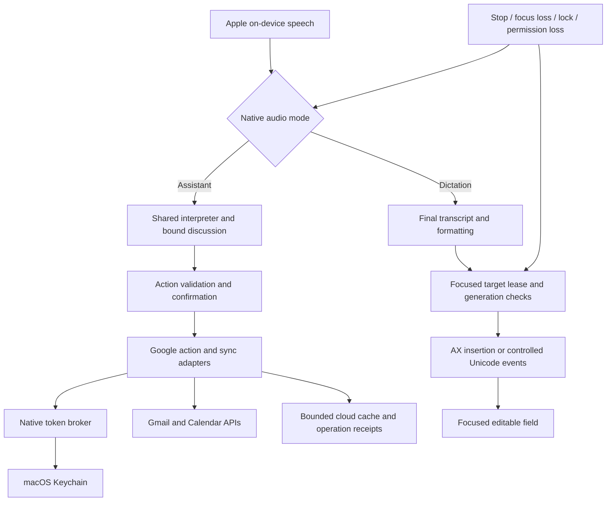

# KST 0.6 — Google workspace actions and dictation across Mac apps

Revision: 1 · Status: proposed implementation contract; no feature code changed  
Prepared for the existing Personal Secretary / kst repository  
Scope owner: kst native Mac app and its local core

## 1. Release decision

Build these features into the existing **kst** app, with two independently releasable feature flags:

1. **Google connection:** Gmail and Google Calendar account access, synchronization, voice queries and validated actions.
2. **Dictation:** speak into the focused editable field of another Mac app, including Chrome, Gmail/Google Docs in a browser, text editors, iTerm and Terminal.

Use version **0.6.0** when both features pass their own gates. Deliver internal milestones 0.6.0-preview.1 (dictation), preview.2 (Google reads/sync), preview.3 (Google writes). Bundle numbers increase from the actual checkout at build time. Release evidence for the previous adaptive classifier remains separate and must not be silently marked complete by this release.

This is a plan, not authorization to connect accounts, grant OS permissions, send email, alter calendars, or implement the feature immediately. The user's existing instruction forbidding GitHub pushes remains in force.

### Frozen constraints

- Existing Swift/AppKit/SwiftUI app, Apple on-device speech recognition, installed male Apple voice at the current speaking pace.
- Existing Node.js core, SQLite operational receipts, C++/JS small intent classifier. No local LLM, pretrained embedding download or paid inference dependency.
- Google synchronization uses documented APIs and OAuth, independent of ChatGPT's connected apps. Browser cookies and browser automation are not the synchronization mechanism.
- Dictation runs in the native process. Dictated text never passes through the command classifier, Node core, learning store, Google API adapters or an LLM.
- Release-one Google services are **Gmail and Calendar**. Drive/Docs/Sheets APIs, Google Tasks and Contacts synchronization are later increments. Dictating into those apps' visible text fields can work before their APIs are integrated.
- Do not advertise universal control over every screen: text insertion requires a supported editable target. Password fields, login/lock screens, protected controls and some canvas/remote interfaces are excluded.

## 2. User-visible behavior

| Request / action | Required result |
|---|---|
| “Connect my Google account” | Open account connection UI, then the normal browser for Google's consent flow. |
| “Show unread Gmail from Alex” | Resolve the selected account/sender; return a bounded, fresh result list. |
| “Read the latest one” | Resolve one message from this discussion's result IDs, read plain text using the male Apple voice. |
| “Give me an inbox briefing” | Counts, senders, subjects and short extractive previews; no claim of LLM-level summarization. |
| “Reply saying I can join at three” | Prepare an exact-text reply to a resolved thread; show recipients, subject and body before sending. |
| “Archive that email” | Apply the Gmail label action to the exact resolved message/thread; return a receipt. |
| “What is on my Google calendar tomorrow?” | Read selected calendars, explicitly identify timezone, freshness and any incomplete results. |
| “Schedule a review tomorrow at 3 PM for 30 minutes on Google Calendar” | Check availability, collect required fields, preview calendar and time, then commit the confirmed event. |
| “Move the Google review to 4 PM” | Resolve event, clarify date/AM-PM if needed, compare remote version, then update. |
| “Publish this plan to Google Calendar” | Preview the proposed focus blocks and destination calendar. Publish explicitly selected blocks after confirmation. |
| Dictation hotkey while the Gmail compose field is focused | Start a non-activating status overlay; final speech chunks appear at the cursor. |
| “arise, start dictation” while an editor is focused | Acknowledge before capture, pin the target, then dictate without requiring another wake word per phrase. |
| “new paragraph” in a normal editor | Insert two newline characters, subject to target capability. |
| Dictation in a terminal | Insert literal single-line text in the explicitly armed terminal target. Never synthesize Enter, Tab, Escape or control sequences. |
| Stop button / dictation hotkey | Stop capture and cancel unissued text chunks immediately. |

“Email Alex” and “type this into Gmail” are different operations. API actions can work without Gmail being open. Dictation writes only into the user-selected visible field; it does not know which Google account owns that page.

## 3. Architecture and responsibility boundaries

| Layer | Implementation |
|---|---|
| Native audio coordinator | Swift, one shared audio engine and speech session; mutually exclusive assistant/dictation/TTS capture. |
| Focus and insertion | Swift, ApplicationServices Accessibility APIs, AppKit focus notifications, CoreGraphics events where needed. |
| OAuth/token owner | Swift `GoogleAccountBroker`, URLSession, macOS Keychain; authorization-code flow with PKCE. |
| Google transport/sync | Node modules using native `fetch`, AbortController and explicit schemas. Access tokens are obtained transiently from the native broker. |
| MIME | A pinned maintained MIME composer/parser dependency selected during dependency audit; size-limited plain-text extraction, never ad-hoc header concatenation. |
| Persistence | Separate `google-cache.sqlite` plus additive operation tables in private `kst.sqlite`; domain `secretary.sqlite` retains local records. |
| Intent routing | Versioned Google action registry layered onto the existing classifier/coordinator; no change to IDs 0–26 in the existing model. |

The core must never read Keychain secrets by invoking `security` with tokens on a command line. The native broker supplies short-lived access tokens over an owner-only Unix-domain socket under the private profile: directory0700, socket0600, same-UID peer check and per-launch random capability. Refresh tokens stay in Keychain. If that broker is unavailable, cloud work pauses; ordinary local features and dictation continue.

The broker grants only fixed Google service scopes for a linked account. Network requests go to hardcoded Google API/token hosts; it is not a generic authenticated HTTP proxy. Tokens never appear in dashboard responses, URLs, SQLite, logs, environment variables or process arguments.

## 4. Google account setup and permissions

### Developer preparation

1. Create a Google Cloud project and enable Gmail API and Calendar API.
2. Configure the consent screen, app identity and a **Desktop app** OAuth client. Record the selected client library/version and its PKCE tests during implementation.
3. Register intended personal test users while developing. Review Gmail scope classification and production verification requirements before distributing the app.
4. Store the public client configuration in a versioned config file. A desktop client cannot rely on a bundled client secret being confidential.
5. Use a stable app bundle identifier and signing identity. Keychain and Accessibility behavior must be tested across an app update.

Use the external system browser and a short-lived loopback callback bound to `127.0.0.1` on an ephemeral port; PKCE-S256, random state, exact callback path, single-use state, five-minute deadline. Never embed Google's login page. Google documents desktop loopback callbacks and PKCE; installed apps do not support its incremental-authorization mechanism, so an expanded scope set requires a new explicit authorization transaction rather than assuming silent scope upgrades. [Google desktop OAuth](https://developers.google.com/identity/protocols/oauth2/native-app)

### Permission profiles

The UI presents features and requested access before connection. Initial defaults: Gmail reads and Calendar reads. Write features remain disabled until the user selects the corresponding capability and completes consent with the full selected scope set. Check actual granted scopes after every authorization; partial grants are supported.

| Capability | Scope choices, using `https://www.googleapis.com/auth/` prefix |
|---|---|
| Identify account | `openid`, `email` through Google's identity flow; bind account by verified issuer+subject, not mutable email text. |
| Gmail reading/search | `gmail.readonly`. |
| Gmail draft creation/replacement and send | `gmail.compose`; this scope already permits sending, so do not describe it as draft-only account permission. |
| Mark read/unread, archive, trash | `gmail.modify`; use this instead of redundant Gmail scopes where it subsumes them. Permanent deletion is excluded. |
| List calendars | `calendar.calendarlist.readonly`. |
| Read events | `calendar.events.readonly`. |
| Read and write events on owned calendars | `calendar.events.owned`; v1 writes only to an owned, selected writable calendar. |
| Availability queries | `calendar.events.freebusy` when the chosen FreeBusy method needs it; verify the selected endpoint/scope combination in integration tests. |

The action executor still restricts operations even when an OAuth scope technically allows more. Gmail read/compose/modify scopes are restricted scopes; public distribution can require verification and additional review depending on data handling. This release cannot promise a forever-free public distribution process. No paid inference is required. [Gmail scopes](https://developers.google.com/workspace/gmail/api/auth/scopes), [Calendar scopes](https://developers.google.com/workspace/calendar/api/auth)

### Account lifecycle

Support one linked Google identity in 0.6, with multiple calendars under that identity. Database keys include account ID from the start. Account switching requires disconnect/reconnect, purges the prior account's cloud cache, and never reuses pending actions.

Keychain stores refresh token and granted-scope metadata. Keep access tokens in RAM until expiry; serialize refresh per account. Refresh revocation/`invalid_grant` becomes `REAUTH_REQUIRED`, not a retry loop. Stop account workers before disconnect, invalidate the account generation, cancel unadmitted actions, revoke credentials when possible, remove Keychain items and clear account-specific cache. A failed remote revoke is reported separately from successful local disconnect.

Connection should persist across normal quits and restarts. Google can expire or revoke refresh tokens, and testing-status restrictions can require reauthorization; do not promise consent is literally permanent. [Google token expiration](https://developers.google.com/identity/protocols/oauth2#expiration)

## 5. Google synchronization contract

### General rules

- Google is authoritative for Google records. Imported records are references with provenance, not independent local duplicates.
- Local tasks/reminders/notes remain local. No silent conversion into Google events or Gmail drafts.
- Use one sync worker and one serialized writer per account/service. Coalesce manual refreshes; cancel on account-generation change.
- UI shows `lastSuccessfulSync`, `lastAttempt`, connected account, selected calendars and completeness. Cached availability is not proof that a time is free.
- No public webhook/Pub/Sub infrastructure in 0.6. Poll adaptively while the core and native token broker are running; app exit pauses cloud sync.
- Calendar poll default 120 seconds; Gmail poll default 180 seconds; ±20% jitter. User refresh has a15 second debounce. Sleep/offline/low power back off; resume with one coalesced catch-up.
- Honour Retry-After. Retry safe reads with full-jitter exponential backoff:1,2,4,8,16 seconds, maximum 5 attempts per cycle. Quota failures back off to15 minutes. Writes follow the separate uncertain-effect rules below.

### Gmail

Bootstrap a bounded cache of recent inbox message metadata: up to 500 messages from the last30 days, fully paginated within that bound. Capture a starting history ID before the paginated bootstrap, then apply history changes since that captured point before committing the final cursor. Persist IDs, thread IDs, history cursor, labels, sender/recipient headers, subject and short snippet; fetch bodies only on explicit read/draft-reply request. Never claim this bounded cache represents the entire mailbox.

Use `users.history.list` for subsequent changes and deduplicate by message ID and history item. Commit the new cursor only after all pages of the cycle are applied. Invalid/outdated history yielding404 triggers a bounded full resync, not an empty-inbox result. On-demand Gmail search queries the API, paginates results, returns at most50 items per user query and explicitly offers continuation. Gmail documents history-based partial synchronization and404 recovery. [Gmail synchronization](https://developers.google.com/workspace/gmail/api/guides/sync)

Gmail body rendering is plain text. Decode MIME and character sets within size caps, remove executable HTML, do not fetch remote images or attachments automatically. Text from email is untrusted content and cannot authorize commands, training labels, recipient changes, or external-model uploads.

### Calendar

Track a calendar-list cursor and one event cursor per selected calendar. Bootstrap the selected calendars' event resources using a token-compatible unbounded-by-date query configuration; never combine a sync cursor with incompatible time filters. Page to completion in a staging generation, then publish the mirror and final `nextSyncToken` together. Afterward apply incremental changes and tombstones. A410 invalid cursor resets only that calendar mirror and performs a full resync; it never deletes local secretary records. [Calendar sync](https://developers.google.com/workspace/calendar/api/guides/sync)

To keep storage bounded, cap the mirrored master-resource set at 5000 events per selected calendar and5 selected calendars. If exceeded, enter explicit `QUERY_ONLY` mode for that calendar: discard the incomplete staging mirror, use direct paginated range queries, and label the mirror incomplete. Do not advance a cursor on a partial snapshot.

Agenda queries use direct bounded range queries with recurrence expansion (`singleEvents=true`) when freshness/completeness requires it. Default display horizon:30 days back and180 days forward. Read recurring occurrences and all-day events correctly; v1 mutation of recurring series/occurrences is deferred and must return a clear unsupported action, not accidentally edit a whole series. Date-only end dates are exclusive; timed events retain timezone/offset. [Calendar event listing](https://developers.google.com/workspace/calendar/api/v3/reference/events/list)

## 6. Gmail action design

| Action | Fields and behavior |
|---|---|
| `google.gmail.search` | Explicit query or validated sender/unread/date filters; never put a guessed person into a write. |
| `google.gmail.read` | Exact account/message ID; mark-read is separate from read-aloud unless the user enabled that preference. |
| `google.gmail.draft` | Exact to/cc addresses, subject, literal body; create a Gmail draft, return its ID and link. |
| `google.gmail.replyDraft` | Exact thread/message ID, recipients and literal body; preserve reply headers and threading. Default reply only to sender, not reply-all. |
| `google.gmail.sendDraft` | Exact draft ID and latest body/recipient digest; final send confirmation expires in 60 seconds. |
| `google.gmail.setLabels` | Exact IDs, explicit add/remove labels; archive removes INBOX, read-state changes affect UNREAD. |
| `google.gmail.trash` | Exact message/thread choice with confirmation; no permanent-delete capability. |

Default commands operate on a resolved message. “Archive the whole conversation” is a separate thread action whose preview includes message count. Names with multiple addresses ask which address. Free-spoken addresses are read back and shown; no directory-wide Contacts scope is added just to guess recipients.

A Gmail draft is a stable container whose underlying message can change when edited. Before send, retrieve it again and compare recipients/body against the approved preview. An edit invalidates the send confirmation. Build MIME through a library, reject CR/LF in header values, encode base64 url, and preserve `Message-ID`/`In-Reply-To`/`References` for replies. [Gmail drafts](https://developers.google.com/workspace/gmail/api/guides/drafts), [Gmail sending](https://developers.google.com/workspace/gmail/api/guides/sending)

An inbox briefing is an extractive view, not an invented conversational answer. “Draft a reply saying TEXT” uses the user's exact content. A request to reason over a long email or generate an original response needs an explicitly selected external provider and a visible data preview under the existing approval flow. Google sync itself never invokes that provider.

## 7. Calendar, planner and reminder actions

`google.calendar.list`, `availability`, `create`, `reschedule`, `cancel` and `publishPlan` use exact account/calendar/event identities. Explicitly choose a default **Google** calendar on connection. Unqualified “schedule a meeting” asks local versus Google until the user explicitly saves a default destination; replies always identify the destination. Existing local meetings are not uploaded during connection.

Every write follows: resolve target → fetch fresh remote resource → recheck date/time and conflict interval → show preview → bind confirmation → dispatch with account generation and resource version pinned.

Create events with a deterministic Google-compatible event ID derived from account+original request ID. On an uncertain create, retrieve that ID and compare the operation marker; never generate a new event ID to retry. Existing-event writes use the fetched etag and `If-Match`. A412 means re-read and show a new preview; do not overwrite a concurrent edit. These are the API's documented concurrency mechanisms. [Calendar resource versions](https://developers.google.com/workspace/calendar/api/guides/version-resources)

Use PATCH only for explicitly changed scalar fields; preserve untouched fields and do not replace attendee arrays accidentally. When an operation must alter an array, construct the complete approved array from a fresh GET. The API replaces array fields in a patch, so this is a required behavior, not an optimization. [Event patch](https://developers.google.com/workspace/calendar/api/v3/reference/events/patch)

Meetings with guests preview the exact guest emails and notification behavior. Send invitations only after that action is confirmed; set `sendUpdates=all` for guest changes. Do not rely on `sendUpdates=none` to promise nobody can be notified. Google Meet links are optional, explicit create requests with a stable conference request ID; pending conference creation is displayed as pending. [Event creation](https://developers.google.com/workspace/calendar/api/v3/reference/events/insert)

Availability is rechecked just before admission, but no claim of atomic booking across different calendar writers is allowed. Conflicts appearing after creation are surfaced as conflicts, not resolved by cancelling an unrelated event.

Planner publishing creates operation-linked event blocks. Google edits flow back into the Google mirror; they do not rewrite unrelated local tasks. Local reminders derived from Google events store the remote identity and version, update on sync, and stop nudging after cancellation. A single shared nudge deduplication key prevents both local and Google copies from nudging twice. Quiet-hours and in-meeting suppression remain in force.

## 8. Operation locking, retries and receipts

Extend the original-request ledger rather than adding a second execution coordinator. Persist account ID/generation, service, canonical payload digest, target remote IDs, etag/revision, confirmation ID and deterministic provider identifiers before dispatch.

States: `PREPARED`, `NEEDS_CONFIRMATION`, `DISPATCHING`, `SUCCEEDED`, `FAILED`, `UNKNOWN`, `CANCELLED`. Duplicate request IDs return their original operation. A different payload under the same ID returns409. Locks are scoped by account/service/remote target, with sorted acquisition for batch operations. A draft-send lock cannot be shared with a concurrent draft edit.

- Calendar create: reconcile deterministic event ID before any retry.
- Calendar update/delete: conditional write and fresh GET reconciliation. No second action against a different version without confirmation.
- Gmail draft create/send: Gmail provides no general exactly-once send guarantee. Store draft ID, generated MIME Message-ID and operation marker. On ambiguous transport failure, mark UNKNOWN and inspect draft/sent receipts; absence from an eventual-consistency search is not proof of non-send. Never automatically resend an uncertain message.
- Label state changes: reconcile actual labels; do not retry a different semantic operation under the original receipt.
- Disconnect increments account generation before cleanup. Outstanding confirmations from the old account cannot dispatch after reconnect.
- Offline writes produce a reviewable local proposal, not an automatically executing outbox. On reconnect, revalidate and reconfirm.

Stop cancels unadmitted actions and requests cancellation of owned workers. It cannot retract an email already sent or guarantee that a network write already admitted did not complete. Show its real or unknown receipt.

## 9. Dictation state machine and mode separation

States: `OFF → TARGETING → DICTATING → FINALIZING → INSERTING → DICTATING`; exceptional states `PAUSED_FOCUS`, `PAUSED_PERMISSION`, `TARGET_UNSUPPORTED`, `DELIVERY_UNKNOWN`.

The default global toggle is **Control+Option+D**, implemented through a registered system hotkey; detect registration failure and let the user change it. The status-item menu supplies Start/Pause/Stop as a fallback. Do not install a raw global key recorder just to implement the shortcut.

Rules:

1. In assistant mode, only explicit “start dictation” or the hotkey enters dictation. Normal sentences such as “note...” continue to be assistant requests.
2. Capture the currently focused external application/field before showing a non-activating `NSPanel` overlay. Never steal keyboard focus to display the overlay or request audio permission halfway through target selection.
3. Announce the selected app before dictation capture starts. During dictation, suppress TTS so spoken replies do not enter the user's text field.
4. Only final Apple recognition results can insert text. Partial text appears in the overlay, never repeatedly overwrites the field. Show “finishing speech” while waiting for finalization.
5. After each final segment, insert it once, append a bounded in-memory receipt and resume capture without a wake word. Keep the existing recognizer's turn limit but recycle it into continuous dictation rather than ending the whole discussion.
6. While dictating, “arise” is ordinary text. Assistant commands do not execute from dictated content.
7. Exact full-utterance “stop dictation” ends dictation without inserting that phrase; “pause dictation” pauses. Bare “stop” is literal text in dictation. The overlay Stop button/hotkey is the unambiguous immediate control.
8. “Literal phrase stop dictation” inserts “stop dictation”; only the explicit escape prefix is removed. No hidden model interpretation of dictated prose.
9. Lock, sleep, app termination, permission revocation or audio-device failure stops capture and cancels unissued chunks. The next start needs an explicit action.
10. Starting dictation cancels pending assistant clarification/confirmation and increments the audio-mode generation. Returning to assistant mode does not revive those confirmations.

The current native `VoiceControl` shortcut that treats a bounded read followed by Stop as cancellation applies only to assistant mode. It must not be reused for dictation.

## 10. Focus lease and insertion algorithm

A dictation session pins `(sessionId, generation, PID, bundleID, focusedWindow identity, focusedElement AX identity, role/subrole, available tab/document identity, selected range, target kind)`. Keep these only in RAM. Recheck target identity before each insertion chunk and observe focus/window/application changes through AXObserver and NSWorkspace; use a200 ms poll only when notifications are unavailable.

If the user changes app, window, tab or text field, **pause**. Do not silently follow focus with buffered speech. Show the new target and require the hotkey or explicit resume action to bind a new lease. Pending uninserted text remains visible in the overlay for at most30 seconds; it is not automatically delivered to the next field. Non-collapsed selection at session start is shown as replacement intent and requires explicit acknowledgment before insertion. If the caret/selection changes during recognition, pause rather than inserting against the stale selection; resume pins the current range.

Insertion priority:

1. If the focused AX element supports setting `kAXSelectedTextAttribute`, use that to replace the current acknowledged selection or insert at the cursor. Inspect settable support first.
2. Otherwise, for an explicitly supported editable target, send Unicode keyboard text events using `CGEvent.keyboardSetUnicodeString`; split at Unicode scalar boundaries into chunks of at most32 UTF-16 units. Recheck focus/generation between chunks.
3. If the target cannot be identified as editable, pause and report unsupported. Do not type blindly into a canvas or an unknown window.
4. Clipboard paste is **not an automatic fallback**. An explicit “paste dictated text” option can temporarily save the supported pasteboard items, paste once, and restore only if the clipboard still contains the exact value kst placed there. Never overwrite a clipboard changed by the user or another app. Non-restorable clipboard formats require a visible copy-only alternative.

Never set the entire field's AXValue to “old text plus new text”; that can overwrite concurrent user edits and break rich formatting. Do not inspect or store the whole document to implement dictation. Read only target capability, selected range and a bounded local insertion fragment where supported.

The Apple SDK exposes AXUIElement capability checks and secure text-field roles, and CoreGraphics exposes Unicode text events. API availability is not a guarantee that every app implements editable Accessibility semantics. [Apple AXUIElement](https://developer.apple.com/documentation/applicationservices/axuielement), [Apple Unicode keyboard events](https://developer.apple.com/documentation/coregraphics/cgevent/keyboardsetunicodestring(stringlength:unicodestring:))

There is an unavoidable race between checking foreground focus and the OS delivering input. Pause on focus changes and bound event batches to minimize exposure; do not describe this as a perfect transactional lock on another application's UI. If focus changes during delivery, cancel the rest and report delivery uncertain. Never replay a partially delivered segment automatically.

## 11. Terminal and sensitive-field behavior

Terminal dictation is explicitly supported as **literal typing into a user-armed terminal**, independent of the assistant's configured recipe executor. It does not grant the command interpreter arbitrary shell execution.

- Use the currently focused terminal pane; do not write to all iTerm sessions or select a pane in the background.
- Show a terminal indicator when the target lease is armed. Switching terminal tabs/panes invalidates the lease when detectable; require re-arming if pane identity cannot be reliably established.
- Reject carriage return, newline, escape, NUL and other control characters from inserted terminal text, including Unicode line/paragraph separators. No automatic punctuation transforms or newline formatting controls in terminal mode.
- Never emit Return, Tab, Escape, arrow keys or control-key chords. “Run it”, “press enter” and “new line” do not execute a terminal command in this release; ask the user to use the keyboard or an existing approved recipe.
- Terminal input can affect interactive programs even without Enter. Tell the user to arm dictation at an intended text-entry prompt; unknown/secure prompt state pauses delivery. Do not promise that every terminal pane is a harmless shell line editor.
- Existing-pane input receipts say text was delivered/attempted, not that a shell command ran successfully.

For every app, reject secure/password AX subroles and active Secure Event Input where detectable. Never bypass an application's protected field. Password managers, OS login/lock screens and credential prompts are unsupported targets. A screen that does not expose enough information to rule out a protected input requires manual input rather than a blind fallback.

## 12. Formatting and editing scope

Initial dictation controls are deterministic, locale-English and whole-utterance only:

| Control | Standard editor | Terminal |
|---|---|---|
| “new line” | Insert one LF if multiline target supports it | Unsupported |
| “new paragraph” | Insert two LFs | Unsupported |
| “comma”, “period”, “question mark” | Explicit punctuation token | Literal words by default |
| “delete last dictation” | Only if the exact last insertion range/content is still verifiable | Unsupported |
| “undo that” | Ask if it means last dictation; never issue generic Cmd+Z blindly | Unsupported |
| “literal phrase ...” | Insert following words without control parsing | Literal following words, still control-character checked |

Use Apple's recognized capitalization/punctuation otherwise. No LLM polishing or semantic rewriting. Do not claim to correct arbitrary already-existing screen text. Single-line form fields cannot receive newline controls because those might submit a form. Bound each final segment to4096 UTF-16 units and16 KiBUTF-8; over-limit input remains in the overlay and asks the user to split it.

## 13. Permissions, storage and resource budgets

### macOS permissions

Microphone and Speech Recognition remain as implemented. Cross-app dictation additionally requires **Accessibility**, checked with `AXIsProcessTrustedWithOptions`; prompt only on explicit dictation setup/start. Provide the system settings link and explain what the permission enables. The permission is owned by macOS and normally persists for the app identity; a different signature, changed build identity or OS reset can cause reauthorization. Stable signing is a release task, not a promise that ad-hoc development builds never need it again.

No Screen Recording permission is required for the baseline design. No Input Monitoring permission is requested unless a separately reviewed implementation actually needs monitored input; the selected hotkey/event-emission design must be tested without it. Google account consent is separate from macOS privacy settings.

### Retention

- Raw audio: RAM only, Apple recognition buffers; never saved.
- Dictated text: current uninserted segment plus at most10 receipt descriptors in RAM; no per-session transcript archive and no learning examples from dictation.
- Google tokens: Keychain only. Operational receipts store IDs/digests and minimal action metadata, not bearer tokens.
- Gmail content: bodies fetched on demand, RAM-only by default, maximum 256 KiB decoded visible text per read; explicitly saved local notes are separate user records.
- Cloud cache: metadata/event resources with account provenance, LRU eviction and a default 16 MiB SQLite cap including indexes; mailbox metadata defaults remain500 messages. Large pages are streamed/limited before allocation.
- Cloud write payloads needed for uncertain-effect recovery: encrypted bounded operation envelope in the private profile, key in Keychain, at most20 MiB/100 pending operations. Clear body after terminal receipt or seven-day retention, whichever comes first; retained minimal receipt still identifies uncertainty. Account disconnect clears these payloads after generation invalidation.
- Dictation target lease and text queues: at most128 KiB serialized content; runtime/framework overhead measured separately.
- The earlier64 KiB personal ML payload cap remains separate. Google mailbox/calendar caches cannot truthfully be promised to fit that learning-memory budget.

Targets, not measured claims: command/dictation mode switch<200 ms excluding OS permission dialogs; insertion p95<150 ms after final transcript, excluding ASR finalization; added idle CPU<1%on the target Mac; no unbounded sync queues. Measure app/core/speech RAM separately. A proposed64 MiB added-RSS target for these features must be validated rather than asserted.

## 14. Data and API contracts

Add private tables:

- `google_accounts(account_id, subject, email, generation, scopes, status, selected_calendar_ids, default_calendar_id)`; secret references only.
- `google_sync_state(account_id, collection_id, generation, cursor, config_hash, phase, last_success, error)`.
- `google_messages(account_id, message_id, thread_id, labels, headers, snippet, history_id, observed_at)`.
- `google_events(account_id, calendar_id, event_id, etag, resource, generation, observed_at)`.
- `google_operation_links(original_request_id, account_id, account_generation, remote_id, payload_digest, etag, state)` in the operational database.

Composite primary keys are mandatory; calendar title, email subject and array position are never identities. Sync staging swaps and cursor advancement are transactional within the cloud cache. Cross-database writes use the existing durable admission/reconciliation pattern, not a pretend multi-database atomic transaction.

New paired loopback endpoints, with existing bearer/Host/Origin checks and strict unknown-field rejection:

| Method / path | Contract |
|---|---|
| GET `/api/google/status` | Account identity, grants, selected calendars, freshness/completeness and errors; no tokens. |
| POST `/api/google/connect` | Request native connection UI; body `{requestId, capabilityProfile}`. The dashboard never receives authorization codes. |
| POST `/api/google/disconnect` | `{requestId, expectedAccountGeneration}`. |
| PATCH `/api/google/settings` | `{requestId, expectedRevision, selectedCalendarIds, defaultCalendarId, defaultMeetingDestination}`. |
| POST `/api/google/sync` | `{requestId, service}`; coalesced safe refresh. |
| POST `/api/google/search` | `{requestId, service, query, pageToken?}`; result selection tokens bind account generation. |
| POST `/api/google/actions` | `{requestId, action, contextRevision}`; coordinator creates a preview/proposal, not unchecked dispatch. |
| POST `/api/google/operations/:id/confirm` | `{requestId, confirmationId, payloadDigest, accountGeneration}`; immutable exact scope. |
| GET `/api/google/operations/:id` | Receipt and uncertain state; no automatic resubmission. |

Dictation has no web endpoint accepting arbitrary keystrokes or a target PID. Native UI/hotkeys own dictation activation and target selection. The core may receive only the existing coarse runtime-state heartbeat (`dictating` is a new versioned audio-state value) to prevent training/TTS/work contention.

## 15. Interpreter, ML and action registry migration

Keep model-v1 label IDs unchanged. Introduce a new action namespace with explicit deterministic controls first: `google.gmail.*`, `google.calendar.*` and native-only dictation controls. Generic learned patterns cannot directly authorize account connection, sends, account changes, terminal submission or cross-app typing.

If Google intents are added to the classifier, ship registry/model-v2 under distinct filenames and schema versions. Do not squeeze new labels into the old reserved rows without migration or reinterpret old personal labels under a new mapping. Seed corpus must be authored before rollout; each new intent needs held-out paraphrases and critical guards. Personal examples transfer only for explicitly identical labels/features; otherwise retain the previous model for its own namespace and request a documented migration.

Google IDs, recipient addresses and account identifiers come from validated entity resolution, never from a classifier-generated string. Dictation uses formatting controls only and supplies no intent-training labels. Received emails, event descriptions and screen text are data, never trusted assistant instructions.

## 16. Failure handling and user messages

| Condition | Required behavior |
|---|---|
| Google offline | Local/dictation features continue; show stale cache, never announce a new cloud write as committed. |
| Access token expires | One serialized refresh; if revoked, request account reconnection. |
| Scope not granted | Disable affected action; show the missing feature permission without repeated prompts per utterance. |
| Gmail404 history / Calendar410 cursor | Scoped rebootstrap with old display marked stale; no lost local records. |
| Calendar412 | New remote version preview; no silent overwrite. |
| Send timeout | UNKNOWN receipt, no automatic resend. |
| Cache/operation envelope full | Evict permitted cache or refuse new work; do not delete uncertain-operation evidence to make space. |
| Focus changes during speech | Pause, preserve bounded undelivered text briefly, ask to re-arm target. |
| Focus changes during insertion | Cancel remaining chunks; show delivery uncertain, never replay whole text automatically. |
| AX/keyboard insertion failure | No silent clipboard fallback and no repeated insertion. Offer copy-only or another supported field. |
| Permission revoked | Stop audio/insertion at the next check; reopen permission setup only on explicit action. |
| App crash mid-dictation | No auto-resume or automatic replay after restart. |
| Another process owns the profile/audio controller | Respect the lock; do not remove it or start a second injector. |

## 17. Concrete implementation work plan

All tasks below are NOT STARTED. This task list is planning, not delegated background work.

| ID | Implementation / files | Dependencies | Exit evidence |
|---|---|---|---|
| R01 | Pin0.6 contracts, capability profiles, mode invariants, operation schemas | — | Schema fixtures and clear local/Google destination rules. |
| R02 | Dependency/OAuth scope audit; Google project/client setup instructions | R01 | Exact dependency lock, consent profiles, no secrets in repository. |
| R03 | `GoogleAccountBroker.swift`, Keychain store, PKCE callback, broker socket | R02 | Connect/restart/refresh/partial-grant/revoke tests using a disposable test account. |
| R04 | `AudioModeCoordinator.swift`; refactor `VoiceInput.swift` to share one engine | R01 | Assistant/dictation/TTS exclusion, generation cancellation, rapid-switch tests. |
| R05 | `DictationTarget.swift`, AX permission and focus lease, non-activating overlay | R04 | Focus-preservation and secure-field rejection on target apps. |
| R06 | `DictationInjector.swift`, Unicode insertion, final-only deduplication | R05 | Cursor/selection/Unicode/focus-race/unknown-delivery tests. |
| R07 | Dictation controls, terminal policy, explicit clipboard path, hotkey/status item | R06 | Terminal no-Return/control-character tests; clipboard restoration races. |
| R08 | `src/google/transport.mjs`, strict schemas, cache and cursor transactions | R03 | Token-free logs, bounded pagination, retry/cancellation and crash tests. |
| R09 | Gmail read/search/history adapter and extractive briefing | R08 | Read/search outside bounded cache,404 recovery and MIME tests. |
| R10 | Calendar list/sync/direct-range/availability adapter | R08 |410 recovery, recurring reads, timezone/DST/all-day and completeness tests. |
| R11 | Gmail draft/reply/send/label/trash operations and receipts | R09 | Exact recipient/body confirmation, external-edit detection and uncertain-send tests. |
| R12 | Calendar writes, etag conflicts, plan publishing, invitation policy | R10 | Deterministic creates,412 conflicts, no duplicate blocks or silent invitations. |
| R13 | Google action registry and dialogue; new-model migration if needed | R09–R12 | Paraphrase/entity/correction corpus and held-out action equality; no guessed account/recipient. |
| R14 | Dashboard/native connection UI, freshness, operation review, nudges | R03,R09–R13 | Account isolation, no duplicate nudges, understandable stale/unknown states. |
| R15 | Signing/permission persistence, packaging, old-profile migration | R07,R14 | App update retains permissions where supported; no token or model migration loss. |
| R16 | Live compatibility, resource/latency, crash matrix and release report | R15 | Mechanically checked evidence for all release criteria below. |

Recommended order: R01–R02, then dictation R04–R07 as the first usable milestone; broker/sync R03,R08–R10 next; Google writes R11–R14; finish R15–R16. Native dictation and cloud adapters can later be assigned to separate agents with disjoint ownership, but their shared contracts must be fixed first.

No blanket new installation is required for dictation beyond the existing Swift/Xcode command-line toolchain. Google requires client configuration, a reviewed OAuth library and MIME dependency, not a Python service or local language model. No iPhone entitlement/app work is included; future iPhone clients need their own native OAuth flow and cannot reuse the desktop loopback callback.

## 18. Required test and acceptance matrix

### Google tests

G01: correct PKCE/state; G02: callback replay/wrong state; G03: expired auth session; G04: partial scopes; G05: single-flight refresh; G06: revoked refresh; G07: restart Keychain persistence; G08: disconnect while write pending; G09: account identity isolation; G10: paginated Gmail initial sync; G11: repeated history changes dedup; G12: history404 recovery; G13: message outside cache searched correctly; G14 MIME/HTML/charset limits; G15: ambiguous recipient; G16: draft externally edited before send; G17: send timeout never resends; G18: archive/read label reconciliation; G19: calendar pagination; G20: sync410 staging recovery; G21: query-only overflow; G22 DST/all-day/recurrence reads; G23: etag412 conflict; G24: crash after deterministic create; G25: guest notification preview; G26: plan publish retry; G27 Google edit reflected once; G28: no duplicate meeting nudge; G29: quota/offline backoff; G30: disk full during cursor commit; G31: email prompt injection never dispatches; G32: no automatic external-LLM use.

### Dictation tests

D01: toggle while editor focused; D02: overlay never steals focus; D03: partial/final dedup; D04: stop before final; D05: mode switch invalidates pending assistant confirmation; D06: focus change before commit; D07: focus change between Unicode chunks; D08: switch browser tab with reused field; D09: terminal pane change; D10: emoji/combining characters; D11: selected-text replacement; D12: concurrent user typing; D13: secure field denied; D14: permission revoked; D15: no readable/editable AX target; D16: clipboard changed during paste; D17: unsupported clipboard types; D18: terminal newline/CR/escape/control separators rejected; D19: no terminal Return/Tab/control keys; D20: literal words “stop” and “arise”; D21: escaped “stop dictation”; D22: sleep/lock; D23: recognizer45 second turn recycle; D24: audio route change; D25: crash/relaunch no replay; D26: unknown delivery no double typing; D27: single-line “new line” cannot submit; D28: manual cursor change invalidates undo range; D29: hotkey collision; D30 TTS never leaks into dictated text.

### Live app matrix

Record app/version/OS, target role, insertion method, exact observed outcome and limitations for: Chrome Gmail compose, Chrome Google Docs, Chrome normal inputs/contenteditable, Safari text input, Notes, TextEdit plain/rich text, VS Code, iTerm shell prompt, Terminal shell prompt, and one unsupported canvas/remote client. Treat Google Docs and terminal compatibility as release gates, not assumptions. No real outgoing email or meeting invitation is sent merely to test insertion; disposable drafts/calendars are used for cloud tests.

### Release gates

- Every required deterministic test passes; live matrix covers the named supported apps or explicitly removes the unsupported app from advertised support.
- No unintended email sends, guest invitations, terminal submissions or protected-field typing in the critical suite.
- No duplicate insertion after final callbacks, network replay, process crash or focus change.
- Fresh remote reads precede Google mutations; incomplete sync never claims complete availability.
- OAuth and macOS permission persistence verified across quit/reopen and an actual signed app update.
- Resource/latency caps measured on the user's Mac, including full cache and peak write/journal usage.
- New ML intents meet held-out quality/action-equality gates before model-based automation; dictation remains independent of those gates.
- No credentials, raw audio, complete dictation history or imported email bodies appear in learning data or logs.
- All source, artifact, test and live evidence hashes bind to the 0.6 build; existing release/user-preview status is reported accurately.

## 19. Deferred increments

0.6.x: more than one linked Google account, richer recurring-event edits, explicit reply-all and attachment handling after their own tests.0.7: Drive search and file actions, Docs/Sheets structured API edits, Google Tasks/Contacts if needed. Arbitrary screen reasoning, autonomous terminal execution, automatic sensitive-field typing and an iPhone companion are separate designs.

## 20. Reference and verification notes

Technical assumptions were checked against Google's OAuth/Gmail/Calendar documentation and Apple's Accessibility/CoreGraphics references linked inline. Local SDK headers were also inspected for `AXUIElementIsAttributeSettable`, `kAXSelectedTextAttribute`, `kAXSecureTextFieldSubrole` and `AXIsProcessTrustedWithOptions`; this inspection does not establish live compatibility with another app.

Existing baselines: [adaptive understanding design](KST-ADAPTIVE-UNDERSTANDING-DESIGN.md), [current release evidence](KST-ADAPTIVE-RELEASE-REPORT.md), [current app features](KST-README.md). This release plan does not change their implementation state.
