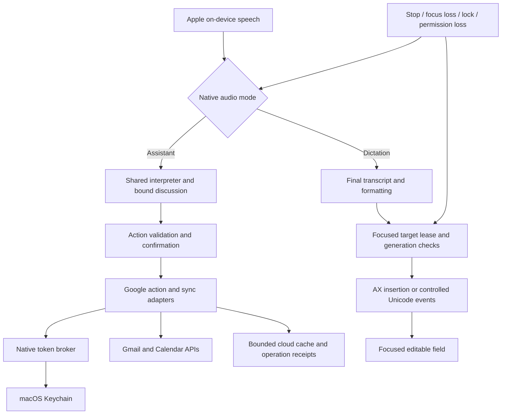

# KST 0.6 — Google workspace actions and dictation across Mac apps

Revision: 3 · Status: implementation contract plus preview integration decisions; live release gates incomplete  
Prepared for the existing Personal Secretary / kst repository  
Scope owner: kst native Mac app and its local core

## 1. Release decision

Build these features into the existing **kst** app, with two independently releasable feature flags:

1. **Google connection:** Gmail and Google Calendar account access, synchronization, voice queries and validated actions.
2. **Dictation:** speak into the focused editable field of another Mac app, including Chrome, Gmail/Google Docs in a browser, text editors, iTerm and Terminal.

Use version **0.6.0** when both features pass their own gates. Deliver internal milestones 0.6.0-preview.1 (dictation), preview.2 (Google reads/sync), preview.3 (Google writes). Bundle numbers increase from the actual checkout at build time. Release evidence for the previous adaptive classifier remains separate and must not be silently marked complete by this release.

This document authorizes no account connection or cloud mutation. The recent GitHub branch/PR publication and merge were separately authorized; this document update is local until another publication request. Requirements use MUST/SHALL as mandatory and MAY as optional. Sections 21–28 define the precise contracts behind the overview; any future change to them needs a documented design revision before dependent code is merged.

### Frozen constraints

- Existing Swift/AppKit/SwiftUI app, Apple on-device speech recognition, installed male Apple voice at the current speaking pace.
- Existing Node.js core, SQLite operational receipts, C++/JS small intent classifier. No local LLM, pretrained embedding download or paid inference dependency.
- Google synchronization uses documented APIs and OAuth, independent of ChatGPT's connected apps. Browser cookies and browser automation are not the synchronization mechanism.
- Dictation runs in the native process. Dictated text never passes through the command classifier, Node core, learning store, Google API adapters or an LLM.
- Release-one Google services are **Gmail and Calendar**. Drive/Docs/Sheets APIs, Google Tasks and Contacts synchronization are later increments. Dictating into those apps' visible text fields can work before their APIs are integrated.
- Do not advertise universal control over every screen: text insertion requires a supported editable target. Password fields, login/lock screens, protected controls and some canvas/remote interfaces are excluded.

## 2. User-visible behavior

| Request / action | Required result |
|---|---|
| “Connect my Google account” | Open account connection UI, then the normal browser for Google's consent flow. |
| “Show unread Gmail from Alex” | Resolve the selected account/sender; return a bounded, fresh result list. |
| “Read the latest one” | Resolve one message from this discussion's result IDs, read plain text using the male Apple voice. |
| “Give me an inbox briefing” | Counts, senders, subjects and short extractive previews; no claim of LLM-level summarization. |
| “Reply saying I can join at three” | Prepare an exact-text reply to a resolved thread; show recipients, subject and body before sending. |
| “Archive that email” | Apply the Gmail label action to the exact resolved message/thread; return a receipt. |
| “What is on my Google calendar tomorrow?” | Read selected calendars, explicitly identify timezone, freshness and any incomplete results. |
| “Schedule a review tomorrow at 3 PM for 30 minutes on Google Calendar” | Check availability, collect required fields, preview calendar and time, then commit the confirmed event. |
| “Move the Google review to 4 PM” | Resolve event, clarify date/AM-PM if needed, compare remote version, then update. |
| “Publish this plan to Google Calendar” | Preview the proposed focus blocks and destination calendar. Publish explicitly selected blocks after confirmation. |
| Dictation hotkey while the Gmail compose field is focused | Start a non-activating status overlay; final speech chunks appear at the cursor. |
| “arise, start typing” while an editor is focused | Switch from assistant listening to dictation hands-free, acknowledge before capture, pin the target, then dictate without another wake word per phrase. |
| “new paragraph” in a normal editor | Insert two newline characters, subject to target capability. |
| Dictation in a terminal | Insert literal single-line text in the explicitly armed terminal target. Never synthesize Enter, Tab, Escape or control sequences. |
| Stop button / dictation hotkey | Stop capture and cancel unissued text chunks immediately. |

“Email Alex” and “type this into Gmail” are different operations. API actions can work without Gmail being open. Dictation writes only into the user-selected visible field; it does not know which Google account owns that page.

## 3. Architecture and responsibility boundaries

| Layer | Implementation |
|---|---|
| Native audio coordinator | Swift, one shared audio engine and speech session; mutually exclusive assistant/dictation/TTS capture. |
| Focus and insertion | Swift, ApplicationServices Accessibility APIs, AppKit focus notifications, CoreGraphics events where needed. |
| OAuth/token owner | Swift `GoogleAccountBroker`, URLSession, macOS Keychain; authorization-code flow with PKCE. |
| Google transport/sync | Node modules using native `fetch`, AbortController and explicit schemas. Access tokens are obtained transiently from the native broker. |
| MIME | Nodemailer's MailComposer for outgoing RFC 822 and MailParser's streaming parser for incoming messages; exact audited versions and integrity hashes frozen by R02. No SMTP transport. |
| Persistence | Separate `google-cache.sqlite` plus additive operation tables in private `kst.sqlite`; domain `secretary.sqlite` retains local records. |
| Intent routing | Versioned Google action registry layered onto the existing classifier/coordinator; no change to IDs 0–26 in the existing model. |

The core must never read Keychain secrets by invoking `security` with tokens on a command line. The native broker supplies short-lived access tokens over an owner-only Unix-domain socket under the private profile: directory0700, socket0600, same-UID peer check and per-launch random capability. Refresh tokens stay in Keychain. If that broker is unavailable, cloud work pauses; ordinary local features and dictation continue.

The broker grants only fixed Google service scopes for a linked account. Network requests go to hardcoded Google API/token hosts; it is not a generic authenticated HTTP proxy. Tokens never appear in dashboard responses, URLs, SQLite, logs, environment variables or process arguments.

## 4. Google account setup and permissions

### Developer preparation

1. Create a Google Cloud project and enable Gmail API and Calendar API.
2. Configure the consent screen, app identity and a **Desktop app** OAuth client. Implement the fixed OAuth exchange with Swift URLSession, CryptoKit and Security APIs as specified in section 21; no additional OAuth SDK.
3. Register intended personal test users while developing. Review Gmail scope classification and production verification requirements before distributing the app.
4. Version the client configuration schema and placeholder example; keep the actual Google desktop client configuration in the owner-only local setup file. A desktop client cannot rely on its client secret being confidential; supply any Google-required desktop client secret only in the native token POST body, never as evidence of a trusted confidential client.
5. Use a stable app bundle identifier and signing identity. Keychain and Accessibility behavior must be tested across an app update.

Use the external system browser and a short-lived loopback callback bound to `127.0.0.1` on an ephemeral port; PKCE-S256, random state, exact callback path, single-use state, five-minute deadline. Never embed Google's login page. Google documents desktop loopback callbacks and PKCE; installed apps do not support its incremental-authorization mechanism, so an expanded scope set requires a new explicit authorization transaction rather than assuming silent scope upgrades. [Google desktop OAuth](https://developers.google.com/identity/protocols/oauth2/native-app)

### Permission profiles

The UI presents features and requested access before connection. Initial defaults: Gmail reads and Calendar reads. Write features remain disabled until the user selects the corresponding capability and completes consent with the full selected scope set. Check actual granted scopes after every authorization; partial grants are supported.

| Capability | Scope choices, using `https://www.googleapis.com/auth/` prefix |
|---|---|
| Identify account | `openid`, `email` through Google's identity flow; bind account by verified issuer+subject, not mutable email text. |
| Gmail reading/search | `gmail.readonly`. |
| Gmail draft creation and prepared-message send | `gmail.compose`; this scope already permits sending, so do not describe it as draft-only account permission. Replacing an existing cloud draft is deferred; corrections create a new reviewed draft. |
| Mark read/unread, archive, trash | `gmail.modify`; use this instead of redundant Gmail scopes where it subsumes them. Permanent deletion is excluded. |
| List calendars | `calendar.calendarlist.readonly`. |
| Read events | `calendar.events.readonly`. |
| Read and write events on owned calendars | `calendar.events.owned`; v1 writes only to an owned, selected writable calendar. |
| Availability queries | Always request `calendar.events.freebusy` with Calendar reads/writes; use POST `/calendar/v3/freeBusy`. Per-calendar errors mean unknown availability. |

The action executor still restricts operations even when an OAuth scope technically allows more. Gmail read/compose/modify scopes are restricted scopes; public distribution can require verification and additional review depending on data handling. This release cannot promise a forever-free public distribution process. No paid inference is required. [Gmail scopes](https://developers.google.com/workspace/gmail/api/auth/scopes), [Calendar scopes](https://developers.google.com/workspace/calendar/api/auth)

### Account lifecycle

Support one linked Google identity in 0.6, with multiple calendars under that identity. Database keys include account ID from the start. Account switching requires disconnect/reconnect, purges the prior account's cloud cache, and never reuses pending actions.

Keychain stores refresh token and granted-scope metadata. Keep access tokens in RAM until expiry; serialize refresh per account. Refresh revocation/`invalid_grant` becomes `REAUTH_REQUIRED`, not a retry loop. Stop account workers before disconnect, invalidate the account generation, cancel unadmitted actions, revoke credentials when possible, remove Keychain items and clear account-specific cache. A failed remote revoke is reported separately from successful local disconnect.

Connection should persist across normal quits and restarts. Google can expire or revoke refresh tokens, and testing-status restrictions can require reauthorization; do not promise consent is literally permanent. [Google token expiration](https://developers.google.com/identity/protocols/oauth2#expiration)

## 5. Google synchronization contract

### General rules

- Google is authoritative for Google records. Imported records are references with provenance, not independent local duplicates.
- Local tasks/reminders/notes remain local. No silent conversion into Google events or Gmail drafts.
- Use one sync worker and one serialized writer per account/service. Coalesce manual refreshes; cancel on account-generation change.
- UI shows `lastSuccessfulSync`, `lastAttempt`, connected account, selected calendars and completeness. Cached availability is not proof that a time is free.
- No public webhook/Pub/Sub infrastructure in 0.6. Poll adaptively while the core and native token broker are running; app exit pauses cloud sync.
- Calendar poll default 120 seconds; Gmail poll default 180 seconds; ±20% jitter. User refresh has a15 second debounce. Sleep/offline/low power back off; resume with one coalesced catch-up.
- Honour Retry-After. Retry safe reads with full-jitter ceilings of 1,2,4,8 seconds between attempts, maximum 5 total attempts per cycle. Quota failures back off to15 minutes. Writes follow the separate uncertain-effect rules below.

### Gmail

Bootstrap a bounded cache of recent inbox message metadata: up to 500 messages from the last30 days, fully paginated within that bound. Capture a starting history ID before the paginated bootstrap, then apply history changes since that captured point before committing the final cursor. Persist IDs, thread IDs, history cursor, labels, sender/recipient headers, subject and short snippet; fetch bodies only on explicit read/draft-reply request. Never claim this bounded cache represents the entire mailbox.

Use `users.history.list` for subsequent changes and deduplicate by message ID and history item. Commit the new cursor only after all pages of the cycle are applied. Invalid/outdated history yielding404 triggers a bounded full resync, not an empty-inbox result. On-demand Gmail search queries the API, paginates results, returns at most50 items per result page and explicitly offers continuation through a bound server handle. Gmail documents history-based partial synchronization and404 recovery. [Gmail synchronization](https://developers.google.com/workspace/gmail/api/guides/sync)

Gmail body rendering is plain text. Decode MIME and character sets within size caps. Read only text/plain parts; if an email has HTML only, report that it cannot be read aloud in 0.6 and offer to open Gmail. Never render HTML, fetch remote images or download attachments automatically. Text from email is untrusted content and cannot authorize commands, training labels, recipient changes, or external-model uploads.

### Calendar

Poll the complete bounded calendar list; track one event cursor per selected calendar. Bootstrap the selected calendars' event resources using a token-compatible unbounded-by-date query configuration; never combine a sync cursor with incompatible time filters. Page to completion in a staging generation, then publish the mirror and final `nextSyncToken` together. Afterward apply incremental changes and tombstones. A410 invalid cursor resets only that calendar mirror and performs a full resync; it never deletes local secretary records. [Calendar sync](https://developers.google.com/workspace/calendar/api/guides/sync)

To keep storage bounded, cap the mirrored master-resource set at 5000 events per selected calendar and5 selected calendars. If exceeded, enter explicit `QUERY_ONLY` mode for that calendar: discard the incomplete staging mirror, use direct paginated range queries, and label the mirror incomplete. Do not advance a cursor on a partial snapshot.

Agenda queries use direct bounded range queries with recurrence expansion (`singleEvents=true`) when freshness/completeness requires it. Default display horizon:30 days back and180 days forward. Read recurring occurrences and all-day events correctly; v1 mutation of recurring series/occurrences is deferred and must return a clear unsupported action, not accidentally edit a whole series. Date-only end dates are exclusive; timed events retain timezone/offset. [Calendar event listing](https://developers.google.com/workspace/calendar/api/v3/reference/events/list)

## 6. Gmail action design

| Action | Fields and behavior |
|---|---|
| `google.gmail.search` | Explicit query or validated sender/unread/date filters; never put a guessed person into a write. |
| `google.gmail.read` | Exact account/message ID; mark-read is separate from read-aloud unless the user enabled that preference. |
| `google.gmail.draft` | Exact to/cc addresses, subject, literal body; create a Gmail draft, return its ID and link. |
| `google.gmail.replyDraft` | Exact thread/message ID, recipients and literal body; preserve reply headers and threading. Default reply only to sender, not reply-all. |
| `google.gmail.sendPrepared` | Exact source draft ID resolved to a server-prepared message and approved frozen MIME digest; final send confirmation expires in 60 seconds. See section 23 for the external-edit race. |
| `google.gmail.setLabels` | Exact IDs, explicit add/remove labels; archive removes INBOX, read-state changes affect UNREAD. |
| `google.gmail.trash` | Exact message/thread choice with confirmation; no permanent-delete capability. |

Default commands operate on a resolved message. “Archive the whole conversation” is a separate thread action whose preview includes message count. Names with multiple addresses ask which address. Free-spoken addresses are read back and shown; no directory-wide Contacts scope is added just to guess recipients.

A Gmail draft is a stable container whose underlying message can change when edited. Before send, retrieve it again and compare recipients/body against the approved preview. An observed edit invalidates the send confirmation. A read cannot lock Gmail's draft against a subsequent external edit: send the immutable approved MIME via `messages.send`, not a mutable draft ID via `drafts.send`. Retain the source draft and identify it visibly after sending; do not automatically delete a potentially concurrently edited draft. Build MIME through a library, reject CR/LF in header values, encode base64 url, and preserve `In-Reply-To`/`References` with a new outbound `Message-ID` for replies. [Gmail drafts](https://developers.google.com/workspace/gmail/api/guides/drafts), [Gmail sending](https://developers.google.com/workspace/gmail/api/guides/sending)

An inbox briefing is an extractive view, not an invented conversational answer. “Draft a reply saying TEXT” uses the user's exact content. A request to reason over a long email or generate an original response needs an explicitly selected external provider and a visible data preview under the existing approval flow. Google sync itself never invokes that provider.

## 7. Calendar, planner and reminder actions

`google.calendar.list`, `availability`, `create`, `reschedule`, `cancel` and `publishPlan` use exact account/calendar/event identities. Explicitly choose a default **Google** calendar on connection. Unqualified “schedule a meeting” asks local versus Google until the user explicitly saves a default destination; replies always identify the destination. Existing local meetings are not uploaded during connection.

Every write follows: resolve target → fetch fresh remote resource → recheck date/time and conflict interval → show preview → bind confirmation → dispatch with account generation and resource version pinned.

Create events with a deterministic Google-compatible event ID derived from account+original request ID. On an uncertain create, retrieve that ID and compare the operation marker; never generate a new event ID to retry. Existing-event writes use the fetched etag and `If-Match`. A412 means re-read and show a new preview; do not overwrite a concurrent edit. These are the API's documented concurrency mechanisms. [Calendar resource versions](https://developers.google.com/workspace/calendar/api/guides/version-resources)

Use PATCH only for explicitly changed scalar fields; preserve untouched fields and do not replace attendee arrays accidentally. When an operation must alter an array, construct the complete approved array from a fresh GET. The API replaces array fields in a patch, so this is a required behavior, not an optimization. [Event patch](https://developers.google.com/workspace/calendar/api/v3/reference/events/patch)

Meetings with guests preview the exact guest emails and notification behavior. Send invitations only after that action is confirmed; set `sendUpdates=all` for guest changes. Do not rely on `sendUpdates=none` to promise nobody can be notified. Google Meet links are optional, explicit create requests with a stable conference request ID; pending conference creation is displayed as pending. [Event creation](https://developers.google.com/workspace/calendar/api/v3/reference/events/insert)

Availability is rechecked just before admission, but no claim of atomic booking across different calendar writers is allowed. Conflicts appearing after creation are surfaced as conflicts, not resolved by cancelling an unrelated event.

Planner publishing creates operation-linked event blocks. Google edits flow back into the Google mirror; they do not rewrite unrelated local tasks. Local reminders derived from Google events store the remote identity and version, update on sync, and stop nudging after cancellation. A single shared nudge deduplication key prevents both local and Google copies from nudging twice. Quiet-hours and in-meeting suppression remain in force.

## 8. Operation locking, retries and receipts

Extend the original-request ledger rather than adding a second execution coordinator. Persist account ID/generation, service, canonical payload digest, target remote IDs, etag/revision, confirmation ID and deterministic provider identifiers before dispatch.

Google proposal states: `PREPARED`, `NEEDS_CONFIRMATION`, `DISPATCHING`, `SUCCEEDED`, `FAILED`, `UNKNOWN`, `CANCELLED`. These belong to the new Google operation extension, not the existing understanding ledger state column, whose decoder accepts a different set. Section 23 specifies their mapping. Duplicate request IDs return their original operation. A different payload under the same ID returns409. Locks are scoped by account/service/remote target, with sorted acquisition for batch operations. A prepared-message send lock cannot be shared with a concurrent local edit of that proposal.

- Calendar create: reconcile deterministic event ID before any retry.
- Calendar update/delete: conditional write and fresh GET reconciliation. No second action against a different version without confirmation.
- Gmail draft create/message send: Gmail provides no general exactly-once guarantee. Store source draft ID if known, generated MIME Message-ID and operation marker. On ambiguous transport failure, mark UNKNOWN and inspect draft/sent receipts; absence from an eventual-consistency search is not proof of non-send. Never automatically retry an uncertain create/send.
- Label state changes: reconcile actual labels; do not retry a different semantic operation under the original receipt.
- Disconnect increments account generation before cleanup. Outstanding confirmations from the old account cannot dispatch after reconnect.
- Offline writes produce a reviewable local proposal, not an automatically executing outbox. On reconnect, revalidate and reconfirm.

Stop cancels unadmitted actions and requests cancellation of owned workers. It cannot retract an email already sent or guarantee that a network write already admitted did not complete. Show its real or unknown receipt.

## 9. Dictation state machine and mode separation

States: `OFF → TARGETING → DICTATING → FINALIZING → INSERTING → DICTATING`; exceptional states `PAUSED_USER`, `PAUSED_FOCUS`, `PAUSED_PERMISSION`, `TARGET_UNSUPPORTED`, `DELIVERY_UNKNOWN`. Section 25 supplies the complete event rules.

The default global toggle is **Control+Option+D**, implemented through a registered system hotkey; detect registration failure and let the user change it. The status-item menu supplies Start/Pause/Stop as a fallback. Do not install a raw global key recorder just to implement the shortcut.

Rules:

1. In assistant mode, the explicit full utterances “start typing”, “start typing for me”, “begin typing”, “start dictation”, or “begin dictation” enter dictation. The command works during an active voice discussion, or immediately after the configured wake phrase (for example, “arise, start typing”). The wake listener must already be armed when no discussion is active. The dictation enable setting and one-time macOS permissions must already be granted. No per-session button or shortcut is required; the hotkey remains an optional start/stop fallback. Normal sentences such as “note...” continue to be assistant requests.
2. Capture the currently focused external application/field before showing a non-activating `NSPanel` overlay. Never steal keyboard focus to display the overlay or request audio permission halfway through target selection.
3. Announce the selected app before dictation capture starts. During dictation, suppress TTS so spoken replies do not enter the user's text field.
4. Only final Apple recognition results can insert text. Partial text appears in the overlay, never repeatedly overwrites the field. Show “finishing speech” while waiting for finalization.
5. After each final segment, insert it once, append a bounded in-memory receipt and resume capture without a wake word. Keep the existing recognizer's turn limit but recycle it into continuous dictation rather than ending the whole discussion.
6. While dictating, “arise” is ordinary text. Assistant commands do not execute from dictated content.
7. Exact full-utterance “stop dictation” ends dictation without inserting that phrase; “pause dictation” pauses. Bare “stop” is literal text in dictation. The overlay Stop button/hotkey is the unambiguous immediate control.
8. “Literal phrase stop dictation” inserts “stop dictation”; only the explicit escape prefix is removed. No hidden model interpretation of dictated prose.
9. Lock, sleep, app termination, permission revocation or audio-device failure stops capture and cancels unissued chunks. The next start needs an explicit action.
10. Starting dictation cancels pending assistant clarification/confirmation and increments the audio-mode generation. Returning to assistant mode does not revive those confirmations.

The current native `VoiceControl` shortcut that treats a bounded read followed by Stop as cancellation applies only to assistant mode. It must not be reused for dictation.

## 10. Focus lease and insertion algorithm

A dictation session pins `(sessionId, generation, PID, bundleID, focusedWindow identity, focusedElement AX identity, role/subrole, available tab/document identity, selected range, target kind)`. Keep these only in RAM. Recheck target identity before each insertion chunk and observe focus/window/application changes through AXObserver and NSWorkspace; use a200 ms poll only when notifications are unavailable.

If the user changes app, window, tab or text field, **pause**. Do not silently follow focus with buffered speech. Show the new target and require the hotkey or explicit resume action to bind a new lease. Pending uninserted text remains visible in the overlay for at most30 seconds; it is not automatically delivered to the next field. Non-collapsed selection at session start is shown as replacement intent and requires explicit acknowledgment before insertion. If the caret/selection changes during recognition, pause rather than inserting against the stale selection; resume pins the current range.

Insertion priority:

1. If the focused AX element supports setting `kAXSelectedTextAttribute`, use that to replace the current acknowledged selection or insert at the cursor. Inspect settable support first.
2. Otherwise, for an explicitly supported editable target, send Unicode keyboard text events using `CGEvent.keyboardSetUnicodeString`; split at Unicode scalar boundaries into chunks of at most32 UTF-16 units. Recheck focus/generation between chunks.
3. If the target cannot be identified as editable, pause and report unsupported. Do not type blindly into a canvas or an unknown window.
4. Clipboard paste/restore is excluded from 0.6. Offer only explicit Copy to clipboard; it never pastes automatically and clearly replaces current clipboard contents.

Never set the entire field's AXValue to “old text plus new text”; that can overwrite concurrent user edits and break rich formatting. Do not inspect or store the whole document to implement dictation. Read only target capability, selected range and a bounded local insertion fragment where supported.

The Apple SDK exposes AXUIElement capability checks and secure text-field roles, and CoreGraphics exposes Unicode text events. API availability is not a guarantee that every app implements editable Accessibility semantics. [Apple AXUIElement](https://developer.apple.com/documentation/applicationservices/axuielement), [Apple Unicode keyboard events](https://developer.apple.com/documentation/coregraphics/cgevent/keyboardsetunicodestring(stringlength:unicodestring:))

There is an unavoidable race between checking foreground focus and the OS delivering input. Pause on focus changes and bound event batches to minimize exposure; do not describe this as a perfect transactional lock on another application's UI. If focus changes during delivery, cancel the rest and report delivery uncertain. Never replay a partially delivered segment automatically.

## 11. Terminal and sensitive-field behavior

Terminal dictation is explicitly supported as **literal typing into a user-armed terminal**, independent of the assistant's configured recipe executor. It does not grant the command interpreter arbitrary shell execution.

- Use the currently focused terminal pane; do not write to all iTerm sessions or select a pane in the background.
- Show a terminal indicator when the target lease is armed. Switching terminal tabs/panes invalidates the lease when detectable; require re-arming if pane identity cannot be reliably established.
- Reject carriage return, newline, escape, NUL and other control characters from inserted terminal text, including Unicode line/paragraph separators. No automatic punctuation transforms or newline formatting controls in terminal mode.
- Never emit Return, Tab, Escape, arrow keys or control-key chords. “Run it”, “press enter” and “new line” do not execute a terminal command in this release; ask the user to use the keyboard or an existing approved recipe.
- Terminal input can affect interactive programs even without Enter. Tell the user to arm dictation at an intended text-entry prompt; unknown/secure prompt state pauses delivery. Do not promise that every terminal pane is a harmless shell line editor.
- Existing-pane input receipts say text was delivered/attempted, not that a shell command ran successfully.

For every app, reject secure/password AX subroles and active Secure Event Input where detectable. Never bypass an application's protected field. Password managers, OS login/lock screens and credential prompts are unsupported targets. A screen that does not expose enough information to rule out a protected input requires manual input rather than a blind fallback.

## 12. Formatting and editing scope

Initial dictation controls are deterministic, locale-English and whole-utterance only:

| Control | Standard editor | Terminal |
|---|---|---|
| “new line” | Insert one LF if multiline target supports it | Unsupported |
| “new paragraph” | Insert two LFs | Unsupported |
| “comma”, “period”, “question mark” | Explicit punctuation token | Literal words by default |
| “delete last dictation” | Only if the exact last insertion range/content is still verifiable | Unsupported |
| “undo that” | Ask if it means last dictation; never issue generic Cmd+Z blindly | Unsupported |
| “literal phrase ...” | Insert following words without control parsing | Literal following words, still control-character checked |

Use Apple's recognized capitalization/punctuation otherwise. No LLM polishing or semantic rewriting. Do not claim to correct arbitrary already-existing screen text. Single-line form fields cannot receive newline controls because those might submit a form. Bound each final segment to4096 UTF-16 units and16 KiBUTF-8; over-limit input remains in the overlay and asks the user to split it.

## 13. Permissions, storage and resource budgets

### macOS permissions

Microphone and Speech Recognition remain as implemented. Cross-app dictation additionally requires **Accessibility**, checked with `AXIsProcessTrustedWithOptions`; prompt only on explicit dictation setup/start. Provide the system settings link and explain what the permission enables. The permission is owned by macOS and normally persists for the app identity; a different signature, changed build identity or OS reset can cause reauthorization. Stable signing is a release task, not a promise that ad-hoc development builds never need it again.

No Screen Recording permission is required for the baseline design. No Input Monitoring permission is requested unless a separately reviewed implementation actually needs monitored input; the selected hotkey/event-emission design must be tested without it. Google account consent is separate from macOS privacy settings.

### Retention

- Raw audio: RAM only, Apple recognition buffers; never saved.
- Dictated text: current uninserted segment plus at most10 receipt descriptors in RAM; no per-session transcript archive and no learning examples from dictation.
- Google tokens: Keychain only. Operational receipts store IDs/digests and minimal action metadata, not bearer tokens.
- Gmail content: bodies fetched on demand, RAM-only by default, maximum 256 KiB decoded visible text per read; explicitly saved local notes are separate user records.
- Cloud cache: metadata/event resources with account provenance; 16 MiB steady live-data/index budget, 32 MiB physical database cap. Never evict individual rows from a cursor-backed complete mirror; section 24 defines whole-collection eviction and peak disk limits. Mailbox metadata defaults remain500 messages. Large pages are streamed/limited before allocation.
- Cloud write payloads needed for uncertain-effect recovery: encrypted bounded operation envelope in the private profile, key in Keychain, at most20 MiB/100 pending operations. Clear body after terminal receipt or seven-day retention, whichever comes first; retained minimal receipt still identifies uncertainty. Account disconnect clears these payloads after generation invalidation.
- Dictation target lease and text queues: at most128 KiB serialized content; runtime/framework overhead measured separately.
- The earlier64 KiB personal ML payload cap remains separate. Google mailbox/calendar caches cannot truthfully be promised to fit that learning-memory budget.

Targets, not measured claims: command/dictation mode switch<200 ms excluding OS permission dialogs; insertion p95<150 ms after final transcript, excluding ASR finalization; added idle CPU<1%on the target Mac; no unbounded sync queues. Measure app/core/speech RAM separately. A proposed64 MiB added-RSS target for these features must be validated rather than asserted.

## 14. Data and API contracts

Add private tables:

- `google_accounts(account_id, subject, email, generation, scopes, status, selected_calendar_ids, default_calendar_id)`; secret references only.
- `google_sync_state(account_id, collection_id, generation, cursor, config_hash, phase, last_success, error)`.
- `google_messages(account_id, message_id, thread_id, labels, headers, snippet, history_id, observed_at)`.
- `google_events(account_id, calendar_id, event_id, etag, resource, generation, observed_at)`.
- `google_operation_links(original_request_id, account_id, account_generation, remote_id, payload_digest, etag, state)` in the operational database.

Composite primary keys are mandatory; calendar title, email subject and array position are never identities. Sync staging swaps and cursor advancement are transactional within the cloud cache. Cross-database writes use the existing durable admission/reconciliation pattern, not a pretend multi-database atomic transaction.

New paired loopback endpoints, with existing bearer/Host/Origin checks and strict unknown-field rejection:

| Method / path | Contract |
|---|---|
| GET `/api/google/status` | Account identity, grants, selected calendars, freshness/completeness and errors; no tokens. |
| POST `/api/google/connect` | Request native connection UI; body `{requestId, capabilityProfile}`. The dashboard never receives authorization codes. |
| POST `/api/google/disconnect` | `{requestId, expectedAccountGeneration}`. |
| PATCH `/api/google/settings` | `{requestId, expectedRevision, selectedCalendarIds, defaultCalendarId, defaultMeetingDestination}`. |
| POST `/api/google/sync` | `{requestId, service}`; coalesced safe refresh. |
| POST `/api/google/search` | `{requestId, service, query, pageToken?}`; result selection tokens bind account generation. |
| POST `/api/google/actions` | `{requestId, action, contextRevision}`; coordinator creates a preview/proposal, not unchecked dispatch. |
| POST `/api/google/operations/:id/confirm` | `{requestId, confirmationId, payloadDigest, accountGeneration, contextRevision}`; immutable exact scope. |
| GET `/api/google/operations/:id` | Receipt and uncertain state; no automatic resubmission. |

Dictation has no web endpoint accepting arbitrary keystrokes or a target PID. Native UI/hotkeys own dictation activation and target selection. The core may receive only the existing coarse runtime-state heartbeat (`dictating` is a new versioned audio-state value) to prevent training/TTS/work contention.

## 15. Interpreter, ML and action registry migration

Keep model-v1 label IDs unchanged. Introduce a new action namespace with explicit deterministic controls first: `google.gmail.*`, `google.calendar.*` and native-only dictation controls. Generic learned patterns cannot directly authorize account connection, sends, account changes, terminal submission or cross-app typing.

No new classifier or registry/model-v2 ships in 0.6. Google routing uses deterministic intent/slot parsing with authored paraphrases and explicit entity resolution; unresolved utterances ask a question. Existing model-v1 labels and personal examples remain byte-compatible. A future classifier expansion requires a separate migration design with distinct artifact filenames, authored corpus and held-out gates; reserved rows cannot be repurposed silently.

Google IDs, recipient addresses and account identifiers come from validated entity resolution, never from a classifier-generated string. Dictation uses formatting controls only and supplies no intent-training labels. Received emails, event descriptions and screen text are data, never trusted assistant instructions.

## 16. Failure handling and user messages

| Condition | Required behavior |
|---|---|
| Google offline | Local/dictation features continue; show stale cache, never announce a new cloud write as committed. |
| Access token expires | One serialized refresh; if revoked, request account reconnection. |
| Scope not granted | Disable affected action; show the missing feature permission without repeated prompts per utterance. |
| Gmail404 history / Calendar410 cursor | Scoped rebootstrap with old display marked stale; no lost local records. |
| Calendar412 | New remote version preview; no silent overwrite. |
| Send timeout | UNKNOWN receipt, no automatic resend. |
| Cache/operation envelope full | Evict permitted cache or refuse new work; do not delete uncertain-operation evidence to make space. |
| Focus changes during speech | Pause, preserve bounded undelivered text briefly, ask to re-arm target. |
| Focus changes during insertion | Cancel remaining chunks; show delivery uncertain, never replay whole text automatically. |
| AX/keyboard insertion failure | No silent clipboard fallback and no repeated insertion. Offer copy-only or another supported field. |
| Permission revoked | Stop audio/insertion at the next check; reopen permission setup only on explicit action. |
| App crash mid-dictation | No auto-resume or automatic replay after restart. |
| Another process owns the profile/audio controller | Respect the lock; do not remove it or start a second injector. |

## 17. Concrete implementation work plan

All tasks below are NOT STARTED. This task list is planning, not delegated background work.

| ID | Implementation / files | Dependencies | Exit evidence |
|---|---|---|---|
| R01 | Pin0.6 contracts, capability profiles, mode invariants, operation schemas | — | Schema fixtures and clear local/Google destination rules. |
| R02 | Dependency/OAuth scope audit; Google project/client setup instructions | R01 | Exact dependency lock, consent profiles, no secrets in repository. |
| R03 | `GoogleAccountBroker.swift`, Keychain store, PKCE callback, broker socket | R02 | Connect/restart/refresh/partial-grant/revoke tests using a disposable test account. |
| R04 | `AudioModeCoordinator.swift`; shared engine, runtime-state v2 endpoint/handshake and training inhibition | R01 | Assistant/dictation/TTS exclusion, generation cancellation, rapid-switch tests. |
| R05 | `DictationTarget.swift`, AX permission and focus lease, non-activating overlay | R04 | Focus-preservation and secure-field rejection on target apps. |
| R06 | `DictationInjector.swift`, selected-text/Unicode insertion, final-only deduplication | R05 | Cursor/selection/Unicode/focus-race/unknown-delivery tests. |
| R07 | Dictation controls, terminal policy, explicit Copy-only path, hotkey/status item | R06 | Terminal no-Return/control-character tests; no automatic clipboard access or paste. |
| R08 | `src/google/transport.mjs`, strict schemas, cache and cursor transactions | R03 | Token-free logs, bounded pagination, retry/cancellation and crash tests. |
| R09 | Gmail read/search/history adapter and extractive briefing | R08 | Read/search outside bounded cache,404 recovery and MIME tests. |
| R10 | Calendar list/sync/direct-range/availability adapter | R08 |410 recovery, recurring reads, timezone/DST/all-day and completeness tests. |
| R11 | Gmail draft/reply/send/label/trash operations and receipts | R09 | Exact recipient/body confirmation, external-edit detection and uncertain-send tests. |
| R12 | Calendar writes, etag conflicts, plan publishing, invitation policy | R10 | Deterministic creates,412 conflicts, no duplicate blocks or silent invitations. |
| R13 | Deterministic Google action registry, paraphrase/slot parsing and dialogue | R09–R12 | Paraphrase/entity/correction corpus and held-out action equality; no guessed account/recipient. |
| R14 | Dashboard/native connection UI, freshness, operation review, nudges | R03,R09–R13 | Account isolation, no duplicate nudges, understandable stale/unknown states. |
| R15 | Signing/permission persistence, packaging, old-profile migration | R07,R14 | App update retains permissions where supported; no token or model migration loss. |
| R16 | Live compatibility, resource/latency, crash matrix and release report | R15 | Mechanically checked evidence for all release criteria below. |

Recommended order: R01–R02, then dictation R04–R07 as the first usable milestone; broker/sync R03,R08–R10 next; Google writes R11–R14; finish R15–R16. Native dictation and cloud adapters can later be assigned to separate agents with disjoint ownership, but their shared contracts must be fixed first.

No blanket new installation is required for dictation beyond the existing Swift/Xcode command-line toolchain. Google requires client configuration, a reviewed OAuth library and MIME dependency, not a Python service or local language model. No iPhone entitlement/app work is included; future iPhone clients need their own native OAuth flow and cannot reuse the desktop loopback callback.

## 18. Required test and acceptance matrix

### Google tests

G01: correct PKCE/state; G02: callback replay/wrong state; G03: expired auth session; G04: partial scopes; G05: single-flight refresh; G06: revoked refresh; G07: restart Keychain persistence; G08: disconnect while write pending; G09: account identity isolation; G10: paginated Gmail initial sync; G11: repeated history changes dedup; G12: history404 recovery; G13: message outside cache searched correctly; G14 MIME/HTML/charset limits; G15: ambiguous recipient; G16: draft externally edited before send; G17: send timeout never resends; G18: archive/read label reconciliation; G19: calendar pagination; G20: sync410 staging recovery; G21: query-only overflow; G22 DST/all-day/recurrence reads; G23: etag412 conflict; G24: crash after deterministic create; G25: guest notification preview; G26: plan publish retry; G27 Google edit reflected once; G28: no duplicate meeting nudge; G29: quota/offline backoff; G30: disk full during cursor commit; G31: email prompt injection never dispatches; G32: no automatic external-LLM use.

### Dictation tests

D01: toggle while editor focused; D02: overlay never steals focus; D03: partial/final dedup; D04: stop before final; D05: mode switch invalidates pending assistant confirmation; D06: focus change before commit; D07: focus change between Unicode chunks; D08: switch browser tab with reused field; D09: terminal pane change; D10: emoji/combining characters; D11: selected-text replacement; D12: concurrent user typing; D13: secure field denied; D14: permission revoked; D15: no readable/editable AX target; D16: no clipboard fallback/restore; D17: Copy requires explicit click; D18: terminal newline/CR/escape/control separators rejected; D19: no terminal Return/Tab/control keys; D20: literal words “stop” and “arise”; D21: escaped “stop dictation”; D22: sleep/lock; D23: recognizer45 second turn recycle; D24: audio route change; D25: crash/relaunch no replay; D26: unknown delivery no double typing; D27: single-line “new line” cannot submit; D28: manual cursor change invalidates undo range; D29: hotkey collision; D30 TTS never leaks into dictated text; D39: with dictation enabled and permissions already granted, say “arise, start typing” while an editable external field is focused; verify the command is not typed, assistant speech is canceled, target is announced, and only subsequent finalized speech is inserted without pressing a button or hotkey.

### Live app matrix

Record app/version/OS, target role, insertion method, exact observed outcome and limitations for: Chrome Gmail compose, Chrome Google Docs, Chrome normal inputs/contenteditable, Safari text input, Notes, TextEdit plain/rich text, VS Code, iTerm shell prompt, Terminal shell prompt, and one unsupported canvas/remote client. Treat Google Docs and terminal compatibility as release gates, not assumptions. No real outgoing email or meeting invitation is sent merely to test insertion; disposable drafts/calendars are used for cloud tests.

### Release gates

- Every required deterministic test passes; live matrix covers the named supported apps or explicitly removes the unsupported app from advertised support.
- No unintended email sends, guest invitations, terminal submissions or protected-field typing in the critical suite.
- No duplicate insertion after final callbacks, network replay, process crash or focus change.
- Fresh remote reads precede Google mutations; incomplete sync never claims complete availability.
- OAuth and macOS permission persistence verified across quit/reopen and an actual signed app update.
- Resource/latency caps measured on the user's Mac, including full cache and peak write/journal usage.
- New ML intents meet held-out quality/action-equality gates before model-based automation; dictation remains independent of those gates.
- No credentials, raw audio, complete dictation history or imported email bodies appear in learning data or logs.
- All source, artifact, test and live evidence hashes bind to the 0.6 build; existing release/user-preview status is reported accurately.

## 19. Deferred increments

0.6.x: more than one linked Google account, richer recurring-event edits, explicit reply-all and attachment handling after their own tests.0.7: Drive search and file actions, Docs/Sheets structured API edits, Google Tasks/Contacts if needed. Arbitrary screen reasoning, autonomous terminal execution, automatic sensitive-field typing and an iPhone companion are separate designs.

## 20. Reference and verification notes

Technical assumptions were checked against Google's OAuth/Gmail/Calendar documentation and Apple's Accessibility/CoreGraphics references linked inline. Local SDK headers were also inspected for `AXUIElementIsAttributeSettable`, `kAXSelectedTextAttribute`, `kAXSecureTextFieldSubrole` and `AXIsProcessTrustedWithOptions`; this inspection does not establish live compatibility with another app.

Existing baselines: [adaptive understanding design](KST-ADAPTIVE-UNDERSTANDING-DESIGN.md), [current release evidence](KST-ADAPTIVE-RELEASE-REPORT.md), [current app features](KST-README.md). This release plan does not change their implementation state.

## 21. Frozen platform, account and broker contracts

### Build inputs and dependencies

The deployment floor stays macOS 14, Apple Silicon, Swift 6 and the existing Node 22 runtime with `node:sqlite`; do not introduce Bun into the production core path. Preserve bundle identifier `com.kshiteesh.kst.dev` for this release and the current data directory resolved by `server.mjs`. A production identifier change requires an explicit migration release. Preserve the installed male voice selection and rate 0.52; no voice assets, Python process, embedding model or LLM are added.

OAuth uses native URLSession plus Security/CryptoKit and a Network.framework loopback listener. Node uses built-in fetch/crypto/SQLite. The only new npm dependency families are `nodemailer` (import only its MailComposer) and `mailparser` (streaming parser). R02 SHALL freeze exact supported, non-vulnerable versions in `packages/kst-core/package.json` without `^`, `~` or `latest`, update the existing root `bun.lock`, and record Node compatibility, licenses and audit results in `resources/google/dependency-manifest.json`. No dependent task can pass while versions/integrities are missing. This is a dependency-resolution gate, not permission to choose an alternative architecture. Streaming attachments are drained and discarded within the raw-input cap; `simpleParser` is excluded because it buffers full messages. [MailComposer](https://nodemailer.com/extras/mailcomposer), [MailParser](https://nodemailer.com/extras/mailparser).

Developer setup instructions SHALL contain exact steps to create the project/client, enable APIs, add the personal test account and copy `client_id` plus Google's desktop client configuration into an owner-only local file. No actual credential file is committed. The runtime validates this configuration before opening a browser. No project/account is created automatically. Public release requires a stable Developer ID signing identity supplied outside the repository; missing signing credentials block R15, rather than triggering a changed app identifier.

### Account state and identity

Account states are `DISCONNECTED`, `AUTHORIZING`, `CONNECTED`, `REAUTH_REQUIRED`, `DISCONNECTING`. `CONNECTED` does not imply every capability was granted; effective capabilities are the intersection of selected features, returned grants and implementation allowlist. Connectivity (`ONLINE`/`OFFLINE`) and sync completeness are separate fields. One authorization transaction may exist; a second returns `AUTH_IN_PROGRESS`.

The requested scope set is computed as follows: always `openid email`; Gmail read adds `gmail.readonly`; compose adds `gmail.compose`; labels/trash adds `gmail.modify` and removes redundant `gmail.readonly`/`gmail.compose` from the request; Calendar read adds `calendar.calendarlist.readonly`, `calendar.events.readonly`, `calendar.events.freebusy`; Calendar write adds `calendar.events.owned` and retains the two list/freebusy scopes plus read access to non-owned selected calendars. All non-identity scope names use the prefix in section 4. Default feature set is Gmail read + Calendar read. No Bcc, delegated Send As, aliases, attachments or reply-all support in 0.6.

Use `response_type=code`, `access_type=offline`, PKCE-S256 and `prompt=consent select_account` on an explicit connection transaction. Generate verifier/state with cryptographic random bytes (32 bytes each; verifier is unpadded base64url). Bind the listener before constructing its redirect URL: `http://127.0.0.1:<port>/oauth/callback`. Accept only GET on that exact path, matching Host/port and exactly one state plus code (or provider error); consume matching state once before exchange. Close on success, cancel or five-minute expiry. Never log callback query parameters. An unsolicited wrong-state request is rejected without consuming the valid transaction.

Exchange/refresh only at `https://oauth2.googleapis.com/token`; revoke at `https://oauth2.googleapis.com/revoke`. Resolve identity with the issued access token at `https://openidconnect.googleapis.com/v1/userinfo`, require nonempty `sub` and `email_verified=true`, and bind the fixed trusted issuer `https://accounts.google.com` plus returned `sub`. Do not trust an unverified decoded ID token or an email supplied by the callback/UI. `accountId = sha256(issuer + '\n' + sub)` in lowercase hex. Preserve existing refresh credentials only when the new connection resolves to that same identity and the new response omits a refresh token; otherwise connection cannot become persistent. [Google identity claims](https://developers.google.com/identity/openid-connect/openid-connect).

Account generation is a durable increasing integer, advanced before disconnect, account replacement or scope reauthorization. A fresh account record must not reset this counter and accidentally validate an old confirmation. Authorization success persists new grants/credentials before workers start. Disconnect takes the account admission barrier, increments generation in `kst.sqlite`, cancels workers, then clears secrets/cache. A `DISPATCHING` operation becomes `UNKNOWN` if no definitive response arrives; disconnect cannot retroactively cancel it. Mark local disconnect complete even if remote revocation fails, showing the revoke failure separately. Reconnection never resumes old writes.

### Native broker protocol

Create a random directory `/private/tmp/kst-<uid>-<random128>/` with mode 0700 and `b.sock` mode 0600; reject symlinks, wrong owner and socket paths over the platform limit before binding. The native app owns/removes only its own directory. A random 32-byte capability and socket path are passed once to the supervised core over an inherited private stdin pipe, then the pipe closes. Do not persist the capability or put it in argv/environment. A separately launched CLI core cannot access Google without an explicitly paired native broker.

Frames are a four-byte big-endian length followed by UTF-8 JSON, maximum 512 KiB. Validate same UID via peer credentials, capability with constant-time comparison, protocol version, exact method schema and account generation on every request. Five-second broker RPC deadline; at most eight in-flight requests, one token refresh per account. Allowed methods only: `token.get`, `envelope.seal`, `envelope.open`, `input.digest`, `account.status`. Connection/consent/disconnect require native UI commands through the supervised channel, not arbitrary RPC URLs. No caller-chosen Keychain key names or file paths.

`token.get` accepts `{accountId, accountGeneration, service:"gmail"|"calendar"}` and returns `{accessToken, expiresAt, grantedScopes}`. Refresh 60 seconds before expiry; an explicit API 401 permits one serialized refresh and one retry for a safe read only. Provider writes follow section 23. `envelope.seal/open` use AES-256-GCM, random 96-bit nonce per seal, authenticated operation/account/generation/schema metadata and a Keychain-held key. Return ciphertext or plaintext only to the authenticated core; no plaintext files or body-bearing logs. `input.digest` returns an HMAC-SHA256 over path + canonical request using the Keychain installation key, without exposing the key; it has the same frame/capability limits. Broker restart cancels RPCs, invalidates its capability and pauses cloud work until the supervised core re-pairs.

## 22. Typed commands, resolution and HTTP behavior

### Common types and bounds

`requestId` is 1–128 ASCII characters matching `[A-Za-z0-9_.:-]+`; the original namespace is shared with existing conversation/learning requests. IDs from Google remain opaque strings (1–1024 UTF-8 bytes), never parsed as integers. Generations/revisions are nonnegative safe integers; timestamps are UTC ISO 8601 with milliseconds except provider date-only fields. Internal clocks use monotonic time for deadlines and UTC for receipts. Reject duplicate JSON keys at the wire decoder, unknown fields, nonfinite numbers, invalid UTF-8 and bodies over 64 KiB with no admission.

The envelope for an action is `{kind, accountId, accountGeneration, args}`. The route adds `{requestId, conversationId, contextRevision}`; no account/target is inferred from a browser tab. Every action below has an exact discriminated schema with no additional fields:

| Kind | Required `args`; optional fields are marked `?` |
|---|---|
| `google.gmail.search` | `query` (1–2048 UTF-8 bytes), `continuationId?` |
| `google.gmail.read` | `messageId` |
| `google.gmail.draft` | `to` (1–20 validated addresses), `cc` (0–20), `subject` (1–998 UTF-8 bytes), `body` (0–32768 UTF-8 bytes) |
| `google.gmail.replyDraft` | `messageId`, `body` (same cap); server resolves the sender and thread |
| `google.gmail.sendPrepared` | `sourceDraftId` (exact resolved Gmail draft ID) |
| `google.gmail.setLabels` | `target:{type:"message"|"thread",id}`, `mode:"archive"|"read"|"unread"` |
| `google.gmail.trash` | `target:{type:"message"|"thread",id}` |
| `google.calendar.list` | `calendarIds` (1–5), `start`, `end`, `timeZone` |
| `google.calendar.availability` | same range/calendar fields |
| `google.calendar.create` | `calendarId`, `title` (1–256 chars), `start`, `end`, `timeZone`, `attendees` (0–20 addresses), `createMeet` boolean; `description?` (≤8192 UTF-8 bytes), `location?` (≤1024) |
| `google.calendar.reschedule` | `calendarId`, `eventId`, `start`, `end`, `timeZone` |
| `google.calendar.cancel` | `calendarId`, `eventId` |
| `google.calendar.publishPlan` | `calendarId`, `planId`, `planRevision`, `blockIds` (1–20 exact IDs) |

Calendar create/reschedule/publishPlan args additionally accept optional `conflictOverrideToken`, an opaque server-issued token bound to the exact conflict snapshot, discussion and 60-second expiry. It is issued only after the user explicitly requests proceeding despite the displayed conflict; an arbitrary client string is invalid. Cancel never needs availability override.

Timed ranges must have explicit offsets, a valid IANA timezone, end after start and duration ≤24 hours for writes; range reads span ≤366 days. Nonexistent/ambiguous DST wall times require selection of a real offset before preview. Writes support only ordinary timed, nonrecurring events owned by the linked account; all-day writes, birthday/focus/out-of-office event types, attachments, recipient edits and recurrence edits return `UNSUPPORTED_ACTION` without fallback. Reads retain those event types. Date parser output is a candidate, never authority to invent a missing day, AM/PM, timezone or recipient.

Addresses must parse to exactly one mailbox, reject header controls and preserve the validated address. Reply uses a single valid Reply-To mailbox when supplied, otherwise From; multiple/invalid Reply-To requires explicit choice. Preview shows that source. Subject uses the existing subject with a single `Re:` prefix. Reply headers preserve references and thread ID. From is the verified primary account address; requests to use an alias fail explicitly.

Result bindings live in RAM per discussion: `{selectionId, accountGeneration, contextRevision, orderedRemoteIds, expiresAt}`. Expiry is five minutes; a new search invalidates “the latest one” from the old selection. Mutations resolve a concrete ID before preview. Search never guesses a write target from a partial title. A stale or ambiguous reference asks a question and dispatches nothing. Imported email/event text is never sent back into the command parser.

### Endpoint completion of section 14

`/actions` requires `conversationId` and `contextRevision` in addition to the action envelope above. `/search` is read-only shorthand with `{requestId,conversationId,contextRevision,service,query,continuationId?}`; Gmail query is a string, Calendar query is the `list` range object. Replace the overview's `pageToken` input with `continuationId`: it is a random server-side handle tied to exact query hash/account/generation, ten-minute expiry, maximum 20 handles. Never accept a raw provider cursor as authority for a different query.

`capabilityProfile` is exactly `{gmailRead, gmailCompose, gmailModify, calendarRead, calendarWrite}` with booleans; writes imply their service read flag. Settings PATCH accepts a full settings object; `defaultCalendarId` may be null, otherwise must be among selected calendars with current owner role for writes. `defaultMeetingDestination` is `"ask"|"local"|"google"`; initial value `ask`. Return `settingsRevision`, incremented transactionally. Changes invalidate pending proposals affected by those settings.

HTTP 200 returns a completed read/settings result or an existing identical receipt. HTTP 202 returns `{operationId,state,receiptURL}` for async connection/sync/proposal admission; the UI polls after 250, 500, 1000 ms then at most every two seconds while visible. Long-running work must not hold an HTTP request past the existing ten-second server deadline. Confirmation returns 202 after durable dispatch admission, or 200 for an already completed identical request. UI never retries a write using a new request ID on timeout.

Errors follow the existing `{error:{code,message,retryable,requestId}}` envelope: 400 invalid schema/unsupported action, 401 local pairing, 403 missing Google scope, 409 stale context/generation/confirmation/idempotency, 413 payload cap, 429 busy/capacity, 503 broker/offline/reauth/storage, 504 safe-read deadline. `retryable` never authorizes automatic provider-write replay. Stable codes include `TARGET_AMBIGUOUS`, `CONFIRMATION_EXPIRED`, `REMOTE_CHANGED`, `AVAILABILITY_UNKNOWN`, `DELIVERY_UNKNOWN`, `BROKER_UNAVAILABLE`, `REAUTH_REQUIRED`, `GOOGLE_STORAGE_FULL`.

All Google writes, including draft creation and label changes, require one preview and explicit confirmation. Reads require no per-request approval after account permission is granted. Generic “yes” confirms only when exactly one unexpired proposal is bound to this discussion revision; “send” additionally names the prepared send proposal. Deadline is 60 seconds for every write, measured from preview issuance. Any correction changes the digest, invalidates the old token and produces a new preview. Confirmation IDs are cryptographically random 32-byte opaque values; never derive them from text.

## 23. Durable admission, locking and provider effects

### Existing-core integration

`InterpretationLedger` currently stores full `original` conversation bodies and accepts `SUPERSEDED` but not `NEEDS_CONFIRMATION` or `CANCELLED`. Do not simply insert Google states into that table. Add `google_operations` in the same `kst.sqlite` transaction domain as the existing ledger. Its row holds the Google proposal state; the existing parent request stays `PREPARED` until dispatch, then `DISPATCHING`, then its supported terminal state. A cancelled Google proposal maps its parent to `SUPERSEDED`, with a cancelled public receipt. Uncertain maps to `UNKNOWN`.

Google routing SHALL occur before any generic full-body conversation receipt is persisted. For Google requests, persist a scrubbed reference envelope and a keyed input digest, with any literal message body/utterance needed for recovery in the encrypted envelope. Never duplicate that plaintext through `engine.once`, `understanding_requests.original`, a stored response or learning feedback. A transient authenticated preview response may contain the approved body for display, uses Cache-Control:no-store and is never persisted as a receipt. The key for input digests is an installation key in Keychain; inability to access it pauses cloud admission. The action digest exposed for confirmation is SHA-256 of existing `stableJSON` canonical action fields; store it only for the bounded operation retention window. Confirmation/context edits and dispatch share one serialized core admission path.

An operation key is `g1-` plus SHA-256 of original request ID. Store this ID rather than allocating a new operation on retry. Same request + same keyed input digest returns the original receipt; different digest returns 409. Derived batch-child IDs include parent ID and immutable block ID, never list position. The cross-feature request-ID reservation checks the existing request and learning namespaces atomically.

### State transitions and lock order

| From | Event | To / effect |
|---|---|---|
| absent | valid request, envelope persisted | `PREPARED` |
| PREPARED | resolved fields and fresh preview | `NEEDS_CONFIRMATION` |
| PREPARED / NEEDS_CONFIRMATION | cancel, expiry, Stop, disconnect, changed context | `CANCELLED`; never dispatch |
| NEEDS_CONFIRMATION | valid token + fresh target/availability checks + durable admission | `DISPATCHING` |
| DISPATCHING | definitive provider success persisted | `SUCCEEDED` |
| DISPATCHING | definitive rejection proving no effect | `FAILED` |
| DISPATCHING | timeout, lost connection, crash, uncertain cancellation | `UNKNOWN` |
| UNKNOWN | positive provider evidence matches this operation | `SUCCEEDED` |
| UNKNOWN | no conclusive evidence | stay `UNKNOWN`; no new automatic attempt |

`FAILED`, `SUCCEEDED`, `CANCELLED` are terminal for that operation. A user-requested retry after a definitive failure creates a newly previewed original request. `UNKNOWN` cannot be reset by an HTTP retry. On restart, all `DISPATCHING` rows become `UNKNOWN` before cloud writes are enabled; unconfirmed proposals are cancelled. Provider callbacks include account/core generation; obsolete callbacks may record minimal uncertainty evidence but cannot resume workers or revive confirmation.

The existing `owner.lock` remains the single core owner. Native dictation additionally uses a per-profile POSIX advisory lock held for its whole process lifetime; kernel release on process exit avoids deleting another process's lock. Within the core, acquire locks in this order: account admission barrier → account/service mutation mutex → lexicographically sorted resource IDs. Sync has a separate single-flight read worker and never holds SQLite transactions across network calls. Do not hold an SQLite transaction while waiting for a lock. Cache invalidation follows a successful receipt; cache failure cannot change a known provider success to failed or cause redispatch.

Dispatch transaction consumes the confirmation and sets `DISPATCHING` before issuing exactly one HTTP request. A disk failure before that commit means no request. A disk failure after provider response means uncertainty on restart. Stop, disconnect and dispatch use the same admission barrier, so whichever wins defines admission; aborting a fetch is not proof the provider rolled back.

### Per-provider rules

Calendar event ID is unpadded lowercase base32hex(SHA-256(UTF-8(accountId + LF + originalRequestId + LF + blockId))); use empty blockId for a single event and the server-owned immutable block UUID for a plan; use the same algorithm for every retry/reconciliation. Put the full operation ID in private extended properties. A 409 on create triggers GET of that exact ID; succeed only when marker and immutable approved fields match, otherwise report identity conflict. UNKNOWN create is read-reconciled only; this release does not auto-reissue writes. PATCH/DELETE always carry the exact approved etag in If-Match. Before dispatch, if current etag or conflict status changed, cancel the proposal and require a new preview. Post-admission event field equality alone is insufficient proof that kst performed an uncertain update; keep UNKNOWN unless operation evidence is conclusive.

FreeBusy requests use POST `/calendar/v3/freeBusy`; any per-calendar error or incomplete required calendar set means `AVAILABILITY_UNKNOWN`, not free. Do not include guest calendars unless explicitly selected and accessible. An existing conflict requires a new preview saying “schedule despite this conflict”; the resulting digest includes that exact override. Availability has no atomic lock across Google writers. [FreeBusy scopes and per-calendar errors](https://developers.google.com/workspace/calendar/api/v3/reference/freebusy/query).

The sendPrepared action reads its sourceDraftId during proposal preparation and returns a server-issued preparedMessageId in the preview. It accepts only plain-text drafts from this account with no attachments, Bcc or alternate From; unsupported drafts ask the user to send manually in Gmail. The encrypted proposal contains the source semantic-content digest (addresses/subject/plain-body/thread), frozen raw bytes and their separate SHA-256. Creating a draft returns its draft ID; a later send is a new operation with a new confirmation and encrypted envelope. Gmail prepares frozen RFC 822 bytes once for that send operation, including a new Message-ID and date. A send preview covers exact to/cc/from/subject/body/thread and raw-byte digest. Immediately before admission, re-read any source draft and reject observed changes; send the approved raw bytes through `messages.send`. An edit racing after that read cannot change the bytes kst sends. Do not use drafts.send for this action. The UI explicitly says the source draft is retained; cleanup is a separate manual Gmail action outside 0.6. Success requires Google's returned sent message ID persisted in the receipt. A unique matching positive Sent result may reconcile UNKNOWN; absence, duplicate matches or only a draft match cannot prove send outcome. Gmail has no automatic retry for draft creation or sending after admission, including 401/429/5xx responses unless the provider conclusively proves no effect and the user reconfirms.

Gmail label/trash writes target the previewed set of message IDs. A thread action resolves up to 100 IDs during preview; if the thread membership changes before admission, re-preview rather than affecting new messages. Apply message-level modifications to that frozen set; track one child receipt per message. No bulk thread endpoint that can silently include later arrivals. Partial batches return `PARTIAL` as a computed parent result with success/failed/unknown children; this is not a new ledger execution state. Never retry successful children or compensate by restoring old labels over later user changes.

Plan publishing uses the same child-receipt strategy, maximum 20 blocks, sequential dispatch after one exact batch preview. Recheck the plan revision and remote conflicts before each child; on a new conflict or uncertain child stop the remaining children. Show created/failed/unknown/not-started blocks. No automatic rollback deletes an already-created event or revokes invitations.

## 24. Persistence, synchronization and bounded resource contract

### Durable layout

Keep all new data under the existing resolved core profile, owner 0700/directories and 0600/files, no symlinks. `google-cache.sqlite` is disposable; `kst.sqlite` is authoritative for account generations, settings, operation admission and receipts. Keychain contains refresh tokens, encryption/input-digest keys and granted-secret metadata. An account metadata copy in SQLite is not authority to obtain a token without the matching Keychain account/generation.

Use the following logical schema; integers are SQLite INTEGER, bounded JSON is TEXT with `json_valid`, IDs/digests are TEXT, ciphertext is BLOB. Every field below is NOT NULL unless explicitly `?`. Epoch times are integer milliseconds. JSON arrays must pass application schema validation before a transaction. Enumerated states have CHECK constraints. Migrations create tables/indexes in one transaction, with a named `google_schema_migrations(version PRIMARY KEY, applied_at)` row in `kst.sqlite`; cache uses its own `PRAGMA user_version=1`. Do not change the existing understanding state decoder or global profile schema implicitly.

| Store / table | Key and required columns |
|---|---|
| Operational `google_accounts` | PK `account_id`; `issuer,subject,email,generation,status,granted_scopes_json,settings_json,settings_revision`; unique `(issuer,subject)` |
| Operational `google_profile_state` | Single PK `id=1`; `next_account_generation`; retained after account deletion |
| Operational `google_operations` | PK `operation_id`; unique `original_request_id`; `account_id,account_generation,kind,state,input_hmac,payload_digest,envelope_ref?,remote_id?,remote_etag?,parent_operation_id?,created_at,updated_at,result_json?`; result never contains message body |
| Operational `google_confirmations` | PK `confirmation_hash`; unique `operation_id`; `conversation_id,context_revision,account_generation,payload_digest,expires_at,consumed_at?`; store token hash, not the raw token |
| Cache `google_sync_state` | PK `(account_id,collection_id)`; `account_generation,active_snapshot_id?,cursor?,query_config_hash,phase,complete,last_success?,last_attempt,error_code?` |
| Cache `google_messages` | PK `(account_id,snapshot_id,message_id)`; `thread_id,labels_json,headers_json,snippet,history_id,observed_at`; index on `(account_id,thread_id)` |
| Cache `google_events` | PK `(account_id,calendar_id,snapshot_id,event_id)`; `etag,resource_json,observed_at`; index on `(account_id,calendar_id)` |
| Cache `google_calendars` | PK `(account_id,calendar_id)`; `resource_json,observed_at` |

Encrypted envelopes live in `google-envelopes/<operationId>.bin`, written to an exclusive temp file, fsynced, atomically renamed and directory-fsynced before the admission reference is committed. Crash-orphan files with no operational reference are removed on next startup; a referenced missing/corrupt envelope blocks dispatch with `ENVELOPE_UNAVAILABLE`. Envelope AES additional authenticated data includes operation ID, account ID/generation and schema version. Decryption/authentication failure is never treated as an empty body. For small operations the same envelope format is mandatory so sensitive payloads cannot drift into plaintext receipts.

### Sync completeness and budgets

A sync cursor certifies the particular bounded collection/query, not the entire account. Freeze Gmail cache membership as `INBOX` and message internalDate in the last 30 rolling days; reconcile changed message IDs with fresh metadata to include/remove members. A server-side Gmail search count is an estimate unless all pages were counted. Cache counts are labeled “cached recent inbox”. Once daily rebootstrap the moving time boundary to prevent old memberships accumulating; publish the refreshed snapshot and cursor atomically. If matching mailbox size exceeds 500, mark `complete=false,reason=LIMIT`, retain a clearly bounded recent subset and use on-demand API queries for authoritative search/count claims.

Calendar query configuration is fixed per collection: `singleEvents=false`, `showDeleted=true`, `maxResults=250`, no time/query/order filters, same allowed parameters on incremental pages plus syncToken/pageToken. Calendar-list polling is a complete paginated list (at most 250 entries, exceeding which requires a narrowed selection UI); no calendar-list cursor is required in 0.6. Removed/unreadable selected calendars disable their writes and invalidate previews. Event cursors follow the Google token constraints; a config change requires rebootstrap. Bound one response to 2 MiB encoded/decompressed bytes (enforce while reading, including chunked bodies), 250 resources/page, one in-flight sync response per service. A resource over 64 KiB does not enter the cache; mark the collection incomplete and switch it to QUERY_ONLY rather than silently dropping a row under a complete cursor.

Keep the old active snapshot while building staging, with `freshness=STALE`. Cursor and active snapshot ID commit in one cache transaction only after all pages/catch-up changes have applied. Startup drops uncommitted staging; a cursor write failure leaves the old snapshot/cursor pair. A data-cap violation discards staging and its cursor. Never LRU-evict individual rows from a cursor-backed complete collection. Evict the oldest entire collection, clear its cursor/completeness, and make future reads use direct queries. Calendar default caps (5000 masters/calendar, five calendars) are ceilings, not a promise they fit the byte cap.

Steady live cache data/index budget is 16 MiB; physical database cap is 32 MiB including staging/free pages, and total peak including journals is 48 MiB. Enforce both row-payload accounting and SQLite max_page_count; stage one collection at a time and stop/revert before the physical/peak limits. Delete obsolete snapshot rows after publish; free pages are reused and remain counted against the 32 MiB file cap. Compaction is optional and cannot exceed the same 48 MiB aggregate cap. Use rollback-journal mode DELETE for this disposable cache so checkpoint growth is not unbounded. Envelopes have a separate 20 MiB/100 nonterminal-operation ceiling including temp files; prune expired/terminal payloads first, otherwise refuse admission. New operational Google receipt rows have a separate 8 MiB estimated serialized-payload ceiling and 30-day retention for terminal minimal receipts. After pruning a terminal Google row, retain its small existing parent-ledger terminal tombstone so replay returns an archived receipt and cannot redispatch; this baseline ledger storage is accounted separately from the feature payload quota. Never evict unresolved uncertainty receipts to make space. If their metadata fills the quota, stop cloud mutations and offer explicit user-reviewed archival; reads may continue. These are feature budgets, not caps on the existing entire operational database.

Payload retention is seven days maximum, including UNKNOWN; expired payload removal leaves the minimal operation identity/state with `payloadExpired=true` and prohibits replay. Normal terminal completion removes payload on receipt commit/cleanup; no send content is retained just to train the assistant. Disconnect invalidates generations first and clears account payloads/cache even if operations remain uncertain. Explain that remote effects may have occurred before disconnect.

HTTP reads have a 15-second per-attempt deadline; sync cycle is at most 120 seconds before yielding. On-demand foreground search takes priority over poll traffic. Five total safe-read attempts (initial + four retries), delays from full-jitter ceilings 1,2,4,8 seconds; Retry-After is a lower bound and may defer work to a later cycle. Quota cooldown is at least 15 minutes. Provider writes get one 30-second request after durable admission; any loss of definitive outcome becomes UNKNOWN. At most four foreground proposals and 100 pending/unknown cloud operations exist; reject capacity before storing another body. App sleep stops new admission; after wake safe reads catch up once, pending writes require fresh confirmation.

## 25. Dictation lifecycle, text and delivery contract

### Audio ownership and timing

`AudioModeCoordinator` is a `@MainActor` owner of the existing single AVAudioEngine, mic tap, recognition task and synthesizer admission. Only this owner can install/remove the mic tap. Mode is exactly `OFF`, `ASSISTANT`, `DICTATION`, `TTS`; pending transition is a distinct internal flag, never another active engine. Every transition increments `modeGeneration`; recognizer callbacks carry `(modeGeneration,sessionId,turnId)` and are ignored unless all match the owner. Target acquisition, broker calls and UI rendering never block the realtime audio callback.

The existing assistant `.confirmation` speech hint remains for assistant mode; dictation uses `.dictation`, en-US, requiresOnDeviceRecognition=true and no online fallback. A turn requests finalization after 1.5 seconds without a changed transcript or at 45 seconds elapsed, whichever first. Wait up to five seconds for the final callback. At 45 seconds with no speech, recycle the empty turn. Never insert an unverified partial after timeout. A recognition failure stops capture and pauses with the partial visible only for manual Copy; the next start is explicit.

Version 0.6 recycles the recognizer after insertion; it does not promise lossless recognition during finalization/restart. Overlay shows Listening only while the new audio tap is capturing and shows Finishing/Typing otherwise. Audio spoken in the gap may be missed; do not silently claim continuously buffered transcription. Measure gap duration in R16; do not add a second recognizer or disk audio spool to hide it.

Default hotkey behavior: OFF starts TARGETING; any active DICTATING/FINALIZING/INSERTING press stops and discards unissued text; paused-state press re-arms the current target with a new session and discards previous pending text. Start menu action snapshots the last external focused target before the menu activates; if that snapshot is no longer current, close menu and ask the user to focus the field/use hotkey. A native KST text box is not a cross-app target.

### Complete exceptional transitions

- `TARGETING`: request missing permissions first, then require a fresh hotkey/start after the OS dialog has closed; do not reuse a pre-dialog lease. After a valid lease, speak app-name acknowledgment while capture is off; revalidate focus after TTS completion before DICTATING.
- `DICTATING → FINALIZING`: end audio request once. First nonempty final result wins for the turn; assign `segmentId=(sessionId,turnId,finalSequence=1)`. Duplicate callbacks for that ID are ignored. Two distinct turns containing identical words must both type.
- `FINALIZING → INSERTING`: whole-utterance control parsing, bounds/control-character validation, lease/selection validation, then delivery admission. No insertion if Stop or pause advanced generation first.
- Successful INSERTING records one in-memory receipt, advances the expected caret using verified AX range when available and begins a new turn. A failed/ambiguous insertion enters DELIVERY_UNKNOWN and cannot auto-resume/replay.
- Exact “pause dictation” enters PAUSED_USER and ends capture. Focus change enters PAUSED_FOCUS and ends capture; permission loss enters PAUSED_PERMISSION and ends capture. No paused state accepts speech controls because its microphone is off; resume through hotkey/menu/overlay after refocusing.
- Lock, sleep, audio-route change, app close or explicit Stop enters OFF, removes tap/cancels recognizer and clears all pending text. Starting assistant mode also discards dictation buffers. Returning to assistant never resurrects the old conversation confirmation.
- Buffered undelivered text in focus/user pause expires after 30 seconds and is never automatically moved to a new target. The overlay MAY offer Copy; 0.6 does not offer automatic “insert buffered into new target”.

No spoken end-of-discussion heuristic stops dictation: only the explicit controls above do. Assistant discussion-ending behavior remains separate. Normal command and wake-phrase configuration are unchanged.

### Text construction and insertion receipts

Control comparison trims outer whitespace, case-folds and removes one optional trailing sentence mark; no substring matching. `literal phrase` escape parsing runs first. Control-only punctuation produces the corresponding character, and `new line`/`new paragraph` only produce LF in a verified multiline editor. In terminal mode those formatting phrases are literal words, with a visible hint that Enter is never emitted; they are not translated into execution keys. Normalize no spelling, command syntax or Unicode in the dictated payload itself.

Trim recognition-added outer whitespace, preserving internal text. Between successful ordinary text segments prepend one ASCII space only when the previous segment ended in a letter/number/closing punctuation, the new one starts with a letter/number, and the same lease/caret continuity is verified. Do not prepend at session start, after newline/whitespace/opening punctuation, before a punctuation control or after any focus/selection uncertainty. If continuity cannot be verified, pause instead of guessing. No trailing space is appended. Terminal uses this same inter-segment rule but no automatic punctuation (`addsPunctuation=false`); it is literal natural-language typing, not a spoken-shell syntax translator.

A final segment exceeding 4096 UTF-16 units or 16 KiB UTF-8 is not queued; pause and offer bounded Copy/truncate preview requiring manual selection, never silent truncation. Reject C0/C1 controls, ESC, DEL and Unicode line/paragraph separators for terminal/single-line input; verified multiline editors allow LF only among controls. Reject isolated UTF-16 surrogates. Keep complete Unicode scalars in ≤32 UTF-16-unit event chunks. Terminal target acquisition always requires a positive nonsecure target result and explicit user acknowledgment that this pane is at the intended text prompt; no claim of automatic shell/TUI understanding. Missing reliable pane identity or active Secure Event Input makes that terminal unsupported.

For AX_SELECTED_TEXT, perform exactly one set operation for the final segment; a timeout is UNKNOWN and must not fall through to keyboard events. Choose the delivery method before issuing any write. For Unicode events, record each chunk as attempted before post; never synthesize Enter/Tab/key chords. An event post returning normally proves submission to the OS, not that the application accepted text. Public receipt values are `VERIFIED` only when a bounded AX selected-range/text check proves the expected insertion, `SUBMITTED_UNVERIFIED` when events were posted under a valid lease without readback, or `UNKNOWN` on focus/transport failure. Do not retry any submitted segment automatically.

The last ten RAM-only receipts contain IDs, method, count, expected range and at most the last inserted segment needed for verified delete. Clear on Stop, lock, session end, 30-second inactivity or 128 KiB total budget. Verified delete requires exact unchanged range/text and current lease; otherwise offer manual editing. User typing/caret movement invalidates pending insertion and undo eligibility; AX notifications plus lease rechecks detect it where supported. No key recorder is added. A target without enough observability fails compatibility rather than receiving blind events.

Clipboard paste is explicitly deferred from 0.6.0 to a later increment: it conflicts with the no-Tab/control-chord terminal policy and adds restoration races. Provide only explicit Copy to clipboard, which states it replaces clipboard contents and never automatically pastes/restores. D16/D17 now verify that no clipboard fallback/restoration occurs and that Copy requires an explicit click. This removes an optional implementation path from R07.

## 26. Runtime compatibility, flags, nudges and UI decisions

New flags are persisted settings `googleEnabled=false`, `dictationEnabled=false`, independent of the existing understanding activation file. Enabling a flag never grants permissions or performs a cloud write. Preview builds expose only the milestone's completed flag; final 0.6 requires both gates. Turning off Google cancels proposals/sync but retains the linked credential until explicit Disconnect; turning off dictation stops/clears capture immediately. Old core/new native capability mismatch disables these new features while exposing the reason.

Version runtime heartbeat explicitly: old `/api/understanding/runtime-state` stays unchanged. Add `/api/runtime-state/v2` with all existing fields plus `schemaVersion:2`, `modeGeneration`, and `voiceState` enum extended with `dictating`, `dictation-paused`, `finalizing`, `inserting`. Emit every five seconds and on transitions. All dictation states including pause inhibit training; stale heartbeat ≥30 seconds also inhibits it. Never send transcript, target PID, window title or selected text. Native capability handshake requires runtimeStateV2 before enabling dictation. Core and native upgrade in one signed bundle.

Dictation suppresses spoken nudges/TTS; display existing permitted notifications without activating the target app/window. Google reminder notifications are opt-in on connection, no new OS notification permission assumption. Default lead time is ten minutes for timed events, no all-day nudges in 0.6. Dedupe identity is `(accountId,calendarId,eventId,occurrenceStart,leadMinutes)`; store delivery status through the existing notification scheduler in `secretary.sqlite` using an additive `google_nudge_links` table, unique on that tuple, with source version/start time. An update moves an undelivered reminder; a cancellation suppresses it; an already delivered reminder never replays for the same tuple after restart. Local meetings linked by published-plan operation ID share this remote dedupe identity. Full descriptions/attendees are not copied into local tasks. Existing screen-time thresholds, quiet hours and meeting suppression remain authoritative.

Account UI must show: linked email, exact granted features, selected calendars/default, connection error and Disconnect. Status shows cached vs live, last successful sync, incomplete/query-only reason and manual Refresh. Operation preview shows account, destination, exact text/guest effects, expiry and Confirm/Cancel. Unknown result says “The request may have completed. I will not send it again automatically.” Sending success says “Sent. The source draft remains in Gmail” when applicable. Dictation overlay shows target app, listening/finalizing/paused/uncertain status, Stop and Copy; it never contains cloud approval or steals focus. Preserve existing eyes icon and cream styling.

## 27. Executable work breakdown and evidence schema

R01 SHALL produce checked-in JSON schemas/fixtures for sections 21–26 and a contract constants module before implementation; do not mark it complete with this prose alone. Native shared pure policy goes in `KstNativeCore`; AppKit/Speech effects stay in `KstApp`. Node modules live under `src/google/{schemas,broker-client,transport,cache,sync,gmail,calendar,operations,dialogue}.mjs`. Add `google/runtime.mjs` as the only composition entry in `server.mjs`. Extend the existing HTTP handler/coordinator admission paths; do not create a second server or execution coordinator. Dashboard changes stay under `packages/kst-web`.

R02 versions/client-configuration gate precedes R03 and R08; R04–R07 can proceed from R01 without a Google account. R08 must include section 23's operational schema/receipt adapter before R11/R12, not leave durable admission to the UI task. R07 implements terminal policy and Copy-only; paste/restore is removed. R13 implements deterministic Google parsing only; new ML artifacts are excluded. R04 includes the versioned runtime heartbeat/handshake and training inhibition so the dictation-first milestone is independently releasable; R14 includes the Google nudge migration. R15 includes an old-profile backup/restore drill and stable signature identity; app updates never delete the existing activation file or silently bypass its fingerprint checks. Recompute existing release evidence honestly after source changes; prior user-preview authorization is not evidence that a new source fingerprint passed release gates.

Each R task produces a report `resources/google/release/tasks/Rxx.json` with `{schemaVersion:1,taskId,status,sourceSHA256,artifactSHA256,testRunIds,limitations}`. Status is `NOT_STARTED`, `IN_PROGRESS`, `BLOCKED` or `PASSED`; blocked includes a concrete dependency/input. Dependencies must be PASSED before a dependent task can pass. R16 generates `resources/google/release/readiness.json` from those reports, never by manually toggling a boolean.

Add these required cases to the existing G01–G32 / D01–D30 matrix:

| ID | Fixture and required outcome |
|---|---|
| G33 | Old ledger decoder opens a migrated profile; cancelled proposal maps to SUPERSEDED and old local requests still replay. |
| G34 | Body-bearing Google voice request; no plaintext body enters operational receipts/logs/learning; encrypted envelope is recoverable only through broker. |
| G35 | External draft edit between final GET and send; outgoing raw bytes equal the confirmed bytes, source draft is retained. |
| G36 | Gmail thread gains a message after preview; invalidate confirmation, never modify that extra message. |
| G37 | Cache cap reached during staging; old snapshot/cursor remains paired or collection becomes query-only, never partial complete. |
| G38 | Rolling Gmail age boundary changes at midnight; daily bootstrap removes expired members and preserves cursor catch-up. |
| G39 | FreeBusy returns one per-calendar error; no “free” result or automatic booking. |
| G40 | Mixed batch success/unknown; stop unstarted children, restart never duplicates successful children. |
| G41 | Crash at each envelope fsync/rename/reference/dispatch/receipt boundary; no admitted write without recoverable identity and no automatic uncertain resend. |
| G42 | OAuth wrong user, omitted refresh token, reused generation or scope reauth; no account mix or old confirmation revival. |
| G43 | Broker wrong peer/capability, oversized frame and stale generation; reject without token leakage. |
| G44 | Every selected capability subset and API error class maps to typed state/UI; no repeated consent loop. |
| D31 | Two turns with identical text both insert; repeated final callback from one turn inserts once. |
| D32 | Punctuation/newline/Unicode and inter-segment spacing follow section 25 byte-for-byte. |
| D33 | Finalization gap is displayed and measured; no partial insertion on five-second timeout. |
| D34 | AX set times out; no fallback to CGEvent/paste and no replay. |
| D35 | Re-arm after OS permission dialog/paused state discards old lease and pending segment. |
| D36 | Dictation heartbeat to old core disables feature; v2 dictating/paused/finalizing/inserting prevents training. |
| D37 | Dictation and Google meeting nudge coincide; no TTS/audio overlap, focus theft or duplicate nudge. |
| D38 | Terminal cannot expose stable pane identity/nonsecure state; fail closed with Copy/manual alternative. |
| D39 | With the wake listener armed and dictation enabled, “arise, start typing” (with or without trailing dictated text) hands off to foreground dictation without a per-session click/hotkey; command words are not inserted and trailing text is inserted once. |

Each evidence record must include case ID, scenario, expected outcome, observed outcome, pass/fail, runner command or human procedure, source/build hash, OS/app version, UTC timestamp and artifact/log hash. Live cases additionally record target role, AX method, focus transition and whether insertion was verified or only submitted. A screenshot alone is not proof that no extra characters were posted; instrument the injector event sink and include a trace with text redacted but key/event counts retained.

Contract/schema tests, Google fake-server integration, native policy/event-sink tests, real sandbox account tests and the named live-app matrix are all required layers. Never send real personal mail as a test. Use a separately consented disposable account, owned test calendar and test recipient; one explicitly authorized live send/invite validates provider behavior, not an arbitrary user's contact. The signing/update and terminal/browser compatibility cases cannot be replaced by mocks.

Readiness evaluates **83 cases** (44 Google + 39 dictation), every task report, existing regression suites, migration/restore and live matrix. A stale hash, missing case or unsupported required target returns `releaseReady=false` with reasons. Required advertised targets for final 0.6 are Chrome Gmail compose, Chrome Google Docs, normal Chrome fields, TextEdit, iTerm and Terminal; failure of any blocks the requested release. Safari/Notes/VS Code may be documented unsupported until validated, but cannot be advertised on untested assumptions.

Performance gate uses 100 warm mode switches and 1000 final-segment deliveries per supported insertion method in an instrumented editable-target harness, plus the separate real-app compatibility matrix; report p50/p95/max and failures. Mode switch p95 ≤200 ms excludes permissions and spoken acknowledgment; insertion p95 ≤150 ms measures final-callback-to-method-return for segments ≤256 UTF-16 units, with readback and ASR reported separately. Idle added CPU ≤1% is the average over ten minutes on this Mac with default polling; report OS/hardware/baseline. Added combined native+core RSS steady target ≤64 MiB excludes OS speech service growth, which must still be measured/reported. A missed performance target blocks final release until optimized or the budget is explicitly revised in this document; it cannot silently become a claim. Exercise full cache, staging/envelope peaks, offline/sleep and active dictation during these measurements.

## 28. Design review disposition

Revision 2 closed the following design decisions: one native OAuth implementation; exact feature scopes and endpoint selection; account-generation barriers; the existing-ledger mapping; frozen MIME sending; no uncertain provider-write replay; fixed thread/batch membership; complete-mirror eviction rules; encrypted-body admission; dictation finalization/spacing/deduplication; no automatic paste path; native/core heartbeat migration; and source-bound release evidence. Revisions 3 and 4 below record the concrete integration and current implementation evidence.

The remaining external inputs are deliberately explicit: personal Google Cloud desktop client configuration, a disposable live-test account/recipient and a stable signing identity for update validation. Missing inputs block their named tasks, never trigger an undocumented substitute. Accessibility behavior, terminal prompt/pane visibility and resource targets are empirical release gates. This review does not claim Apple exposes an atomic cross-app typing lock, Gmail offers exactly-once sending, or every app exposes editable fields; the implementation must surface those limits through the defined states.

This document remains the 0.6 coding contract. Revisions 4 and 5 update implementation status, validation evidence and the hands-free dictation command. Code implementation, preview build, and production readiness are tracked separately. Building the preview does not enable accounts, grant permissions, start microphone capture, or write to personal cloud data.

## 29. Preview implementation decisions and remaining release gates

Revision 3 recorded the concrete integration refinements used by the 0.6 preview:

- Authenticated broker `account.connect`/`account.disconnect` are the supervised command channel. They require the same private capability/UID checks as token operations. `token.get` accepts optional boolean `forceRefresh` for one safe-read 401 recovery.
- Strict schemas/constants and JSON fixtures are in `src/google` and `resources/google`; common cached message/event resources share one account/collection/snapshot-keyed table instead of duplicate physical tables. Resource schemas and completeness rules remain enforced.
- Slow conversation reads/previews and structured POST `/actions` or `/search` return a transient pending receipt after two seconds: GET `/api/google/requests/:requestId`. That receipt exposes `state`, `pending`, `response` and `responseStatus`; a completed structured request's response is its original body. At most eight foreground jobs/512 KiB each stay in RAM for five minutes after completion. Durable Google operation IDs remain authority for effects; losing a transient display receipt cannot permit resending an uncertain operation. Terminal RAM receipts may be evicted for capacity; running jobs cannot. Clients poll only validated local receipt paths and never auto-reissue a write.
- Gmail metadata search uses four bounded concurrent workers and a 120-second whole-search deadline, preserving result order. No additional inference is involved.
- Single-event conflict override issues a new preview and still requires normal confirmation. Publishing a plan with a newly conflicting child stops before that child; there is no whole-plan bypass of per-child validation. Choose a new plan or publish the remaining eligible blocks after review.
- Dictation shortcut customization persists through registered hotkeys. With spoken replies disabled, the nonactivating target overlay supplies visual acknowledgment; otherwise the installed male voice announces the app before capture. Core cancellation is acknowledged before dictation capture admission.
- iTerm pane validation uses explicit read-only Automation permission, current window/session identity and positive `isAtShellPrompt` from iTerm shell integration, rechecked around delivery. It never reads scrollback or writes through Automation. Terminal.app remains unsupported in this preview because a reliable positive prompt signal has not been established. Required Terminal.app acceptance therefore continues to block final 0.6 rather than being silently removed.
- This is an optimized, ad-hoc-signed developer preview. The source app identifier stays unchanged. A stable Developer ID signing/update test, live on-device speech/Accessibility compatibility, resource measurements, the actual OAuth client/test account and exact audited installed MIME dependencies remain release gates.

Current implementation state and measured test outcomes are recorded in [implementation tasks](KST-0.6-IMPLEMENTATION-TASKS.md) and [release report](KST-0.6-RELEASE-REPORT.md). Documentation/compiled fixtures cannot substitute for the required live acceptance evidence. No account connection, permission grant, microphone session or personal-cloud write is initiated by building this preview.

## 30. Revision 4 implementation and verification status

The implementation now covers the R01–R14 source deliverables and creates an optimized `0.6.0` build 17 marked `preview.1`. R15 is a preview build only: it uses an ad-hoc signature, and verification with a stable Developer ID and update/relaunch is still required. R16 remains blocked on the gates below. See the linked task tracker and release report for exact file ownership, commands and evidence hashes.

At closeout, the complete Node suite reports 292 tests: 291 passed and one existing HTTP listener test could not bind `127.0.0.1` because this execution environment returns `EPERM`. This is an environment limitation and that test remains unverified. The web dashboard suite passes 11/11. Native Swift policy checks pass; optimized Swift compilation and app bundling pass; `codesign --verify --deep --strict` passes for the ad-hoc preview. `swift test` is not the project's native test runner because `KstNativeChecks` is an executable target; the required runner is `swift run --disable-sandbox --package-path apps/macos KstNativeChecks`.

Production readiness remains false. The exact audited `nodemailer`/`mailparser` packages have not been installed because registry DNS resolution failed (`ENOTFOUND`) and Bun is unavailable to update the lockfile. No Google Desktop OAuth configuration or consented disposable account was supplied, so OAuth, provider reads/writes, synchronization and live recovery were not exercised. No valid Developer ID signing identity is installed. Network listener creation is restricted in this execution environment. The real-app typing/focus/permission matrix, Terminal.app support, and CPU/RSS/latency measurements were not run. iTerm support is limited to a fresh positive shell-prompt check with iTerm shell integration; Terminal.app does not meet the required positive prompt-verification gate and blocks final release.

Automated tests with fakes prove local protocol and policy behavior only. They do not count as any of the 83 end-to-end acceptance cases unless a source-bound, scenario-specific evidence record meets section 27. The machine-readable `readiness.json` therefore must continue to report `releaseReady:false`; do not mark an acceptance case passed based only on implementation presence or a fake provider.

## 31. Revision 5 hands-free dictation command

The native assistant router recognizes the explicit utterances `start typing`, `start typing for me`, `begin typing`, `start dictation`, and `begin dictation`. When KST is already in an active assistant discussion, saying one of these routes directly to native dictation. If ordinary dictated words follow in the same finalized utterance, preserve them as a single initial dictation segment after target acknowledgment, then start continuous speech capture. When the wake listener is idle, say the configured wake phrase and command in the same utterance (for example, “arise, start typing”). The wake listener must be armed first; KST does not continuously capture audio while disarmed.

This path requires the persistent dictation-enabled preference plus previously granted macOS microphone, speech-recognition and Accessibility permissions. After the command, KST cancels assistant speech/core work, verifies and pins the currently focused editable target, audibly acknowledges the target when spoken replies are enabled, then starts on-device dictation. The command itself is control text and is never inserted. Only subsequent finalized speech is typed. Permission prompts or unsupported/uncertain targets fail closed with a visible status; protected fields are never typed into. The hotkey remains an optional fallback and Stop method, not a per-session requirement.

Acceptance case D39 covers the hands-free command, optional inline first segment, and non-insertion of control words. The current native implementation includes the deterministic local phrase router; live microphone/permission/target acceptance remains unverified until recorded with the section 27 evidence format.
