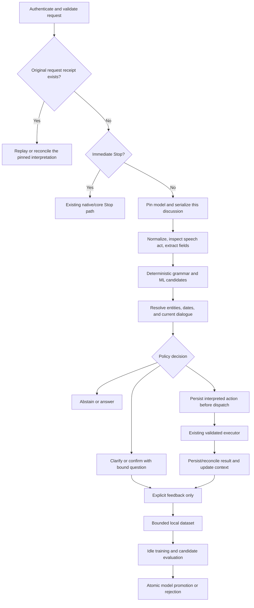

# KST adaptive language understanding — implementation specification

Revision: 3  
Date: 7 November 2026  
Status: Implementation in progress; see KST-ADAPTIVE-IMPLEMENTATION-TASKS.md and KST-ADAPTIVE-RELEASE-REPORT.md for evidence  
Project: Personal Secretary / KST for macOS  
Supersedes: Revisions 1 and 2 of this document

## 1. Authority, scope, and terminology

This document specifies version one of KST's adaptive understanding feature. MUST/MUST NOT are release requirements. SHOULD is an optimization that may be omitted only with a recorded reason. Examples illustrate these requirements; examples do not expand the action registry.

The feature interprets supported secretary, browser, terminal, and provider requests from varied wording, carries a bounded discussion context, and improves from explicit user feedback. It uses no paid inference or training API, downloaded LLM, pretrained embedding download, or additional voice model.

It does not add general knowledge reasoning, arbitrary computer control, external calendar synchronization, messaging, recurring reminder execution, or new terminal privileges. Existing capability validators remain authoritative. Training changes interpretation weights, not executable code or capability policy.

Implementation was authorized after this review. The implementation tracker records progress and release blockers. Nothing in this document authorizes a GitHub push.

### Units and claims

- KiB = 1,024 bytes; MiB = 1,048,576 bytes.
- Personal learning data, model files, code binaries, runtime RAM, and existing secretary records are separate quantities.
- Size and latency numbers below are acceptance limits or targets, not measurements already achieved.
- No claim of human-level comprehension or guaranteed improvement per conversation is permitted.

## 2. Frozen version-one decisions

| Decision | Required implementation |
|---|---|
| Production classifier | Feature-hashed multiclass Passive-Aggressive I, algorithm ID `1`; the exact algorithm is in section 9. |
| Production dimensions | 4,096 features, 32 allocated output rows, 27 enabled labels. |
| Deployment | Int8 matrix, float32 per-class scales, versioned binary artifact. |
| Training | Rebuild float32 weights from the shipped replay corpus and eligible personal examples. No persisted optimizer or float training checkpoint. |
| Native kernel | C++17, loaded in the existing Node core through Node-API version 9. |
| JavaScript role | Shared normalization, extraction, dialogue, policy, execution coordination, and a numerically compatible classifier fallback/reference. |
| Swift role | Existing voice input, TTS, native UI, Stop, and activity reporting. No separate voice-only interpreter. |
| Adaptive evidence | Explicit intent confirmations, corrections, and remembered phrase preferences; no labels inferred from silence or merely successful execution. |
| Learned-action policy | A model-only or personal-template-only mutation requires a bounded interpretation confirmation in v1. Clear deterministic requests retain their current behavior. |
| Learning storage | Separate private SQLite store, compact binary feature records, bounded personal replay buffer. |
| Model authority | One active model pointer in the learning database; immutable files. No second writable manifest. |
| Persistence scope | No raw audio or ambient transcript retention; no accumulating full conversation archive. |
| Default rollout mode | `shadow`; production execution continues through the compatibility path until activation gates pass. |
| Default feedback setting | `learningEnabled=true`, but only explicit user feedback is eligible for personal retention. |

This freezes an implementable baseline, not a claim that PA-I is universally most accurate. Logistic-SGD and quantized fastText are development comparisons under section 23. They MUST NOT be silently substituted, bundled as a model picker, or run alongside the production model. A change of algorithm, dimensions, or runtime requires a recorded design amendment with evaluation results. If the frozen baseline fails release gates, active rollout is blocked; the developer does not guess a replacement.

## 3. Required user experience

Equivalent requests must resolve to the same structured action when their details are equivalent:

- “Schedule a design review tomorrow at three PM for half an hour.”
- “Tomorrow at three PM, block thirty minutes for design review.”
- “Put a design review on my calendar tomorrow at three PM. Give it thirty minutes.”

Follow-up example:

> User: Put a design review on my calendar tomorrow.  
> KST: What time tomorrow?  
> User: Three in the afternoon.  
> KST: How long should it last?  
> User: Half an hour.  
> KST: Scheduled design review for tomorrow at 3 PM for thirty minutes.

The exact final reply is generated from the committed result, not from a model prediction.

Unfamiliar-expression example:

> User: Put renewing my passport on my radar.  
> KST: Should I add a task or set a reminder?  
> User: Add a task.  
> KST: Add the task “Renewing my passport”?  
> User: Yes.

The explicit classification and action confirmation supply a positive personal example when learning is enabled. KST does not need a further “remember” question for each confirmed request. A phrase template needs an explicit “remember that expression” instruction because templates alter extraction, not only classification.

Correction after execution:

> User: No, I meant a reminder.  
> KST: I already added the task. I can set a reminder too. When should I remind you?

Do not automatically delete the original task. Any requested repair is a separate validated operation with its own receipt. Feedback labels and repair execution are separate.

## 4. Current code and required refactoring

| Existing file | Required change |
|---|---|
| `packages/kst-core/src/http.mjs` | Route new conversation requests through one coordinator after authentication/input checks and the immediate Stop path. Preserve the existing response fields. |
| `packages/kst-core/src/workspace.mjs` | Reuse `action()` and its transactions. Add read/query and unique-target lookup methods; expose durable receipt lookup. Do not call `apply()` directly from the new interpreter. Extend `action(requestId, action, preconditions)` with validated expected target revisions checked inside its existing domain transaction; keep action payload schemas unchanged. |
| `packages/kst-core/src/engine.mjs` | Add structured provider proposal/result methods and receipt lookup, preserving approval scope and expiry. Remove dependence on rewriting interpreted requests into regex command strings. |
| `packages/kst-core/src/terminal.mjs` | Expose lookup by deterministic child request ID; continue to run configured recipes only. |
| `packages/kst-core/src/external.mjs` | Reuse provider dispatch and browser launch; expose result reconciliation. Browser launches need coordinator receipts because a crash cannot prove whether Chrome opened. |
| `packages/kst-core/src/server.mjs` | Own initialization, model loading, worker lifecycle, shutdown, and profile lock integration. |
| `apps/macos/Sources/KstApp/main.swift` | Send optional understanding context revision and activity/voice state; display clarifications while keeping Stop independent. |
| `apps/macos/Sources/KstApp/VoiceInput.swift` | Keep final on-device transcripts; add bounded vocabulary hints. Do not train from partial or armed ambient text. |
| `packages/kst-web/app.js` | Send context revisions and expose learning settings/review/feedback. |

Current core version checks use `0.4.1` in both the native app and `/health`. When this feature ships, bump both together to `0.5.0`; the separate macOS bundle build number must increase monotonically from the checkout's current value. Do not change protocol behavior under a version mismatch.

New files belong under `packages/kst-core/src/understanding/`, `packages/kst-core/native/understanding/`, `packages/kst-core/test/understanding/`, and `packages/kst-core/resources/understanding/`. Runtime personal data MUST NOT be created anywhere inside the repository.

## 5. End-to-end request order



In active mode the compatibility parser is a pure parse function: it returns candidate actions and spans without calling `converse`, `apply`, provider transports, or terminal services. Do not execute the old mutable parser and then interpret its result a second time. Off/shadow mode alone retains the old execution route.

A request uses one model version, captured reference time, timezone, context revision, and privacy generation. Retry does not recalculate these values. Once dispatch starts, changing weights or feedback cannot change that operation.

## 6. Stable intent registry

The on-disk ID mapping is fixed. Renaming a JavaScript function must not renumber labels. Rows 27–31 are disabled and excluded from ranking, learning, and calibration. Adding a label requires a registry-version bump and a new seed artifact.

| ID | Label | Structured operation / required fields |
|---|---|---|
| 0 | `other` | Abstain; no executor. |
| 1 | `task.create` | Workspace `task.create`: `title`; optional explicit `dueAt`, `project`. |
| 2 | `task.complete` | Workspace `task.complete`: exact resolved `target` ID. |
| 3 | `tasks.list` | Read/query tasks; optional explicit date scope. |
| 4 | `note.create` | Workspace `note.create`: `title`, `body`. |
| 5 | `notes.list` | Read notes. |
| 6 | `reminder.create` | Workspace `reminder.create`: `title`, future `fireAt`. |
| 7 | `reminder.reschedule` | Workspace `reminder.reschedule`: target ID, future `fireAt`. |
| 8 | `reminder.snooze` | Workspace `reminder.snooze`: target ID, integer `minutes` in 1–1440. |
| 9 | `reminder.cancel` | Workspace `reminder.cancel`: target ID. |
| 10 | `reminders.list` | Read reminders; optional date scope. |
| 11 | `meeting.create` | Workspace `meeting.create`: `title`, future `startAt`, integer `durationMinutes` in 5–480. |
| 12 | `meeting.reschedule` | Workspace `meeting.reschedule`: target ID, future `startAt`, duration. Preserve an existing duration only after resolving the record and disclosing it. |
| 13 | `meeting.cancel` | Workspace `meeting.cancel`: target ID. |
| 14 | `calendar.list` | Read local calendar; optional date interval. |
| 15 | `timeline.list` | Read timeline; optional date interval. |
| 16 | `plan.propose` | Workspace `plan.propose`: optional explicit block `minutes` in 15–120; existing default 30. |
| 17 | `plan.apply` | Workspace `plan.apply`: current proposal `planId`; requires the existing plan confirmation. |
| 18 | `web.search` | Browser handoff: nonempty original query, at most 1,200 characters. |
| 19 | `terminal.runRecipe` | Terminal `runRecipe`: configured `projectId` and `recipeId`. |
| 20 | `terminal.inventory` | Explicit iTerm inventory; existing OS permission handling. |
| 21 | `terminal.cancelJob` | Exact owned `jobId`, or clarify competing active jobs. |
| 22 | `external.request` | Provider proposal: explicit `service` and original `prompt`; existing approval flow follows. |
| 23 | `external.results` | Read verified provider receipts. |
| 24 | `source.read` | Read-only Personal Secretary snapshot: explicit collection, current provenance/limits. |
| 25 | `help` | Static supported-capability explanation. |
| 26 | `status` | Current local core and adapter state. |
| 27–31 | reserved | Disabled. |

Stop, discussion end, clarification replies, feedback, settings changes, and approval decisions are deterministic dialogue controls, not additional ML labels. The model cannot invent a field, a recipe, a provider, or an action kind.

Titles retain the current 500-character limit; note bodies retain the 8,000-character domain limit, while the conversation HTTP input remains at most 4,000 characters. A title-less note derives its title from the first 80 characters of its explicitly captured body, as the current parser does. Do not silently trim oversized fields to make an invalid mutation pass.

## 7. Input, normalization, and extraction contract

### Input limits

Accept only final user speech or typed input submitted through the paired API. Preserve the original string in request processing. Require valid Unicode scalar text, at most 4,000 UTF-16 code units and 16,000 UTF-8 bytes; reject unpaired surrogates and disallowed control characters except tab/newline. The coordinator validates these before native calls.

Original string offsets are half-open UTF-16 offsets, matching JavaScript string indexing. Date/title/entity spans refer to the original string. Normalization maintains an offset map; normalized offsets MUST NOT be applied directly to original text.

### Normalization version 1

1. Identify explicit note bodies, provider prompts, search-query spans, and quoted spans. Preserve their original contents for extraction.
2. For classification only, use NFC normalization, Unicode lowercase, curly-to-straight apostrophe normalization, collapsed whitespace, and removal of terminal sentence punctuation outside protected spans.
3. Preserve negation, modality, question markers, tense evidence, and correction markers. Do not remove them as stop words.
4. Replace confidently extracted personal title/body spans and date/duration spans with fixed typed markers for classification. Grammar proposes these spans without depending on the final ML label. When boundaries compete, retain ambiguity and do not fabricate a training example.
5. Recognize spoken duration numbers in explicit temporal contexts. Never replace number words inside a title or provider prompt globally.

The original executable data, including search queries, comes from original spans, not lowercased feature text.

### Fields

Every extracted field has `value`, `source`, and optional `span`. `source` is one of `explicit`, `context`, `record`, or `default`. Only `explicit` fields carry a span. Non-explicit fields include the referenced entity/request ID and revision or the named default rule.

Missing fields stay absent; do not serialize them as guessed values. Required-field ordering is: intent choice, target identity, title/body/query/prompt, date, time, duration, interpretation confirmation, existing capability approval.

### Clauses and speech acts

V1 executes at most one domain action per utterance. Clauses that supply details for the same action may merge. Multiple independent actions produce a question asking which to do first; no partial action list executes. Apply a final correction clause before dispatch. Contradictory or unresolved clauses abstain or clarify.

A negated, hypothetical, quoted, or reported action cannot authorize a mutation. An explicit note/provider/query capture treats its contents as data. Outside a protected data span, unsupported speech-act combinations ask a question rather than infer an imperative.

## 8. Feature schema version 1

Features are generated once by JavaScript and passed as sparse numeric arrays to both inference implementations. This prevents separate Swift/C++/JS tokenizers from drifting.

1. Tokenize the normalized, masked text with the shared Unicode letter/number/apostrophe tokenizer; typed markers are single tokens. Keep at most the first 64 tokens. If truncation would discard an action or correction clause, abstain instead of executing from a prefix.
2. Emit `w:` word unigrams in order, `b:` adjacent word bigrams in order, and `c:` character trigrams from the first twelve Unicode scalar characters of each non-marker token. Do not emit characters from masked personal spans.
3. Emit bounded context flags from the pinned dialogue: pending field, last entity type, explicit negation, question, and correction. Context flags never include raw entity titles.
4. Hash UTF-8 feature bytes using unsigned FNV-1a 32-bit, offset `2166136261`, multiply `16777619` after each XOR modulo 2^32 (`Math.imul` followed by unsigned conversion in JavaScript, uint32 arithmetic in C++). Feature index is `1 + (hash % 4095)`; sign is +1 when bit 31 is zero, otherwise -1. Index 0 is reserved for bias.
5. For each index record its earliest occurrence ranked by namespace priority (context, unigram, bigram, trigram), then emission order within that namespace. Sum signed counts from all emitted features mapping to that index; clamp the final count to [-3,3] and remove zero counts. Rank the remaining unique indices by their recorded earliest occurrence and retain the first 127. Sort retained indices numerically and add bias index 0 with value 1. Do not refill a cancelled collision from discarded features.
6. L2-normalize the complete retained vector, including bias; round stored normalized values to float32. Runtime vector length is at most 128 and indices are unique ascending integers in [0,4095].

The normalized text used to form a masked-template fingerprint is distinct from the final sparse vector: do not derive a human-readable template from a feature hash.

Training examples store pre-normalization sparse counts; replay applies this exact normalization. The record codec stores a version byte, uint16 count, ascending delta-encoded unsigned LEB128 feature IDs, and signed int8 counts including bias. Maximum encoded feature blob is 512 bytes. Reject duplicate/out-of-order indices, overlong varints, non-canonical encodings, missing bias, or values outside the range. No text vocabulary is needed at inference.

Namespace priority, emission order, hash, and collision behavior have cross-language golden vectors. Any change bumps `featureSchemaVersion` and invalidates incompatible personal artifacts.

## 9. Classifier and trainer specification

### Inference

Allocate 32 class-major rows with 4,096 columns. Enable IDs 0–26 only. For class c, compute `score[c] = scale[c] * sum(q[c,j] * x[j])` over sparse input entries, with float32 arithmetic in stable ascending-index order. Disabled rows are never selected. Rank descending score, breaking exact ties by ascending label ID. If the top class is `other`, the ML candidate abstains; an exact compatibility command may still proceed through its independent deterministic path.

Return the top three enabled classes and their raw scores, plus `margin = topScore - secondScore`. These are not probability estimates. The decision policy consumes scores only with artifact thresholds and grammar/extraction evidence.

### PA-I training

Start every candidate from an all-zero float32 matrix. Use the complete immutable training snapshot: shipped train partition plus eligible personal train examples. Training never consumes a held-out or promotion-gate label.

- Eight epochs; shuffle once per epoch with PCG-XSH-RR 32, initial 64-bit state exactly 42 and odd increment exactly 55, without a separate library seeding routine.
- Let y be the label and r the highest-scoring enabled class other than y; ties resolve by ascending ID.
- `loss = max(0, 1 - (score[y] - score[r]))`.
- `tau = min(0.1 * exampleWeight, loss / (2 * squaredL2Norm(x)))`.
- If loss > 0, update `W[y] += tau*x`, `W[r] -= tau*x`. No momentum, Adam state, or hidden averaging state.
- Seed weight = 1. Explicit personal feedback weight = 2. Duplicate events do not increase weight. At each epoch personal examples are capped at 25% of sample presentations; deterministically subsample personal examples if needed, cycling the omitted examples across later epochs.
- Compute every arithmetic update in float32; reject non-finite weights.
- The trainer receives a ten-second elapsed-time deadline from a monotonic clock and a cancellation flag, checked between samples. Exceeding either discards the whole candidate.

PCG step: save `old=state`; set `state=(old*6364136223846793005+55) mod 2^64`; set `v=uint32(((old>>18)^old)>>27)` and `r=old>>59`; output the uint32 rotate-right of v by r. JavaScript uses BigInt for the 64-bit state. Fisher–Yates shuffles from the final index down to 1. For bound b, draw until the uint32 output is at least `(2^32-b) % b`, then use output modulo b; this avoids modulo bias. Include golden output and shuffle sequences in tests.

For each epoch keep all shipped seed-train records. Sort personal train examples by their 16-byte IDs; select at most `floor(seedTrainCount/3)` from this list, rotating the start by `epochIndex*selectionLimit mod personalCount` when necessary. Concatenate seed and selected personal records, then shuffle with the continuing generator state. Personal samples are never silently duplicated to fill a batch.

### Quantization

For each enabled class use `scale=max(abs(W[c]))/127`; use scale 1 for an all-zero row. Quantize `W/scale` by nearest integer with halves away from zero, clamp to [-127,127], and store int8. Disabled rows contain zeros with scale 1. Evaluate the exported artifact, not only float training weights. Quantization regressions block promotion.

The seed corpus and candidate seed-training result are reproducible within documented float32 tolerance on the supported arm64 build. Cross-platform bit identity is not assumed.

## 10. Native module and build contract

Production target: macOS 14+, arm64, installed Node 22.23+ using Node-API 9. Initial deployment is arm64 only. Add x86_64 support in a later explicit packaging change. Build C++17 with optimization `-O3`, no fast-math, and floating-point contraction disabled. Catch C++ exceptions before the Node boundary. No Python, GPU stack, native package manager, or per-request child process is required.

Expose only:

- `loadModel(bytes: Buffer) -> immutable handle`: full artifact validation; copy or retain immutable owned bytes with documented lifetime.
- `predict(handle, indices: Uint16Array, values: Float32Array) -> Float32Array(27)`: validate equal lengths, limits, unique indices, and finite values. Require indices length in 1–128, bias index 0, values in [-1,1], and squared L2 norm within 1e-4 of 1. Reject non-finite output scores. No file access or training side effects.
- `train(datasetBuffers, options, cancelFlag) -> candidateBytes + bounded metrics`: callable only from the training worker. Options are validated fixed-schema values; arbitrary file paths, code, and shell arguments are prohibited.
- `dispose(handle)`: release owned buffers after the last pinned request releases its reference.

The JavaScript reference uses `Math.fround` for each multiplication/addition and the same order. Scores must agree within absolute tolerance 1e-4; interpretation at a threshold within that tolerance asks for clarification, avoiding boundary-dependent execution.

Native training runs inside a dedicated Node worker thread, created only when training starts. Pure JS evaluation/extraction code may also run in this worker on bounded synthetic fixtures, with fake records supplied in memory. The main thread sets a shared atomic cancellation flag, which the native loop checks between samples. Do not rely on worker messages being delivered while a synchronous native function is running. Never block the main event loop with training.

A native crash can terminate the core even from a worker thread. Keep the existing core supervision and owner-lock recovery rules. Write a bounded native-session sentinel after profile ownership is established; remove it on clean shutdown. After an unclean native-enabled run, the next legally recovered core startup conservatively disables the addon and uses the JS reference until the user re-enables native inference. This does not authorize automatic removal of a stale owner lock.

The addon binary is packaged and signed alongside the app's other resources. Its code size is measured separately from model/data storage. Loading failure selects the JS implementation of the same artifact, reports `runtime=js-fallback`, and does not trigger a model download.

## 11. Grammar, confidence, and action decisions

Deterministic grammar and classifier candidates are distinct evidence sources. An established complete command or reviewed built-in grammar may execute through existing policy. A model-only interpretation does not become deterministic simply because its score is high. Personal phrase templates always retain `personal-template` provenance.

### Decision table

| Evidence and state | Decision |
|---|---|
| Explicit Stop | Immediate existing Stop path, independent of inference. |
| Exact control reply bound to a current question/revision | Apply that question's transition only. |
| Exact compatibility grammar identifies one complete valid action | Execute under existing capability policy after speech-act/negation checks; an uncertain classifier does not break a known command. |
| Expanded built-in grammar identifies one complete valid action and its label agrees with ML top label | Execute under existing capability policy. |
| Expanded grammar and ML disagree, or expanded grammar yields competing candidates | Clarify; no unspecified “strong disagreement” threshold. |
| Classifier/personal template identifies a mutation | Assemble fields, then ask a concise interpretation confirmation. |
| Classifier identifies a read above calibrated score and margin floors, with explicit scope | Execute the read. |
| Model identifies web search above floors, with an explicit search verb and query | Open Chrome Incognito directly; no new web approval. |
| Web intent/query uncertain | Ask what to search; this is clarification, not an approval gate. |
| Terminal execution or provider request selected through ML | Confirm the specific interpretation, then preserve existing recipe/approval rules. |
| Missing fields or competing records | Ask the next focused question. |
| `other`, absent calibrated thresholds, negated action, or insufficient evidence | Abstain or clarify; no model-based automatic execution. |

### Calibration procedure

For each read/web class evaluate `(topScoreFloor, marginFloor)` pairs on the development calibration partition. Use observed score/margin values rounded upward to 0.01 as the finite candidate grid. Retain pairs with at least ten accepted positives for that class and at least 98% accepted-intent precision. Across enabled automatic read/web classes require at least 100 accepted calibration cases. Choose maximum correct coverage; ties prefer larger margin floor, then larger score floor. If these conditions cannot be met, store `automaticEnabled=false` for that class.

These are empirical sample gates, not a statistical guarantee. Validate independently on the release test set. Mutations inferred by ML still require interpretation confirmation regardless of calibration. No classifier probability threshold can replace provider approval or plan confirmation.

The automatic-policy allowlist is IDs 3, 5, 10, 14, 15, 18, 23, 24, 25, and 26. A classifier-selected iTerm inventory request requires interpretation confirmation because it reads another app; an explicit deterministic inventory command keeps current behavior. All other model-selected action IDs have automatic policy disabled.

Personal candidate training does not re-fit calibration on personal train examples. Preserve seed-policy floors and require candidate gate performance to satisfy section 23; failed classes are disabled for automatic reads rather than lowered thresholds.

## 12. Date, time, and entity rules

Use the existing `chrono-node` dependency via one adapter. Before implementing the adapter, resolve the installed/locked root package version, pin that exact supported version in the lockfile, and record it in the adapter's release manifest. This dependency audit is task U02; no implicit upgrade to whatever version is latest is permitted.

Classification language is English in v1; preserve non-English names and title text as data, but clarify unsupported language rather than claiming multilingual intent understanding.

Capture `referenceInstant` at first acceptance and the core's current IANA timezone from `Intl.DateTimeFormat`. V1 uses the core's timezone; it does not add a second timezone setting. A timezone change invalidates pending local-time actions. Explicit ISO offsets are supported. Named foreign timezones outside explicit ISO input ask the user for a supported explicit time; do not guess abbreviations.

- Missing AM/PM on a 1–12 hour asks for clarification unless the same request explicitly states morning/afternoon/evening or unambiguous 24-hour time.
- “Tomorrow afternoon” supplies a date and period, not an exact start time.
- A weekday without “next” means the nearest future occurrence in the captured timezone; if today is that weekday and no time is supplied, ask whether today or the following week.
- “Next Friday” asks which calendar date in v1; do not choose a regional convention silently.
- “Half an hour” = 30 minutes; “a quarter of an hour” = 15 minutes. “Quarter past three” still needs AM/PM.
- “Move back fifteen minutes” asks earlier or later. “Fifteen minutes later” is unambiguous after the target is resolved.
- Repeated or nonexistent DST local times ask for an explicit offset. A future check occurs again at dispatch.
- A date alone cannot complete a timed reminder or meeting.
- Date-scoped reads use half-open intervals [local midnight, next local midnight), allowing 23/25-hour DST days. Calendar reads include events overlapping that interval; reminder reads use effective snooze/fire time; task reads filter explicit due time. Undated tasks are listed separately, never described as having a due date. “What is on my plate today?” asks tasks versus calendar when context does not identify a collection.

Entity queries use exact ID first, then a unique case-insensitive normalized title within the correct entity type. Do not use the dashboard's bounded snapshot as a complete index. Add a database lookup that detects truncation and competing records.

For suggestions only, use token Jaccard overlap over normalized titles plus normalized Levenshtein similarity, weighted 0.5 each. Fetch candidates in the correct type ordered by updated timestamp descending, then ID ascending, with LIMIT 501; a 501st row proves truncation, so ask for more detail rather than scoring an incomplete candidate universe. Present at most three candidates scoring at least 0.6. A fuzzy suggestion always needs selection before mutation; its similarity never authorizes a write. Only returned exact IDs reach `Workspace.action`. For date-scoped entity searches apply the date constraint in SQL before the 501-row limit.

References such as “it” resolve only to one recent entity of the required type in this discussion. Revision mismatch requires re-reading and explicit reconfirmation; a deleted target clears the reference. Context can preserve a resolved meeting's duration, but cannot invent missing details for a new meeting.

## 13. Dialogue state machine and concurrency

Each discussion has one of: `IDLE`, `NEEDS_INTENT`, `NEEDS_FIELD`, `NEEDS_ENTITY`, `NEEDS_CONFIRMATION`, `DISPATCHING`, or `RESULT`. A provider approval remains owned by the existing external approval ledger, not a generic dialogue yes/no state.

Store in bounded RAM: conversation ID/generation, context revision, pending interpretation ID/digest, missing field, question ID, at most three entity choices, last result ID/type/revision, masked feedback candidate, model version, privacy generation, and expiry. Full canonical action fields stay in the operational envelope and are loaded transiently when needed; a long note body is not duplicated in every dialogue context. At most eight discussions, 2 KiB serialized content each, 16 KiB content total. This is a content limit; object/runtime overhead is measured separately. On capacity, evict the least-recently-used `IDLE`/`RESULT` context; if all are pending, reject creating another with `DISCUSSION_CAPACITY`. Never evict a dispatching action.

- Incomplete action and its question expire after 120 seconds of user inactivity.
- Last-result references expire 300 seconds after the last explicit mention.
- Every state transition increments `contextRevision`.
- Stop/end invalidates the generation and pending question. Stop affects managed jobs according to the existing Stop contract.
- Same-discussion requests run in arrival order. Different discussions may interpret concurrently, but mutations still use existing database/resource locks.
- If a second request arrives while that discussion is dispatching, return `DISCUSSION_BUSY`; do not execute it out of order.
- A compatible follow-up fills the pending field. A new explicit action cancels the incomplete action and starts a new one. An unrelated statement asks whether to continue; it is not stored as a title.
- A correction before dispatch replaces the pending fields/intent and invalidates an earlier confirmation. A correction after dispatch references the result and offers a separate repair.

A generic “yes,” “no,” number selection, or “make it thirty minutes” is accepted only against a live, matching question/context revision. It cannot confirm an external request. Explicit “approve external request” continues to use that ledger's exact target/revision rules. Context is not restored after a core restart; persisted action receipts remain available.

## 14. Conversation and learning API contracts

Existing bearer authentication, loopback Host/Origin validation, body-size limits, and request-ID rules apply to every new endpoint. Developer-only configuration values do not become writable HTTP settings. Unknown fields are rejected.

### Conversation

`POST /api/conversation` retains `requestId`, `text`, and optional `conversationId`. Add optional `contextRevision` (nonnegative safe integer) and `source` (`voice` or `typed`; informational only). The server creates a UUID discussion ID when absent. The clients must return the last server revision in follow-up requests.

Response retains `reply` and `conversationId` and may add:

```json
{
  "understanding": {
    "schemaVersion": 1,
    "requestId": "request-12345678",
    "interpretationId": "server-uuid",
    "intent": "meeting.create",
    "decision": "clarify",
    "modelVersion": 7,
    "runtime": "native",
    "contextRevision": 4,
    "question": {"id": "question-uuid", "kind": "field", "field": "startAt"}
  }
}
```

`decision` is exactly `execute`, `read`, `clarify`, `confirm`, `abstain`, or `control`. Do not expose private weights, full training examples, or raw confidence as user-facing certainty.

Older clients may omit the revision for full explicit requests. Their unbound generic yes/no replies must ask them to repeat the explicit action rather than authorize a new adaptive confirmation. Existing exact legacy plan/provider confirmation controls remain backward compatible through their own ledgers.

If a supplied revision is stale, return 409 `CONTEXT_CHANGED`, current revision, and a short instruction to restate the request. Do not consume the supplied answer or silently overwrite pending state.

### In-flight requests and client error behavior

Reserve original request IDs using a unique operational-ledger insert before asynchronous work and keep an in-flight promise map. An identical duplicate attaches to the existing result when possible; if it cannot finish within the request deadline, return 202 with the same request/interpretation IDs and a receipt reference. Add authenticated GET `/api/understanding/requests/:requestId`: 200 returns the stored state and final response when available; 404 means no such accepted request. Pending polling never resubmits an operation. Clients poll every one second while a visible request remains pending, stop after thirty seconds or on discussion Stop, and retain the original request ID for later review.

Update both clients for protocol 0.5.0: 200 follows normal turn-taking; 202 shows pending and polls; known 409 context/conflict errors show the precise question/result and keep ordinary voice recovery available. A pairing failure pauses voice and asks to reconnect. Network failure, unexplained 5xx, or `UNKNOWN` retains the pending request/receipt for review and never automatically sends the same utterance under a new ID. Do not label every expected clarification/conflict as “core rejected this request.” The native Stop button remains usable during polling and transport failure.

### Learning endpoints

| Method/path | Body / result |
|---|---|
| GET `/api/understanding/status` | Mode, runtime, active version, privacy generation, learning enabled, training state, bounded counters, exact byte accounting. |
| GET `/api/understanding/preview?targetRequestId=ID&contextRevision=N` | Returns a live confirmed expression template preview. Marks only ephemeral preview visibility; no learning write. A later explicit remember request must reference that same live target/revision. |
| GET `/api/understanding/preferences?after=ID&limit=N` | User-approved readable preferences only; limit 1–10, default 10. No complete transcript history. |
| PATCH `/api/understanding/settings` | `{requestId, expectedRevision, learningEnabled?, promotionPaused?}`; require at least one setting; stale revision -> 409. |
| POST `/api/understanding/feedback` | `{requestId, targetRequestId, contextRevision, decision, correctedIntent?}`; decision is `confirm-intent` or `correct-intent`. Validate label and exact target. |
| POST `/api/understanding/remember` | `{requestId, targetRequestId, contextRevision}`; requires resolved user-confirmed example and editable template preview. |
| POST `/api/understanding/forget` | `{requestId, preferenceId}`; applies the privacy barrier in section 20. |
| PATCH `/api/understanding/runtime-state` | `{clientInstanceId, sequence, voiceState, ttsActive, idleSeconds, lowPowerMode, thermalState}`; ephemeral native activity heartbeat as specified below. |
| POST `/api/understanding/train` | `{requestId}`; queue a training request; does not bypass idle/safety/rate/space gates. |
| POST `/api/understanding/rollback` | `{requestId, expectedModelVersion}`; eligible previous version only; pauses automatic promotion. |
| POST `/api/understanding/reset/prepare` | `{requestId}` -> expiring reset token bound to current learning revision. |
| POST `/api/understanding/reset/confirm` | `{requestId, resetToken}`; one-use token expires in 60 seconds; reset learning only. |

The runtime-state endpoint uses no durable per-heartbeat receipt: retain one reporter UUID and sequence in RAM. Sequence is a monotonically increasing safe integer for that native app instance; ignore older/equal sequences with `{accepted:false}`. Require voiceState `off|armed|discussion|speaking`, boolean TTS/low-power fields, finite idleSeconds in [0,86400], and thermalState `nominal|fair|serious|critical`. Freshness uses server receipt time, not a client clock. The native singleton sends every ten seconds and on transitions; a wake/discussion transition raises the core cancellation flag on receipt without making audio capture wait for a network reply. A new authenticated reporter UUID replaces a stale reporter; a competing fresh reporter pauses training and reports a state conflict. Heartbeats cannot alter executor permissions.

Feedback references a recent request the server can resolve from this profile and a masked feedback candidate still present in the live discussion; missing/expired candidate -> 410 `FEEDBACK_EXPIRED`. The feedback endpoint records evidence only and never dispatches an action; never accept a client-supplied arbitrary training string/action as confirmed evidence. The UI uses the same endpoints as voice control. Exact voice aliases include “what have you learned,” “pause learning,” “resume learning,” “that interpretation was wrong,” “remember that expression,” and “forget that expression.” Ambiguous feedback targets ask which item; they do not guess.

Settings `mode` changes and native-runtime recovery re-enable are developer/local configuration operations in v1, not inferred voice commands. UI learning enable/disable does not activate a shadow model. “Resume learning” sets learningEnabled only; after rollback, explicit “resume model updates” or the corresponding dashboard control clears promotionPaused. Reset preparation/confirmation first checks the original request receipt: replay returns the old result before token expiry checks; a new request ID cannot reuse an already consumed token to reset later data.

## 15. Coordinator receipts and crash recovery

Add an interpretation ledger to the existing private operational `kst.sqlite`, not the shared secretary source or the compact learning store. Its growth is reported separately from learning memory; it must not be advertised as part of the 64 KiB personal-example limit.

For each original request persist: original request ID, SHA-256 payload hash, resolved discussion ID, captured time/timezone, context revision/generation, interpretation/action schema version, model version, privacy generation, canonical action, action digest, deterministic child request ID, state, and final response/receipt reference.

Payload hashing prefixes the endpoint path and a newline, then uses stable JSON over the original accepted fields (`text`, client-supplied conversationId or null, contextRevision or null, source or null), not normalized text. A duplicate ID with a different payload returns 409. Stable JSON recursively sorts object keys, preserves array order and original string contents, and rejects undefined/non-finite values. Retry first checks the ledger before context expiry, model inference, or timezone lookup. Every mutating understanding endpoint uses this same receipt mechanism with its own exact body schema; IDs are unique across these endpoint paths.

Child request ID is `u1-` plus the 64 lowercase hex characters of SHA-256(original request ID). It is stable, fits current ID constraints, and is reused for executor admission. Do not generate a new child ID on retry.

Operational schema uses `understanding_requests` with request ID as its unique primary key, a 32-byte payload digest, versioned canonical envelope, deterministic child ID, state, and stored response/receipt reference. Validate both envelope and response schemas on read; corrupted coordinator state cannot authorize re-dispatch. `understanding_privacy` is a singleton with generation and pending privacy-operation reference; privacy-operation receipts use the same globally unique request IDs. These tables are additive in private `kst.sqlite`, never created in an imported secretary source.

States: `PREPARED`, `DISPATCHING`, `SUCCEEDED`, `FAILED`, `UNKNOWN`, `SUPERSEDED`. Persist `PREPARED` and canonical interpretation before any side effect, then `DISPATCHING` before adapter admission. For managed jobs, `SUCCEEDED` here means durable job admission/result response, not that the asynchronous workload has finished; its real outcome remains in the job ledger. Store a complete response for non-side-effect clarification/read/control requests as well. A duplicate returns its original response, not the latest dialogue state.

Cross-database writes are not one atomic transaction. Recovery uses executor receipts:

| Operation | Reconciliation after an interrupted dispatch |
|---|---|
| Workspace mutation | Look up child request receipt in the same database transaction ledger as its domain effect. Found -> reconcile result. Missing after ownership/running-state verification -> eligible for the same idempotent action, revalidating privacy generation and target revision. |
| Managed terminal/provider job | Look up original admitted child receipt; preserve its actual running/failed/unknown state. Never start a second job with a new ID. |
| Browser open | Mark `UNKNOWN` if launch completion was not durably recorded; never reopen automatically. Offer an explicit new user request. |
| Provider proposal/approval | Reconcile its existing proposal/decision ledger; no approval by generic dialogue state. |

Do not claim exactly-once external effects across crashes. For an uncertain outcome return a reviewable receipt and do not retry the browser/provider launch. Scope target revision checks inside the workspace mutation transaction; merely checking a snapshot before dispatch is insufficient.

## 16. Personal feedback and replay-buffer policy

Learning enabled means KST automatically retains eligible explicit feedback; the user does not need a second consent prompt for every correction. Turning learning off prevents new example/preference collection and training. It does not disable the selected seed/personal model; reset does that.

Eligible evidence:

1. An explicit selection between candidate intents, followed by confirmation of the complete interpretation.
2. An explicit correction of a specific intent, with the corrected complete interpretation confirmed.
3. An explicit “remember that expression” after a resolved request.

No automatic weak labels from canonical command success in v1. No labels from partial speech, ambient text, silence, absence of complaint, provider output, note contents, terminal output, or KST's own prediction. Field-only corrections update dialogue/extraction feedback but do not pretend to train a new intent label. Neural field learning is out of scope.

Each feedback event is bound to original request ID, context generation/revision, and interpretation digest. Only one current label per example fingerprint is eligible. A contradictory explicit correction replaces the prior label, invalidates models containing it, and queues a rebuild. Repeated identical feedback does not increase its weight.

Unpinned examples expire after 90 days. Explicitly remembered preferences pin their backing examples until forgotten; this exemption is bounded by the same example, preference and byte limits. Limits: at most 256 examples, at most 32 readable preferences, and at most 64 KiB combined logical encoded payload. Byte limit wins over row counts. Each example feature blob <=512 bytes; each readable template <=160 UTF-8 bytes plus <=256 bytes of encoded slot metadata. Metadata must not contain copies of complete task records.

Fingerprint is SHA-256(feature schema ID, normalized masked template, intent-independent context flags), stored as the first 16 bytes plus collision checking against the encoded example. Hashing is not anonymization; sensitive contents must be masked before hashing. If a collision occurs with different encoded content, reject retention and report a bounded diagnostic, rather than merge labels.

Eviction order: expired items, exact duplicates, then the oldest non-pinned example from the most represented intent. User-approved readable preferences are pinned until forgotten unless all pinned items fill the byte budget; in that case pause new collection and ask the user to forget an expression. Never silently expand the budget.

For train/personal-gate partitioning, use the first byte of SHA-256(group fingerprint) modulo 5: value 0 is personal gate, values 1–4 are train. Related templates and date/title substitutions share a group. No sample moves between partitions to make a candidate pass. With fewer than five gate groups for an intent, newly learned expressions for that intent remain provisional; mutation confirmation is still mandatory in all cases.

### Personal extraction templates

Templates are declarative, not regex or executable code supplied by the user. V1 supports one variable slot (`title`, `query`, or `prompt`) with bounded literal prefix/suffix tokens and an explicit label. The server derives a template only from an unambiguous original span and shows its preview before remembering it. Matching is anchored to the entire normalized command, requires a nonempty slot, and still applies negation/speech-act checks. Multiple-slot or conflicting templates ask for clarification and are not stored. Templates cannot encode approval, Stop, settings changes, arbitrary recipe arguments, IDs, or shell commands.

## 17. Training scheduler and promotion gates

Training is queued after ten new eligible train examples since the last completed attempt or a manual train request. Coalesce requests. At most one attempt per 30 minutes, including manual requests. Failed attempts use the same cooldown; do not run a retry loop. Record attempted dataset revisions, and do not automatically retry the same revision after failure. New eligible feedback or an explicit manual request is required for another attempt.

Idle eligibility requires: no active discussion capture, no TTS, no current conversation request, no owned running terminal/provider job, system idle for at least 60 seconds, no low-power mode, and thermal state nominal/fair (serious/critical both defer training). Passive armed wake listening is permitted: its wake event cancels training immediately before discussion capture starts. Otherwise an always-armed assistant would never train. The native app reports these states with a 30-second freshness window. Missing/stale activity prevents background training. Manual requests may waive system-idle time only; they cannot waive active audio, jobs, thermal, space, or cooldown gates.

At eligibility create an immutable dataset snapshot with dataset revision, privacy generation, corpus hashes, trainer version, seed, and exact sample partition. The worker receives encoded example features and packaged synthetic gate fixtures only, not personal raw transcripts, database handles, API tokens, filesystem paths, or executor access. Full-text critical fixture evaluation uses the pure extraction/policy modules with in-memory fake records; it cannot call real adapters. Training deadline is ten seconds from worker entry. Main-thread cancellation is raised immediately on new voice capture/TTS, new work, privacy change, or shutdown; check it between samples. Discard incomplete candidate and free its buffers.

Evaluate the int8 candidate against:

- Packaged independent gate partition: at least ten cases per enabled action label and 64 `other` cases.
- Packaged critical suite: at least 192 negation, reported-speech, quoted-content, unsupported-action, reference-boundary, and adversarial-title cases, including their policy/extraction expectations.
- Personal gate groups, when present; never include them in training.

Promotion requires zero new critical unintended actions, no per-class gate intent accuracy below the seed model, and total gate intent accuracy not below the active model. Personal-gate accuracy must not decline when at least five distinct groups exist. A candidate that changes no classification behavior and improves no personal gate case is recorded as `NO_CHANGE` and is not promoted. Disable automatic read classes that fail their preserved calibration policy; never lower floors to gain coverage.

Packaged gate sets are repeatedly used deployment checks, not a substitute for the independently authored release test set. Do not describe repeated local promotion scores as unbiased future accuracy estimates.

## 18. Binary model and compact database contracts

### Artifact format version 1

Little-endian, fixed size 132,224 bytes, maximum permitted artifact allocation 144 KiB. All offsets are absolute byte offsets; parse integers explicitly rather than casting an untrusted struct pointer.

| Offset | Bytes | Field |
|---|---:|---|
| 0 | 8 | Magic: ASCII `KSTNLU3` followed by NUL. |
| 8 | 2 | Format version = 1. |
| 10 | 2 | Algorithm ID = 1. |
| 12 | 2 | Allocated classes = 32. |
| 14 | 2 | Enabled classes = 27. |
| 16 | 4 | Feature dimensions = 4096. |
| 20 | 4 | Feature schema = 1. |
| 24 | 4 | Registry version = 1. |
| 28 | 4 | Payload bytes = 131712. |
| 32 | 8 | Model version, unsigned monotonic integer. |
| 40 | 8 | Dataset revision. |
| 48 | 8 | Privacy generation. |
| 56 | 32 | SHA-256 of payload bytes [512,132224). |
| 88 | 32 | SHA-256 of ordered label registry. |
| 120 | 32 | SHA-256 of packaged replay corpus. |
| 152 | 4 | Header CRC32/ISO-HDLC; compute over bytes [0,512) with this field zeroed. |
| 156 | 356 | Reserved, must be zero. |
| 512 | 128 | 32 float32 per-class scales, each finite and in (0,1000000]. |
| 640 | 131072 | Int8 class-major matrix, 32 x 4096. |
| 131712 | 512 | 32 policy records, sixteen bytes each. |

Policy record: float32 score floor at +0, float32 margin floor at +4, uint8 automatic-read-enabled at +8, uint8 reserved at +9, six reserved zero bytes at +10. Disabled policies use finite zero floors and flag 0. Disabled class rows are all zero with scale 1 and policy disabled. Reject all reserved nonzero values, unsupported dimensions/versions, bad hashes, int8 weight -128, non-finite values, and file-length mismatch before allocating a model handle. All uint64 counters must also fit JavaScript safe-integer range (0 through 2^53-1); refuse promotion on counter exhaustion. Seed model version/dataset/privacy counters are zero; a packaged seed is valid in any privacy generation. Personal versions are positive and must match the current authoritative privacy generation. Registry digest input is UTF-8 JSON of the ordered 32-label array, with null for reserved entries and no whitespace.

Replay corpus `seed-replay.bin` is capped at 128 KiB on disk, using a fixed 64-byte header and raw-DEFLATE payload. Decoded payload is at most 1 MiB. Use Node's built-in zlib with an enforced output limit; reject truncated streams, trailing data, unknown codec IDs, excessive counts, and checksum mismatch.

Header layout: magic eight bytes ASCII `KSTRPL1` plus NUL at 0; uint16 format=1 at 8; uint16 codec=1 at 10; uint32 record count <=4096 at 12; uint32 compressed bytes at 16; uint32 decoded bytes <=1048576 at 20; SHA-256 of decoded payload at 24 (32 bytes); eight reserved zero bytes at 56. File length must be 64 + compressed bytes.

Each decoded record is prefixed by uint16 body byte length, followed by uint8 partition (0=train, 1=gate, 2=critical), uint8 label, uint16 expected guard bitmask, sixteen-byte group ID, uint16 feature blob length, feature blob, uint16 extra length, and extra bytes. Body length must match exactly and be <=2048. Feature codec is section 8. Extra is empty for train records; gate/critical extra is bounded UTF-8 stable JSON containing only `utterance`, `context`, and `expected`. Utterance is synthetic text <=256 UTF-8 bytes; context has fixed fake IDs, revisions, reference time/timezone, and bounded fields; expected contains registered intents, typed field assertions, and `mustNotDispatch` flags. An allowlist schema validates extra before use. Guard bit 0=negated, 1=quoted, 2=reported, 3=ambiguous, 4=unsupported, 5=requires-confirmation; remaining bits zero.

Critical records exercise pure extraction and policy using their synthetic originals and in-memory fake records; hashed features alone cannot test those behaviors. The feature vector generated from any included original must match the record's encoded vector. The packaged corpus must satisfy section 17 minimum gates and forty seed train cases per action label plus eighty `other` train cases. If required cases cannot fit, release is blocked pending an explicit budget/representation amendment; do not silently reduce coverage.

Personal template codec is stable UTF-8 JSON with exactly `v=1`, `prefix` token array, `suffix` token array, `slot` (`title|query|prompt`), and `intent` (registry integer). Combined literal prefix/suffix text <=160 UTF-8 bytes, complete encoded template <=416 bytes. Arrays contain literal tokens or fixed date/duration marker tokens already recognized by the built-in extractor. They contain no regex, executable expression, arbitrary URI, or new field type. Do not store a specific user's date as a permanent literal when its span should be a temporal marker. Full original development utterances and extraction assertions live in development fixtures; final release test cases never enter the shipped replay corpus.

### Learning SQLite schema

Use exactly three `WITHOUT ROWID` tables with no secondary indexes in v1:

```sql
CREATE TABLE examples (
  id BLOB PRIMARY KEY CHECK(length(id)=16),
  label INTEGER NOT NULL CHECK(label BETWEEN 0 AND 26),
  role INTEGER NOT NULL CHECK(role IN (0,1)),
  group_id BLOB NOT NULL CHECK(length(group_id)=16),
  created_s INTEGER NOT NULL,
  features BLOB NOT NULL CHECK(length(features)<=512)
) WITHOUT ROWID;
CREATE TABLE preferences (
  id BLOB PRIMARY KEY CHECK(length(id)=16),
  example_id BLOB NOT NULL,
  label INTEGER NOT NULL CHECK(label BETWEEN 0 AND 26),
  created_s INTEGER NOT NULL,
  template BLOB NOT NULL CHECK(length(template)<=416)
) WITHOUT ROWID;
CREATE TABLE control (
  key TEXT PRIMARY KEY CHECK(length(key)<=32),
  value BLOB NOT NULL CHECK(length(value)<=4096)
) WITHOUT ROWID;
```

Application validation enforces UTF-8 template limits, encoded structure, row counts, and aggregate bytes before a transaction. `role=0` is train; `role=1` is gate. Control keys are an allowlist in code: settings, active, previous, dataset-revision, privacy-generation, training, promotion-paused, metrics, native-session. Total control payload <=16 KiB. No arbitrary log keys. Resolve dangling preference/example links as corruption and fall back to seed interpretation while preserving files for review.

Set 4,096-byte page size on a new learning database before table creation, `max_page_count=32`, `journal_mode=DELETE`, `synchronous=FULL`, and `secure_delete=ON`. Use short single-writer transactions under the existing core ownership lock. Do not change the journal settings of existing app databases. Failure to create this schema within its budget disables learning and preserves canonical command operation.

## 19. Storage admission, ownership, and atomic promotion

Paths:

```text
Packaged immutable resources:
  resources/understanding/seed-v1.bin
  resources/understanding/seed-replay.bin
Private profile:
  understanding/learning.sqlite
  understanding/models/<version>.bin
```

All new profile directories require owner UID, mode 0700, and no symlink ancestors within the profile. New data/model files require regular owned files, mode 0600, and no symlink or hard-link substitution. Reject unsafe storage and use seed/compatibility operation. Construct model filenames from validated safe-integer versions; never accept a path from a model, preference, or client. Cleanup removes only validated unreferenced version files and owned candidate names inside this directory, never unrelated files or backups.

No JSON weight arrays, raw conversation log, permanent float checkpoints, vector database, or unbounded training log is permitted. Model metrics are fixed counters and at most eight summarized promotion outcomes in the bounded control record. Feedback and request idempotency receipts remain in the existing operational ledger; they are counted separately from learning data.

| Budget | Required limit |
|---|---:|
| Examples and readable-preference logical payload | 64 KiB combined, plus explicit row caps. |
| Learning SQLite main file | 128 KiB, including control/schema/free pages. |
| One inference artifact | Exactly 132,224 bytes; parser allocation ceiling 144 KiB. |
| Seed + active personal + previous personal artifacts | <=432 KiB allowance combined; seed not duplicated in the profile. |
| Packaged replay corpus | <=128 KiB. |
| Auxiliary steady-state metadata outside SQLite | None; no duplicate active manifest. |
| Complete steady-state learning data/resources | <=768 KiB. |
| Temporary peak, including journal/candidate/compaction files | <=1,024 KiB. |
| Dialogue serialized content in RAM | <=16 KiB. |
| Numeric training working buffers | <=4 MiB, excluding Node/worker/runtime overhead. |

Measure both logical file lengths and allocated filesystem blocks for the complete feature tree, counting resource files and transient files. Filesystem block allocation may differ from payload length. Code binaries, existing app databases, speech assets, and runtime memory are excluded and separately reported. The app's total memory is not promised in KiB.

Before training, compaction, or promotion, reserve the worst-case permitted write envelope; include a 136 KiB SQLite rollback journal allowance (page copies plus journal header/record overhead) and one candidate artifact. Serialize all feature writes through one coordinator. If admission would exceed the temporary cap or disk headroom is less than 8 MiB, skip training with `LEARNING_STORAGE_LIMIT`. Do not delete the active model to make room. Recount actual allocated blocks after every maintenance operation.

The core's existing `owner.lock` is the only profile owner lock; one training coordinator belongs to it. Never remove an owner record merely because training timed out.

Promotion protocol:

1. Pin eligible current/previous versions and dataset/privacy revisions. Discard a candidate when either revision changed during training.
2. Validate candidate bytes, tests, size, and model version. Allocate the next monotonic version in control state; unused version gaps are allowed.
3. Write one uniquely named candidate file using exclusive create, mode 0600, under the private model directory. Flush bytes; rename to immutable `<version>.bin`; flush directory metadata. No simultaneous second copy of the candidate.
4. In one learning-DB transaction set `previous=old active`, `active=new version/hash/generation`, and metrics. SQLite is the sole pointer authority.
5. Publish the in-memory immutable handle for future requests. Existing pinned handles remain alive only until their requests finish.
6. Delete unreferenced personal model files after pins release; enforce two retained personal versions. A pinned obsolete file that prevents satisfying the peak budget defers promotion.

Crash before step 4 leaves an orphan file, which startup removes after verifying it is unreferenced. Crash after step 4 loads the database pointer and validates its hash. A bad active artifact falls back to an eligible previous version of the current privacy generation, otherwise the seed. No file timestamp or largest version number is treated as pointer authority.

## 20. Forgetting, reset, rollback, and retention

The private operational ledger contains one authoritative `understanding_privacy` singleton row and idempotent privacy-operation receipts. The learning store mirrors its generation, but cannot reduce or override it. Model loading and dispatch compare against this operational authority. This makes deletion fail safely even if the learning database is corrupt or a crash occurs between databases.

Privacy generation starts at 1 and increases whenever a correction replaces a stored label, an example expires/is evicted, a preference is forgotten, or learning is reset. No personal artifact from an earlier generation is eligible for inference or rollback after the deletion transaction commits.

Deletion protocol:

1. Raise the trainer cancellation flag and block new dispatch from uncommitted interpretations.
2. First commit the generation increment and deletion target to the operational privacy-operation receipt. Then, in one learning-DB transaction mirror the new generation, remove selected data, set the active pointer to seed, clear previous personal pointer, and queue a clean rebuild if learning is enabled. Generation mismatch alone disables all personal artifacts during the interval. A retry resumes the same recorded operation; it does not increment the generation again.
3. Invalidate pending interpretations carrying an older privacy generation. Before any not-yet-admitted side effect, the coordinator rechecks privacy generation and target revision.
4. Release obsolete model handles and remove all affected candidate/personal model files. Any already admitted operation keeps its real receipt; it is not undone.
5. Report deletion complete only after the new pointer is active and affected feature files are removed. On deletion I/O failure keep seed active, pause learning, and report `LEARNING_DELETE_INCOMPLETE`. If even the initial operational barrier cannot be written, fail the request and disable personal inference in memory; report that deletion has not completed rather than claiming a durable reset.

Retire affected gate examples and preference templates too. Startup reconciles operational privacy receipts and repeats incomplete cleanup before enabling personal inference. If the authoritative privacy row cannot be read, use seed/compatibility interpretation and pause learning. This is application-level forgetting; do not promise forensic erasure of APFS snapshots, backups, or already existing executor receipts. A learning reset leaves tasks, notes, calendar, reminders, and operational action receipts intact.

Rollback switches to the eligible previous model only when privacy generations match. It increments the visible context revision, invalidates pending interpretation confirmations, and pauses promotion. It does not change dataset membership or undo actions. Resume promotion requires explicit user action in the learning UI. If no eligible prior model exists, the rollback response offers seed reset rather than pretending a model was restored.

A retention sweep runs on startup and at most once per hour while idle. It uses the same deletion barrier. Do not write an hourly counter forever; keep one bounded timestamp.

## 21. Resource and latency contracts

| Measurement | Release target / behavior |
|---|---|
| Warm classifier + feature generation | p95 <=5 ms. |
| Full interpretation, including fields, dialogue, bounded entity lookup, and policy | p95 <=25 ms for bounded fixtures. |
| Cold artifact load | Report independently; no artifact reload per utterance. |
| Hot-path allocations | Reuse bounded sparse/scores buffers; pin one immutable artifact. |
| Training | Ten-second deadline; max one candidate per thirty minutes; idle gates apply. |
| Inference parameters | 128 KiB quantized matrix plus specified scales/header/policies. |
| Training float matrix | 512 KiB; total numeric buffers <=4 MiB. |
| Runtime RSS | Measure app, core, worker, and speech separately; no KB-scale total-app claim. |

Benchmark release C++ builds and the installed supported Node runtime, with 100 warm-up requests followed by at least 10,000 mixed fixture requests, five independent runs. Report p50/p95/p99 and the worst run's p95, dataset hashes, architecture, compiler flags, OS, Node version, and runtime selection. Include Node-API boundary costs and JS feature generation. Do not report only a standalone native dot product.

Run interactive speech trials separately: endpoint detection, microphone turn-taking, TTS startup, browser launch, and domain writes are outside classifier compute latency and can dominate perceived speed. Core event-loop delay during training must remain below 10 ms p95 on the same bounded fixture workload; otherwise training remains disabled pending correction.

## 22. Rollout, feature controls, and failure matrix

Single developer configuration `KST_UNDERSTANDING_MODE=off|shadow|active`, default `shadow`. Invalid values fail configuration validation, not profile deletion.

- `off`: compatibility parser, no adaptive collection/training.
- `shadow`: compatibility parser executes; interpreter scores requests in memory for bounded aggregate comparison only. No adaptive side effects, no raw shadow transcript log, no personal example collection or training. Explicit learning UI reports that activation is pending.
- `active`: coordinator, approved feedback, training, and adaptive actions operate under this specification.

Shadow comparison reports counts only: supported grammar agreement, disagreement, abstention, and timing. Active mode is enabled only after section 23 release gates pass and both native and browser clients support context revisions.

| Failure | Required behavior |
|---|---|
| Native addon missing/incompatible | JS reference with same compatible artifact; visible runtime status. |
| Native-enabled unclean core run | After lawful owner recovery, JS fallback until explicit re-enable. |
| Personal model invalid | Eligible same-generation previous model, otherwise seed. |
| Seed artifact invalid | Compatibility parser only; disable adaptive training/actions and report setup failure. |
| Learning DB full/unwritable/corrupt | Pause learning, seed/compatibility path as appropriate, preserve records. |
| Worker deadline/cancel | Discard candidate; keep active model; honor cooldown. |
| Candidate gate failure | Keep active model and bounded rejection reason. |
| Disk full during candidate write | Remove only owned candidate temp file; active model remains intact. |
| Context expired/stale | Ask a fresh explicit question/request. |
| Executor result uncertain | Durable `UNKNOWN` receipt; no automatic external re-dispatch. |
| Forget/reset cleanup failure | Seed active, learning paused, explicit incomplete-deletion status. |

Do not catch all failures and continue with a guessed action. Domain error replies must distinguish interpretation uncertainty, validation conflict, setup failure, and execution uncertainty.

## 23. Dataset, classifier comparison, and release gates

### Development data

For each enabled action label author at least 120 train, 40 calibration, and 80 independent test utterances. `other` includes at least 500 independent negative test utterances. Maintain at least 192 critical policy/extraction regression cases. Group paraphrases and title/date substitutions before splitting; no group crosses partitions. Keep original utterance/span/action fixtures in development files with synthetic names, not personal records.

The packaged replay subset has different size limits and minimum counts specified in sections 17–18. Its selection is deterministic by group hash. It may contain only development train, calibration-derived gate, and designated regression cases, never final release test cases. Its gate results are deployment checks, not proof of test-set accuracy.

### Candidate comparison

Implement logistic-SGD as a reference experiment and evaluate quantized fastText from our own data. Use identical semantic splits, action policies, and end-to-end benchmarks. Include artifact bytes, retained vocabulary/quantizer bytes, library binary size, training workspace, latency, and incremental RAM. No pretrained vectors or LLM download is allowed. Do not label fastText as better without a measured improvement at the same envelope.

PA-I remains the frozen implementation. If a challenger wins materially, write an amendment identifying new artifact/optimizer/runtime implications before coding its production integration. Runtime selection is not an unresolved coding decision.

### Release gates

1. At least 95% intent accuracy on the independent in-domain test corpus, with per-class results and denominators; this is a sample result, not a future guarantee.
2. At least 98% precision for automatically executed read/web interpretations, with at least 100 accepted test cases overall; classes without enough evidence remain clarification-only.
3. No model-only mutation bypasses confirmation. Zero unintended writes or external dispatches in the critical regression suite.
4. At most 2% of the independent `other` negative set activates an automatic read/web action. Report these as false activations even when the resulting read would be harmless. No out-of-domain mutation executes.
5. Field-span and action-schema equality checks cover title preservation, word order, dates, duration, negation, and names containing command words. A correct intent with a wrong required field is a failed case.
6. Chronological adaptation test: predict before each feedback label is exposed, train according to the scheduler, then evaluate untouched future groups. Record improvement, regression, and abstention; do not require a fabricated improvement percentage.
7. Personal model promotion and quantization gates pass; corrupt-file, storage, cancellation, and privacy-generation tests pass.
8. Identical final speech transcripts and typed text give identical semantic results and policy decisions.
9. Byte and latency targets pass with steady-state and temporary files included.
10. Existing core, dashboard, native voice lifecycle, browser behavior, terminal, provider approval, and secretary regression suites pass or have an explicitly recorded environment limitation that is validated on the ordinary Mac before active release.

No test should assert that matching a particular phrase alone proves understanding. Assert intended structured action, preserved fields, question selection, and absence/presence of actual effects.

## 24. Required conformance scenarios

| ID | Scenario | Expected assertion |
|---|---|---|
| T01 | Three differently ordered design-review requests | Same meeting fields; correct confirmation provenance. |
| T02 | Missing date/time/duration across turns | One focused question per missing field; no early write. |
| T03 | “Don't cancel the meeting” | No cancellation or positive training label. |
| T04 | Note body includes “delete my tasks” | Body preserved; no task mutation. |
| T05 | “I cancelled the meeting yesterday” | No new cancellation. |
| T06 | Two meetings share a title | Ask/select exact ID; no fuzzy write. |
| T07 | “Move it” after expiry or another discussion | No cross-discussion reference. |
| T08 | “Back fifteen minutes” | Ask earlier/later. |
| T09 | Confirmation arrives with an old revision | 409; pending action unchanged. |
| T10 | Generic yes while provider approval exists | No provider approval. |
| T11 | Retry same request after model/timezone change | Original interpretation/response; no duplicate effect. |
| T12 | Same ID with different original text | 409 `IDEMPOTENCY_CONFLICT`. |
| T13 | Crash after workspace write before coordinator result | Reconcile same child receipt; one domain record. |
| T14 | Crash during Chrome handoff | Unknown result; no automatic second window. |
| T15 | Promotion while a request is pending | Request stays pinned; new requests use new artifact. |
| T16 | Forget while trainer is running | Trainer cancelled; old generation cannot promote. |
| T17 | Expired example appears in rollback model | Old model ineligible; seed until clean rebuild. |
| T18 | Disk full at each promotion boundary | Valid old pointer or seed; no guessed active file. |
| T19 | Oversized/malformed model and feature buffers | Rejected before unsafe native access; no execution. |
| T20 | Voice capture starts during training | Cancellation observed between samples; voice remains responsive. |
| T21 | More than eight pending discussions | Capacity error; no eviction of pending actions. |
| T22 | Read query beyond bounded snapshot | Authoritative lookup or explicit narrowing, not incomplete certainty. |
| T23 | New learned terminal expression | Only configured recipe; confirmation retains exact project/recipe. |
| T24 | Web paraphrase with explicit query | Visible Chrome Incognito handoff; “You can read now”; no new approval. |
| T25 | Canonical command in off/shadow mode | Existing behavior and receipts unchanged. |
| T26 | Threshold within numerical tolerance | Clarify consistently in JS and native. |
| T27 | All personal storage slots pinned/full | Pause collection; no unbounded growth or record deletion. |
| T28 | Reset replayed after completion | Same reset receipt; no deletion of newly learned later data. |
| T29 | Duplicate arrives while browser/provider admission is pending | One admission; duplicate shares result or receives 202 and polls. |
| T30 | Native app remains armed all day | Idle training can run; wake cancels it without blocking audio. |
| T31 | Corrupt learning DB during forgetting | Operational privacy barrier prevents an old personal model from loading. |

## 25. Implementation tasks, dependencies, and exit evidence

The following table defines required deliverables. Current implementation states and release blockers are recorded separately in KST-ADAPTIVE-IMPLEMENTATION-TASKS.md.

| ID | Task and dependencies | Required exit artifact |
|---|---|---|
| U01 | Add registry, schemas, constants, and rollout configuration | Versioned contracts and validation tests; section 6 IDs fixed. |
| U02 | Audit/pin existing date dependency; implement span-preserving normalization and date adapter; depends U01 | Locked version manifest, timezone/DST and original-span fixtures. |
| U03 | Author grouped corpus, calibrate seed policy, and package replay subset; depends U01–U02 | Split manifest/hashes, byte report, independent test set. |
| U04 | Implement JS PA-I reference, codec, artifact loader, and training golden vectors; depends U03 | Deterministic artifacts, numerical/format tests. |
| U05 | Implement C++ Node-API scorer/trainer and packaging; depends U04 | arm64 addon, JS parity, malformed-buffer tests, compiler manifest. |
| U06 | Run logistic/fastText development comparisons; depends U03–U05 | Accuracy/latency/size report; PA-I acceptance or explicit amendment/blocker. |
| U07 | Implement shared extraction, grammar, entity queries, and dialogue state machine; depends U01–U02 | T01–T10/T21–T22 semantic fixtures. |
| U08 | Add coordinator ledger, structured adapters, and crash reconciliation; depends U07 | T11–T14/T23–T25 effect tests. |
| U09 | Implement bounded learning DB, feedback, preferences, and API; depends U04/U07/U08 | Row/byte accounting, explicit-feedback and template tests. |
| U10 | Implement scheduler, worker cancellation, gates, atomic promotion, forgetting, and reset; depends U05/U09 | T15–T20/T27–T28 fault-injection results. |
| U11 | Add dashboard controls, context revision support, and native activity/voice-state reporting; depends U07/U09 | Typed/voice context-revision, polling/error recovery, and UI behavior checks. |
| U12 | Add bounded speech vocabulary hints; depends U11 | At most 100 relevant short hints, no ambient text persistence. |
| U13 | Conduct release benchmark, corpus evaluation, crash tests, and ordinary-Mac hardware trial; depends U01–U12 | Section 23 mechanically checked release report with limitations and raw summary metrics. |
| U14 | Build version 0.5.0 app and enable active mode locally after gates | Correct matched core/native version, feature-byte accounting, rollback exercise. |

Suggested implementation sequence: U01–U05, U07–U08, U06, U09–U12, U13–U14. Parallel work is optional only when separately authorized; this task list does not require delegation.

## 26. Review findings resolved and change control

| Review gap in revision 2 | Resolution in revision 3 |
|---|---|
| Classifier/runtime selection left to coding | Frozen PA-I/C++/Node-API baseline; challengers require an amendment. |
| Unbounded vocabulary despite KB target | Fixed signed hashing, fixed label registry, fixed matrix and binary codec. |
| Unspecified learning labels | Explicit feedback only; execution success and silence excluded. |
| Thresholds described qualitatively | Deterministic calibration selection, fail-to-clarification behavior, ML mutation confirmation. |
| Dates could inherit parser defaults | Explicit AM/PM, weekday, DST, timezone, and relative-shift rules. |
| Generic yes could bind to the wrong request | Question/context revision contract and separate provider approval ledger. |
| Replay could reinterpret under new weights | Original request envelope, pinned interpretation, child ID, and executor reconciliation. |
| SQLite/files promoted as if one transaction | Immutable artifacts with DB pointer authority and crash ordering. |
| Forgetting did not fully cover old artifacts | Privacy generation barrier, previous-model invalidation, and cleanup status. |
| KB caps omitted journals and candidates | Allocated-block accounting, transient budget, admission, and explicit pause behavior. |
| Training cancellation assumed worker messages | Shared atomic flag checked inside the native sample loop. |
| Native worker crash isolation overstated | Explicit core-crash risk, lawful lock recovery, JS fallback sentinel. |
| Dataset requirements conflicted with small installed size | Separate development corpus, bounded packaged replay/gate subset, blocked release if it cannot fit. |
| Voice and typed routing could diverge | One shared coordinator and client revision contract. |

No open architectural selection is delegated implicitly to the implementer. Dependency audit outputs, measured threshold values, model weights, and benchmark results are outputs of specified tasks, not missing design choices. If an output cannot meet these constraints, record a blocker and amend this document before expanding scope, storage, permissions, or automatic action behavior.

The review defines an executable contract; it does not guarantee that a classifier will achieve the targets before a corpus and benchmark exist.

## 27. Technical references

- Existing blueprint: [JARVIS-IMPLEMENTATION-PLAN.md](JARVIS-IMPLEMENTATION-PLAN.md)
- Current delivered features: [KST-README.md](KST-README.md)
- Existing app tasks: [KST-TASKS.md](KST-TASKS.md)
- [Online Passive-Aggressive Algorithms — original paper](https://www.jmlr.org/papers/volume7/crammer06a/crammer06a.pdf)
- [fastText classification research](https://arxiv.org/abs/1607.01759)
- [FastText.zip compression research](https://arxiv.org/abs/1612.03651)
- [Node-API](https://nodejs.org/api/n-api.html)
- [Apple Accelerate](https://developer.apple.com/accelerate/)
- [Apple speech contextual vocabulary](https://developer.apple.com/documentation/speech/sfspeechrecognitionrequest/contextualstrings)
- [Chrono](https://github.com/wanasit/chrono)
- [SQLite file and journal formats](https://www.sqlite.org/fileformat.html)
- [SQLite WAL auxiliary files](https://sqlite.org/wal.html)

## Voice preference amendment — 7 November 2026

The user selected a single male Apple voice at a medium pace. The native app resolves one voice from Apple’s current installed catalog, preferring Daniel and then another available male English voice. It uses AVSpeechUtterance rate 0.52 and pitch 1.0 (increased after the user found 0.45 too slow). It does not download an additional voice. Exact compact/super-compact identifiers are not assumed. If Apple provides no usable male voice, the response remains visible and listening resumes with a setup message. This supersedes earlier system-default/female voice wording; there is no voice-model picker.

## User-authorized local preview activation amendment

The user explicitly requested activation before completion of the release gates. An owned private `understanding-activation.json` may contain `userRequestedPreview=true` alongside the existing active-mode/source-hash fields. With a valid seed, this enables the shared ML coordinator and explicit-feedback learning locally. `releaseReady` remains false and status identifies `activationKind=user-preview`. Automatic model-only read/web policy is disabled in this preview; inferred mutations retain bound confirmation, recipe restrictions and provider approvals. Without this explicit setting, the normal release gate remains authoritative.
�