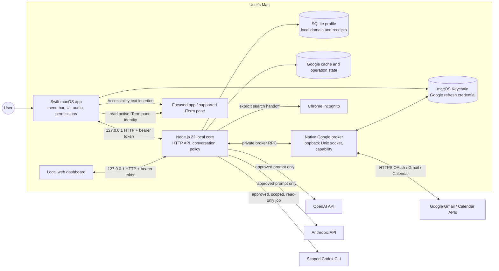

# KST Current System Design

**Status:** implementation-oriented description of the current macOS preview in this repository  
**Product:** kst (Personal Secretary companion)  
**Release marker in source:** `0.6.0-preview.1`  
**Last reviewed:** 2026-11-10

This document describes the implementation that exists now. It distinguishes working code paths from capabilities that are gated on permissions, configuration, packaging, or real-account validation. It is not a proposal for the next release and does not treat older Flow-State architecture notes as a description of KST.

## 1. Product and system boundary

KST is a single-user macOS menu-bar assistant with a local Node.js core and a local dashboard. The native app owns microphone access, Apple speech recognition and synthesis, focused-field dictation, macOS notifications, activity sampling, and the supervised lifecycle of the local core. The core owns local conversation routing, persistent secretary records, planning, notification scheduling, managed project jobs, external-service admission, and Google integration logic.

The components communicate over loopback HTTP. A private native-to-core broker channel is used for Google credentials and cryptographic operations. The system does not use a local reasoning LLM. Its normal secretary command path is deterministic parsing and validation; a separately built adaptive classifier can be activated as a local understanding layer, but it does not grant execution authority by itself. External model requests are separate, explicit, approval-gated operations.



**Trust boundaries:** the browser dashboard and native app are clients, not authorities. The core authenticates local API calls and validates each operation. The native Google broker is the sole holder of refresh credentials. External-service approval controls whether prompt dispatch occurs. Accessibility dictation is a separately scoped native capability and does not make the core a general-purpose keyboard or shell executor.

## 2. Runtime components

| Component | Implementation | Responsibility |
|---|---|---|
| macOS app | Swift 6, AppKit/SwiftUI, AVFoundation, Speech, ApplicationServices | Menu-bar lifecycle, native UI, audio state, wake phrase transcript gate, TTS, permissions, activity, notifications, dictation focus lease and insertion |
| Native policy module | Swift package target `KstNativeCore` | Wake phrase parsing, voice session state, dictation policy, Google policy, usage interval rules; deterministic and testable without starting microphone capture |
| Local core | Node.js 22+, built-in `node:http`, `node:sqlite` | Loopback API, request validation, conversation/domain logic, scheduling, persistence, jobs, Google control/runtime, external approvals, adaptive classifier integration |
| Local workspace | SQLite opened by `Workspace` | Secretary tasks, notes, reminders, events, plans, notifications, dialogue/clarification and idempotency state |
| Runtime state | SQLite `Engine` state document | Wake phrase and revisions, jobs, approvals, request receipts, generation and compact scratch-compatible state |
| Google runtime | Node.js Google modules plus native broker | OAuth account lifecycle, explicit Gmail/Calendar operations, previews/confirmation, bounded synchronization/cache, calendar nudge inputs |
| Native Google broker | Swift actor, Keychain, private Unix socket, loopback OAuth callback | Google credential ownership, OAuth PKCE, token refresh, account identity, encrypted payload envelopes and request authentication |
| External services | Node HTTPS, configured Codex CLI, macOS `open` | Approval-gated OpenAI/Claude/Codex requests and direct Google Search handoff to Chrome Incognito |
| Dashboard | Static HTML/CSS/JS in `packages/kst-web` | Local pairing and visibility/control surface for conversation, Google, approvals, jobs, settings, workspace and notices |

The native app may attach to an already healthy core. If no core is healthy and the bundle has configured absolute Node/core paths, it launches and supervises its own child process with bounded restart attempts. It must not terminate a core it did not launch. Finder launch does not inherit arbitrary shell environment variables; paths and permitted environment keys are packaged or explicitly configured.

## 3. Startup, pairing, and ownership

1. The native app initializes its local preferences, menu-bar UI, native voice and notification coordinators. It does not start microphone capture during initialization.
2. For Google-enabled startup, the app starts its broker and creates a private bootstrap containing the broker socket path and random capability. The bootstrap is written to the supervised core's standard input, not argv, environment, logs, or the dashboard.
3. The app checks `http://127.0.0.1:4310/health`. It attaches if healthy; otherwise it starts the configured local Node entry point. Recovery is bounded to three delayed launches in one app session.
4. The core validates a dedicated, user-owned data directory, enforces restrictive directory/file modes, loads or creates a random pairing token, opens SQLite, and creates `owner.lock` using exclusive file creation (`wx`).
5. The core binds only to `127.0.0.1`. `/health` is public. `/api/*` requires the bearer token. Host and Origin are restricted to loopback, JSON bodies are strictly decoded with unknown/duplicate fields rejected, and response headers disable caching and framing.
6. The native app obtains the pairing token from its private profile location. The dashboard is paired using the local token; it is not exposed on the LAN.
7. On graceful shutdown, services stop accepting work, owned jobs are asked to cancel, databases close, then the core removes the lock only if its nonce still owns the exact lock. A crash leaves the lock in place; automatic stale-lock deletion is deliberately not performed.

Default profile: `~/Library/Application Support/kst-dev/core`. Main local DB: `kst.sqlite`. The default workspace is private and separate from the legacy Personal Secretary DB. `KST_DATA_DIR`, `KST_PORT`, `KST_TOKEN`, `KST_CORE_ENTRY`, `KST_NODE_PATH`, and selected reviewed integration variables can override defaults. The app uses loopback HTTP only and refuses redirects.

## 4. Primary voice and conversation pipeline

### 4.1 Assistant speech input

Voice is opt-in per app session. The user explicitly chooses **Start listening** or **Arm wake phrase**. `VoiceInput` asks macOS for microphone and Speech Recognition authorization, requires `en-US` `SFSpeechRecognizer` with on-device recognition support, sets `requiresOnDeviceRecognition = true`, and uses `AVAudioEngine` to feed microphone buffers directly to Apple's speech request. Audio is not written to a file and there is no online speech fallback.

The app accepts only a final recognition result. Partial results may update the visible transcript during an open discussion, but are never sent to the core or acted on. It finalizes after 1.5 seconds without changed recognition text or on explicit Finish turn; finalization has a five-second deadline. A turn is bounded to 45 seconds. The microphone pauses while TTS speaks; this is turn-taking, not barge-in.

When wake-armed, the same on-device speech recognizer creates bounded recognition turns. `WakeGate.command` matches the configured whole word/phrase in the finalized transcript. The wake phrase is stored in core settings (initial value `arise`), validated to 2–40 visible characters, and updated with a revision check. This is a transcript gate, not a dedicated low-power keyword model. Ambient nonmatching transcript stays transient in memory and is discarded; it is not displayed, persisted, or sent to the core. A wake with a trailing command submits that command immediately. A wake without trailing text opens a discussion.

An open discussion remains in the listening state across turns and speaks replies. “End conversation” returns an armed assistant to wake checking; explicit “stop listening”, disarm, native Stop, lock/session deactivation, route changes, permission loss, or error stop capture. An idle discussion closes after 45 seconds without recognized speech. Lock and capture lifecycle checks invalidate stale callbacks so an older recognition turn cannot be accepted after Stop or a mode change.

### 4.2 Shared request path

Typed user input and finalized assistant speech converge on the same native request function and core API. Voice adds `source: "voice"`; it does not use a separate intent parser. Request IDs are unique and allow receipt lookup/idempotency. The core routes requests in this order: global Stop and provider-specific admission/control; local understanding if active; explicit external service/web request; supported managed terminal recipe/inventory; deterministic secretary workspace command; explicit read-only Personal Secretary query; then limited scratch command fallback. Unsupported language must return a clarification or capability message; it does not imply arbitrary shell execution.

```mermaid
sequenceDiagram
  participant U as User
  participant V as Native VoiceInput
  participant G as WakeGate / VoiceControl
  participant A as AppModel
  participant C as Loopback Core API
  participant I as Understanding + policy
  participant W as Workspace / providers
  participant T as AVSpeechSynthesizer
  U->>V: speak after explicit listen/arm
  V->>V: on-device recognition; final transcript only
  V->>G: finalized transcript
  G->>A: wake phrase removed / control parsed
  A->>C: POST /api/conversation {requestId,text,source}
  C->>I: validate, classify/route, enforce policy
  I->>W: execute bounded local operation or prepare provider action
  W-->>C: result / clarification / preview / receipt
  C-->>A: reply and structured result
  A->>T: speak bounded reply with Apple male voice
  T-->>V: playback finished; resume capture if session permits
```

### 4.3 Dictation pipeline

Dictation is a separate native mode from assistant conversation. While the assistant discussion is listening, the local voice control recognizes prefixes such as **“start typing”**, **“start typing for me”**, **“begin typing”**, **“start dictation”**, or **“begin dictation”**. Any words after the prefix are preserved as the initial dictation text (for example, “start typing what’s the time” first inserts “what’s the time”). From wake standby, speak the configured wake phrase followed by the command. This transfer is local; dictated text is not passed to the core/LLM as a secretary command.

Before capture/insertion, `AudioModeCoordinator` checks the opt-in setting and runtime-state protocol, verifies microphone and Speech authorization and `AXIsProcessTrusted()`, obtains the singleton dictation lock, and captures the focused target. It rejects unsupported targets and revalidates focus, selected range, app identity, and iTerm pane identity before each commit. It provides an audible target acknowledgment before the first insertion. Selected text requires user acknowledgment because it will be replaced. iTerm dictation requires explicit target acknowledgment; Return/Enter is never emitted.

The injector prefers Accessibility selected-text insertion when the target supports it; otherwise it sends bounded Unicode keyboard chunks. It never falls back to a second injection method after a side effect may have occurred. Receipts distinguish `VERIFIED`, `SUBMITTED_UNVERIFIED`, and `UNKNOWN`. Only verified ranges may use the conservative delete-last correction. Dictation supports explicit stop/pause/new paragraph/literal phrase controls. Focus loss, lock, stop, permission failure, uncertain insertion, or target change closes capture. Microphone permission alone is not enough: Accessibility permission is required for target inspection and supported insertion.

### 4.4 Speech output

The native app uses `AVSpeechSynthesizer` and an installed Apple English male voice, selecting from the live voice catalog with Daniel preferred (then available supported fallbacks). Current utterance rate is `0.52`; the utterance is bounded to 1,200 characters and playback to 60 seconds. TTS can be disabled in app preferences. While a reply is being spoken, assistant capture is paused, then resumes only after the synthesis completion callback. No Google TTS, Siri invocation, cloud voice API, or separately downloaded voice model is used by the current pipeline.

## 5. Conversation understanding and authority

### 5.1 Local path

The deterministic secretary path is backed by `Workspace.converse` and a set of explicit patterns, time normalization, entity resolution, action validation, and transactional writes. It supports task/note/reminder/meeting/timeline/list/plan operations, plus limited conversational controls and clarification slots. It is not a general open-ended reasoning engine. Dates and times are normalized against the core's local timezone. Missing time/duration asks a follow-up; ambiguous targets, duplicate names, conflicts, stale plans, invalid dates, or changed records fail closed instead of guessing.

The adaptive understanding package provides an optional in-house classifier path, feature extraction, feedback/preferences, bounded learning/training records, and optional native addon acceleration. Its release/build artifacts and active status determine whether it handles a request; a compiled addon or a seed corpus alone does not mean the feature is active or production-accurate. The classifier can propose/route a recognized intent, but command schema validation, entity resolution, confirmation rules, idempotency, and execution policy remain in the core. The classifier cannot create shell commands or external-service authority.

The core config advertises `localReasoning: false`. There is no local generative model. Apple Speech Recognition transcribes; native classifier logic and deterministic parsers process intents. They are distinct from an LLM.

### 5.2 Clarification, previews, and commits

Operations that need missing information create short-lived server-side dialogue state keyed by conversation ID (90 seconds for supported clarification/plan confirmation). Write actions run only after all required fields are present. Plan proposal and plan application are separate operations; application rechecks task revisions, meeting overlaps, other reserved focus blocks, and elapsed times. Google writes use their own exact previews, confirmation tokens, account generation and provider receipts. Request IDs are content-bound: replaying the same ID and same payload returns the original result; reusing it for a different payload is rejected.

### 5.3 Stop and uncertain results

Stop is a high-priority control that invalidates local dialogue and pending approvals, stops understanding/Google queues, and asks owned external/terminal jobs to cancel. Cancellation must be confirmed by the owning service. If an operation may have reached a remote provider or target app, it is recorded as unknown; KST does not silently retry and does not claim that Stop undid an already accepted side effect. The native Stop also immediately closes local audio/TTS. It cannot roll back a completed database write or external side effect.

## 6. Secretary workspace and persistence

`Workspace` opens a dedicated `secretary.sqlite` in the private profile by default, using the Personal Secretary foundation schema. It stores current app tasks, notes, reminders and events, and KST-specific plans, notifications, Google calendar links, dialogue/clarification state, idempotency and delivery keys. `Engine` stores runtime/approval/job state in `kst.sqlite`; Google cache/operation data and external job receipts use separate SQLite files. Native speech preferences and locks use separate files under the KST application support directory. Google refresh credentials are held in Keychain, not SQLite.

Workspace read surfaces include a bounded snapshot of tasks/notes/reminders/calendar, a merged timeline (events, active reminders, applied focus blocks), plans and pending notifications. Work operations use explicit action kinds (`task.create`, `task.complete`, `note.create`, reminder create/snooze/cancel/reschedule, meeting create/reschedule/cancel, plan propose/apply). Local mutations and request receipts commit transactionally. Reminder/notification delivery is idempotent using stable delivery keys.

The default local workspace is not automatically the pre-existing Personal Secretary database. An optional source adapter can inspect an explicitly selected source read-only. Shared-source writes are guarded by both an approved path and explicit startup opt-in, create and validate a backup before mutation, and retain transaction/receipt guarantees. A workspace snapshot has a source label so the UI can distinguish local and shared mode. Neither mode is cloud sync.

Data retention and bounded state:

- Assistant transcript display is capped at 80 messages in the native app; it is session UI state, not durable conversation history by default.
- Audio frames, partial recognition, and raw transcripts from wake-miss turns are not stored as files or sent to the core.
- Accepted commands, domain records, request receipts, plans, approvals, and jobs persist in local SQLite as required for continuity and idempotency.
- Activity samples and their own receipts expire after 24 hours; notification bodies age out after 30 days while minimal dedupe keys remain.
- Google resource cache is a disposable bounded cache, separate from authoritative KST domain records. Google content is not copied into task/note state unless a distinct, explicit action creates a local record.
- File/profile ownership and restrictive permissions are checked on startup; state corruption fails closed rather than resetting or deleting user data.

## 7. Scheduling, calendar, and proactive notices

The core scheduler ticks every 15 seconds while running, reconciles due reminders and meetings, checks managed-job receipts, and consumes a Google calendar nudge snapshot when connected and opted in. The scheduler persists notices before native display. The native app polls `/api/notifications`, delivers stable IDs once, and sends Dismiss/Snooze decisions back to the core. Lock suppresses native delivery. Focus/quiet/meeting context can suppress ordinary nudges.

Native activity sampling is explicitly enabled by the user. It sends a coarse summary to `/api/activity`: active minutes, idle seconds, lock state, optional meeting/quiet flags, and app bundle ID. It does not include screenshots, window titles, key presses, page contents, or microphone text. Five minutes idle, lock, sleep, or missing intervals reset the active bout. This is KST's limited observed-activity signal, not full Apple Screen Time access and not proof of attention. Pause nudges stops collection and polling.

Google Calendar nudge observation is an explicit integration setting. The core fetches a bounded next-day calendar view, identifies valid timed events from selected calendars, records account generation and source version, and links events for collision/nudge logic. Incomplete or stale Google snapshots must not be treated as authoritative availability. Calendar nudge reads are distinct from calendar write operations.

Native notices are visual OS notifications. They do not wake the microphone or speak on their own. A click/action can open the app or update persistent notification state.

## 8. Google account and action architecture

Google sync/action code is present behind setup and authorization gates. The user provides a Google Desktop OAuth client JSON in the private core profile. Native `GoogleAccountBroker` performs OAuth authorization-code with PKCE via a loopback callback, verifies state and account identity, requests only the selected capability profile, and stores a refresh token in the macOS Keychain. Access tokens are transient in memory. Exact granted scopes are checked before actions. The Node core can ask the broker for a token only over the private capability-protected Unix socket. Broker requests are bounded, same-user validated, and do not expose general credential access.

The feature design includes Gmail search/read and bounded sync, Calendar list/availability and selected write operations, message draft/reply/send preparation, labels/trash, event changes and operation receipts. Provider writes are staged as exact previews and require a current confirmation. Send is a two-stage flow: prepare exact draft/recipients, then separately confirm sending that prepared draft within the allowed window. Account generation changes cancel stale operations. Potentially uncertain provider writes are not replayed. Google API behavior depends on Cloud Console setup, consent-screen tester/verification state, scopes, MIME packages, network, and live account validation. Code presence does not establish that the user's account is currently connected or that each write path has passed a live test.

## 9. Browser, external models, and managed jobs

### Web search

An explicit `search web QUERY`/equivalent command launches Google Search via `/usr/bin/open` with Google Chrome `--incognito --new-window`. On macOS this path does not ask for an external-service approval. KST sends the query to Google in the URL and returns **“You can read now”** after a successful launch. KST does not inspect the page, summarize it, or read browser contents. Chrome must be installed; this is a visible browser handoff.

### ChatGPT, Claude, Codex

Explicit ChatGPT/OpenAI and Claude requests are stored as pending approvals; nothing is dispatched until the user approves the exact request. Approval expires and is bound to the prompt and current transport/configuration. The OpenAI and Anthropic adapters send only the approved prompt, without chat history/files/audio/terminal output, using configured API keys and models; their API usage may incur provider billing. There is no automatic fallback to another service.

Codex, when explicitly enabled and configured, is a bounded CLI job with an offline scope probe and a read-only project permission profile. Project files in the approved scope may be sent to Codex after approval. Writes, browser/computer tools, plugins, hooks, MCP servers, and direct agent network access are disabled by its restrictive profile. Scope probe failure blocks dispatch. Antigravity is recognized as a provider label but has no configured transport in this implementation.

### Terminal/iTerm

KST is not an unrestricted terminal copilot. It supports reviewed fixed-argument project recipes and explicit read-only iTerm inventory. It does not evaluate arbitrary transcript text as shell code, type and execute shell commands through an existing iTerm pane, or emit Return during dictation. Native dictation can type literal text into a verified supported focused iTerm prompt, which is distinct from authorizing command execution. Jobs have ownership IDs, bounded output/time, explicit cancellation, durable receipts and unknown-state handling after interruption.

## 10. API surfaces (current main paths)

All listed `/api/*` paths require the paired bearer token. Exact request body schemas are enforced by route handlers; methods and optional parameters vary by endpoint.

| API | Role |
|---|---|
| `GET /health` | Loopback readiness and release/capability marker |
| `GET /api/status` | Mode, settings, capabilities, current jobs/approvals and workspace summary |
| `GET/PATCH /api/settings` | Revision-checked wake phrase/settings updates |
| `POST /api/conversation` | Shared typed/final-speech conversation entry point |
| `POST /api/stop` | Stop owned work and invalidate pending requests |
| `GET /api/approvals`, `POST /api/approvals/:id` | Review and decide a service request |
| `GET /api/jobs` and terminal/external status endpoints | Job receipts and current job state |
| `GET /api/secretary/workspace` | Local/shared workspace snapshot |
| `GET /api/notifications`, `POST /api/notifications/:id` | Native notice poll and dismiss/snooze |
| `POST /api/activity` and `/api/runtime-state/v2` | Coarse activity and native voice/runtime state |
| `/api/understanding/*` | Understanding status, preview, feedback, preferences and guarded learning controls |
| `/api/google/*` | Account, sync, search and confirmation-bound actions |
| `/api/terminal/*` | Reviewed recipe jobs and read-only terminal inventory/display |
| `/api/external/*` | External provider status, receipts and cancellation |

The transport-independent handler is used by socket HTTP and deterministic handler tests. Tests that call the handler directly do not validate macOS permissions, OAuth consent, Keychain prompts, Chrome installation, signing identity, or physical microphone/focus behavior.

## 11. Failure handling and safety invariants

1. **Single core owner:** exclusive profile lock prevents a second writer. No timeout-only stale-lock reclamation.
2. **Local-only listener:** bind loopback; authenticate all API routes except health/static assets; reject unexpected host/origin and redirects.
3. **No partial speech action:** only final on-device transcription enters the conversation path.
4. **Stop dominates:** local capture and TTS stop immediately; core Stop cancels eligible jobs/approvals and invalidates dialogue. Completed effects cannot be undone.
5. **No ambiguous replay:** request receipts are idempotent; external/provider uncertain outcomes become `unknown`; no automatic retry after timeout/crash.
6. **Least privilege:** Google credentials remain in Keychain/native broker; Codex scope is read-only; terminal actions are reviewed recipes; dictation is bounded to an actively verified focus target.
7. **Revalidate before effect:** revisions, account generations, entity revisions, focus/range and terminal pane identity are checked at admission/commit points.
8. **Fail closed:** missing permissions, unsupported local speech, failed broker, invalid database, stale target, unknown provider state, unconfigured integration, or unsupported intent produce a visible error/clarification rather than a guessed action.
9. **Bounded resources:** request bodies, transcript lengths, provider outputs, notification lists, job concurrency, timeouts, and stored display history have explicit limits.
10. **No secret logging:** token values, OAuth callback secrets, broker capability, API keys and message contents are excluded from ordinary startup/error logs.

## 12. Permissions and external prerequisites

| Permission / setup | Used for | Needed when |
|---|---|---|
| Microphone | Native assistant listening and dictation | User explicitly starts/arms voice or dictation |
| Speech Recognition | Apple on-device speech transcription | Same; English on-device recognizer must be available |
| Accessibility | Focus inspection and supported text insertion | Dictation into another app; app must be trusted by macOS |
| Apple Events / Automation | Verify iTerm active pane/shell prompt | iTerm terminal dictation verification; no arbitrary command execution |
| Notifications | Visual proactive notices | User enables native notices/nudges |
| Google OAuth client and consent | Gmail/Calendar API connection | User explicitly connects Google; Google may limit test users/scopes |
| OpenAI/Anthropic API keys + model config | External request after approval | User explicitly chooses the service and approves each request |
| Codex CLI + approved project | Read-only Codex job after approval | Explicitly enabled and scope probe succeeds |
| Google Chrome | Browser search handoff | User explicitly requests web search |

System Settings may show a permission enabled for a stale or differently signed app identity. The current preview is ad-hoc signed, so rebuilds/locations can affect macOS permission association. Runtime APIs must be checked; a visible toggle alone is not proof that the running process is trusted.

## 13. Build, packaging, and runtime requirements

- macOS 14 or newer; Apple Silicon is the primary development target.
- Node.js 22.23+ for built-in SQLite and current core APIs.
- Swift 6 toolchain/Command Line Tools for native build; full Xcode is not required for this development slice.
- `bash apps/macos/build-app.sh` produces `apps/macos/build/kst.app`, embeds local core/runtime paths, logo, and optional understanding addon, then applies local ad-hoc signing.
- Run with `open apps/macos/build/kst.app`; moving project or Node paths requires rebuilding.
- Developer ID signing, notarization, portable bundling, launch-at-login, and stable production TCC identity are not part of this preview.

The app's packaging mode matters: an ad-hoc local build is a development app with machine-specific paths and permissions, not a distributable production install.

## 14. Capability status and important limitations

| Capability | Current status |
|---|---|
| Typed local tasks, notes, reminders, meetings, plans, timeline | Implemented local path; deterministic phrase/slot support is bounded |
| Voice conversation and configurable `arise` wake phrase | Implemented native path; requires explicit arming, supported on-device English speech, and real hardware validation |
| Apple male TTS, medium/slightly faster rate | Implemented via live catalog and configured utterance rate; voice availability varies by macOS install |
| Say “start typing” to dictate | Implemented local handoff; requires the assistant to be listening, dictation enabled, microphone/Speech/Accessibility and verified focus |
| Dictate into iTerm | Literal insertion into supported verified prompt only; Apple Events + Accessibility; never submits Return |
| Proactive activity/calendar nudges | Implemented bounded local scheduler path; activity is a coarse opt-in app/idle sample, not Screen Time; live sources/settings determine actual notices |
| Google account and Gmail/Calendar actions | Implemented behind OAuth/config/scope/confirmation gates; live account connection and each provider behavior need real-account validation |
| Web | Direct Google Search handoff to visible Chrome Incognito; no page reading or returned summary; reply “You can read now” |
| ChatGPT / Claude | Explicit per-request approval and configured API transport; user API keys/billing required |
| Codex | Explicit approval plus configured CLI/project and passed restrictive scope probe; read-only scope |
| Antigravity | No action transport in current implementation |
| Arbitrary terminal command execution | Not supported; reviewed fixed project recipes only |
| iPhone app / cloud sync | Not implemented |
| Siri delegation | Not implemented |
| Local generative LLM | Not installed or used |

## 15. Source map

- Native app orchestration/UI/audio: `apps/macos/Sources/KstApp/main.swift`
- Speech capture: `apps/macos/Sources/KstApp/VoiceInput.swift`
- Assistant/discussion/dictation handoff: `apps/macos/Sources/KstApp/AudioModeCoordinator.swift`, `apps/macos/Sources/KstNativeCore/WakeGate.swift`
- Focus capture/insertion: `apps/macos/Sources/KstApp/DictationTarget.swift`, `DictationInjector.swift`, `TerminalPaneProbe.swift`
- Single-instance and core supervision: `apps/macos/Sources/KstApp/CoreSupervisor.swift`, native lock implementation in `KstNativeCore`
- Google native broker/OAuth: `GoogleAccountBroker.swift`, `GoogleBrokerSocket.swift`, `GoogleOAuthLoopback.swift`
- Core composition/API: `packages/kst-core/src/server.mjs`, `http.mjs`
- Workspace/domain/scheduler: `packages/kst-core/src/workspace.mjs`
- Core state/idempotency: `packages/kst-core/src/engine.mjs`
- Google service logic: `packages/kst-core/src/google/`
- Adaptive understanding: `packages/kst-core/src/understanding/`, `packages/kst-core/native/understanding/`
- External providers/browser: `packages/kst-core/src/external.mjs`
- Terminal recipes/inventory: `packages/kst-core/src/terminal.mjs`, `bridges/iterm/`
- Dashboard: `packages/kst-web/`
- Bundle manifest/build: `apps/macos/Info.plist`, `apps/macos/build-app.sh`

## 16. Source-of-truth rule

When this design and implementation differ, the shipped source and runtime `/health`, `/api/status`, `/api/understanding/status`, `/api/google/status`, and receipts are the authority. Before a release is called fully working, validate the built signed bundle on the target Mac for microphone/Speech, wake accuracy, TTS, Accessibility insertion, iTerm prompt verification, notifications, actual Google OAuth/scopes and representative provider actions, browser handoff, configured external-service approval, and crash/restart behavior. Unit/handler tests and a successful compile establish code behavior only within their tested boundary.
