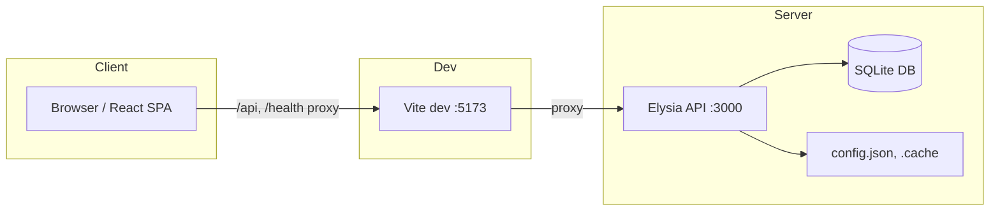
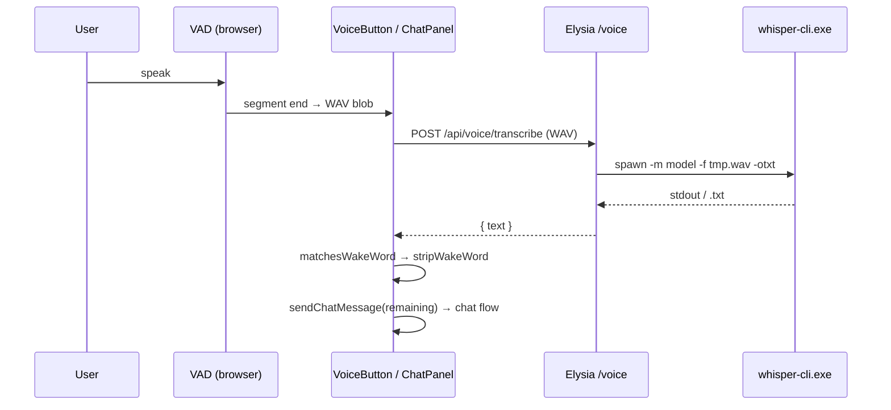
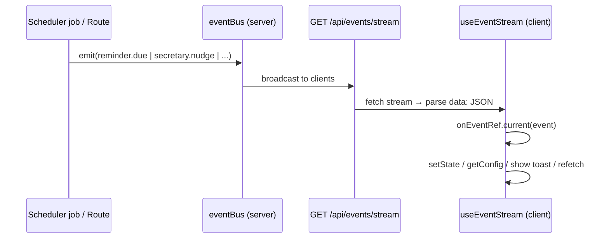

# Flow-State — Architecture and Design

This document describes the **architecture and design** of the Flow-State implementation. It answers *how the system works*: auth, config, data model, routes, events, chat/voice flow, scheduler, and implementation rules. Together with `PROJECT-STRUCTURE.md`, it contains every detail needed for an agent to re-create the entire application. No Jira, Outlook, Loop, or Copilot calendar integration; calendar is local-events only.

---

## 3. Core architecture

### Split

- **Backend**: `packages/server` — Elysia on configurable host/port (default 127.0.0.1:3000).
- **Frontend**: `packages/web` — Vite dev on 5173; production build is static assets (API assumed same origin or configured proxy).

### 3.1 Design diagrams

The following Mermaid diagrams capture system context, data flow, voice flow, UI hierarchy, and event streaming. Use them to re-create or reason about the implementation.

**System context (high-level)**



**Request flow (chat / API)**

```mermaid
sequenceDiagram
  participant U as User
  participant UI as ChatPanel / Page
  participant API as Elysia routes
  participant CR as CommandRouter
  participant SVC as Services
  participant DB as SQLite
  U->>UI: type / speak
  UI->>API: POST /api/chat (Bearer)
  API->>CR: parseIntent → run(parsed)
  CR->>SVC: task / calendar / brief / ...
  SVC->>DB: repository CRUD
  SVC-->>CR: result
  CR-->>API: CommandResult
  API->>API: emit data.changed
  API-->>UI: { reply, actions_performed }
  UI-->>U: show reply; optional TTS
```

**Voice flow (transcription → command)**



**UI component hierarchy**

```mermaid
flowchart TB
  App[App]
  App --> AuthGate[ensureAuthToken gate]
  App --> Router[BrowserRouter]
  Router --> Nav[Nav: Brief|Calendar|Tasks|Reminders|Notes|Settings]
  Router --> Main[main#main-content]
  Router --> FAB[chat-fab + badge]
  Router --> ChatPanel[ChatPanel]
  Router --> BGVoice[BackgroundVoiceIndicator]
  Router --> NotificationToast[NotificationToast]
  Main --> BriefPage[BriefPage]
  Main --> CalendarPage[CalendarPage]
  Main --> TasksPage[TasksPage]
  Main --> RemindersPage[RemindersPage]
  Main --> NotesPage[NotesPage]
  Main --> SettingsPage[SettingsPage]
  ChatPanel --> VoiceButton[VoiceButton]
  ChatPanel --> MessageList[Message list]
  ChatPanel --> SlashMenu[Slash command menu]
  BriefPage --> HoverPreview[HoverPreview: Event/Task/Reminder]
  CalendarPage --> FullCalendar[FullCalendar]
  TasksPage --> HoverPreview
```

**SSE / event bus flow**



### Frontend–backend communication

- **Base URL**: Relative `/api`, `/health`, `/docs`; in dev Vite proxies all three to `http://127.0.0.1:3000` (packages/web/vite.config.ts).
- **Health**: GET /health returns `{ status: "ok", db: "ok", version: "1.0.0" }` (no auth).
- **Bootstrap**: GET /api/bootstrap returns `{ authToken: string | null }`; `authToken` is null when `config.server.host` is not `127.0.0.1` or `localhost` (no auth).
- **Auth**: Server generates/stores `server.authToken` in `config.json`. Frontend gets it via GET /api/bootstrap; stores in `localStorage` key `secretary_auth_token`. All other `/api/*` requests send `Authorization: Bearer <token>`. Middleware: packages/server/src/middleware/auth.ts — derives authToken from header; throws Error("Unauthorized") if missing or mismatch.
- **Error responses**: 401 → `{ code: "UNAUTHORIZED", message: "Unauthorized" }`; 400 (ValidationError) → `{ code, message, details? }`; 404 (NotFoundError) → `{ code, message }`. Content-Type application/json.
- **Swagger**: Served at `/docs`; title "Flow-State API", version "1.0.0".
- **Key routes**: See section 9. Public: GET /health, GET /api/bootstrap. Auth required: all other /api/* including GET /api/events/stream (SSE).

### Config loading

- **Where**: `config.json` at project root; path = `process.env.CONFIG_PATH` or `join(projectRoot, "config.json")`. Project root = `process.env.PROJECT_ROOT` or first path that has `migrations` (cwd, cwd/.., or cwd/../..). **Config route** (GET/PATCH /api/config) uses `configPath()` = `process.env.CONFIG_PATH ?? join(process.cwd(), "..", "config.json")`. Intended: run server from packages/server so cwd is packages/server and config path is repo root.
- **How**: packages/server/src/config/index.ts — `loadConfig(configPath?)` reads JSON, deep-merges with defaults, ensures `server.authToken` (writes back if missing). PATCH config writes merged JSON to same path, then emits `config.changed` once per changed top-level key (payload.section). GET /api/config may add `trackingUnavailable`, `trackingUnavailableReason` when tracking enabled but service unavailable.

---

## 4. Data and persistence

### Database

- **Engine**: Bun SQLite; path = `process.env.DB_PATH` or `join(projectRoot, "secretary.db")` (packages/server/src/db/index.ts). Project root same as loadConfig (migrations dir or PROJECT_ROOT). **Migrations directory**: `process.env.MIGRATIONS_DIR ?? join(projectRoot, "migrations")`.
- **WAL**: `PRAGMA journal_mode=WAL`; `busy_timeout=5000`; `foreign_keys=ON`.
- **Migrations**: packages/server/src/db/migrations.ts — creates `schema_version` (version INTEGER PRIMARY KEY, applied_at TEXT) first; reads migrations dir for `*.sql`, sorts by filename; version = parseInt(filename.split("_")[0]); runs only when version not in schema_version; after each file runs, INSERT into schema_version. **001_foundation.sql**: reminders.linked_event_id REFERENCES events(id) ON DELETE **SET NULL**; notes/notes_tasks ON DELETE SET NULL / CASCADE; seeds activity_categories (team_call, cursor_coding, mail, jira).

### Main entities (from 001_foundation.sql and later migrations)

- **events**: id, title, start_ts, end_ts, all_day, recurrence_rule, location, description, created_at, updated_at.
- **tasks**: id, title, due_ts, priority, status, project, tags, created_at, updated_at; later: position, scheduling params, pinned_time, progress.
- **reminders**: id, title, trigger_ts, repeat_rule, linked_event_id, status, snooze_until_ts, created_at, updated_at.
- **notes**: id, title, body, linked_event_id, created_at, updated_at; FTS via notes_fts (fts5). **notes_fts** is external-content FTS5 (`content='notes', content_rowid='rowid'`); the app must sync it on note insert/update/delete (DELETE from notes_fts WHERE rowid=? then INSERT INTO notes_fts(rowid, title, body)); search via `SELECT rowid FROM notes_fts WHERE notes_fts MATCH ? ORDER BY rank`.
- **notes_tasks**: note_id, task_id (M:M).
- **user_config**: key, value, updated_at.
- **integration_cache**, **integration_snapshot**: for external API/cache.
- **activity_categories**, **activity_sessions**: usage/tracking.
- **daily_schedules**, **checklists**, **weekly_reviews**, **downtime_pipeline**: from later migrations.

### File-based

- **config.json**: App config (see Configuration surface).
- **.cache/copilot-llm-response.json**: Copilot LLM response cache (used by copilot-llm.service).
- **backups/**: Created by db-backup job under project root; contains `secretary-YYYY-MM-DD.db` files; retention 7 days (KEEP_DAYS). Job runs once at startup then every 24 h; copyFileSync(dbPath, destPath); older files deleted by date-descending sort.

### Repository method signatures (key queries)

- **EventsRepository**: `findByDateRange(startMs, endMs)` — SQL `SELECT * FROM events WHERE start_ts < ? AND end_ts > ? ORDER BY start_ts` (params endMs, startMs).
- **RemindersRepository**: `findDue(nowMs)` — (status = 'active' AND trigger_ts <= ?) OR (status = 'snoozed' AND snooze_until_ts <= ?); `advanceTrigger(id, nextTriggerTs)` — UPDATE trigger_ts, status 'active', snooze_until_ts NULL.
- **DailySchedulesRepository**: `findByDate(date)`, `upsert(date, blocks, overflow)` — blocks/overflow JSON.stringify; UPDATE or INSERT by date.
- **NotesRepository**: FTS sync on insert/update/delete: DELETE from notes_fts WHERE rowid=? then INSERT INTO notes_fts(rowid, title, body). **search(query)**: if query empty return findAll(); else escape quotes in query (replace " with ""); SELECT rowid FROM notes_fts WHERE notes_fts MATCH ? ORDER BY rank; resolve rowids to note ids and return notes. On FTS error (e.g. syntax), rebuildFts() and fallback to LIKE search on title/body.

### Usage tracking (for break logic and config)

**Location**: packages/server/src/services/usage-tracking.service.ts.

- **matchCategory**: Activity categories with match_rules (JSON array of { field: "app_name"|"window_title"|"process_name", pattern: string }); regex test on app name, window title, or process name; first match wins; else "uncategorized".
- **sample()**: Get active window (get-windows); same category as current session → updateEndTime only; else end current session and create new one (currentSessionStartTs = now). getCurrentFocusBlockStartTs() returns this in-memory start.
- **trackingUnavailable**: When get-windows throws, service sets unavailable; GET /api/config can add trackingUnavailable, trackingUnavailableReason.

---

## 5. Important flows

### 5.1 Chat / assistant

- **Entry**: User types in ChatPanel or sends same message via voice (see Voice).
- **Steps**:
  1. Frontend: packages/web/src/services/api.ts `sendChatMessage(message, conversationId?, source?)` → `POST /api/chat` with body `{ message, conversation_id, source }`.
  2. Server: packages/server/src/routes/chat.ts — parse body, call `parseIntent(message)` then `CommandRouter.run(parsed)`.
  3. packages/server/src/orchestration/intent-parser.ts: Slash commands (e.g. `/task`→add_task, `/brief`→show_brief) and NL regex patterns + chrono-node for date/time → `ParsedIntent` (intent + slots). See intent-parser.ts for full slash→IntentType map and NL patterns.
  4. packages/server/src/orchestration/command-router.ts: switch(intent) → one CommandResult action per intent (e.g. show_brief→showBrief, briefingService.getBriefForDate; add_task→addTask, taskService.create with slots; list_tasks→listTasks, taskService.findAll({ status: "todo" })). See command-router.ts for full intent→action→service mapping.
  5. packages/server/src/orchestration/response-formatter.ts: `formatResponse(cmdResult, source)` → `{ reply, actions_performed }`.
  6. Chat route emits `data.changed` for create/update/delete; returns `{ reply, actions_performed, engine, conversation_id }`.
  7. Frontend displays reply; optional TTS for voice source.

- **Brief construction (getBriefForDate)**: dayBounds(start, end) for dateStr; events = findByDateRange(start, end); tasks = findByDueDate(start, end) filtered to status !== 'cancelled'; reminders = findAll("active") then filter trigger_ts in [start, end]; overdue_tasks = findOverdue(start); sections + integrations from pluginRegistry.getBriefContributions(date); usage_summary = insightsService.getUsageSummaryForDate if tracking.enabled else null; schedule = schedulesRepo.findByDate(dateStr) or, if missing, designSchedule(dateStr, todoTasks, events) then upsert; Brief = { date, events, tasks, reminders, overdue_tasks, schedule: { blocks, overflow }, sections, integrations, usage_summary, generated_at }.

### 5.2 Voice (transcription + wake word)

- **Entry**: User clicks mic in ChatPanel (or always-on if enabled); packages/web/src/components/VoiceButton.tsx and packages/web/src/services/voice-engine.ts.
- **Steps**:
  1. VoiceEngine (VAD from `@ricky0123/vad-web`) captures speech; on segment end encodes Float32 to WAV (16 kHz mono) and calls `transcribe(wavBlob)`.
  2. `transcribe` = `POST /api/voice/transcribe` with body = WAV blob (packages/web/src/services/api.ts).
  3. Server packages/server/src/routes/voice.ts: Writes blob to temp file, spawns `whisper-cli.exe` (path from config) with `-m modelPath -f tmpWav -otxt`, reads `.txt` (or stdout), returns `{ text }` or `{ text, error }`.
  4. Frontend: If no error, `matchesWakeWord(text, wakeWord)` (normalized Levenshtein ≤ 0.3 for first word or first two words, or substring include in either direction); if match, `stripWakeWord` and call `onCommand(remaining)` which is `sendChatMessage` — same chat pipeline as above. TTS can speak reply.
- **Setup**: One-time run packages/server/scripts/setup-whisper.ps1 — downloads whisper-bin-x64.zip, extracts real `whisper-cli.exe` (>100 KB) and DLLs to packages/server/bin/, model to packages/server/models/ggml-base.en.bin.

### 5.3 Calendar (local events only)

- **Entry**: Calendar page and Brief show events from the local DB only. No external calendar sync (no Jira/Outlook/Loop/Copilot calendar). Events are created/updated via API (POST/PUT /api/events) or via chat (e.g. "add event meeting at 3pm").
- **Steps**: EventsRepository + CalendarService; GET /api/events (or equivalent) for list; Brief and CalendarPage consume events from API.

### 5.4 Proactive nudges

- **Entry**: packages/server/src/scheduler/jobs/proactive-nudge.ts runs on a 60s tick (TICK_MS = 60_000). If `proactive.enabled` and not presenting (presentation-detector), runs checks in order; each emits `secretary.nudge` with `{ nudgeId, category, message, actions? }`. SSE and NotificationToast show nudges; optional OS notification via notification.service.
- **Helpers**: `isWithinRange(hhmm, start, end)` — parse "HH:MM" to minutes, return whether current minute is in [start, end]. `isNearTime(target "HH:MM", toleranceMin = 2)` — current time within ±toleranceMin of target. `getPool(custom, hardcoded)` — return custom?.length ? custom : hardcoded. `pickFromPool(pool)` — pool[random index].
- **WELLNESS_ORDER**: `["walk", "water", "workout", "meditate", "stretch"]`; rotate index each wellness check (`wellnessCategoryIdx = (wellnessCategoryIdx + 1) % length`).
- **checkWellness**: Only if `now - lastWellnessAt >= wellnessIntervalMin * 60_000` and within work hours (isWithinRange vs workHoursStart/End); pick category from WELLNESS_ORDER; message from getPool(nudgeMessages.wellness[category], WELLNESS_POOLS[category]); emit wellness.
- **checkBreak**: Only if `now - lastBreakAt >= breakReminderCooldownMin * 60_000` and `insightsService.shouldSuggestBreak()`; emit break (pool: nudgeMessages.break / BREAK_MESSAGES).
- **checkTaskCheckin**: Only if cooldown and work hours; **skip if any task created in last taskCheckinCooldownMin minutes** (SQL: `SELECT COUNT(*) FROM tasks WHERE created_at > ?` with threeHoursAgo); else emit checkin with actions e.g. “Add a task”.
- **checkMorningKickoff**: Once per day (`morningDoneDate === today`); `isNearTime(morningKickoffTime, 2)`; count meetings (events in day), pending tasks, overdue tasks; build message; call `designSchedule(today, allTodo, events)` and `schedulesRepo.upsert(today, blocks, overflow)`; emit summary with actions “Show brief”, “Add a task”.
- **checkEndOfDaySummary**: `summaryIntervalMin` and work hours; `generateDailySummary(today)`; emit summary (fallback message on error).
- **checkMotivation**: `motivationIntervalMin` and work hours; random slot in ["morning","midday","signoff"]; `getMotivationalMessage(slot)`; emit motivation.
- **checkWeeklyReview**: Trigger when (Sunday 18:00–19:00) or (Monday 9:00–10:00); once per getWeekStart() (Monday-based week start); emit checkin “Time for your weekly review!” with chatCommand “weekly review”.
- **Default message pools**: WELLNESS_POOLS (walk, water, workout, meditate, stretch), BREAK_MESSAGES, CHECKIN_MESSAGES are hardcoded string arrays in proactive-nudge.ts; nudgeMessages config overrides when non-empty.

### 5.5 Reminders and notifications

- **Reminder checker** job (interval 60s): Finds due reminders via `findDue(nowMs)` — `(status = 'active' AND trigger_ts <= ?) OR (status = 'snoozed' AND snooze_until_ts IS NOT NULL AND snooze_until_ts <= ?)`; for each emits `reminder.due` and calls `sendOsNotification` (no trigger check); then advanceRecurring or update status to dismissed. **advanceRecurring(id)**: If no repeat_rule return null. Next trigger: `repeat_rule === "daily"` → `trigger_ts + 24*60*60*1000`; `weekly` → `trigger_ts + 7*24*60*60*1000`. Repository `advanceTrigger(id, next)` sets trigger_ts, status 'active', snooze_until_ts null. **Snooze default**: SNOOZE_MS = 5*60*1000 (5 min) when until not provided.
- **Pre-meeting checker** (interval 60_000 ms): Only if config.notifications.triggers.preMeeting. **Window**: `[now + preMeetingMinutes*60*1000 - 60000, now + preMeetingMinutes*60*1000]` (events starting in the last minute before the N-minute mark). Fetch events: `eventsRepo.findByDateRange(windowStart, windowEnd)` (query: start_ts < endMs AND end_ts > startMs); then filter to e.start_ts in [windowStart, windowEnd]. For each: startsInMs = event.start_ts - now; linkedNotes = notesRepo.findAll(event.id); emit `meeting.approaching` with eventId, title, startsInMs, linkedNotes (id, title).
- **Break checker** (interval 60_000 ms): **Cooldown 30 min** (COOLDOWN_MS = 30*60*1000) between suggestions. Requires tracking.enabled and triggers.breakReminder. `insightsService.shouldSuggestBreak()` must be true: tracking enabled, breakReminder trigger, and getCurrentFocusBlockMinutes() >= config.tracking.focusBlockMaxMinutes (default 90). getCurrentFocusBlockMinutes(): (Date.now() - usageTrackingService.getCurrentFocusBlockStartTs()) / 60000 (0 if no current session). getCurrentFocusBlockStartTs(): in-memory currentSessionStartTs from usage-tracking. Message: “You've been focused for ${durationMin} minutes. Consider a short break.” Emit break.suggested with activityType, durationMin, message.
- **Daily-brief-trigger** (interval 60_000 ms): Parse config.notifications.dailyBriefTime ("HH:MM") to hours, minutes; every tick, if now.getHours() === hours && now.getMinutes() === minutes, emit `brief.ready` with payload `{ date: dateStr }` (YYYY-MM-DD). Event bus listeners in index.ts: break.suggested, brief.ready, meeting.approaching, secretary.nudge — each checks corresponding trigger and sends OS notification (title, body, icon, sound).
- **Task-deadline-checker** (interval 300_000 ms, 5 min): Find all todo tasks with pinned_time set. Convert pinned_time (minutes from midnight) to today's timestamp; if task is 5–10 minutes overdue (elapsed since that time), send OS notification "Task Overdue" and emit secretary.nudge (category checkin) with actions "Mark complete" (chatCommand `/complete ${title}`), "View tasks" (/tasks). Track notified task IDs; remove from set after 1 hour overdue. stopTaskDeadlineChecker() clears timer and set.
- **Cache-cleanup** (interval 900_000 ms, 15 min): IntegrationCacheRepository.purgeExpired() — deletes rows where expires_at <= Date.now(). Logs count purged.
- **Check-downtime** (interval 900_000 ms, 15 min; started only when proactive.enabled): 1-hour cooldown between nudges. downtimePipelineService.detectFreeTime(todayStr()); find first gap with startTs > now and startTs - now < 30*60*1000; suggestForTimeSlot(gapMinutes); emit secretary.nudge (category checkin) with message about free time and suggestion title; actions "Show suggestions" (chatCommand "what should I do"), "Show brief" ("brief"). stopDowntimeChecker() on graceful shutdown.
- **Database backup** (see §4 Data and persistence / Scheduler): BACKUPS_DIR = join(projectRoot, "backups"). Interval 24 h (86_400_000 ms); runs **immediately on server start** then on interval. runBackup(): if dbPath does not exist return; mkdirSync(BACKUPS_DIR, { recursive: true }); copyFileSync(dbPath, destPath) with name `secretary-${date}.db` (date YYYY-MM-DD). **Retention**: list files secretary-*.db, sort by date descending; keep first KEEP_DAYS (7), delete rest with unlinkSync. Backup is full file copy of live DB (no SQLite backup API); WAL not copied; best-effort point-in-time.

### 5.6 Copilot LLM (generic queries)

- **Entry**: Command router for `ask_copilot` or similar; packages/server/src/services/copilot-llm.service.ts.
- **Steps**: Serial queue + rate limit; runs `scripts/query-copilot.ps1` with prompt and mode (Work/Web); script automates M365 Copilot UI, writes result to `.cache/copilot-llm-response.json`; service reads and returns; in-memory cache with TTL.

### 5.7 Schedule designer algorithm (task scheduling)

**Location**: packages/server/src/services/schedule-designer.service.ts. Used by Brief, POST /api/schedule/generate, POST /api/schedule/reschedule, proactive morning kickoff.

- **ScheduleConfig** (from config + defaults): `dayStartMin`, `dayEndMin` (parsed from scheduleDayStart/scheduleDayEnd, default 08:00–22:00); `bufferBeforeMeeting` (default 10 min), `bufferAfterMeeting` (5); `lunchStartMin`/`scheduleLunchDurationMin` (12:00, 30); `dinnerStartMin`/`scheduleDinnerDurationMin` (19:00, 30); `morningEndMin` (13:00), `eveningStartMin` (17:00). **Weights** (config.proactive.scheduleWeights overrides): `urgency` 3, `importance` 3, `deadline_pressure` 2, `energy_fit` 1.5, `context_bonus` 1, `time_pref_fit` 4 in designer (config schema default 1.5). **energyBands**: default minute ranges for high/medium/low (e.g. 480–660 high, 660–720 medium, 750–840 low, …); `getEnergyBand(minute, cfg)` returns band for a slot.
- **buildSlots**: Blocked ranges = events (with buffers), lunch, dinner, **flex anchors** [600, 840, 960, 1200] with `flexMinutes = round((dayEndMin - dayStartMin) * 0.15 / 4)`. Merge overlapping blocked ranges; build `Slot[]` (start, end, energyBand). Assign `energyBand` via `getEnergyBand(slot.start, cfg)`.
- **buildFixedBlocks**: For timeline: buffer blocks before/after each meeting, meeting blocks, lunch, dinner, flex blocks. Deduplicate: remove buffers overlapping non-buffer blocks; merge adjacent buffer blocks.
- **scoreTask** formula: **Urgency**: overdue → `10 + ceil((dayStart - due_ts) / 86400000)`; due today → 10; tomorrow → 8; within 7 days → 5; else 2. **Importance**: priority 1 → 10, 2 → 5, 3 → 2. **deadline_pressure**: `min(10, (time_estimate / minutesUntil) * 10)`. **energy_fit**: task.energy_level === slot.energyBand ? 5 : (medium ? 2 : 0). **context_bonus**: prev task type or context match ? 3 : 0. **time_pref_fit**: morning → slotMid < morningEndMin ? 5 : -3; evening → slotMid >= eveningStartMin ? 5 : -3; else 2. Final score = sum of (weight_i * component_i).
- **designSchedule(date, tasks, events, fromMinuteOfDay?)** algorithm: (1) Load config; **adjust time_estimate** for tasks with progress: `remaining = ceil((time_estimate || 30) * (100 - progress) / 100)`, min 15. (2) Split **pinned** (status todo, pinned_time != null) vs **unpinned**; block slots with pinned ranges. (3) Build available slots and fixed blocks; if `fromMinuteOfDay` provided (reschedule-from-now), filter slots/blocks to start after that minute. (4) **Greedy placement**: loop up to `MAX_ITERATIONS = pendingTasks.length * slotParts.length + 1`; each iteration pick (task, slot) with best score; if remaining slot >= task time_estimate place full block; else if task.is_splittable place partial and reduce task time_estimate; else remove slot. (5) **insertMicroBreaks**: for contiguous task blocks (same end_ts → start_ts), if contiguous duration >= 90 min insert 5 min “Micro-break” block. (6) **resolveOverflow**: unplaced tasks: P1 and (due today or tomorrow) → action `trim` (suggested_estimate = largest free block); else if time_estimate > largestFree && !is_splittable → trim; else → action `defer` (defer_to = tomorrow date string, freed_minutes). (7) Return `{ blocks, overflow }`; blocks sorted by start_ts.
- **rescheduleFromNow(date, tasks, events)**: `designSchedule(date, tasks, events, msToMinuteOfDay(Date.now(), date))`.
- **Config keys** (proactive): scheduleDayStart, scheduleDayEnd, scheduleBufferBeforeMeetingMin, scheduleBufferAfterMeetingMin, scheduleLunchStartTime, scheduleLunchDurationMin, scheduleDinnerStartTime, scheduleDinnerDurationMin, scheduleMorningEnd, scheduleEveningStart, scheduleWeights (urgency, importance, deadline_pressure, energy_fit, context_bonus, time_pref_fit).

### 5.8 Import/export implementation

**Location**: packages/server/src/services/import.service.ts.

- **parseExportPayload**: version must be number; version > SUPPORTED_VERSION (1) throws “newer version”; entities.events/tasks/reminders/notes/notes_tasks default to [] if missing; notes_tasks filtered to valid { note_id, task_id }.
- **Replace mode**: Delete order — notes_tasks; then notes_fts (per row from notes); notes; reminders; tasks; events. Insert order: events, tasks, reminders, notes (then FTS insert per note), notes_tasks.
- **Merge mode**: findConflicts for each entity type (export id exists locally → conflict with local_updated_at, export_updated_at). If conflictResolution === "ask" and conflicts.length > 0 return success false with conflicts. Otherwise useExport(key) = conflictDecisions[key] === "keep_export" || conflictResolution === "keep_export"; useLocal(key) = conflictDecisions[key] === "keep_local" || conflictResolution === "keep_local". Upsert each entity; for notes sync notes_fts after insert/update.

### 5.9 Events parse-text (POST /api/events/parse-text)

**Location**: packages/server/src/routes/events.ts. Body: `{ text: string }`.

- **Preprocess**: Replace `\u2013` (en-dash) with `-`, `\u2014` (em-dash) with space. Split into blocks: blank line separates; line matching `\b\d{1,2}:\d{2}\b` or `^\d+[.)]\s` starts new block (previous block pushed). Segments = blocks or whole normalised text.
- **Per segment**: Strip trailing `\s*\[[^\]]*\]\s*$`; chrono.parse(cleaned); use first result; start = result.start.date(), end = result.end?.date() || start + 1h; title from text before/after date index, strip leading `^\d+[.)]\s*`, trailing `\s+(Time|Date|When|At|On|From|Schedule)[\s:]*$` and leading/trailing punctuation, slice(0,100); default title "Meeting". Create via calendarService.create (all_day false). Return 201 with created events.

---

## 6. Build and run

### Install

- `bun install` at repo root (installs workspace deps).

### Dev

- `bun run dev`: runs `concurrently` server + web.
  - Server: `bun run --cwd packages/server dev` → `bun run --watch src/index.ts` (port 3000).
  - Web: `bun run --cwd packages/web dev` → Vite (port 5173).
- Open http://localhost:5173; API proxied to 3000.

### One-time setup

- **Voice**: From repo root, `.\packages\server\scripts\setup-whisper.ps1` (or from `packages/server`: `.\scripts\setup-whisper.ps1`). Puts `whisper-cli.exe` and DLLs in `packages/server/bin/`, model in `packages/server/models/`.
- **Config**: On first server start, `config.json` is created at project root with defaults and generated `server.authToken`. Optional: `CONFIG_PATH`, `PROJECT_ROOT`, `DB_PATH`, `MIGRATIONS_DIR` env vars.

### Production build

- Web: `bun run --cwd packages/web build` (Vite build → `packages/web/dist`). Serve static files and proxy `/api`, `/health`, `/api/events/stream` to the server.
- Server: `bun run --cwd packages/server start` (no watch). Ensure `config.json` and DB path are set for the deployment environment.

---

## 7. Configuration surface

All keys live under `config.json` (and defaults in packages/server/src/config/index.ts). PATCH `/api/config` accepts partial body; merged and written back; `config.changed` emitted.

- **server**: `port` (default 3000), `host` (default 127.0.0.1), `authToken` (auto-generated if missing).
- **letta**: `enabled`, `baseUrl`, `nluTimeoutMs`, `briefTimeoutMs` (optional NLU backend).
- **integrations**: `jira.enabled`, `outlook.enabled`, `outlook.mode` (optional: "copilot"|"com"|"ics"|"graph"), `outlook.accessToken`, `outlook.icsUrl`, `loop.enabled`.
- **tracking**: `enabled`, `samplingIntervalMs` (default 60000), `focusBlockMaxMinutes` (default 90).
- **notifications**: `dailyBriefTime`, `preMeetingMinutes`, `triggers.dailyBrief`, `preMeeting`, `breakReminder`, `reminderDue`.
- **proactive**: `enabled`, `workHoursStart`/`workHoursEnd` (default 08:00, 23:00), `morningKickoffTime` (08:30), `middayBoostTime` (13:00), `endOfDaySummaryTime` (17:30), `signOffTime` (22:00); wellnessIntervalMin 30, taskCheckinCooldownMin 180, breakReminderCooldownMin 45, motivationIntervalMin 120, summaryIntervalMin 240; wellnessEnabled, breakEnabled, checkinEnabled, motivationEnabled, summaryEnabled; useCopilotForAnalysis, suppressDuringPresentation; scheduleDayStart/scheduleDayEnd (08:00/22:00), scheduleBufferBeforeMeetingMin (10), scheduleBufferAfterMeetingMin (5), scheduleLunchStartTime/scheduleLunchDurationMin (12:00/30), scheduleDinnerStartTime/scheduleDinnerDurationMin (19:00/30), scheduleMorningEnd (13:00), scheduleEveningStart (17:00); **scheduleWeights** (urgency 3, importance 3, deadline_pressure 2, energy_fit 1.5, context_bonus 1, time_pref_fit 1.5 in config — schedule-designer uses time_pref_fit 4 if not overridden).
- **nudgeAppearance**: `position`, `bgColor`, `textColor`, `accentColor`, `borderRadius`, `fontSize`, `soundEnabled`, `soundName`, `customSoundDataUrl`.
- **nudgeMessages**: `wellness.{walk,water,workout,meditate,stretch}[]`, `break[]`, `checkin[]`, `motivation.{morning,midday,signoff}[]`.
- **theme**: `"apple"` | `"ocean"`.
- **voice**: `enabled`, `alwaysOn`, `wakeWord`, `whisperModelPath`, `whisperBinaryPath`, `ttsEnabled`, `ttsVoice`, `language`.

---

## 8. External integrations (no Jira, Outlook, Loop, or Copilot calendar)

| Integration                | Purpose                                      | How enabled                                                    | Credentials / paths                                                        | Main files                                                                                                                |
| -------------------------- | -------------------------------------------- | -------------------------------------------------------------- | -------------------------------------------------------------------------- | ------------------------------------------------------------------------------------------------------------------------- |
| **Whisper.cpp**            | Speech-to-text for voice                     | Voice feature; binary must exist                               | `bin/whisper-cli.exe` + DLLs, `models/ggml-base.en.bin` (setup-whisper.ps1) | packages/server/src/routes/voice.ts, packages/server/scripts/setup-whisper.ps1                                             |
| **M365 Copilot (LLM only)**| Chat answers, motivation, summary, research  | Command-router and proactive nudges                             | None (UI automation); Copilot desktop app must be running and signed in     | packages/server/src/services/copilot-llm.service.ts, packages/server/scripts/query-copilot.ps1                             |
| **OS notifications**       | Toasts for reminders, brief, meeting, nudges | Server emits events; frontend requests permission; node-notifier on server | None                                                                       | packages/server/src/services/notification.service.ts, packages/server/src/index.ts, packages/web/src/services/popups.ts    |
| **Presentation detection** | Suppress nudges while presenting             | Windows-only (get-windows / SHQueryUserNotificationState)       | None                                                                       | packages/server/src/services/presentation-detector.ts                                                                     |

---

## Summary

- **Monorepo**: Bun workspaces; server (Elysia + SQLite), web (React + Vite), shared (types).
- **Auth**: Bootstrap token when host is localhost; Bearer token on API requests.
- **Config**: Single `config.json` at project root; deep-merge with defaults; PATCH updates and emits `config.changed`.
- **Data**: SQLite at project root; migrations in `migrations/`; entities: events, tasks, reminders, notes, schedules, checklists, etc.
- **Chat**: Intent parse → CommandRouter → services → formatResponse; same path for text and voice (voice adds Whisper + wake word).
- **Voice**: VAD in browser, WAV to server, Whisper CLI + model in server bin/models; setup-whisper.ps1 installs binary and DLLs.
- **Realtime**: SSE `GET /api/events/stream`; events: reminder.due, break.suggested, brief.ready, meeting.approaching, data.changed, secretary.nudge, config.changed.
- **Integrations**: Whisper (local binary), M365 Copilot LLM only (PowerShell UI automation via query-copilot.ps1), OS notifications, presentation detection. No Jira, Outlook, Loop, or Copilot calendar.

---

## 9. AI implementation reference (architecture, design, database)

The following gives an AI agent enough detail to implement the app from this doc alone.

### 9.1 API route list (exact; all under auth except /health and /api/bootstrap)

| Method | Path | Purpose |
|--------|------|---------|
| GET | /health | Returns `{ status: "ok", db: "ok", version: "1.0.0" }`; no auth |
| GET | /api/bootstrap | Returns `{ authToken }` (null if host ≠ 127.0.0.1/localhost); no auth |
| GET | /api/config | Full config; may include trackingUnavailable, trackingUnavailableReason |
| PATCH | /api/config | Body: partial Config; merge, write file, emit config.changed per key; return merged |
| POST | /api/test-nudge | Body: `{ category?, message? }`; if no message, use server default per category (wellness: "Test nudge: Time to stretch your legs…", break: "Test nudge: You've been at it for a while…", checkin: "Test nudge: Any new tasks or follow-ups…", motivation: "Test nudge: You're doing great…", summary: "Test nudge: Great work today!…"); emit secretary.nudge |
| GET | /api/nudge-messages/defaults | Returns wellness, break, checkin, motivation pools |
| GET | /api/events/stream | SSE; Content-Type text/event-stream; keepalive every 30s; events: reminder.due, break.suggested, brief.ready, meeting.approaching, data.changed, secretary.nudge, config.changed |
| GET | /api/events | Query **required**: start, end (Unix ms); ValidationError if invalid; returns events in range |
| POST | /api/events | Body: EventCreate; 201 |
| GET | /api/events/:id | Single event; NotFoundError if missing |
| PUT | /api/events/:id | Body: partial EventUpdate |
| DELETE | /api/events/:id | 204 |
| POST | /api/events/parse-text | Body: `{ text: string }`; chrono parse → create events; 201 |
| GET | /api/outlook/calendar | Query: start, end (Unix ms); returns `{ events: [] }` when integrations.outlook.enabled false or invalid; else Outlook events |
| GET | /api/tasks | Query optional: status, priority, due_before |
| POST | /api/tasks | Body: TaskCreate; 201 |
| PUT | /api/tasks/reorder | Body: `{ ordered_ids: string[] }`; reorder by list |
| GET | /api/tasks/:id | Single task |
| PUT | /api/tasks/:id | Body: partial TaskUpdate |
| PATCH | /api/tasks/:id/progress | Body: `{ progress: number }`; clamps 0–100; status set done if 100 |
| DELETE | /api/tasks/:id | 204 |
| GET | /api/reminders | Query optional: status |
| POST | /api/reminders | Body: ReminderCreate; 201 |
| GET | /api/reminders/:id | Single reminder |
| PUT | /api/reminders/:id | Body: partial (title, trigger_ts, repeat_rule, status, snooze_until_ts) |
| DELETE | /api/reminders/:id | 204 |
| GET | /api/notes | Query optional: q (FTS search via notes_fts MATCH; quote-escape; on FTS error fallback to LIKE title/body), linked_event_id |
| POST | /api/notes | Body: NoteCreate; 201 |
| GET | /api/notes/:id | Note with task links (getByIdWithTaskLinks) |
| PUT | /api/notes/:id | Body: partial NoteUpdate |
| DELETE | /api/notes/:id | 204 |
| GET | /api/brief/:date | Path param date YYYY-MM-DD; ValidationError if invalid; returns Brief |
| POST | /api/chat | Body: `{ message, conversation_id?, source? }`; returns ChatResponse |
| GET | /api/voice/status | `{ ready, binaryPath?, modelPath? }` (paths when present) |
| POST | /api/voice/transcribe | Body: raw WAV bytes; Content-Type audio/wav; returns `{ text }` or `{ text, error }` |
| GET | /api/schedule/:date | Returns `{ blocks, overflow }` or empty |
| POST | /api/schedule/generate | Body: `{ date? }`; designSchedule, upsert, emit data.changed |
| POST | /api/schedule/reschedule | Body: `{ date? }`; rescheduleFromNow, upsert, emit data.changed |
| POST | /api/schedule/overflow-action | Body: task_id, action ("defer"|"trim"|"splittable"|"remove"), defer_to? (date YYYY-MM-DD), estimate? (for trim). **Semantics**: defer → set task due_ts to defer_to date at 09:00 (default defer_to = tomorrow); trim → set time_estimate to body.estimate; splittable → set is_splittable true; remove → set status cancelled. After any action, re-run designSchedule(today, todo, events, nowMin), upsert schedule, emit data.changed (entity schedule). |
| GET | /api/checklists | List checklists |
| GET | /api/checklists/:id | Single checklist |
| POST | /api/checklists | Body: name (string), items? (optional string, JSON array) |
| PUT | /api/checklists/:id | Body: name?, items? (optional string) |
| DELETE | /api/checklists/:id | Delete |
| GET | /api/weekly-reviews | List |
| GET | /api/weekly-reviews/:weekStart | One (read-only; no POST/PUT in HTTP API; creation/update via chat or internal service) |
| GET | /api/downtime-pipeline | Query optional: status |
| POST | /api/downtime-pipeline | Body: title (required), category?, estimated_mins?, priority? |
| POST | /api/downtime-pipeline/:id/complete | Mark complete |
| DELETE | /api/downtime-pipeline/:id | Delete |
| GET | /api/downtime-pipeline/suggestions/:minutes | Suggestions |
| GET | /api/downtime-pipeline/free-time/:date | Free time |
| GET | /api/export | Returns JSON ExportPayload (entities.events, tasks, reminders, notes, notes_tasks; config with server.authToken removed); Content-Disposition attachment; filename secretary-export-YYYY-MM-DD.json |
| POST | /api/import | Body: `{ payload, mode: "replace"|"merge", conflict_resolution?, conflict_decisions? }`; 409 on conflicts; returns ImportResult |

**Auth**: all /api/* except /api/bootstrap require header `Authorization: Bearer <token>`; token must match config.server.authToken.

**Request body constraints (key validation)**: Tasks: time_estimate 1–480, priority 1|2|3, status todo|done|cancelled; energy_level high|medium|low; task_type deep_work|communication|admin|creative|review|meeting_prep|personal|fitness|mental_health; time_preference morning|evening|either. Reminders: repeat_rule "daily"|"weekly". OverflowSuggestion (designer): action is "trim" or "defer" only; API overflow-action accepts action "defer"|"trim"|"splittable"|"remove". See Elysia t.* schemas in routes for full validation.

**Server route registration order** (exact): healthRoute → bootstrapRoute → api (authMiddleware → configRouter → sseRouter → eventsRouter → tasksRouter → remindersRouter → notesRouter → briefRouter → chatRouter → exportImportRouter → outlookCalendarRouter → scheduleRouter → checklistsRouter → weeklyReviewsRouter → downtimePipelineRouter → voiceRouter). Swagger at /docs applied to app before routes.

### 9.2 Database schema (full)

**schema_version** (created by migrations runner): version INTEGER PRIMARY KEY, applied_at TEXT.

**events**: id TEXT PK, title TEXT NOT NULL, start_ts INTEGER NOT NULL, end_ts INTEGER NOT NULL, all_day INTEGER NOT NULL DEFAULT 0, recurrence_rule TEXT, location TEXT, description TEXT, created_at INTEGER NOT NULL, updated_at INTEGER NOT NULL. Indexes: start_ts, end_ts.

**tasks**: id TEXT PK, title TEXT NOT NULL, due_ts INTEGER, priority INTEGER NOT NULL DEFAULT 2, status TEXT NOT NULL DEFAULT 'todo', project TEXT, tags TEXT, created_at INTEGER NOT NULL, updated_at INTEGER NOT NULL; plus position INTEGER NOT NULL DEFAULT 0 (002); time_estimate INTEGER NOT NULL DEFAULT 30, energy_level TEXT NOT NULL DEFAULT 'medium', task_type TEXT NOT NULL DEFAULT 'deep_work', is_splittable INTEGER NOT NULL DEFAULT 0, context TEXT, time_preference TEXT NOT NULL DEFAULT 'either' (003); pinned_time INTEGER (007); progress INTEGER DEFAULT 0 (008). Indexes: due_ts, status, priority.

**reminders**: id TEXT PK, title TEXT NOT NULL, trigger_ts INTEGER NOT NULL, repeat_rule TEXT, linked_event_id TEXT REFERENCES events(id) ON DELETE SET NULL, status TEXT NOT NULL DEFAULT 'active', snooze_until_ts INTEGER, created_at INTEGER NOT NULL, updated_at INTEGER NOT NULL. Indexes: trigger_ts, status.

**notes**: id TEXT PK, title TEXT NOT NULL, body TEXT NOT NULL DEFAULT '', linked_event_id TEXT REFERENCE events(id), created_at INTEGER NOT NULL, updated_at INTEGER NOT NULL. Index: linked_event_id. **notes_fts**: FTS5 virtual table on notes(title, body) content='notes' content_rowid='rowid'; app syncs on insert/update/delete (delete FTS row then insert rowid, title, body); search MATCH ? ORDER BY rank.

**notes_tasks**: note_id TEXT NOT NULL REFERENCE notes(id) ON DELETE CASCADE, task_id TEXT NOT NULL REFERENCE tasks(id) ON DELETE CASCADE, PRIMARY KEY (note_id, task_id).

**user_config**: key TEXT PK, value TEXT NOT NULL, updated_at INTEGER NOT NULL.

**integration_cache**: id INTEGER PK AUTOINCREMENT, source TEXT NOT NULL, cache_key TEXT NOT NULL, payload TEXT NOT NULL, fetched_at INTEGER NOT NULL, expires_at INTEGER NOT NULL, UNIQUE(source, cache_key). Indexes: (source, cache_key), expires_at.

**integration_snapshot**: source TEXT PK, payload TEXT NOT NULL, fetched_at INTEGER NOT NULL.

**activity_categories**: id INTEGER PK AUTOINCREMENT, name TEXT NOT NULL UNIQUE, match_rules TEXT NOT NULL, is_predefined INTEGER NOT NULL DEFAULT 0, is_discovered INTEGER NOT NULL DEFAULT 0, enabled INTEGER NOT NULL DEFAULT 1, created_at INTEGER NOT NULL.

**activity_sessions**: id INTEGER PK AUTOINCREMENT, activity_type TEXT NOT NULL, start_ts INTEGER NOT NULL, end_ts INTEGER NOT NULL, source TEXT NOT NULL DEFAULT 'active_window', app_name TEXT, window_title TEXT, process_name TEXT. Indexes: start_ts, activity_type.

**daily_schedules**: id TEXT PK, date TEXT NOT NULL UNIQUE, blocks TEXT NOT NULL (JSON), overflow TEXT NOT NULL DEFAULT '[]', created_at INTEGER NOT NULL, updated_at INTEGER NOT NULL.

**checklists**: id TEXT PK, name TEXT NOT NULL, items TEXT NOT NULL DEFAULT '[]' (JSON), is_template INTEGER DEFAULT 0, created_at INTEGER NOT NULL.

**weekly_reviews**: id TEXT PK, week_start TEXT NOT NULL, what_worked TEXT DEFAULT '', what_to_refine TEXT DEFAULT '', improvements TEXT DEFAULT '[]' (JSON), created_at INTEGER NOT NULL.

**downtime_pipeline**: id TEXT PK, title TEXT NOT NULL, category TEXT DEFAULT 'research', estimated_mins INTEGER DEFAULT 30, priority INTEGER DEFAULT 2, status TEXT DEFAULT 'queued', created_at INTEGER NOT NULL.

### 9.3 Event bus (SSE payload types)

Each SSE message is `data: <JSON>\n\n` where JSON is one of:

- `{ "type": "reminder.due", "payload": { "reminderId": string, "title": string } }`
- `{ "type": "break.suggested", "payload": { "activityType": string, "durationMin": number, "message"?: string } }`
- `{ "type": "brief.ready", "payload": { "date": string } }`
- `{ "type": "meeting.approaching", "payload": { "eventId": string, "title": string, "startsInMs": number, "linkedNotes"?: { id, title }[] } }`
- `{ "type": "data.changed", "payload": { "entity": "task"|"event"|"note"|"reminder"|"schedule", "id": string, "action"?: "created"|"updated"|"deleted" } }` — entity is singular (e.g. "event" not "events").
- `{ "type": "secretary.nudge", "payload": { "nudgeId": string, "category": "wellness"|"break"|"checkin"|"motivation"|"summary", "message": string, "actions"?: { label: string, chatCommand: string }[] } }`
- `{ "type": "config.changed", "payload": { "section": string } }`

### 9.4 Intent types (intent-parser → command-router)

IntentType: show_brief, add_task, add_event, add_note, next_meeting, list_tasks, list_notes, list_reminders, list_events, summarize_tasks, tasks_to_note, add_reminder, usage_query, delete_task, delete_note, delete_reminder, delete_event, complete_task, search, ask_copilot, ask_motivation, read_note, set_priority, design_schedule, show_schedule, reschedule, research, extract_meeting_notes, weekly_review, show_checklists, create_checklist, suggest_improvements, add_to_pipeline, free_time_suggestions, add_task_prompt, unrecognized. **Slash → intent**: /task→add_task, /note→add_note, /reminder→add_reminder, /event→add_event, /schedule→design_schedule, /reschedule→reschedule, /brief→show_brief, /tasks→list_tasks, /notes→list_notes, /reminders→list_reminders, /meetings→list_events, /search→search, /copilot→ask_copilot, /research→research, /review→weekly_review, /checklist→create_checklist, /pipeline→add_to_pipeline, /complete→complete_task, /delete→delete_task (or context), /motivate→ask_motivation; see intent-parser parseSlashCommand. NL: regex patterns in intent-parser.ts; chrono-node for date/time slots (title, date, due_ts, trigger_ts, etc.).

### 9.5 Design decisions for implementation

- **Entity IDs**: Use `crypto.randomUUID()` (node:crypto) for events, tasks, reminders, notes, daily_schedules, checklists, weekly_reviews, downtime_pipeline (in their respective repositories on create).
- **Config**: Single JSON file; deepMerge(defaults, fileConfig); authToken auto-generated and written back if missing. Project root resolved by migrations dir presence (cwd, cwd/.., cwd/../..) or PROJECT_ROOT env.
- **Auth**: One shared secret (server.authToken). Bootstrap returns it only when host is 127.0.0.1 or localhost. Frontend stores in localStorage and sends Bearer on every /api/* request.
- **Repositories**: One repository per aggregate (events, tasks, reminders, notes, daily_schedules, checklists, weekly_reviews, downtime_pipeline, activity, integration_cache). Each takes `db: Database` and exposes CRUD + domain queries.
- **Errors**: ValidationError and NotFoundError from @secretary/shared/errors; server maps to 400 and 404 with JSON body { code, message, details? }.
- **Chat flow**: parseIntent(message) → CommandRouter.run(parsed) → formatResponse(cmdResult, source). After run, chat route emits data.changed for create/update/delete so SSE clients refresh.
- **Voice**: Client sends WAV (16 kHz mono); server resolves paths via **getServerRoot()**: if `join(cwd, "bin")` exists use cwd, else if `join(cwd, "packages", "server", "bin")` exists use packages/server, else cwd. Temp file `tmpdir()/whisper-{id}.wav`; spawn args first `-m modelPath -f tmpWav -otxt`; if exitCode !== 0, fallback args `-m modelPath -otxt tmpWav`. Read .txt file or stdout; cleanup tmp wav and txt in finally. Wake word: normalized Levenshtein ≤ 0.3 for first word or first two words, or substring include either direction. Wake word matching and stripping on client; remaining text sent as chat message.
- **Scheduler (job intervals, ms)**: reminder-checker 60_000; break-checker 60_000; usage-sampler 60_000; pre-meeting-checker 60_000; cache-cleanup 900_000 (15 min); db-backup 86_400_000 (24 h); task-deadline-checker 300_000 (5 min); check-downtime 900_000 (15 min); daily-brief-trigger 60_000 (emit when time matches notifications.dailyBriefTime); proactive-nudge 60_000. Proactive nudge and check-downtime started only when proactive.enabled.
- **Graceful shutdown**: On SIGINT/SIGTERM: app.server.stop(), scheduler.stop(), stopProactiveNudgeEngine(), stopDowntimeChecker(), db.close(), process.exit(0).

---

## 10. UI layer (frontend implementation)

This section ensures the docs cover all UI implementation details needed to re-create the frontend.

### 10.1 App shell and bootstrap

- **Bootstrap**: On load, App calls `ensureAuthToken()`: GET /api/bootstrap; if response.authToken, set localStorage key `secretary_auth_token` (AUTH_KEY) and return; else return null. If no token, App shows error "Could not get auth token. Is the server running on port 3000?" and does not render router.
- **Frontend API (api.ts)**: authHeaders() = `{ Authorization: "Bearer " + getAuthToken() }`. sendChatMessage(message, conversationId?, source?, signal?) — POST /api/chat, optional AbortSignal. transcribeAudio(wavBlob) — POST /api/voice/transcribe, body WAV, Content-Type audio/wav. importData(payload, mode, options?) — POST /api/import body { payload, mode, conflict_resolution?, conflict_decisions? }; 409 returns ImportResult with conflicts.
- **Theme**: On ready, App loads config; sets `document.documentElement.dataset.theme` to `config.theme ?? "apple"` and syncs to localStorage `secretary_theme`. On SSE `config.changed`, refetches config and updates theme. Default themes: `apple` (light), `ocean` (dark).
- **Shell structure**: After bootstrap: `BrowserRouter` wrapping: (1) `AppContent` (Nav + main + chat FAB + ChatPanel + BackgroundVoiceIndicator), (2) `NotificationToast` (sibling, for toasts).

### 10.2 Navigation and layout

- **Nav**: Horizontal nav with links: `/` Brief, `/calendar` Calendar, `/tasks` Tasks, `/reminders` Reminders, `/notes` Notes, `/settings` Settings. Active route: `.nav-link.active`. Class: `.nav`, `.nav-link`.
- **Main**: `<main id="main-content" className="main-content" tabIndex={-1}>`; skip link "Skip to main content" before Nav for a11y.
- **Chat FAB**: Fixed-position button (e.g. bottom-right); opens ChatPanel on click; shows badge count when `secretary.nudge` received and chat not open; class `.chat-fab`, `.chat-fab-badge`.

### 10.3 Pages and data

- **BriefPage**: Date from URL search param `date` or default today (YYYY-MM-DD). `<input type="date">` for date picker; fetch GET /api/brief/:date. **BRIEF_LIST_CAP** = 5 (events/tasks lists capped). Overlap detection: overlappingEventIds (events with start_ts < prev end_ts) for overlap warning. "Generate schedule" button → POST /api/schedule/generate body `{ date }`. ScheduleTimeline: blocks sorted by start_ts; critical overflow items shown in schedule-critical-alert; each task block shows Start (sets progress 1), Complete (PUT status done), and progress range input (PATCH /api/tasks/:id/progress). Block styles: BLOCK_STYLE, BLOCK_STYLE_OCEAN (meeting, task, buffer, lunch, dinner, break, flex); TASK_TYPE_STYLE, TASK_TYPE_STYLE_OCEAN for task_type (deep_work, creative, review, communication, admin, meeting_prep, fitness, mental_health, personal). HoverPreview for event/task/reminder.
- **CalendarPage**: Fetches GET /api/events?start=&end= and GET /api/outlook/calendar?start=&end= in parallel (start/end = visible range in ms). Merges local + Outlook events; Outlook events have extendedProps.source "outlook", distinct backgroundColor. FullCalendar dayGridPlugin, timeGridPlugin, interactionPlugin. Events: start/end from start_ts/end_ts; allDay from all_day. Click event → view/edit modal; select slot → create modal. POST /api/events/parse-text for natural-language create. On SSE data.changed with entity "event", refetches both streams.
- **TasksPage**: GET /api/tasks; list split into todo (draggable) and done. **Reorder**: Native HTML5 drag (draggable, onDragStart/onDragOver/onDrop/onDragEnd); drag-handle on each todo row; on drop, compute new order of todo IDs, send PUT /api/tasks/reorder body `{ ordered_ids: string[] }` (todo order only). PRIORITY_LABELS: 1 High (badge-red), 2 Medium (badge-orange), 3 Low (badge-green). ENERGY_DOT: high/medium/low colors. TASK_TYPE_OPTIONS: deep_work, communication, admin, creative, review, meeting_prep, personal, fitness, mental_health. ESTIMATE_CHIPS: 15m, 30m, 1h, 2h, 4h. Form defaults: time_estimate 30, energy_level "medium", task_type "deep_work", time_preference "either", is_splittable false. Create/edit modal; location state `openCreate: true` opens create modal (e.g. from Ctrl+N). Checkbox marks done (PUT status); progress bar shown when is_splittable && progress > 0.
- **RemindersPage**: GET /api/reminders; list; create/edit; snooze/dismiss via PUT.
- **NotesPage**: GET /api/notes (optional query param for search); create/edit; link to tasks.
- **SettingsPage**: GET /api/config for form; PATCH /api/config on save. Sections: theme (dropdown apple/ocean), notifications (daily brief, pre-meeting, break, reminder toggles), proactive (toggles), voice (wake word, TTS, test, status), nudge appearance (position, colors, font size, sound), export/import (POST /api/export, POST /api/import).

### 10.4 Global UI components

- **ChatPanel**: Slide-over panel; message list (user left, assistant right); input row with send + VoiceButton. Slash commands: /task, /note, /reminder, /event, /schedule, /reschedule, /brief, /tasks, /notes, /reminders, /meetings, /search, /copilot, /research, /review, /checklist, /pipeline, /complete, /delete, /motivate. Task params (priority, energy, type, estimate, at, preference) with Tab to cycle values. Listens to BG_VOICE_COMMAND_EVENT from useBackgroundVoice; on command sends sendChatMessage and can speak reply (TTS). Copy button on assistant messages. Nudge messages can show action buttons (label + chatCommand).
- **VoiceButton**: Uses VoiceEngine (VAD); states: idle, listening, transcribing, speaking. Wake word from config; after match strips wake word and calls onCommand(remaining) → sendChatMessage. Classes: .voice-btn, .voice-btn--listening, .voice-btn--transcribing, .voice-btn--speaking.
- **NotificationToast**: Subscribes to SSE; on reminder.due adds toast (kind reminder, title, reminderId); on secretary.nudge adds toast (kind nudge, category, message). Position from config.nudgeAppearance (bottom-right, bottom-left, top-right, top-left). Plays nudge sound when config.nudgeAppearance.soundEnabled. Category labels: wellness, break, checkin, motivation, summary.
- **BackgroundVoiceIndicator**: Renders when always-on voice is active; shows listening state from useBackgroundVoice.
- **HoverPreview**: EventPreview, TaskPreview, ReminderPreview, NotePreview — used on Brief and list pages to show detail on hover.

### 10.5 Theming and CSS

- **HTML entry**: packages/web/index.html — lang="en", meta viewport, title "Flow-State", body has `<div id="root"></div>`, `<script type="module" src="/src/main.tsx">`.
- **Design system**: Single CSS file `packages/web/src/index.css`. Variables in :root: --font-sans, --font-mono; --color-bg, --color-surface, --color-text-primary/secondary, --color-accent, --color-green/orange/red/purple; --space-xs through --space-4xl; --radius-sm through --radius-pill; --shadow-sm through --shadow-xl; --nav-height, --content-max-width, --content-narrow.
- **Theme switch**: No class on body; theme is `[data-theme="ocean"]` or default (apple) on `document.documentElement`. All theme overrides are under `[data-theme="ocean"]` in index.css.

### 10.6 Keyboard shortcuts

- **Ctrl/Cmd+K**: Toggle ChatPanel.
- **Ctrl/Cmd+N**: Navigate to /tasks with state { openCreate: true }.
- **/** (when focus not in input/textarea): Open ChatPanel.
- **Escape**: Close ChatPanel (and modals on TasksPage, etc.).
- **In ChatPanel**: Typing "/" opens slash menu; Arrow Up/Down navigate; Enter selects. With /task, Tab cycles next task param value.

### 10.7 SSE-driven updates

- **useEventStream**: Hook that fetch GET /api/events/stream with Bearer token; reads body as stream (ReadableStream); splits by "\n\n"; for each block finds line starting with "data:"; JSON.parse(line.slice(5)); ignores ": keepalive" lines; calls onEvent with typed SseEvent. Reconnects with backoff (RECONNECT_MIN_MS 2000 to RECONNECT_MAX_MS 30000) on stream end or error.
- **Consumers**: App (config.changed → getConfig + theme; brief.ready, meeting.approaching → requestNotificationPermission + showProactiveNotification + bringToFront). AppContent (config.changed → getConfig; secretary.nudge → nudge badge). NotificationToast (reminder.due, secretary.nudge → add toast). BriefPage, CalendarPage, TasksPage, RemindersPage, NotesPage: on data.changed for matching entity (e.g. entity "event"), refetch list/data.

This document together with PROJECT-STRUCTURE.md is sufficient for an AI agent to implement the project: structure, dependencies, config, full DB schema, API list, event types, intents, design rules, design diagrams, and full UI layer.
