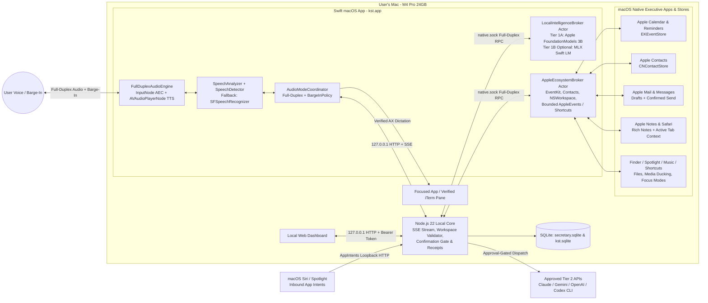
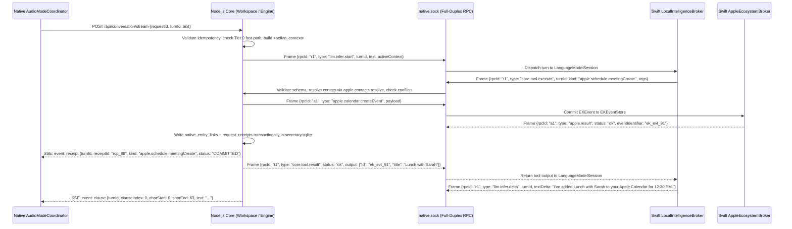
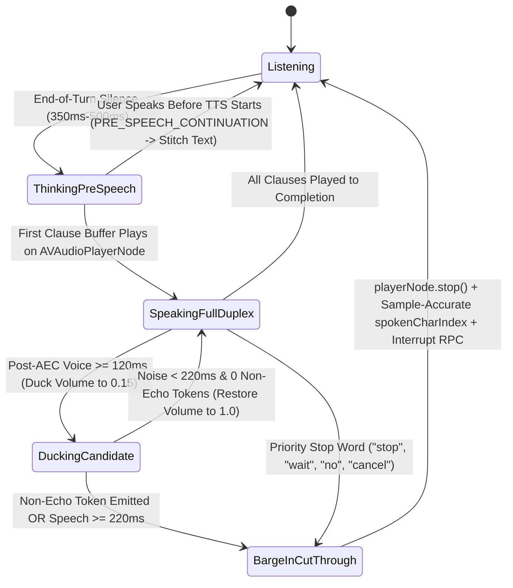

# KST `0.7.0` System Design Specification: Full-Duplex Voice, Tiered Intelligence & Apple-Native Executive Suite

**Status:** Principal-reviewed, implementation-ready architectural specification layered on `KST-CURRENT-SYSTEM-DESIGN.md` (`0.6.0-preview.1`)  
**Product:** kst (Personal Secretary companion)  
**Release Target:** `0.7.0-preview.1`  
**Primary Hardware Baseline:** Apple Silicon MacBook Pro M4 Pro (24 GB Unified Memory)  
**OS & Build Baseline:** macOS 26+ primary path ([Apple Foundation Models](https://developer.apple.com/documentation/foundationmodels) + [`SpeechAnalyzer`](https://developer.apple.com/documentation/speech/speechanalyzer)); macOS 14+ fallback path (`SFSpeechRecognizer` + deterministic/adaptive core); [MLX Swift LM](https://github.com/ml-explore/mlx-swift-lm) strictly **optional** (`KST_ENABLE_MLX=0` by default)  
**Ecosystem Shift in `0.7.0`:** Replaces the Google OAuth / Keychain / Gmail / Google Calendar stack (`GoogleAccountBroker.swift`, `packages/kst-core/src/google/`) with a zero-OAuth **Apple-Native Executive Suite** ([`EventKit`](https://developer.apple.com/documentation/eventkit/ekeventstore), [`Contacts`](https://developer.apple.com/documentation/contacts/cncontactstore), Mail, Messages, Notes, Safari, Finder/Spotlight, Music, and [Shortcuts CLI](https://support.apple.com/guide/shortcuts-mac/run-shortcuts-from-the-command-line-apd455c82f02/mac))

## 0. Principal Engineering Audit: 15 Implementation Blockers Identified & Resolved

A deep engineering audit of `KST-CURRENT-SYSTEM-DESIGN.md` (`0.6.0-preview.1`) and the `0.7.0` requirements uncovered 15 concrete audio, concurrency, context-window, Apple Events permission, and IPC traps. Every blocker below is resolved directly in this specification:

| # | Subsystem | Implementation Trap / Ambiguity | Resolution in This Specification |
|---|---|---|---|
| **G1** | **macOS AEC Reference Routing** | Calling `AVSpeechSynthesizer.speak(_:)` outputs to CoreAudio outside `AVAudioEngine`. Enabling [`inputNode.setVoiceProcessingEnabled(true)`](https://developer.apple.com/documentation/avfaudio/avaudioionode/setvoiceprocessingenabled(_:)) cannot cancel speaker echo unless TTS audio flows through the **same** `AVAudioEngine.outputNode` ([Voice Agent Echo Analysis](https://barock.dev/2026/04/22/why-your-ios-voice-agent-still-hears-itself)). | Route TTS PCM buffers via [`AVSpeechSynthesizer.write(_:toBufferCallback:toMarkerCallback:)`](https://developer.apple.com/documentation/avfaudio/avspeechsynthesizer/write(_:tobuffercallback:tomarkercallback:)) into an `AVAudioPlayerNode` attached to the active `AVAudioEngine` graph, backed by an n-gram self-echo transcript filter (Section 4.1). |
| **G2** | **Sample-Accurate `spokenCharIndex`** | `AVSpeechSynthesizer.write(_:toBufferCallback:toMarkerCallback:)` synthesizes buffers **10x faster than real-time**. Updating `spokenCharIndex` when `toMarkerCallback` fires marks the whole sentence as "spoken" in 40ms before the speaker plays the first word. | Map each `.word` `AVSpeechSynthesisMarker` to its scheduled output `AVAudioFramePosition` and query `playerNode.playerTime(forNodeTime:)` at the exact instant of barge-in (Section 4.3). |
| **G3** | **`AVAudioEngine` Format Crash** | Enabling `setVoiceProcessingEnabled(true)` changes `inputNode` hardware sample rate/channels (e.g., 48 kHz). Installing an audio tap with a hardcoded 16 kHz format throws an uncatchable Objective-C `AVAEInternal` exception. | Query `inputNode.outputFormat(forBus: 0)` *after* enabling voice processing, install the tap with the hardware format, convert via `AVAudioConverter`, and handle `AVAudioEngineConfigurationChange` on AirPods/route switches (Section 4.1). |
| **G4** | **iOS-Only Audio APIs on macOS** | Initial notes cited [`AVAudioSession.setPrefersEchoCancelledInput(true)`](https://developer.apple.com/documentation/avfaudio/avaudiosession/setprefersechocancelledinput(_:)), which does not exist in macOS `AppKit`. | Replaced with macOS `AVAudioEngine` voice processing on `inputNode` + `outputNode` and CoreAudio `AudioObjectAddPropertyListenerBlock` on `kAudioHardwarePropertyDefaultOutputDevice` (Section 4.1). |
| **G5** | **Pre-Speech User Pause ("Turn Stitching")** | Reducing end-of-turn silence from `1.5s` to `350ms` means a brief mid-sentence pause triggers turn `trn_1`. If the user keeps speaking 150ms later *before* TTS starts (`spokenCharIndex == 0`), treating it as a barge-in splits one sentence into two broken turns. | Distinguish **`PRE_SPEECH_CONTINUATION` (`spokenCharIndex == 0`)** from **`MID_SPEECH_BARGE_IN` (`spokenCharIndex > 0`)**: abort uncommitted `trn_1` and stitch `<transcript_1> + " " + <transcript_2>` into a single unified turn (Section 4.2). |
| **G6** | **Inverted Tool Loop Across Swift & Node.js** | Apple's [`LanguageModelSession`](https://developer.apple.com/documentation/foundationmodels/languagemodelsession) executes [`Tool.call(arguments:)`](https://developer.apple.com/documentation/foundationmodels/tool) inside Swift during generation, whereas KST's `Workspace` state, receipts, and confirmation gates live in Node.js (`packages/kst-core`). | Defined a **Full-Duplex Correlated Unix Socket RPC Protocol** (`native.sock`) where Node sends `llm.infer.start`, Swift `Tool.call(arguments:)` invokes `core.tool.execute` back to Node for validation, and Node invokes `apple.*` native bridge RPCs when executing validated Apple app actions (Section 3.3 & Section 6). |
| **G7** | **Unified Socket Replacing Google Broker** | Removing Google OAuth eliminates `GoogleAccountBroker.swift`, Keychain refresh tokens, and `google.sock`, allowing a single clean full-duplex Unix socket (`native.sock`) without head-of-line blocking. | Replaced `GoogleBrokerSocket.swift` with a single full-duplex `NativeSystemBrokerSocket.swift` (`native.sock`) multiplexing `llm.infer.*`, `core.tool.execute`, and `apple.*` native bridge RPCs via correlation `rpcId` frames (Section 2.2 & Section 8.4). |
| **G8** | **Apple 3B 4,096-Token Context Limit** | Apple's on-device ~3B model has a hard **4,096-token** context ceiling ([Apple Foundation Models Tech Report](https://machinelearning.apple.com/research/apple-foundation-models-tech-report-2025)). Adding 9 Apple app integrations as separate tools would overflow the context window. | Consolidated all KST and Apple-native actions into **6 compact `@Generable` domain tools** (`<= 950` tokens total) and enforced a strict 4,096-token budget with automatic session compaction recovery (Section 3.4 & Section 3.5). |
| **G9** | **Command Line Tools vs. `MLX Swift LM`** | `KST-CURRENT-SYSTEM-DESIGN.md` Section 13 requires building with Command Line Tools without full Xcode, whereas [MLX Swift](https://github.com/ml-explore/mlx-swift) requires full Xcode's `metal` compiler for `.metal` shaders. | Gated [MLX Swift LM](https://github.com/ml-explore/mlx-swift-lm) behind an opt-in build flag (`KST_ENABLE_MLX=1`, default `0`) and dynamic SPM conditional target so standard CLI builds succeed with zero MLX dependencies (Section 3.2 & Section 10). |
| **G10** | **Barge-In Mid-Mutation Semantics** | If a user barges in right after a local Calendar/Reminder/Task write commits, silently rolling back violates Section 11 Invariant 4 (*"Completed effects cannot be undone"*), while ignoring it causes duplicates when the user corrects a slot. | Commit local writes before speaking, emit `event: receipt` immediately, mark interrupted turns `COMMITTED_INTERJECTED`, and pin `lastMutatedEntity` in `<active_context>` so the user's correction updates that exact `EKEvent` / `EKReminder` / SQLite ID in place (Section 5.2). |
| **G11** | **Global `Stop` vs. Conversational Barge-In** | Section 5.3 of `0.6.0-preview.1` states global `Stop` invalidates all pending approvals and closes audio capture. Conversational barge-in must **not** cancel unrelated background jobs or disarm the mic. | Separated **Conversational Barge-In** (`POST /api/conversation/interrupt`, scoped strictly to `turnId` TTS/LLM stream while keeping mic open) from **Global Stop** (`POST /api/stop`, which kills all jobs, approvals, and audio capture) (Section 5.3). |
| **G12** | **Unconfirmed Outbound iMessage / Mail Hazard** | Allowing an on-device 3B LLM to directly send an iMessage via `Messages.app` or an email via `Mail.app` on a single misheard voice turn risks irreversible external embarrassment. | Enforced a mandatory **Two-Stage Preview & Confirmation Gate** in `Engine` for all external outbound communications (`apple.mail.send`, `apple.messages.send`, external calendar invites), while allowing instant execution for local drafts and read queries (Section 6.2). |
| **G13** | **AppleScript / ScriptingBridge Main-Thread Hang** | Executing `NSAppleScript` or `ScriptingBridge` calls to `Mail.app`, `Messages.app`, `Notes.app`, or `Safari.app` if the target app is hung or showing a modal dialog can block the Swift caller indefinitely. | Isolated all Apple Event / ScriptingBridge execution inside a dedicated background `AppleAutomationExecutor` actor using `NSUserAppleScriptTask` / `osascript` subprocesses with a strict **3.0-second timeout** and fail-closed error reporting (Section 6.3). |
| **G14** | **Dual-Source Truth Split (`secretary.sqlite` vs. `EventKit` / `Notes`)** | If Calendar events, Reminders, and Notes live in Apple's native stores while KST's `Workspace` still expects SQLite records for receipts and idempotency, state will diverge. | Defined a **Native-Primary, Receipt-Backed Storage Architecture**: `EKEventStore` (`calendarIdentifier`, `calendarItemIdentifier`) and `Notes.app` (`x-coredata://...` ID) are authoritative for schedule/reminder/note content, while `secretary.sqlite` stores lightweight `native_entity_links` and transactional request receipts (Section 6.1 & Section 7). |
| **G15** | **TCC & `AppIntents` Identity Reset** | Ad-hoc signing (`codesign -s -`) resets macOS Microphone, Speech, Accessibility, Calendar, Reminders, Contacts, Automation (`NSAppleEventsUsageDescription`), and Siri `AppIntents` permissions on every rebuild. | Updated `apps/macos/build-app.sh` to use a persistent local self-signed code-signing identity (`KST_CODESIGN_IDENTITY`, fallback `-`) and explicit `Info.plist` usage strings for all native frameworks (Section 10.2). |

## 1. Architectural Delta Summary (`0.6.0-preview.1` vs. `0.7.0`)

| Subsystem | Current `0.6.0-preview.1` Implementation | Target `0.7.0` Implementation | Affected Source Paths |
|---|---|---|---|
| **Google Integration (Removed)** | `GoogleAccountBroker.swift`, `GoogleBrokerSocket.swift`, `GoogleOAuthLoopback.swift`, Keychain OAuth tokens, and `packages/kst-core/src/google/` | **Removed**; replaced entirely by native macOS [`EventKit`](https://developer.apple.com/documentation/eventkit/ekeventstore) (which natively syncs iCloud, Google, and Exchange calendars configured in macOS) and `Mail.app` automation | Delete `Google*.swift` & `packages/kst-core/src/google/`; add `AppleEcosystemBroker.swift` |
| **Audio Duplex & Echo Control** | Half-duplex turn-taking; mic capture pauses while `AVSpeechSynthesizer` speaks | Full-duplex shared `AVAudioEngine` graph (`inputNode` + `AVAudioPlayerNode` -> `outputNode`) with hardware AEC via [`setVoiceProcessingEnabled(true)`](https://developer.apple.com/documentation/avfaudio/avaudioionode/setvoiceprocessingenabled(_:)) and CoreAudio route detection | `apps/macos/Sources/KstApp/VoiceInput.swift`, `AudioModeCoordinator.swift` |
| **Speech Detection & Turn Finalization** | `SFSpeechRecognizer` only; waits 1.5s of unchanged text (5s deadline) before sending batch POST | Primary [`SpeechAnalyzer`](https://developer.apple.com/documentation/speech/speechanalyzer) + [`SpeechTranscriber`](https://developer.apple.com/documentation/speech/speechtranscriber) + [`SpeechDetector`](https://developer.apple.com/documentation/speech/speechdetector) (macOS 26+) with `SFSpeechRecognizer` fallback; adaptive 350ms–600ms end-of-turn | `apps/macos/Sources/KstApp/VoiceInput.swift`, `apps/macos/Sources/KstNativeCore/WakeGate.swift` |
| **TTS Rendering & Barge-In ("Cut It Through")** | Direct `AVSpeechSynthesizer.speak` (up to 1,200 chars); no interruption during playback | Clause-buffered synthesis via [`write(_:toBufferCallback:toMarkerCallback:)`](https://developer.apple.com/documentation/avfaudio/avspeechsynthesizer/write(_:tobuffercallback:tomarkercallback:)) into `AVAudioPlayerNode`; <15ms stop on barge-in with sample-accurate `AVAudioFramePosition` word tracking | `apps/macos/Sources/KstApp/AudioModeCoordinator.swift`, `apps/macos/Sources/KstNativeCore/BargeInPolicy.swift` (new) |
| **Primary Local Intelligence (Tier 1A)** | `localReasoning: false`; deterministic regex/slot rules in `Workspace.converse` + optional classifier | Built-in `LocalIntelligenceBroker` actor in Swift using [Apple Foundation Models (~3B)](https://developer.apple.com/documentation/foundationmodels) (`LanguageModelSession`, `@Generable`, [`Tool`](https://developer.apple.com/documentation/foundationmodels/tool)) over unified `native.sock` | `apps/macos/Sources/KstApp/LocalIntelligenceBroker.swift` (new), `NativeSystemBrokerSocket.swift` (new), `packages/kst-core/src/workspace.mjs` |
| **Optional Local Deep Model (Tier 1B)** | None | **Strictly Optional** compile-time/runtime plugin (`KST_ENABLE_MLX=1`, default `0`) using [MLX Swift LM](https://github.com/ml-explore/mlx-swift-lm) (4-bit 8B–14B models) conforming to [`LanguageModel`](https://developer.apple.com/documentation/foundationmodels/languagemodel) | `apps/macos/Sources/KstMlxPlugin/` (optional target), `apps/macos/build-app.sh` |
| **Apple-Native Executive Suite** | Isolated SQLite reminders/notes; blind Chrome Incognito search handoff; no Contacts, iMessage, Safari, Finder, Music, or Focus integration | Native `AppleEcosystemBroker` integrating [`EventKit`](https://developer.apple.com/documentation/eventkit/ekeventstore) (Calendar + Reminders), [`Contacts`](https://developer.apple.com/documentation/contacts/cncontactstore), `Mail.app`, `Messages.app`, `Notes.app`, `Safari.app`, Spotlight/[`NSWorkspace`](https://developer.apple.com/documentation/appkit/nsworkspace), `Music.app`, and [`/usr/bin/shortcuts`](https://support.apple.com/guide/shortcuts-mac/run-shortcuts-from-the-command-line-apd455c82f02/mac) | `apps/macos/Sources/KstApp/AppleEcosystemBroker.swift` (new), `packages/kst-core/src/apple/` (new) |
| **External Cloud & Coding Escalation (Tier 2)** | Manual commands for OpenAI, [Anthropic Claude](https://platform.claude.com/docs/en/models/overview), and [OpenAI Codex CLI](https://github.com/openai/codex) | Tier 1 tool `KstExternalEscalationTool` automatically stages approval-bound prompts for [Claude](https://platform.claude.com/docs/en/agents-and-tools/tool-use/overview), [Google Gemini](https://aistudio.google.com/docs/function-calling), OpenAI, or [Codex CLI](https://learn.chatgpt.com/docs/codex/cli) | `packages/kst-core/src/external.mjs`, `engine.mjs` |
| **System Siri Integration** | Not implemented | Inbound [App Intents](https://developer.apple.com/documentation/appintents) (`AskKstIntent`, `CreateKstTaskIntent`, `CreateKstReminderIntent`) forwarding to local core | `apps/macos/Sources/KstApp/Intents/KstAppIntents.swift` (new) |

## 2. System Boundary, Trust Model, and Unified Native Broker Bootstrap

### 2.1 Trust Boundary Invariants

1. **Clients vs. Core Authority**: The macOS native app, web dashboard, and Siri `AppIntents` are clients. The Node.js 22 local core is the **single authority** for request validation, entity revision checking, two-stage outbound communication confirmations (`Mail.app` / `Messages.app`), and Tier 2 external-service approval gating.
2. **LLMs Are Untrusted Proposers**: Neither [Apple Foundation Models](https://developer.apple.com/documentation/foundationmodels) nor the optional [MLX Swift LM](https://github.com/ml-explore/mlx-swift-lm) plugin has direct access to `secretary.sqlite`, [`EKEventStore`](https://developer.apple.com/documentation/eventkit/ekeventstore), Apple Events, shell execution, or outbound network sockets. An LLM can only emit structured tool arguments that are validated by the Node.js core before the core dispatches verified commands to `AppleEcosystemBroker`.



### 2.2 Unified `native.sock` Stdin Bootstrap (Replacing Google Bootstrap in Section 3.2)

With Google OAuth removed, `CoreSupervisor.swift` initializes a single full-duplex Unix domain socket (`native.sock`, mode `0600` in `~/Library/Application Support/kst-dev/core/run/native.sock`) that serves both `LocalIntelligenceBroker` and `AppleEcosystemBroker`. The bootstrap JSON written to the supervised Node.js core's `stdin` is:

```json
{
  "bootstrapVersion": 2,
  "nativeSocketPath": "/Users/<user>/Library/Application Support/kst-dev/core/run/native.sock",
  "nativeCapability": "<64-char-hex-random-capability>",
  "intelligenceConfig": {
    "foundationModelsAvailable": true,
    "mlxPluginCompiled": false,
    "mlxOptionalEnabled": false,
    "activeTier1Provider": "foundationModels"
  },
  "applePermissions": {
    "calendar": "fullAccess",
    "reminders": "fullAccess",
    "contacts": "authorized",
    "automation": ["com.apple.mail", "com.apple.MobileSMS", "com.apple.Notes", "com.apple.Safari", "com.apple.Music"]
  }
}
```

* **Attach-Mode Re-Registration**: When `kst.app` attaches to an already healthy core (`GET /health` returns `200 OK`), `kst.app` registers its live `nativeSocketPath` and `nativeCapability` via `POST /api/system/register-broker` over loopback HTTP using the local bearer token.

## 3. Tiered Intelligence & Bidirectional Tool-Calling Architecture

### 3.1 Execution Tiers

| Tier | Engine | Default State | Memory Footprint on M4 Pro (24 GB) | Role & Routing Rule |
|---|---|---|---|---|
| **Tier 0: Deterministic Gate** | `KstNativeCore` (`WakeGate.swift`) + `Workspace` exact rules | **Always Active** | **0 MB** | Handles global `"stop"`, `"cancel"`, dictation mode switches (`"start typing..."`), wake-word stripping, and exact deterministic fast-path commands (`"what time is it"`, `"pause music"`). |
| **Tier 1A: Primary Local LLM** | [Apple Foundation Models (~3B)](https://developer.apple.com/documentation/foundationmodels) (`SystemLanguageModel.default`) | **Always Active** (on macOS 26+ with Apple Intelligence) | **0 MB app footprint** (OS-managed shared weights) | Handles all natural-language secretary conversations, 1–4 step tool calls across the Apple-Native Executive Suite, pronoun resolution, and Tier 2 escalation staging. |
| **Tier 1B: Optional Local Deep Model** | [MLX Swift LM](https://github.com/ml-explore/mlx-swift-lm) (4-bit 8B–14B model from [Hugging Face `mlx-community`](https://huggingface.co/mlx-community)) | **Strictly Optional** (Compile flag `KST_ENABLE_MLX=1` + user setting opt-in) | **~5.5–8.5 GB wired RAM** while active; **0 MB** when idle-evicted after 5 min | Invoked only when compiled and enabled by the user AND either (a) explicitly selected as primary local model, or (b) Tier 1A throws `guardrailViolation` / fails schema validation on a multi-step request. |
| **Tier 2: Approval-Gated Cloud & Code** | [Anthropic Claude](https://platform.claude.com/docs/en/models/overview), [Google Gemini](https://aistudio.google.com/docs/models), OpenAI, and [OpenAI Codex CLI](https://github.com/openai/codex) | **On-Demand Behind Approval Gate** | **< 200 MB** | Invoked when the user explicitly names a provider (*"Ask Claude..."*, *"Run Codex..."*) or when Tier 1 calls `KstExternalEscalationTool` for complex coding, large-context synthesis, or web-grounded research. Nothing dispatches until approved. |

### 3.2 Keeping `MLX Swift LM` Strictly Optional (`KST_ENABLE_MLX`)

1. **Default Build (`KST_ENABLE_MLX` unset or `0`)**: `apps/macos/Package.swift` inspects `ProcessInfo.processInfo.environment["KST_ENABLE_MLX"] == "1"`. By default, it excludes the `mlx-swift-lm` package dependency and compiles `KstApp` using only standard Apple frameworks (`FoundationModels`, `Speech`, `AVFAudio`, `EventKit`, `Contacts`, `AppIntents`). No `.metal` shader compilation or full Xcode installation is required.
2. **Optional MLX Build (`KST_ENABLE_MLX=1 bash apps/macos/build-app.sh`)**: When full Xcode is installed and the user sets `KST_ENABLE_MLX=1`, `Package.swift` includes the `KstMlxPlugin` target wrapping [`mlx-swift-lm`](https://github.com/ml-explore/mlx-swift-lm) behind Apple's [`LanguageModel` protocol](https://developer.apple.com/documentation/foundationmodels/languagemodel) and sets `-DKST_MLX_ENABLED`.
3. **Hard Memory Ceiling & Pressure Eviction**: When Tier 1B is enabled at runtime, `LocalIntelligenceBroker` subscribes to `DispatchSource.makeMemoryPressureSource(eventMask: [.warning, .critical])`. On `.warning`, `.critical`, or 300 seconds of voice inactivity, it immediately releases the `ModelContainer` and runs `MLX.GPU.clearCache()`.

### 3.3 Bidirectional Unix Socket RPC Loop (`NativeSystemBrokerSocket.swift`)

In Apple's [Foundation Models framework](https://developer.apple.com/documentation/foundationmodels), [`LanguageModelSession`](https://developer.apple.com/documentation/foundationmodels/languagemodelsession) drives tool calling inside Swift via [`Tool.call(arguments:)`](https://developer.apple.com/documentation/foundationmodels/tool). To keep the Node.js core as the single authority for validation, confirmation staging, and receipt persistence, every tool call flows through the Node core before invoking `AppleEcosystemBroker`:



### 3.4 Token Budget & Context Compaction for the 4,096-Token Window

Apple's on-device ~3B model (`SystemLanguageModel.default`) enforces a hard **4,096-token** context window ([Apple Foundation Models Tech Report](https://machinelearning.apple.com/research/apple-foundation-models-tech-report-2025)). To prevent `LanguageModelSession.GenerationError.exceededContextWindowSize` while supporting all 9 Apple-native integrations:

| Context Segment | Hard Token Cap | Enforcement Mechanism |
|---|---|---|
| **System Instructions + 6 Consolidated Tool Schemas** | **<= 950 tokens** | Group all workspace and Apple-native actions into **6 domain `@Generable` tools** (defined in Section 3.5) with terse `@Guide` descriptions. |
| **`<active_context>` State Header** | **<= 300 tokens** | Capped to top 8 recent entities (`id`, `sourceApp`, `title`, `time`, `rev`), active Safari tab title/domain (if open), and up to 2 pending confirmation tokens. |
| **Rolling Ephemeral Turn History** | **<= 1,400 tokens** (max 6 turns) | Stored in Node `Engine`; raw tool-call JSON outputs from prior turns are compacted into 1-line receipt summaries (`[Tool apple.schedule.reminderCreate -> ek_rem_14 committed]`). |
| **Current User Prompt + Tool Outputs** | **<= 600 tokens** | `core.tool.execute` truncates list/search results (Calendar events, unread Mail headers, Spotlight files, Safari reader text) to top 5 items or `<= 1,800` chars total. |
| **Model Output Headroom** | **>= 846 tokens** | Guarantees room for up to 4 tool calls (`maxToolCallsPerTurn = 4`) plus a 1,200-char spoken reply. |

### 3.5 The 6 Consolidated `@Generable` Domain Tools (`LocalIntelligenceBroker.swift`)

To maximize 3B model tool-selection accuracy and stay under 950 schema tokens, all KST and Apple-native operations map to 6 tools:

| Tool Struct Name | Operations (`operation` Enum) | Backing Authority & Apple Integration |
|---|---|---|
| **`KstScheduleTool`** | `calendarList`, `calendarAvailability`, `meetingCreate`, `meetingReschedule`, `meetingCancel`, `reminderCreate`, `reminderComplete`, `reminderModify`, `planPropose` | Native [`EventKit` (`EKEventStore`)](https://developer.apple.com/documentation/eventkit/ekeventstore) for Calendar & Reminders + `secretary.sqlite` focus blocks/plans |
| **`KstCommunicationTool`** | `contactResolve`, `mailSearchUnread`, `mailReadThread`, `mailDraftPreview`, `imessagePreviewSend` | Native [`Contacts` (`CNContactStore`)](https://developer.apple.com/documentation/contacts/cncontactstore) + `Mail.app` & `Messages.app` via `AppleAutomationExecutor` (outbound sends always stage a confirmation preview first) |
| **`KstKnowledgeTool`** | `noteCreate`, `noteAppend`, `noteSearch`, `taskCreate`, `taskComplete`, `taskList` | `Notes.app` (`"KST Secretary"` folder via Apple Events) + internal KST tasks in `secretary.sqlite` |
| **`KstDesktopContextTool`** | `safariActiveTabContext`, `safariOpenUrl`, `spotlightFileSearch`, `finderRevealFile`, `appLaunchOrFocus` | `Safari.app` active tab URL/text via Apple Events + Spotlight (`NSMetadataQuery`) + [`NSWorkspace`](https://developer.apple.com/documentation/appkit/nsworkspace) |
| **`KstEnvironmentTool`** | `confirmPendingAction`, `cancelPendingAction`, `musicPlaybackControl`, `focusShortcutRun` | `Engine` confirmation resolver (approves staged Mail/iMessage/plan) + `Music.app` control + reviewed [`/usr/bin/shortcuts`](https://support.apple.com/guide/shortcuts-mac/run-shortcuts-from-the-command-line-apd455c82f02/mac) |
| **`KstExternalEscalationTool`** | `stageCloudApproval` (`claude`, `gemini`, `openai`, `codex`) | Stages pending approval in `Engine` `/api/approvals` for Tier 2 cloud or repo analysis |

```swift
import Foundation
import FoundationModels

@Generable
struct KstCommunicationArguments: Codable, Sendable {
  @Guide(description: "Operation: contactResolve, mailSearchUnread, mailReadThread, mailDraftPreview, or imessagePreviewSend")
  let operation: String
  @Guide(description: "Person name, email, or phone query to resolve via Apple Contacts")
  let recipientOrQuery: String?
  @Guide(description: "Email subject line when creating a Mail.app draft")
  let subject: String?
  @Guide(description: "Message body text for Mail draft or iMessage preview")
  let bodyText: String?
}

struct KstCommunicationTool: Tool {
  let name = "kst_communication"
  let description = "Resolve contacts in Apple Contacts, read/draft emails in Apple Mail, or stage an iMessage in Apple Messages."
  typealias Arguments = KstCommunicationArguments

  let turnId: String
  let brokerSocket: NativeSystemBrokerSocket

  func call(arguments: KstCommunicationArguments) async throws -> String {
    return try await brokerSocket.executeCoreTool(
      turnId: turnId,
      kind: "apple.comm.\(arguments.operation)",
      arguments: arguments
    )
  }
}
```

## 4. Full-Duplex Audio & Sample-Accurate Barge-In Specification ("Cut It Through")

### 4.1 Unified `FullDuplexAudioEngine` & Hardware AEC Routing (`VoiceInput.swift`)

On macOS, `AVAudioEngine`'s Voice Processing I/O unit (`kAudioUnitSubType_VoiceProcessingIO`) strips speaker playback from the microphone input **only when speaker audio flows through the same `AVAudioEngine.outputNode`** ([WWDC19 AVAudioEngine Voice Processing](https://developer.apple.com/videos/play/wwdc2019/510/)).

```mermaid
flowchart LR
  subgraph FullDuplexAudioEngine[Single AVAudioEngine Instance in VoiceInput.swift]
    Mic[MacBook Pro Mic\nAVAudioInputNode]
    Tap[Input Tap\nHardware Format -> 16kHz Mono Converter]
    Synth[AVSpeechSynthesizer\nwrite(_:toBufferCallback:toMarkerCallback:)]
    Converter[AVAudioConverter\n22.05kHz PCM -> Mixer Format]
    Player[AVAudioPlayerNode\nSample-Tracked Buffer Queue]
    Mixer[mainMixerNode]
    Speaker[MacBook Pro Speakers\nAVAudioOutputNode]
    AEC[Hardware VoiceProcessingIO\nInternal AEC Reference]
  end

  Synth -->|PCM Buffers + Word Frame Offsets| Converter
  Converter --> Player
  Player --> Mixer
  Mixer --> Speaker
  Speaker -.->|CoreAudio Output Reference| AEC
  Mic --> AEC
  AEC --> Tap
```

#### Exact Initialization Order (Preventing `AVAEInternal` Format Exceptions):
1. Call `engine.stop()` if running, and if `Music.app` is currently playing out of built-in speakers, optionally duck/pause `Music.app` via `AppleEcosystemBroker`.
2. Enable voice processing on both I/O nodes **before** querying formats or attaching taps:
   ```swift
   try engine.inputNode.setVoiceProcessingEnabled(true)
   try engine.outputNode.setVoiceProcessingEnabled(true)
   engine.inputNode.isVoiceProcessingAGCEnabled = true
   ```
3. Attach `playerNode` (`engine.attach(playerNode)`) and connect it to `engine.mainMixerNode` using `let mixerFormat = engine.mainMixerNode.outputFormat(forBus: 0)`.
4. Query `let hwInputFormat = engine.inputNode.outputFormat(forBus: 0)` *after* step 2, install the input tap using `hwInputFormat`, and convert each buffer to `16 kHz` mono PCM (`AVAudioCommonFormat.pcmFormatFloat32`) via `AVAudioConverter` before feeding [`SpeechAnalyzer`](https://developer.apple.com/documentation/speech/speechanalyzer) / `SFSpeechAudioBufferRecognitionRequest`.
5. Register a listener for `Notification.Name.AVAudioEngineConfigurationChange` and CoreAudio `kAudioHardwarePropertyDefaultOutputDevice`. When headphones/AirPods connect or disconnect:
   - Tear down the input tap, re-read `hwInputFormat` and `mixerFormat`, reconnect `playerNode`, and restart `engine`.
   - Inspect `kAudioDevicePropertyTransportType`: if the output route is headphones, disable speaker ducking and lower the Stage 1 barge-in threshold from `150ms` to `100ms`.

### 4.2 Two-Stage Barge-In & Pre-Speech Continuation State Machine (`BargeInPolicy.swift`)



1. **Scenario A — `PRE_SPEECH_CONTINUATION` (User Pauses Mid-Thought Before TTS Starts)**:
   - The user says *"Schedule lunch with Sarah tomorrow at 12:30"* (pauses 400ms, triggering `trn_01`), and 150ms later—before `playerNode` has played any audio (`spokenCharIndex == 0`)—continues *"at Blue Bottle Coffee."*
   - In Node.js, mutating tools include a **180ms pre-commit hold** when `source == "voice"`. Because `trn_01` has not spoken or committed yet, `AudioModeCoordinator` sends `POST /api/conversation/interrupt { turnId: "trn_01", spokenCharIndex: 0, reason: "user_continuation" }` and prepends `"Schedule lunch with Sarah tomorrow at 12:30 "` to the ongoing transcript buffer so the combined sentence is submitted as `trn_02`.
2. **Scenario B — Brief Cough / Desk Bump During TTS (`DuckingCandidate` -> Restore)**:
   - Post-AEC voice activity persists for `120ms` while `playerNode` is speaking: `playerNode.volume` immediately ducks to `0.15`.
   - Activity ceases before `220ms` and [`SpeechTranscriber`](https://developer.apple.com/documentation/speech/speechtranscriber) emits zero tokens: `playerNode.volume` ramps back to `1.0` without interrupting playback.
3. **Scenario C — Genuine Verbal Barge-In (`BargeInCutThrough`)**:
   - Post-AEC speech persists `>= 220ms` with at least 1 non-echo token (verified by `BargeInPolicy`'s n-gram self-echo filter against the currently playing clause text) OR matches a priority interrupt word (`"stop"`, `"wait"`, `"no"`, `"hold"`, `"cancel"`, `"actually"`):
     1. Read `let playerTime = playerNode.playerTime(forNodeTime: lastRenderTime)` to capture the exact played `sampleTime`.
     2. Call `playerNode.stop()`, `playerNode.reset()`, and [`synthesizer.stopSpeaking(at: .immediate)`](https://developer.apple.com/documentation/avfaudio/avspeechsynthesizer/stopspeaking(at:)) (silencing audio in `<15ms`).
     3. Abort the active SSE request for `turnId` and send `POST /api/conversation/interrupt` with the sample-verified `spokenCharIndex`.

### 4.3 Sample-Accurate `spokenCharIndex` Ledger (`BargeInPolicy.swift`)

Because [`AVSpeechSynthesizer.write(_:toBufferCallback:toMarkerCallback:)`](https://developer.apple.com/documentation/avfaudio/avspeechsynthesizer/write(_:tobuffercallback:tomarkercallback:)) generates PCM buffers and word markers ahead of real-time speaker playback, `BargeInPolicy` maintains a `ScheduledWordLedger`:

1. When `POST /api/conversation/stream` delivers `clauseIndex` with `[charStart, charEnd)`, `AudioModeCoordinator` passes the clause `AVSpeechUtterance` to `synthesizer.write(...)`.
2. Each `AVAudioPCMBuffer` converted to `mixerFormat` increments `totalScheduledFrames += Int64(convertedBuffer.frameLength)`.
3. Each `.word` marker in `toMarkerCallback` (`AVSpeechSynthesisMarker`) carries `byteSampleOffset` and `textRange: NSRange`. `BargeInPolicy` converts `byteSampleOffset` into the corresponding `outputSampleFrame: AVAudioFramePosition` and appends:
   ```swift
   ScheduledWordSpan(
     outputFrameStart: wordOutputFrameStart,
     outputFrameEnd: wordOutputFrameEnd,
     globalCharEnd: clause.charStart + marker.textRange.location + marker.textRange.length
   )
   ```
4. At the instant of barge-in, `BargeInPolicy.spokenCharIndex(atSampleTime: playerTime.sampleTime)` performs a binary search over `ScheduledWordSpan` to return `globalCharEnd` of the last word whose `outputFrameStart <= playerTime.sampleTime`.

## 5. Multi-Turn Dialogue State, Mutation Semantics & Stop Hierarchy

### 5.1 Rolling Ephemeral Conversation Buffer (`Engine`)

* **In-Memory Ring Buffer (Max 6 User + 6 Assistant Turns / 15-Minute TTL)**:
  - Stored in `Engine` runtime memory (`packages/kst-core/src/engine.mjs`). Cleared automatically after 15 minutes of idle time, on `"end conversation"`, on `"clear context"`, or on global `Stop`.
* **Deterministic `<active_context>` Header (`<= 300 Tokens`)**:
  - Injected into `llm.infer.start`:
    - `nowIso`, `timezone`, and `dayOfWeek`.
    - `lastMutatedEntity`: If the immediately preceding turn committed a write (`calendarEvent`, `reminder`, `note`, `task`, `mailDraft`), its `{ id, nativeId, kind, title, scheduledAt, revision, receiptId }` is pinned first.
    - `recentEntities`: Up to 8 entities or resolved `CNContact` records touched in the last 3 turns.
    - `frontmostAppContext`: Current active app bundle ID and, if `Safari.app` is frontmost, `{ title, domain, url }` of the active tab.
    - `pendingConfirmations`: Active 90-second tokens for `plan.apply`, staged `Mail.app` send, staged `Messages.app` send, external calendar invite, or Tier 2 `/api/approvals/:id`.

### 5.2 Interrupt-Safe Mutation Semantics

| Tool Category | Execution Timing During Stream | Behavior on Barge-In (`POST /api/conversation/interrupt`) |
|---|---|---|
| **Read-Only Queries** (`calendarList`, `contactResolve`, `mailSearchUnread`, `safariActiveTabContext`, `spotlightFileSearch`) | Executes immediately on `core.tool.execute` callback | Unspoken results discarded; zero side effects. |
| **Local Reversible Writes** (`meetingCreate` [no external guests], `reminderCreate`, `noteCreate`, `taskCreate`, `mailDraftPreview` [saves visible draft in Mail.app]) | Holds `180ms` for `PRE_SPEECH_CONTINUATION`, then commits via `AppleEcosystemBroker` + `secretary.sqlite` *before* streaming confirmation clause and emits `event: receipt` | **Never silently rolled back** (honoring Section 11 Invariant 4). Receipt status becomes `COMMITTED_INTERJECTED` and the entity (`ek_evt_...`, `ek_rem_...`, `note_...`) is pinned as `lastMutatedEntity` in `<active_context>` so a follow-up correction (*"No, make it 4 PM"*) updates or deletes that exact native item in place. |
| **Outbound Communications & External Actions** (`imessagePreviewSend`, `mailSendConfirmed`, `meetingCreate` [with external attendee invites], `stageCloudApproval`) | **Always two-stage**: Turn 1 creates a staged preview token in `Engine` and speaks the recipient + summary | Staged preview remains pending (or is updated if the user modifies the message/recipient in the interrupting turn); **no iMessage or email ever leaves the Mac without an explicit second-turn confirmation** (*"Yes, send it"*). |

### 5.3 Hierarchy of `Barge-In` vs. Global `Stop` (Updating Section 5.3)

| Control Signal | Trigger | Scope of Cancellation | Microphone & Session State After Signal |
|---|---|---|---|
| **Conversational Barge-In** (`POST /api/conversation/interrupt`) | User speaks over assistant TTS during an open discussion | Cancels **only** the active `turnId` TTS playback and LLM generation stream; preserves background Codex/external jobs, staged previews, and rolling dialogue context | Microphone stays **OPEN** in `.listening` mode to capture the user's interrupting sentence |
| **Global Stop** (`POST /api/stop`) | Explicit native Stop button, menu bar Stop, or spoken command `"KST stop listening"` / `"terminate all"` | Invalidates all dialogue state, staged message previews, and pending approvals, asks owned external/Codex jobs to cancel, and halts TTS | Immediately **CLOSES** microphone capture and exits discussion mode |

## 6. Apple-Native Executive Suite Architecture (`AppleEcosystemBroker.swift`)

### 6.1 Native Integration Matrix (Replacing Section 8 Google Architecture)

| Apple App / Service | Native API / Mechanism in `AppleEcosystemBroker` | Capabilities Exposed to KST | Permission & Safety Gate |
|---|---|---|---|
| **Apple Calendar** | [`EventKit` (`EKEventStore`)](https://developer.apple.com/documentation/eventkit/ekeventstore) via [`requestFullAccessToEvents()`](https://developer.apple.com/documentation/eventkit/ekeventstore/requestfullaccesstoevents(completion:)) + [`EKEventStoreChangedNotification`](https://developer.apple.com/documentation/eventkit/ekeventstorechangednotification) | Sub-5ms query across all macOS-configured calendars (iCloud, Google, Exchange); create/move/delete events; instant push updates to Node scheduler for meeting nudges | Solo events commit immediately with receipt; events with external attendees (`attendees.count > 0`) stage a confirmation preview first |
| **Apple Reminders** | [`EventKit` (`EKEventStore`)](https://developer.apple.com/documentation/eventkit/ekeventstore) via [`requestFullAccessToReminders()`](https://developer.apple.com/documentation/eventkit/ekeventstore/requestfullaccesstoreminders(completion:)) | Create, complete, reschedule, and list reminders in a dedicated `"KST"` list or user-named lists; syncs automatically to iPhone and Apple Watch | Commits with `calendarItemIdentifier` linked in `secretary.sqlite` for idempotency and voice follow-up edits |
| **Apple Contacts** | [`Contacts` (`CNContactStore`)](https://developer.apple.com/documentation/contacts/cncontactstore) (`unifiedContacts(matching:keysToFetch:)`) | Resolves spoken names/nicknames/companies (*"Alex"*, *"my accountant"*) to full name, email addresses, and phone numbers in `<10ms` | Read-only access (`NSContactsUsageDescription`); if multiple contacts match `"Alex"`, returns candidate disambiguation list to Node core |
| **Apple Mail (`Mail.app`)** | Bounded Apple Events / `ScriptingBridge` (`com.apple.mail`) | Search unread/recent inbox messages (`sender`, `subject`, `dateReceived`, truncated plain-text `content`), create visible drafts, and send confirmed drafts | Creating a visible draft window is immediate; **sending** an email requires an explicit second-turn confirmation token in `Engine` |
| **Apple Messages (`Messages.app`)** | Bounded Apple Events (`com.apple.MobileSMS`) paired with `CNContactStore` handle verification | Stages and sends iMessage / SMS text updates to verified contacts (*"Text Sarah I'm running 5 minutes late"*) | **Strictly two-stage confirmed**: Turn 1 resolves the exact phone/Apple ID handle and reads back recipient + text; Turn 2 (`confirmPendingAction`) dispatches the message |
| **Apple Notes (`Notes.app`)** | Bounded Apple Events (`com.apple.Notes`) scoped to folder `"KST Secretary"` | Create rich HTML/checklist notes, append action items to an existing note, and search note titles/snippets | Scoped by default to the `"KST Secretary"` folder unless the user names another folder; never deletes notes without confirmation |
| **Apple Safari (`Safari.app`)** | Bounded Apple Events (`com.apple.Safari`) + [`NSWorkspace.shared.open(_:)`](https://developer.apple.com/documentation/appkit/nsworkspace) | Reads active tab `{URL, name, text}` (capped at `3,000` chars) when the user asks about the current page (*"Summarize this article"*); opens requested URLs or searches in Safari | Only reads Safari tab content when the user's turn explicitly references the current page/tab or browser |
| **Finder & Spotlight** | `NSMetadataQuery` (Spotlight API) + [`NSWorkspace`](https://developer.apple.com/documentation/appkit/nsworkspace) (`activateFileViewerSelecting(_:)`, `openApplication(at:configuration:)`) | Finds recent PDFs, documents, or project folders in `<50ms` and reveals them in Finder or opens the requested macOS application | Read/reveal/launch only; never moves, renames, or deletes user files |
| **Apple Music & Focus / Shortcuts** | `com.apple.Music` Apple Events + [`/usr/bin/shortcuts`](https://support.apple.com/guide/shortcuts-mac/run-shortcuts-from-the-command-line-apd455c82f02/mac) CLI subprocess | Auto-ducks/pauses Music during voice turns; plays named playlists; runs allowlisted macOS Shortcuts (e.g., toggling Focus / Do Not Disturb during KST focus blocks) | Only executes Shortcuts listed in the user's approved `allowedShortcuts` setting in `kst.sqlite` |

### 6.2 Two-Stage Outbound Communication Gate (`Mail.app` & `Messages.app`)

To uphold Section 11 Invariant 6 (Least Privilege) and Invariant 7 (Revalidate Before Effect):
1. When `LocalIntelligenceBroker` calls `KstCommunicationTool` with `operation: "imessagePreviewSend"` or `"mailDraftPreview"`:
   - The Node.js core first invokes `apple.contacts.resolve` over `native.sock`. If 0 or 2+ contacts match, the core returns `AMBIGUOUS_RECIPIENT` to the LLM so it asks the user to clarify (*"Did you mean Alex Chen or Alex Rivera?"*).
   - Once a single contact handle is verified, the core creates a 90-second `pendingConfirmation` record in `Engine` (`confirmationId: "cnf_01J9..."`, `kind: "imessage.send" | "mail.send"`, `recipientHandle`, `bodyHash`) and for Mail, optionally opens the visible draft window in `Mail.app`.
   - The assistant speaks the preview: *"I'm ready to text Alex Chen at (555) 019-2831: 'Running 5 minutes late.' Say 'send it' to confirm."*
2. On the next turn, when the user says *"Send it"* (or *"Yes, go ahead"*), `KstEnvironmentTool` calls `confirmPendingAction(confirmationId: "cnf_01J9...")`. The Node core verifies the token has not expired (90s TTL), verifies the payload hash, and dispatches `apple.messages.sendConfirmed` over `native.sock`.

### 6.3 Timeout-Protected `AppleAutomationExecutor` (Preventing Apple Event Hangs)

Unlike [`EKEventStore`](https://developer.apple.com/documentation/eventkit/ekeventstore) and [`CNContactStore`](https://developer.apple.com/documentation/contacts/cncontactstore) (which talk directly to background system daemons `CalendarAgent` and `contactsd`), `Mail.app`, `Messages.app`, `Notes.app`, `Safari.app`, and `Music.app` use Apple Events (`AEDesc`). If a target GUI app is showing a modal dialog or not responding, synchronous `ScriptingBridge` calls can hang the calling thread.

`AppleEcosystemBroker` isolates all Apple Event and Shortcuts calls inside `AppleAutomationExecutor`:
* Uses pre-compiled parameterized AppleScripts invoked with a hard **3.0-second `Task.withThrowingTaskGroup` timeout** (and terminates any stalled `/usr/bin/osascript` or `/usr/bin/shortcuts` child process on timeout or `Stop`).
* Checks `AEDeterminePermissionToAutomateTarget` before execution so missing macOS Automation permissions (`System Settings -> Privacy & Security -> Automation`) return a clean, structured `AUTOMATION_PERMISSION_DENIED` notice rather than hanging.

## 7. SQLite Schema & Native Entity Link Migrations (Updating Section 6)

Because [`EKEventStore`](https://developer.apple.com/documentation/eventkit/ekeventstore) and `Notes.app` are now the authoritative stores for calendar events, reminders, and notes, `secretary.sqlite` is updated on startup (`USER_VERSION` migration) to link KST receipts and plans to native Apple identifiers without duplicating raw Google cache files (`google.sqlite` is removed):

```sql
-- 1. Extend request_receipts for full-duplex streaming & barge-in
ALTER TABLE request_receipts ADD COLUMN turn_id TEXT;
ALTER TABLE request_receipts ADD COLUMN interrupted_at_char INTEGER;
ALTER TABLE request_receipts ADD COLUMN tier_used TEXT;
CREATE INDEX IF NOT EXISTS idx_request_receipts_turn_id ON request_receipts(turn_id);

-- 2. Link KST receipts, plans, and nudges to native Apple EventKit / Notes / Mail IDs
CREATE TABLE IF NOT EXISTS native_entity_links (
  kst_id TEXT PRIMARY KEY,
  apple_domain TEXT NOT NULL, -- 'calendar_event' | 'reminder' | 'note' | 'mail_draft' | 'imessage'
  native_identifier TEXT NOT NULL, -- EKEvent.eventIdentifier, EKReminder.calendarItemIdentifier, Note x-coredata URI
  title_summary TEXT NOT NULL,
  scheduled_at_iso TEXT,
  last_synced_at_iso TEXT NOT NULL,
  receipt_id TEXT NOT NULL
);
CREATE INDEX IF NOT EXISTS idx_native_entity_links_native_id ON native_entity_links(apple_domain, native_identifier);
```

## 8. Exact Wire Schemas & API Surface Deltas (Updating Section 10)

All `/api/google/*` endpoints from `0.6.0-preview.1` are removed and replaced by `/api/apple/*` and `/api/intelligence/*`. All `/api/*` endpoints bind exclusively to `127.0.0.1` and require `Authorization: Bearer <token>`.

### 8.1 Updated Endpoint Table

| Endpoint | Method | Role |
|---|---|---|
| `GET /health`, `GET /api/status` | `GET` | Readiness, capabilities (`fullDuplexVoice`, `bargeIn`, `appleNativeSuite`), and permission status |
| `POST /api/conversation/stream` | `POST` (SSE) | Full-duplex streaming conversation entry point (`clause`, `tool_preview`, `receipt`, `confirmation_staged`, `done`) |
| `POST /api/conversation/interrupt` | `POST` | Sample-accurate barge-in cancellation (`user_barge_in` or `user_continuation` turn stitching) |
| `GET/PATCH /api/intelligence/status` | `GET`, `PATCH` | Tier 1A (`foundationModels`) / optional Tier 1B (`mlxSwift`) status, memory usage, and settings |
| `GET /api/apple/status` | `GET` | TCC authorization status for Calendar, Reminders, Contacts, and per-app Automation permissions |
| `POST /api/apple/confirm/:id` | `POST` | Confirm or cancel a staged two-stage `Mail.app` send, `Messages.app` iMessage, or external calendar invite |
| `GET/PATCH /api/apple/shortcuts` | `GET`, `PATCH` | List available macOS Shortcuts and manage the allowlisted `allowedShortcuts` set for KST |
| `POST /api/external/gemini` | `POST` | Approval-gated Tier 2 adapter for [Google Gemini Function Calling](https://aistudio.google.com/docs/function-calling) alongside Claude, OpenAI, and Codex CLI |

### 8.2 `POST /api/conversation/stream` (SSE Event Examples)

* **SSE Stream (`Content-Type: text/event-stream; charset=utf-8`)**:
  - `event: tool_preview` — `{"turnId":"trn_01J9X8A001","toolCallId":"tc_1","kind":"apple.comm.imessagePreviewSend"}`
  - `event: confirmation_staged` — `{"turnId":"trn_01J9X8A001","confirmationId":"cnf_01J9X8B","kind":"imessage.send","recipient":"Sarah Jenkins (+1-555-014-9921)","preview":"Running 5 minutes late to our sync!"}`
  - `event: receipt` — `{"turnId":"trn_01J9X8A001","receiptId":"rcp_88","kind":"apple.schedule.meetingReschedule","status":"COMMITTED","nativeId":"ek_evt_42"}`
  - `event: clause` — `{"turnId":"trn_01J9X8A001","clauseIndex":0,"charStart":0,"charEnd":58,"text":"I've moved your meeting with Sarah to 3:30 PM in Calendar, "}`
  - `event: done` — `{"turnId":"trn_01J9X8A001","requestId":"req_01J9X8A001","fullText":"...","tierUsed":"tier1a_foundation_models","latencyMs":240}`

### 8.3 `native.sock` Full-Duplex RPC Protocol (`NativeSystemBrokerSocket`)

All frames over `native.sock` are newline-delimited JSON objects authenticated with `nativeCapability` and correlated by `rpcId`:
* **Node -> Swift (`llm.infer.start` & `llm.infer.cancel`)**: Initiates or aborts a streaming turn on `LocalIntelligenceBroker`.
* **Swift -> Node (`core.tool.execute`)**: Invoked by any of the 6 `@Generable` Swift tools during `LanguageModelSession` inference so the Node.js core validates arguments, checks entity revisions, and enforces confirmation gates.
* **Node -> Swift (`apple.execute`)**: Dispatched by the Node.js core after validation to execute a native operation on `AppleEcosystemBroker`:
  ```json
  {
    "rpcId": "apl_301",
    "type": "apple.execute",
    "capability": "<64-char-hex-native-capability>",
    "domain": "calendar" | "reminders" | "contacts" | "mail" | "messages" | "notes" | "safari" | "spotlight" | "music" | "shortcuts",
    "action": "createEvent" | "rescheduleEvent" | "createReminder" | "resolveContact" | "draftMail" | "sendConfirmedMessage" | "activeTabContext" | "runShortcut",
    "payload": { ... }
  }
  ```
* **Swift -> Node (`apple.eventStoreChanged`)**: Asynchronous push notification sent whenever [`EKEventStoreChangedNotification`](https://developer.apple.com/documentation/eventkit/ekeventstorechangednotification) fires on macOS, passing the updated 24-hour calendar/reminder window to the Node scheduler so proactive nudges stay instant without polling.

## 9. Updated Safety & Failure Invariants (Updating Section 11)

All ten safety invariants in Section 11 of `KST-CURRENT-SYSTEM-DESIGN.md` remain in force (with Google credential rules replaced by Apple TCC & Automation gates), supplemented by six invariants for `0.7.0`:

11. **Sample-Verified Barge-In Dominates Playback & Uncommitted Generation**: Confirmed user speech (`>= 220ms` post-AEC with non-echo token or immediate stop word) halts `AVAudioPlayerNode` and `AVSpeechSynthesizer` in `<15ms`, cancels the active `turnId` inference task via `llm.infer.cancel`, and truncates stored assistant dialogue history at the sample-verified `spokenCharIndex`.
12. **LLMs Propose; Node Core Validates Before `AppleEcosystemBroker` Executes**: `LocalIntelligenceBroker` never calls `EKEventStore` or Apple Events directly. Every `core.tool.execute` callback passes through `Workspace` and `Engine` schema, contact-disambiguation, and confirmation gates in Node.js before Node dispatches `apple.execute`.
13. **Mandatory Two-Stage Confirmation for Outbound Mail & iMessage**: KST never sends an email via `Mail.app`, an iMessage/SMS via `Messages.app`, or an external calendar invite on a single turn. Turn 1 always resolves the recipient via [`CNContactStore`](https://developer.apple.com/documentation/contacts/cncontactstore) and stages an expiring 90-second confirmation token; dispatch occurs only after explicit user confirmation.
14. **No Silent Undo of Committed Local Side Effects on Barge-In**: If a local Calendar event, Reminder, Note, or Task write committed before the user barged in, its receipt transitions to `COMMITTED_INTERJECTED` (never silently deleted), and its native identifier is pinned in `<active_context>` as `lastMutatedEntity` so the user's interrupting phrase (*"No, make it 4 PM"*) deterministically updates or deletes that exact record.
15. **Zero Mandatory ML Memory Overhead (`MLX Swift LM` Optionality)**: The default build (`KST_ENABLE_MLX=0`, `tier1B.enabled = false`) uses 0 MB of app-allocated LLM weights by relying on macOS's shared [Foundation Models framework](https://developer.apple.com/documentation/foundationmodels). If the user opts into the optional [MLX Swift LM](https://github.com/ml-explore/mlx-swift-lm) plugin, wired memory is capped at 9 GB and evicted immediately upon OS memory pressure or 5 minutes of idle time.
16. **Bounded 3.0s Timeout on All Apple Events & Shortcuts**: Every Apple Event (`Mail`, `Messages`, `Notes`, `Safari`, `Music`) and `/usr/bin/shortcuts` execution is isolated in `AppleAutomationExecutor` with a hard 3.0-second deadline and an allowlist check (`allowedShortcuts`).

## 10. Permissions, Packaging & Phased Implementation Roadmap

### 10.1 Updated macOS Permissions Matrix (`apps/macos/Info.plist` — Updating Section 12)

| Permission / `Info.plist` Key | Used For | When Prompted |
|---|---|---|
| `NSMicrophoneUsageDescription` | Full-duplex voice listening, barge-in, and dictation | First time user starts/arms voice or dictation |
| `NSSpeechRecognitionUsageDescription` | On-device [`SpeechAnalyzer`](https://developer.apple.com/documentation/speech/speechanalyzer) / `SFSpeechRecognizer` | First time user starts/arms voice or dictation |
| [`NSCalendarsFullAccessUsageDescription`](https://developer.apple.com/documentation/bundleresources/information-property-list/nscalendarsfullaccessusagedescription) | Reading/writing Apple Calendar events via [`EKEventStore`](https://developer.apple.com/documentation/eventkit/ekeventstore) | First calendar query/action or onboarding |
| `NSRemindersFullAccessUsageDescription` | Reading/writing Apple Reminders via [`EKEventStore`](https://developer.apple.com/documentation/eventkit/ekeventstore) | First reminder query/action or onboarding |
| `NSContactsUsageDescription` | Resolving names to emails/phones via [`CNContactStore`](https://developer.apple.com/documentation/contacts/cncontactstore) | First contact lookup for Mail/Messages/Calendar |
| `NSAppleEventsUsageDescription` | Automating `Mail`, `Messages`, `Notes`, `Safari`, `Music`, and `iTerm2` | First time KST interacts with each target app |
| Accessibility (`AXIsProcessTrusted()`) | Focused-field dictation insertion (`DictationInjector.swift`) | First time user invokes `"start typing..."` |

### 10.2 Updated Source Map (Updating Section 15)

* **Removed Files**: `apps/macos/Sources/KstApp/GoogleAccountBroker.swift`, `GoogleBrokerSocket.swift`, `GoogleOAuthLoopback.swift`, `apps/macos/Sources/KstNativeCore/GooglePolicy.swift`, and `packages/kst-core/src/google/`.
* **New / Updated Native Files**:
  - `apps/macos/Sources/KstNativeCore/BargeInPolicy.swift` *(new)*: Pure, testable two-stage barge-in state machine, `PRE_SPEECH_CONTINUATION` stitcher, self-echo n-gram filter, and `ScheduledWordSpan` sample-frame ledger.
  - `apps/macos/Sources/KstApp/VoiceInput.swift` & `AudioModeCoordinator.swift` *(updated)*: Shared `FullDuplexAudioEngine` (`setVoiceProcessingEnabled(true)` + `AVAudioPlayerNode`), [`SpeechAnalyzer`](https://developer.apple.com/documentation/speech/speechanalyzer) pipeline, and sample-accurate barge-in stop.
  - `apps/macos/Sources/KstApp/NativeSystemBrokerSocket.swift` *(new)*: Full-duplex `native.sock` server multiplexing `llm.infer.*`, `core.tool.execute`, and `apple.*` RPCs.
  - `apps/macos/Sources/KstApp/LocalIntelligenceBroker.swift` *(new)*: Swift actor managing [`LanguageModelSession`](https://developer.apple.com/documentation/foundationmodels/languagemodelsession), 4,096-token budget compaction, and the 6 consolidated `@Generable` KST tools.
  - `apps/macos/Sources/KstApp/AppleEcosystemBroker.swift` & `AppleAutomationExecutor.swift` *(new)*: Native actor integrating [`EKEventStore`](https://developer.apple.com/documentation/eventkit/ekeventstore), [`CNContactStore`](https://developer.apple.com/documentation/contacts/cncontactstore), [`NSWorkspace`](https://developer.apple.com/documentation/appkit/nsworkspace), `NSMetadataQuery`, and 3.0s timeout-bounded Apple Events (`Mail`, `Messages`, `Notes`, `Safari`, `Music`, `/usr/bin/shortcuts`).
  - `apps/macos/Sources/KstApp/Intents/KstAppIntents.swift` *(new)*: Inbound `AskKstIntent`, `CreateKstTaskIntent`, and `CreateKstReminderIntent` for [Siri and Spotlight](https://developer.apple.com/documentation/appintents).
  - `apps/macos/Sources/KstMlxPlugin/` *(new, optional target)*: Compile-time optional (`KST_ENABLE_MLX=1`) wrapper around [MLX Swift LM](https://github.com/ml-explore/mlx-swift-lm).
* **New / Updated Node Core Files**:
  - `packages/kst-core/src/apple/index.mjs` *(new)*: Validator, contact-disambiguation logic, two-stage Mail/iMessage confirmation gate, and `native_entity_links` persistence.
  - `packages/kst-core/src/server.mjs`, `workspace.mjs`, `engine.mjs`, `external.mjs` *(updated)*: SSE streaming endpoints, 180ms pre-commit hold, `<active_context>` builder, and [Google Gemini Function Calling](https://aistudio.google.com/docs/function-calling) Tier 2 adapter.

### 10.3 Four-Phase Implementation Sequence

1. **Phase 1 — Remove Google Stack & Wire `AppleEcosystemBroker` (`EventKit` + `Contacts` + `native.sock`)**:
   - Remove `Google*.swift` and `packages/kst-core/src/google/`.
   - Implement `NativeSystemBrokerSocket.swift`, `AppleEcosystemBroker.swift` (`EKEventStore` Calendar/Reminders + `CNContactStore` + `EKEventStoreChangedNotification`), and `packages/kst-core/src/apple/index.mjs`.
2. **Phase 2 — Full-Duplex Audio & Sample-Accurate Barge-In (`VoiceInput.swift` + `AudioModeCoordinator.swift` + `BargeInPolicy.swift`)**:
   - Wire `AVSpeechSynthesizer.write(_:toBufferCallback:toMarkerCallback:)` -> `AVAudioConverter` -> `AVAudioPlayerNode` on the shared `AVAudioEngine` with `setVoiceProcessingEnabled(true)`.
   - Implement `POST /api/conversation/stream` and `POST /api/conversation/interrupt`, verifying `<15ms` audio stop and sample-accurate `spokenCharIndex` truncation on MacBook Pro M4 Pro speakers.
3. **Phase 3 — Tier 1A `LocalIntelligenceBroker` (`FoundationModels` + 6 Consolidated `@Generable` Tools)**:
   - Implement `LocalIntelligenceBroker.swift` with the 6 `@Generable` tools (`KstScheduleTool`, `KstCommunicationTool`, `KstKnowledgeTool`, `KstDesktopContextTool`, `KstEnvironmentTool`, `KstExternalEscalationTool`) and 4,096-token budget enforcement.
4. **Phase 4 — Extended Apple Arms (`Mail`, `Messages`, `Notes`, `Safari`, `Spotlight`, `Music`, `Shortcuts`), Siri `AppIntents`, and Optional `KST_ENABLE_MLX=1`**:
   - Implement `AppleAutomationExecutor.swift` with 3.0s timeout-bounded scripts and two-stage confirmation for outbound `Mail` and `Messages`.
   - Add `KstAppIntents.swift` for Siri and verify the optional `KST_ENABLE_MLX=1` build flag.